# ¿Cómo configurar una metodología de auditoría?


Este tutorial explica cómo configurar y utilizar la [\*\*metodología de auditoría\*\*](https://help.globalsuitesolutions.com/es/globalsuite/v1/metodologias-auditorias) en GlobalSuite® para planificar, ejecutar y hacer seguimiento de auditorías dentro del sistema de gestión.
El objetivo es detallar cómo adaptar las metodologías de auditoría a los distintos tipos de elementos, riesgos y controles de la organización, relacionándolas con las metodologías de riesgos y controles existentes, y cómo aplicar las \*\*metodologías de ejecución\*\* para evaluar de manera específica los distintos componentes del universo auditable.


## Introducción a GlobalSuite® Audit Management

GlobalSuite® Audit Management es una licencia destinada a la planificación, análisis y ejecución de auditorías en base a los datos ya existentes del sistema relacionados con riesgos y controles.

Dentro de la licencia denominada **"Auditoría"**, se habilitan las siguientes opciones:

* **Plan de auditorías:** Gestión de los planes de auditorías planificados y en ejecución dentro del SG.
* **Programa de auditorías:** Gestión de los trabajos desarrollados en el Plan de Auditoría.
* **Ticketing:** Existen dos opciones de Gestión > Tickets en el apartado de Auditoría: [No Conformidades](https://help.globalsuitesolutions.com/es/globalsuite/v1/no-conformidades) y [Correctivas y Preventivas](https://help.globalsuitesolutions.com/es/globalsuite/v1/correctivas-y-preventivas). Además , esta licencia incluye un el ticket adicional llamado [Requerimientos](https://help.globalsuitesolutions.com/es/globalsuite/v1/requerimientos), opción propia para las auditorías.

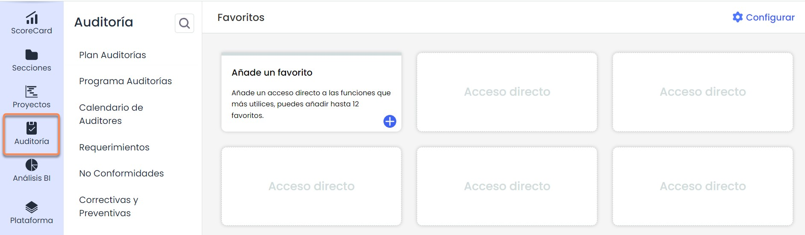

Las fases para llevar a cabo la creación y configuración del módulo de Auditoría son:

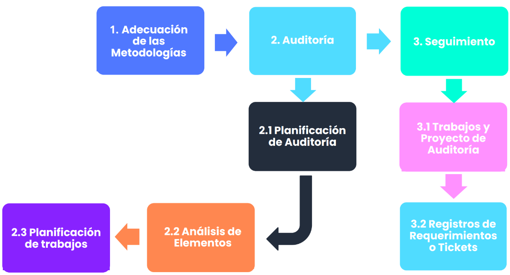

## Metodología de Auditoría

En **Ajustes > Metodologías >** [**Auditorías**](https://help.globalsuitesolutions.com/es/globalsuite/v1/metodologias-auditorias) permite configurar diferentes metodologías de auditoría para evaluar y priorizar los elementos de la organización a partir de una metodología de riesgos previamente configurada, es decir, actúa sobre elementos del inventario, sus riesgos en los distintos análisis y sus acciones mitigadoras o controles.

En el apartado **General** se pueden definir tipos de auditores, configurar las gráficas del cuadro de mandos y configurar campos personalizables

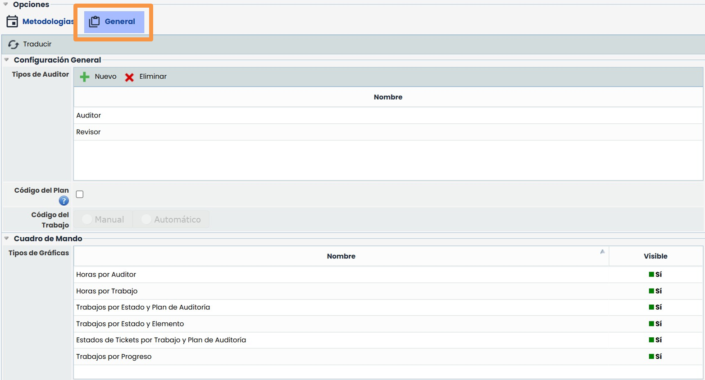

### Configuración campos personalizables

El botón Nuevo permite añadir campos adicionales de tipo Fecha, Texto y Selector.

Estos campos serán visibles en las siguientes opciones:

* Formularios de los trabajos de auditoría.
* Tabla de trabajos, opción Plan Auditorías > [Planificación Trabajos](https://help.globalsuitesolutions.com/es/globalsuite/v1/planificacion-trabajos)
* Tabla principal de [Programación de auditorías.](https://help.globalsuitesolutions.com/es/globalsuite/v1/programa-auditorias)

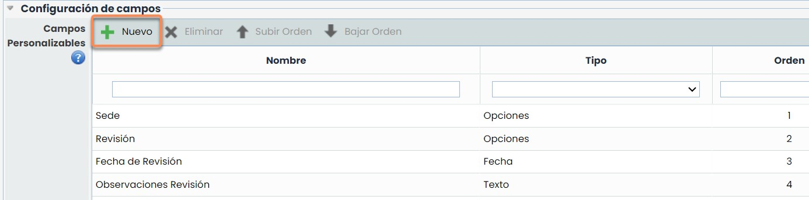

Al entrar a la configuración de la metodología de auditoría, es importante asociar una metodología de riesgos previamente configurada en **Ajustes > Metodologías >** [**Riesgos**](https://help.globalsuitesolutions.com/es/globalsuite/v1/metodologia-riesgos)para que sirva como base a la metodología de auditoría.

Además, se pueden **proponer** dimensiones básicas que ayuden a gestionar una metodología de auditoría. Estas dimensiones se pueden modificar como se requiera.

El botón **añadir** permite crear nuevas dimensiones de apoyo de tipo cuantitativo y cualitativo (manual o automático), texto o fecha dentro de la metodología de auditoría, similares a las que se pueden proponer.

**Incorporar Nuevos Registros**  
Se deberá seleccionar cuando se deseen incluir nuevos elementos, riesgos o controles a un Programa de Auditorías (ya realizado o en cualquier estado que se encuentre) incluidos en su análisis de riesgos correspondiente.

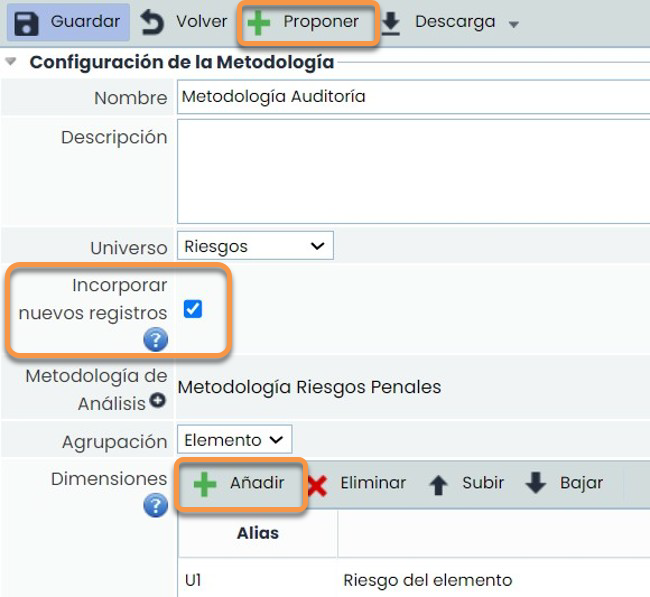

### Metodología de Auditoría. Dimensiones y fórmulas

Para configurar la fórmula de una dimensión automática, se pueden utilizar las dimensiones de otras metodologías (cuantitativas/cualitativas):

1. **Inventario de Elementos**: son las dimensiones configuradas en la metodología de elementos (inventario).
2. **Análisis de Riesgos**: estas dimensiones tienen cuantificadores para relacionar los resultados de todos los registros del análisis de riesgos que utiliza como metodología de riesgos la que se ha asociado previamente a esta metodología de auditoría. Esta relación se realiza mediante: contador, máximo, mínimo y/o sumatorio.
3. **Evaluación Controles**: estas dimensiones tienen cuantificadores para relacionar los resultados de todos los registros de Gestión de Controles (metodología de controles) vinculados al análisis de riesgos que utiliza como metodología de riesgos la que se ha asociado previamente a esta metodología de auditoría. Esta relación se realiza mediante: contador, máximo, mínimo y/o sumatorio.
4. **Auditorías**: aparecen las dimensiones de *apoyo* que se **propusieron** o **añadieron** con anterioridad en la metodología de auditoría y se pueden relacionar entre sí, siempre y cuando sean cuantitativas o cualitativas.

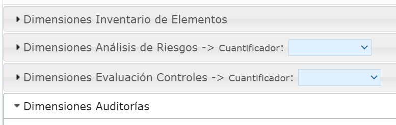

**Dimensiones Especiales**: utilizan cuantificadores para relacionar resultados de los siguientes conceptos: *a) RGE Riesgo Global por Elemento*: para el cálculo del riesgo agrupado por elemento.

1. *RRGE Riesgo Repercutido Global por Elemento*: para el cálculo de riesgo global incluyendo los riesgos de los elementos que están por debajo en el árbol de dependencias.
2. *Fecha de Última Auditoría*: permite comparar fechas y tener resultados de forma automática de fechas adicionales.
3. *Fecha Actual*: permite comparar fechas y tener resultados de forma automática de fechas adicionales.

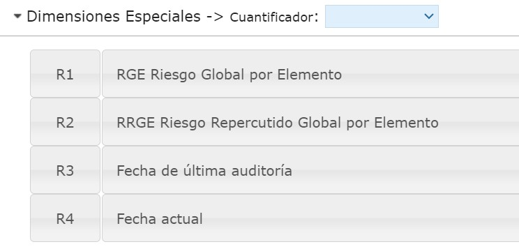

## Metodología de ejecución

Para conocer cuáles son las metodologías de ejecución, previamente se mencionarán algunas diferencias que existe dentro de la metodología de auditoría con las metodologías de ejecución.

1- Ambas se configurarán en el apartado de Ajustes, sin embargo, la metodología de auditoría se gestionará dentro del [Plan de Auditoría](https://help.globalsuitesolutions.com/es/globalsuite/v1/plan-auditorias), mientras que las metodologías de Ejecución desde el apartado [Programa de Auditorías](https://help.globalsuitesolutions.com/es/globalsuite/v1/programa-auditorias).

2- En ambas metodologías se podrán evaluar los elementos del universo auditable (en este caso, del análisis de riesgos), pero dentro de la metodología de auditoría (plan de auditoría) se puede hacer una valoración general. Por otro lado, se puede tener una valoración de auditoría más específica con las metodologías de ejecución (programa de auditoría). Aunque estas metodologías de ejecución se enfocan no solo a los elementos sino también a los riesgos y controles específicos de los elementos (dependerá de lo que se requiera auditar).

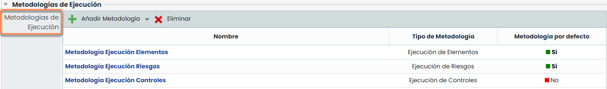

Dentro de la metodología de auditoría se encuentran las metodologías de ejecución. La funcionalidad de dichas metodologías es poder ejecutar "Trabajos de Auditoría" para auditar elementos, riesgos y controles. Las metodologías existentes son:

1. Metodología de Ejecución de Elementos
2. Metodología de Ejecución de Riesgos
3. Metodología de Ejecución de Controles

Todas las metodologías anteriores, se podrán configurar como previamente se ha explicado en las metodologías individuales de Elementos, Riesgos, Controles y Auditoría.

Además, mencionar que, en la metodología de ejecución de riesgos, se deberá relacionar una metodología de ejecución de controles.

#### Metodologías de Ejecución - Elementos

La metodología de Ejecución de Elementos permitirá incluir dimensiones específicas para la valoración de los “elementos” definidos en el inventario y que fueron agregados a un análisis de riesgos. En el apartado de auditoría, los elementos serán seleccionados dentro del apartado “Plan de auditoría” ya que ahí se relacionarán con su respectivo “Programa de Auditoría”.

1-. **Ajustes**: Recordar que el funcionamiento es similar a la configuración de las metodologías de Elementos, Riesgos y Controles, además, que cuenta con una dimensión de FECHA.

2-. **Programa de Auditoría**: Se mostrará la información de los elementos con la valoración del inventario (puede traerse de la tabla del inventario de forma automática por medio de fórmulas) y las nuevas dimensiones configuradas en la metodología de ejecución de elementos (que se pueden valorar directamente en el apartado de Programa de Auditoría). Estas valoraciones no impactan en los AARR productivos.

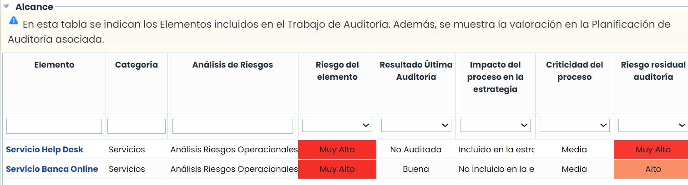

#### Metodologías de Ejecución - Riesgos

La metodología de Ejecución de Riesgos permitirá incluir dimensiones específicas para la valoración de los “riesgos” de los elementos previamente seleccionados.

1-. **Ajustes**: Recordar que el funcionamiento es similar a la configuración de las metodologías de Elementos, Riesgos y Controles, además, que cuenta con una dimensión de FECHA. Se le tendrá que asociar una metodología de ejecución de controles para su uso.

2-. **Programa de Auditoría**: Se mostrará la información de los riesgos de los elementos con la valoración del análisis de riesgos (puede traerse del AARR de forma automática por medio de fórmulas) y las nuevas dimensiones configuradas en la metodología de ejecución de riesgos (que se pueden valorar directamente en el apartado de Programa de Auditoría). Estas valoraciones no impactan en los AARR productivos.

Para poder visualizar la información del punto anterior, se tendría que seleccionar el elemento de la tabla superior para que se puedan visualizar los riesgos y las dimensiones a valorar.

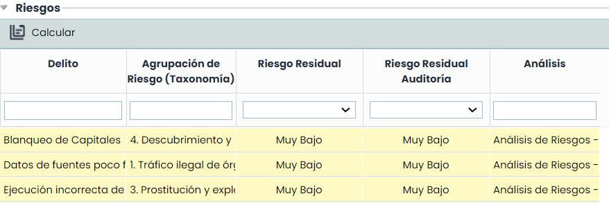

#### Metodologías de Ejecución - Controles

La metodología de Ejecución de Riesgos permitirá incluir dimensiones específicas para la valoración de los “controles” de los riesgos de los elementos previamente seleccionados.

1-. **Ajustes**: Recordar que el funcionamiento es similar a la configuración de las metodologías de Elementos, Riesgos y Controles, además, que cuenta con una dimensión de FECHA. Esta metodología se tiene que asociar a la metodología de ejecución de riesgos correspondiente.

2-. **Programa de Auditoría**: Se mostrará la información de los controles de los riesgos de los elementos con la valoración del análisis de riesgos (puede traerse del AARR/Gestión de Controles de forma automática por medio de fórmulas) y las nuevas dimensiones configuradas en la metodología de ejecución de controles (que se pueden valorar directamente en el apartado de Programa de Auditoría). Estas valoraciones no impactan en los AARR productivos.

Para poder visualizar la información del punto anterior, se tendría que seleccionar el elemento de la primera tabla y posterior el riesgo específico para que se puedan visualizar los controles y las dimensiones a valorar.

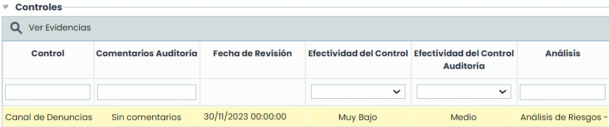
