# ¿Cómo gestionar auditorías?


Este tutorial explica, cómo utilizar el módulo de \*\*Auditoría\*\* en GlobalSuite® para planificar, ejecutar y hacer seguimiento de auditorías dentro del sistema de gestión.
El objetivo es mostrar cómo crear planes y programas de auditoría, asociar metodologías y elementos, registrar hallazgos y gestionar tickets de \*\*no conformidades\*\*, \*\*requerimientos\*\* y \*\*acciones correctivas o preventivas\*\*, garantizando así un control completo del ciclo de auditoría dentro de la plataforma


## Auditoría

Antes de mencionar el uso de la gestión de Auditoría, a continuación, se explicarán las dos primeras opciones de la herramienta:

1-. [**Plan de Auditorías**](https://help.globalsuitesolutions.com/es/globalsuite/v1/plan-auditorias): Su funcionalidad es “planear” las diferentes auditorías de elementos/riesgos/controles de la organización. Pueden registrarse auditorías pasadas, presentes o futuras que se vayan a realizar. En este apartado se podrá seleccionar la metodología de auditoría que se utilizará y el análisis de riesgos correspondiente; además de “Planificar los Trabajos”, donde se podrán seleccionar los elementos a auditar.

2-. [**Programa de Auditorías**](https://help.globalsuitesolutions.com/es/globalsuite/v1/programa-auditorias): En este apartado se “Planeará”, “Ejecutará” y se podrá obtener un “Informe” sobre cada uno de los elementos previamente seleccionados en el “Plan de Auditoría”. También, por cada elemento se podrán observar las dimensiones configuradas en las metodologías de ejecución de elementos/riesgos/controles.

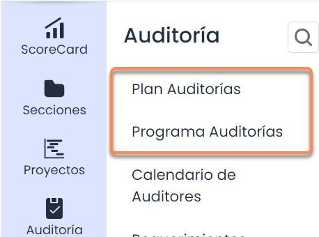

Para poder ejecutar un **Programa de Auditorías**, previamente se deberá crear un Plan de Auditoría. Para poder crear un **Plan de Auditoría**, previamente se deberán configurar las Metodologías de Auditoría. Antes de configurar las [**Metodologías de Auditoría**](https://help.globalsuitesolutions.com/es/globalsuite/v1/metodologias-auditorias), se deberá configurar y crear un Análisis de Riesgos**.** Por último, antes de crear un **Análisis de Riesgos**, se deberán crear las Metodologías de Elementos, Riesgos y Controles.

### Plan de Auditorías

En la opción Plan Auditorías, se crearán los registros de planificación de auditorías y sus trabajos, pudiendo crear y eliminar los planes que deseen mediante los botones superiores:

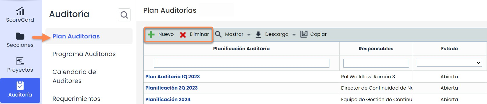

La herramienta permite configurar el detalle de cada planificación de auditoría pulsando sobre la creada. Se mostrará la opción de “Plan de auditoría”, así como la opción de “Planificación de trabajos”:

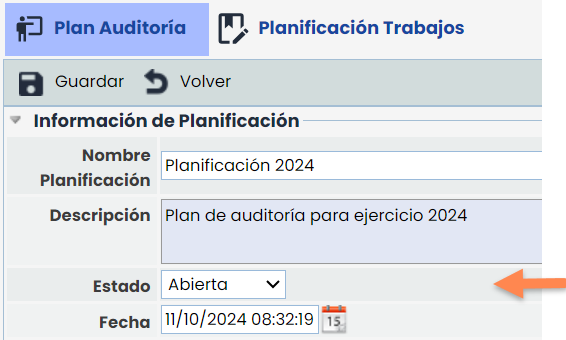

Desde la opción de plan de auditoría se podrá configurar el nombre, la descripción, el estado, fecha y los responsables de la auditoría.

La sección “Modelo del Universo” será la configurada en la metodología de auditoría. Una vez pulsada la Metodología de Planificación, se podrán elegir los análisis de riesgos sobre los que se realizará la auditoría.


\*\*Nota\*\*
Los análisis de riesgos que se pueden elegir tienen que tener la metodología de análisis asociada a la metodología de Planificación de Auditoría en Ajustes.


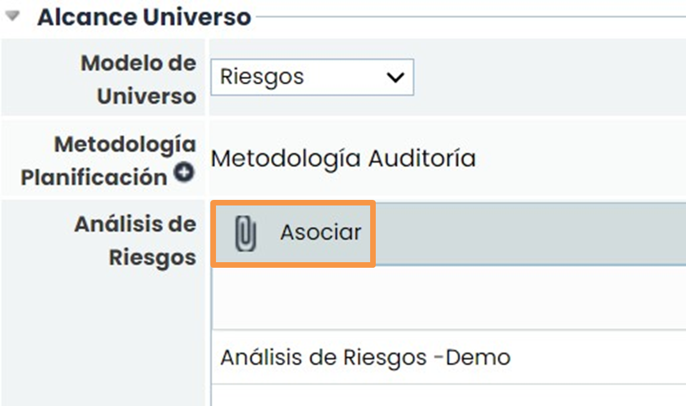

Dentro de la “Planificación Auditoría”, se podrán observar los elementos que se hayan involucrado en el análisis de riesgos previamente seleccionado. Además, la herramienta permite configurar el detalle de cada elemento con respecto a la metodología de auditoría creada.

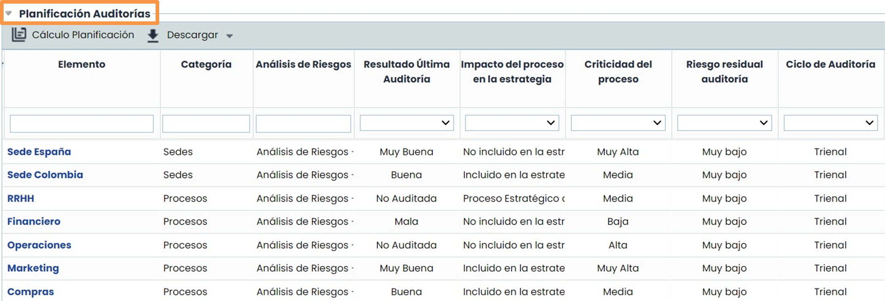

Para asociar los elementos a los trabajos de auditoría, habría que pulsar en la opción Plan de Auditoría/Planificación Trabajos. Posteriormente se deberá de crear un nuevo **Trabajo de Auditoría** y finalmente se deberá pulsar en los elementos de la tabla inferior, en la parte superior seleccionar el trabajo de auditoría y en asociar. Los elementos asociados se podrán ver en "ELEMENTOS".

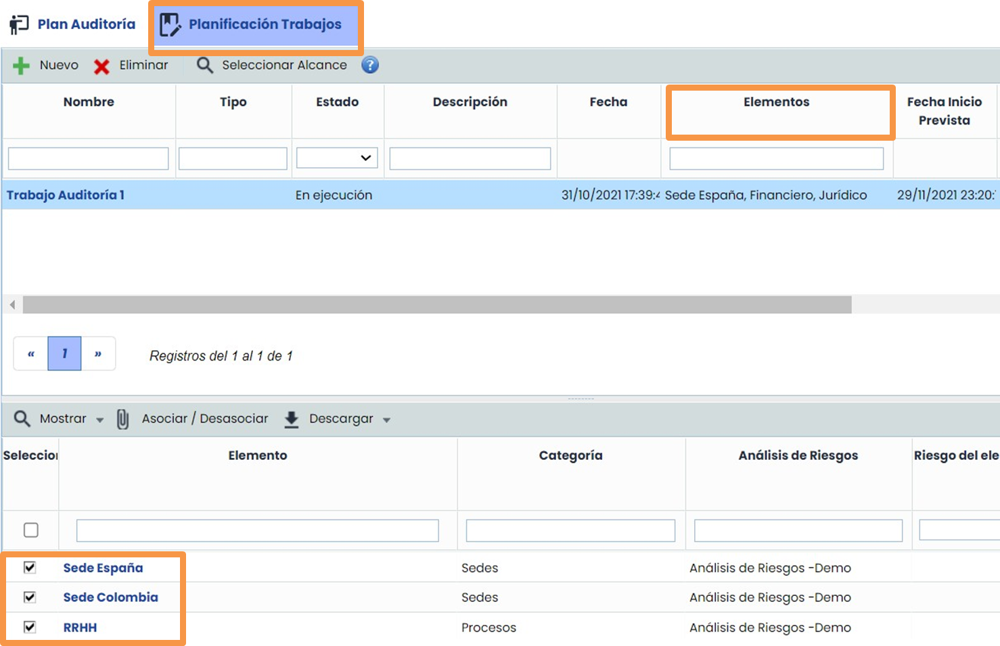

## Programa Auditorías

La opción “Programa auditorías”, mostrará el registro de todos los trabajos o actividades existentes en cada una de las auditorías creadas en la opción anterior “Plan de Auditorías”. Además, permite dar el seguimiento de forma individual a cada uno de los programas y dar una visión general de las actividades en curso o futuras.

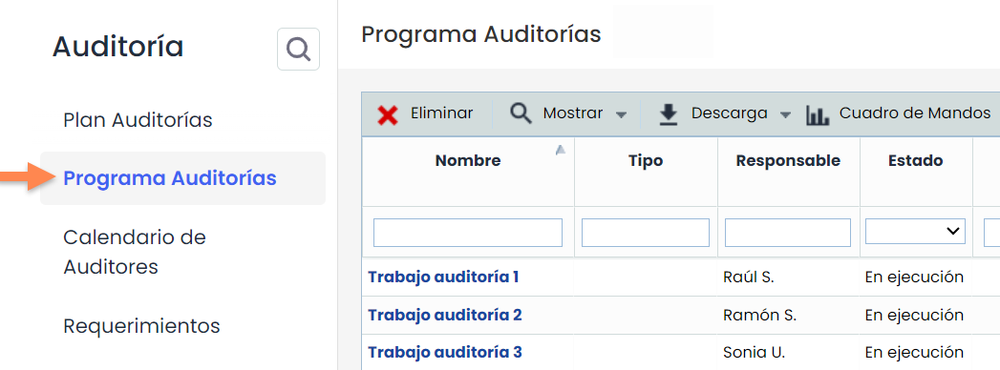

Finalmente, se podrán observar los cuadros de mandos que se habrán configurado en la opción "General" previamente visto en el tutorial ¿Cómo configurar una metodología de auditoría?

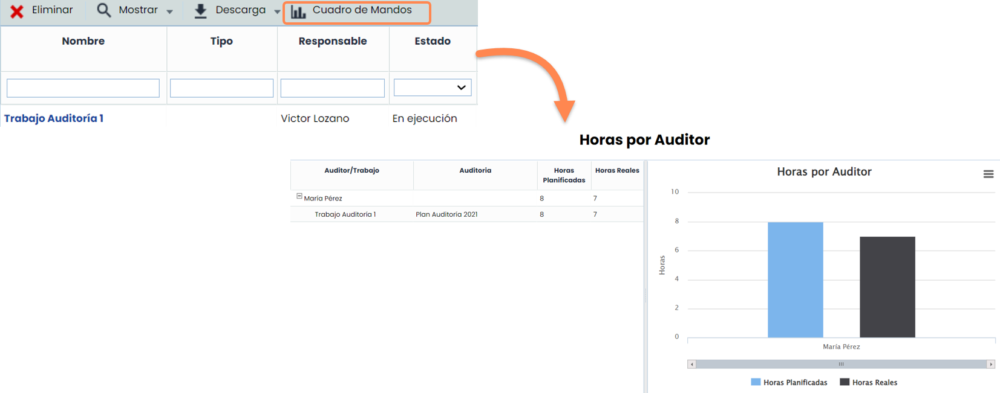

Accediendo a cada uno de los programas, se mostrará por defecto la pantalla de “Plan de Trabajo Auditoría”, dónde se gestionará el detalle del trabajo con opciones como el propio estado, el equipo de trabajo encargado, la documentación del trabajo e incluso será posible crear un proyecto con las tareas a realizar.

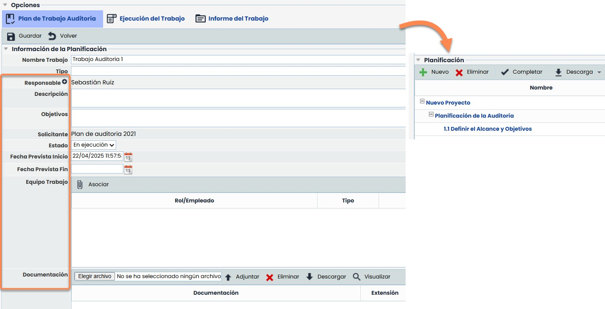

Para poder visualizar las opciones de “Ejecución del Trabajo” e “Informe del Trabajo”, el estado del “Plan de Trabajo Auditoría” deberá ser “En Ejecución”.

En la opción de “Informe del trabajo” se podrá obtener un reporte completo del trabajo realizado.

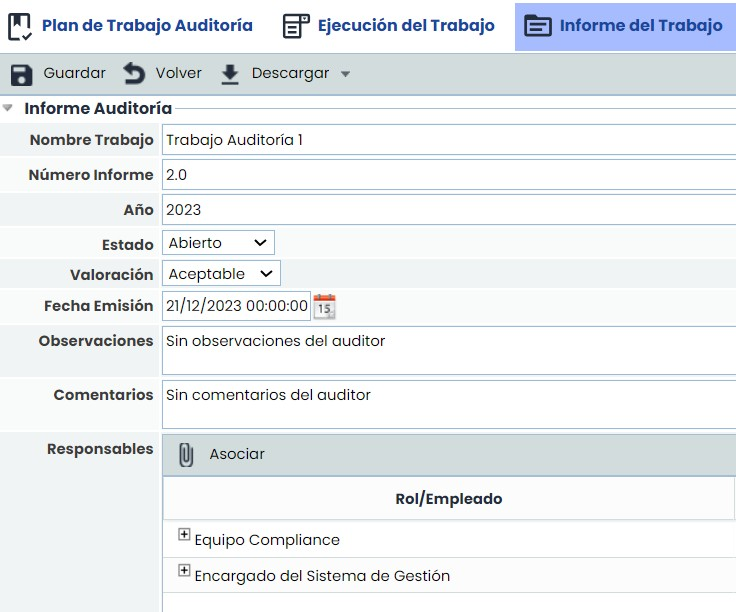

El apartado de Ejecución del Trabajo mostrará el detalle de los elementos auditados, así como sus riesgos y controles asociados junto con su respectiva metodología de ejecución configurada previamente. Tras la auditoría, se completará toda la información a nivel documentación en los papeles de trabajo, así como la creación de las recomendaciones o no conformidades oportunas.

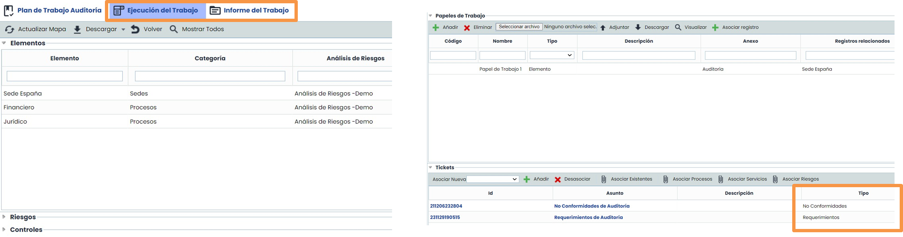

Para visualizar la información del elemento habrá que pulsar sobre la fila de la tabla y se cargarán los riesgos. Si se pulsa sobre el riesgo se cargarán los controles.

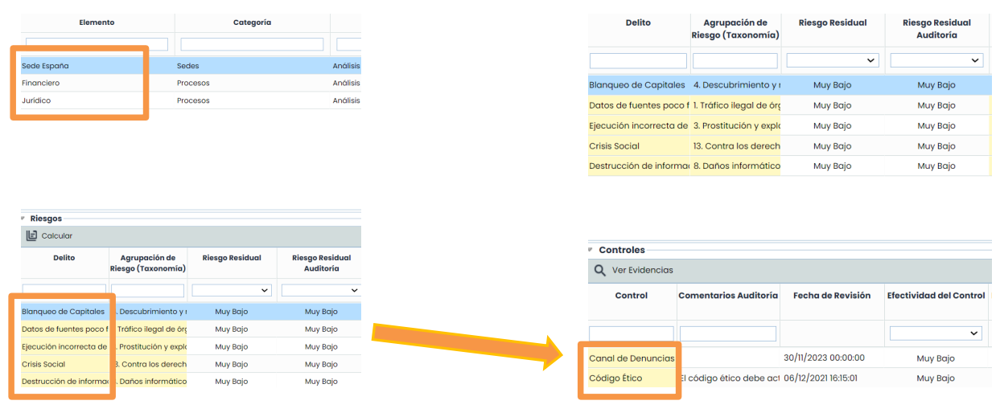

Para asociar los trabajos a elementos, se cargará un documento, se podrá elegir el tipo de asociación y se pulsará en el botón Asociar Registro. Saldrá una ventana emergente con todos los registros a asociar.

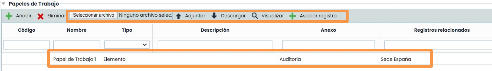

## Ticketing

Los Tickets pueden crearse de dos formas:

1- Directamente desde el apartado de “Requerimientos”, “No Conformidades” o “Correctivas y Preventivas”, dónde se podrán visualizar todos los tickets que se podrán relacionar entre ellos (Tickets de Entrada o Salida), así como relacionarlos como Tickets Existentes desde la Auditoría (siguiente *slide*).

Como opciones de ticketing existen las siguientes:

* [**Requerimientos/recomendaciones**](https://help.globalsuitesolutions.com/es/globalsuite/v1/requerimientos): Registro de todos los planes de acción o recomendaciones surgidas en la auditoría para su posterior tratamiento y ejecución.
* [**No conformidades**](https://help.globalsuitesolutions.com/es/globalsuite/v1/no-conformidades): Cualquier error detectado en la auditoría.
* [**Correctiva y Preventivas**](https://help.globalsuitesolutions.com/es/globalsuite/v1/correctivas-y-preventivas): Acciones correctivas o preventivas relacionadas con las no conformidades.

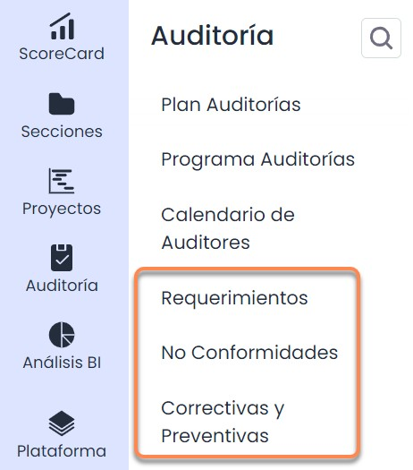

2-. También se podrá crear cualquier tipo de ticket para solventar las No Conformidades, Observaciones, Requerimientos, mejoras, etc. generadas de la auditoría realizada.

En primer lugar, hay que elegir el tipo de ticket, por ejemplo, No Conformidades, y pulsar en el botón “Añadir”. De ese modo, un nuevo ticket o registro se añadirá a la tabla.

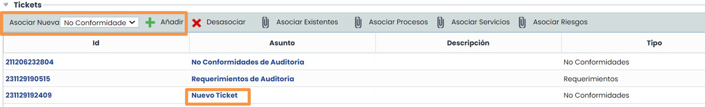

Además de crear nuevos, también es posible vincular tickets existentes para poder reutilizar los hallazgos de la auditoría, pulsando sobre el botón “Asociar Existentes”. Se abrirá una ventana emergente con la información de todos los tickets disponibles.

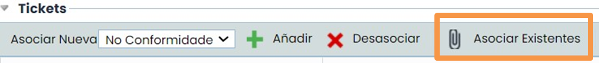

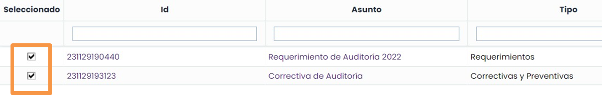

Los tickets creados en el apartado del Informe de Auditoría no solo se podrán visualizar en dicho apartado, sino que también se podrán visualizar de forma individual en su sección de tipo de ticket correspondiente.

Dentro dl formulario se puede agregar el nuevo campo “AUDIT-WORK” que informa de los trabajos de auditoría con los que está vinculado el ticket. Este campo también se puede agregar y visualizar en la Tabla Principal.

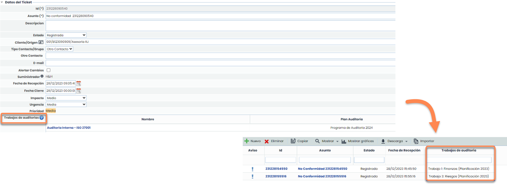

Para más información sobre la configuración de Tickets, existen guías rápidas específicas:

* TICK.03. Configuración Tickets
* TICK.04. Tipos de campo Tickets

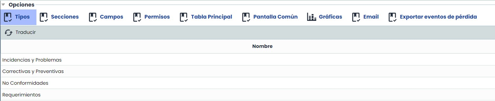
