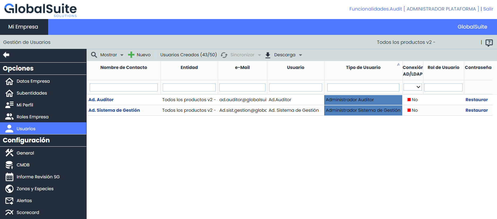
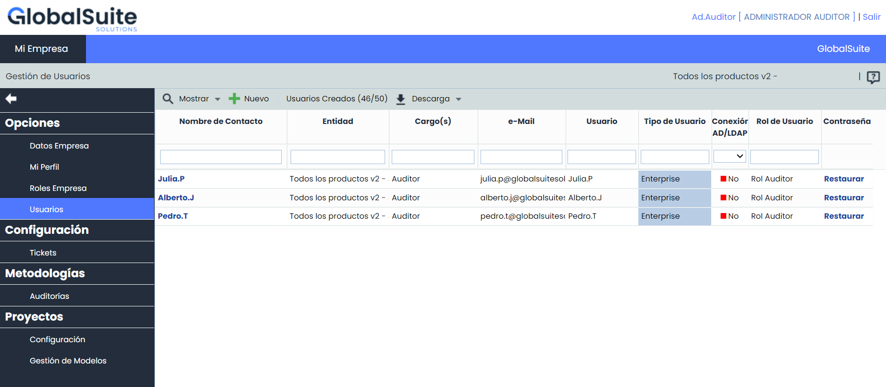
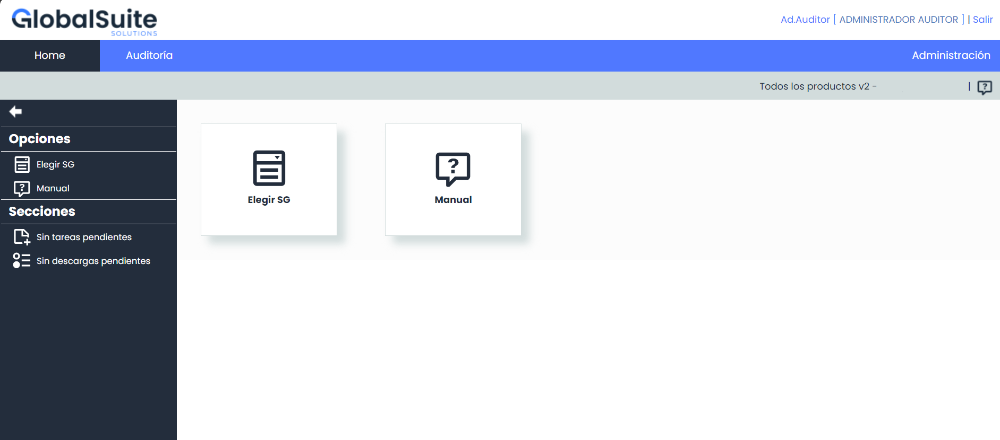
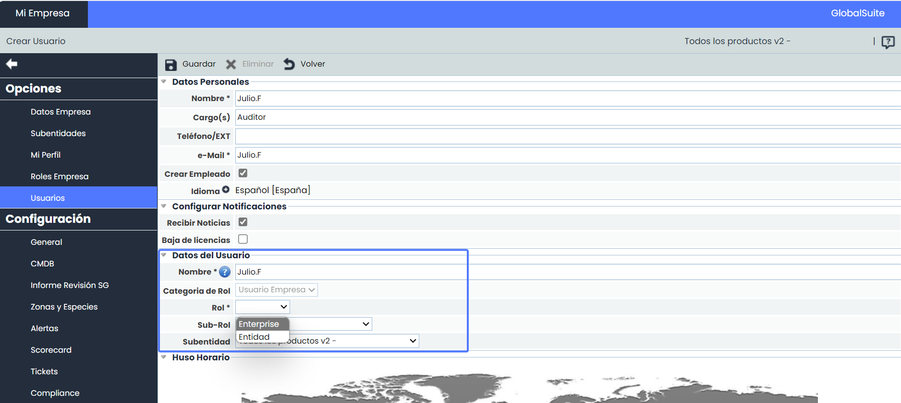
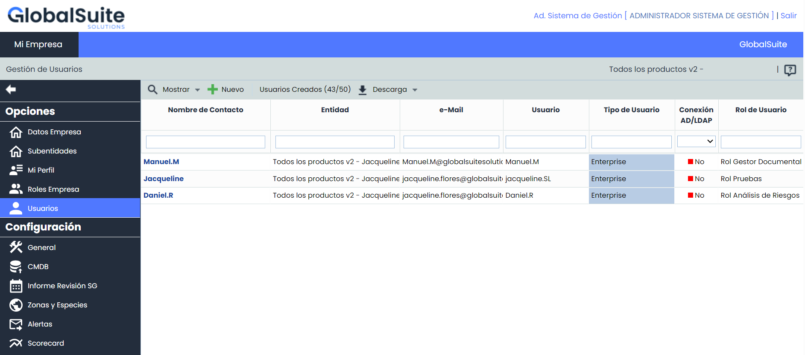
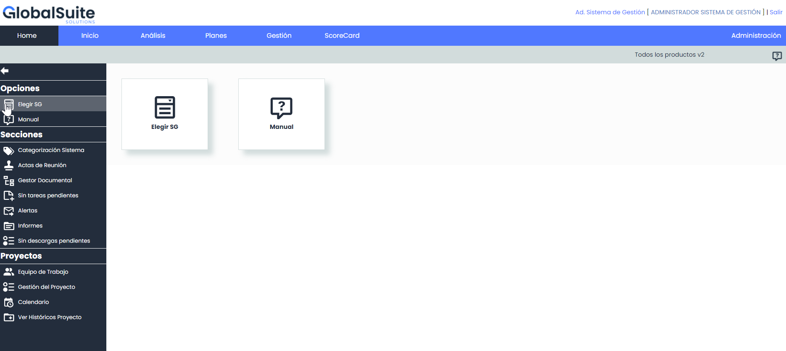
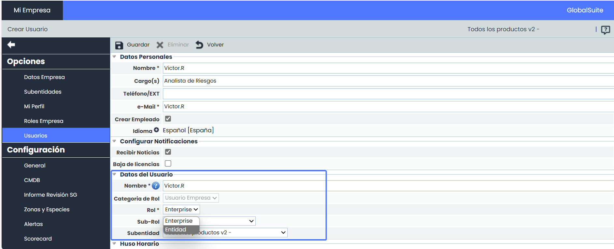

# ¿Cómo puedo gestionar los permisos de los usuarios con acceso a las opciones de Auditoría?


En este artículo veremos como configurar las opciones de acceso a las funcionalidades de GlobalSuite para el módulo de Auditoría.


Estas opciones de acceso permitirán un mayor control y restricción en el uso de la plataforma.

Esto garantiza que el área de Auditoría pueda operar de manera independiente y segura, al mismo tiempo que se integra eficazmente con otras áreas de la organización, como la de Riesgos.

## ¿Cuáles son los Roles de específicos Auditoría?

Existen dos roles tipo Administrador específicos del Módulo de Audit Management

* Ad. Auditor
* Ad. Sistema de Gestión

Estos roles implican permitir un nivel de control y restricción más detallado para garantizar que el área de Auditoría pueda operar de manera aislada e independiente del resto, al mismo tiempo que se integra con otras áreas como la de Riesgos.

## ¿Cómo crear estos Roles?

Los siguientes roles tienen la capacidad de crearlos:

* Administrador Enterprise
* Administrador Plataforma
* Administrador de Accesos
* Los usuarios organizativos: Platinum, Gold, Administrador Consulting y Consulting.

Se deberán crear como el resto de usuarios, desde la opción Ajustes > [Usuarios](https://help.globalsuitesolutions.com/es/globalsuite/v1/usuarios)

### ¿Qué implica el Rol Ad. Auditor?

El Ad. Auditor tiene privilegios y acceso exclusivo a las funcionalidades relacionadas con el menú de auditoría y podrá crear usuarios empresa con acceso únicamente a dichas funcionalidades. El resto de las funcionalidades de GlobalSuite, estarán fuera de su alcance.

Algunas características clave de este Rol:

* **Creación y Gestión de Usuarios de Auditoría**: Los usuarios con este rol pueden crear y gestionar usuarios con acceso exclusivo a las funcionalidades del módulo de Auditoría.
* **Restricción listado de usuarios:** Sólo podrán visualizar el listado de usuarios que tengan acceso al módulo de Auditoría. pero no podrán visualizar ni administrar usuarios con acceso a otras opciones fuera dicho módulo.

* **Acceso Limitado funcionalidades:** Los usuarios con el rol Ad. Auditor solo tendrán acceso a las funcionalidades del módulo de Audit Management y no podrán acceder ni administrar funciones fuera de este ámbito.

#### ¿Cómo configurar un usuario desde el Rol Ad. Auditor?

Se deberán crear como el resto de usuarios, desde la opción Ajustes > [Usuarios](https://help.globalsuitesolutions.com/es/globalsuite/v1/usuarios)

En el apartado Datos de Usuario las opciones posibles son las siguientes:

* Categoría de Rol : Se cargará por defecto “Usuario Empresa”. Este rol no podrá crear usuarios administradores.
* Rol: Se podrán crear tanto usuarios Enterprise, como Entidad.
* Sub-Rol: Solo se mostrarán en las opciones del desplegable, los sub-roles con acceso exclusivo a las opciones de Auditoría. Es necesario completar este campo para crear un usuario con este rol.

### ¿Qué implica el Rol Ad. Sistema de Gestión?

El Ad. Sistema de Gestión tiene privilegios para administrar las funcionalidades generales del sistema de gestión, pero no tendrá acceso directo a las funcionalidades específicas del módulo de auditoría.

Algunas características clave de este Rol:

* **Creación y Gestión de Usuarios Generales:** Los usuarios con el rol pueden crear y gestionar usuarios con acceso a todas las opciones, excepto a las relacionadas con Auditoría.
* **Restricción Listado usuarios:** Podrán visualizar el listado de usuarios que no tengan acceso a Auditoría, pero no podrán visualizar ni administrar usuarios con acceso a dicha funcionalidad.

* **Sin Acceso a Auditoría:** Los usuarios con este rol no pueden acceder ni administrar funciones dentro del ámbito de Auditoría.

Sin acceso a la pestaña de Auditoría, y en consecuencia, a todas las opciones del Módulo.

#### ¿Cómo configurar un usuario desde el Rol Ad. Sistema de Gestión?

Se deberán crear como el resto de usuarios, desde la opción Ajustes > [Usuarios](https://help.globalsuitesolutions.com/es/globalsuite/v1/usuarios)

En el apartado Datos de Usuario las opciones posibles son las siguientes:

* Categoría de Rol : Se cargará por defecto “Usuario Empresa”. Este rol no podrá crear usuarios administradores.
* Rol: Se podrán crear tanto usuarios Enterprise, como Entidad.
* Sub-Rol: Se mostrarán en las opciones del desplegable, todos los sub-roles, excepto los que tienen acceso a las opciones de Auditoría. Es necesario completar este campo para crear un usuario con este rol.


Estos nuevos roles brindan una mayor flexibilidad y seguridad en la administración de usuarios y accesos, mejorando la eficiencia y la gestión de la auditoría en su conjunto.

