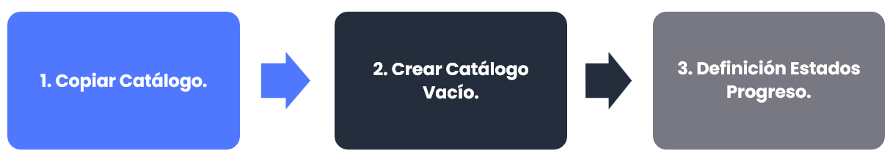
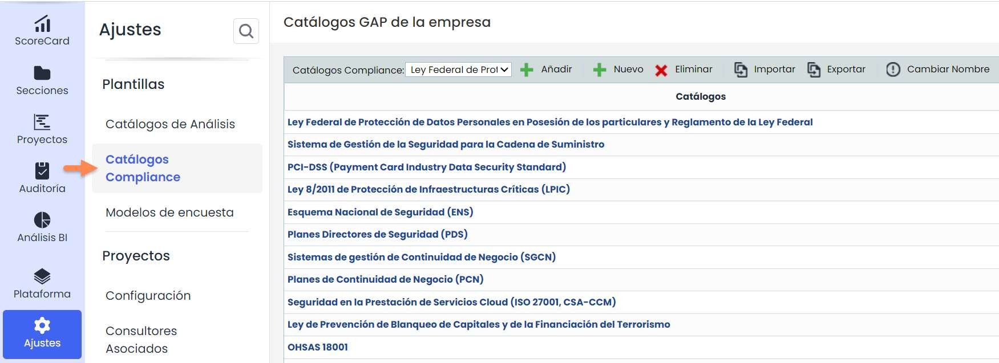
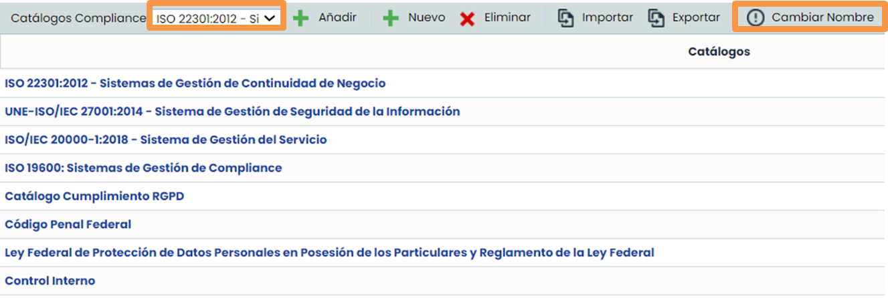
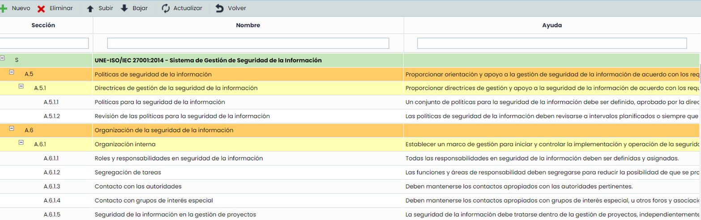
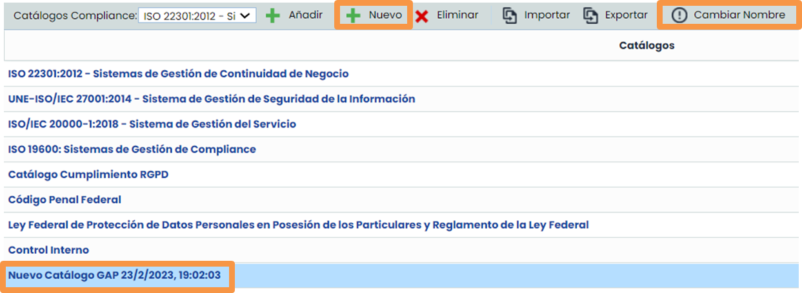
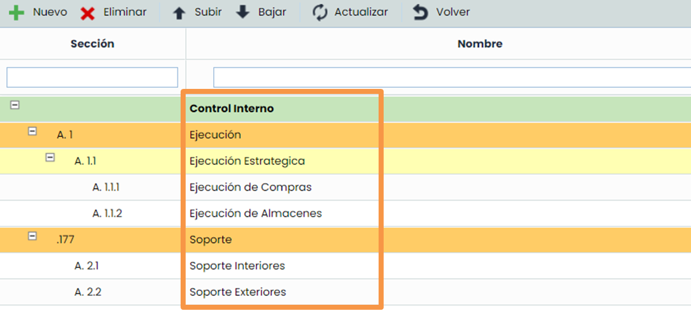
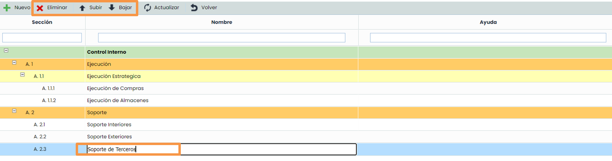
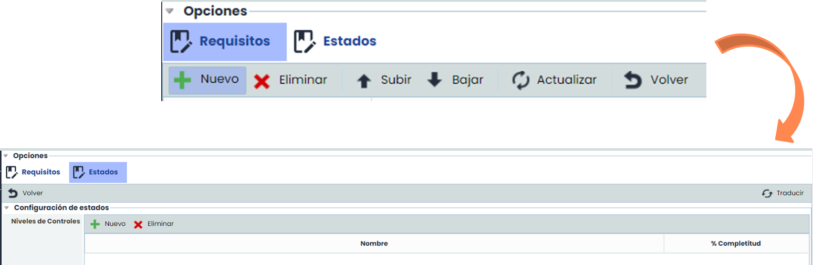
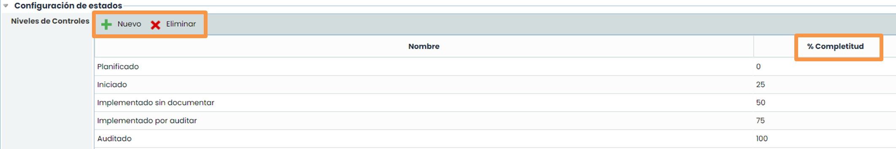

# ¿Cómo crear y configurar un catálogo de Compliance en GlobalSuite®?


En este artículo tratamos cómo configurar el catálogo de Compliance en GlobalSuite®, copiando uno existente o creando uno vacío desde cero, añadiendo y organizando controles, ajustando sus secciones y ayudas, y definiendo los estados de progreso que permitirán evaluar el nivel de cumplimiento en las distintas opciones de la plataforma.


### Fases para la configuración del catálogo de Compliance.

## Configuración Compliance

Esta opción permite configurar el catálogo [**Compliance**](https://help.globalsuitesolutions.com/es/globalsuite/v1/configuracion-compliance) que se usará en las distintas opciones de cumplimiento (GAP Analysis, Plan de Adecuación, Compliance y Encuestas).  
Una vez configurado el catálogo en **Ajustes**, se podrá comenzar a realizar un análisis de brecha sobre el catálogo elegido en las opciones ya mencionadas. Siempre que se use este catálogo se realizará una copia del mismo.

Existen dos formas distintas de crear un catálogo Copiar Catálogo o Crear un catálogo vacío.

## Copiar Catálogo.

* Si se va a configurar un catálogo muy similar a algunos de los ya configurados en el entorno. Se seleccionará el catálogo deseado y se pulsará el botón **Añadir**. Se creará una nueva entrada donde se podrá cambiar el nombre del catálogo asociado.

  
* Al pulsar el nombre del catálogo saldrá el catálogo copiado con los controles de la norma elegida. Este catálogo se puede modificar en función de la norma que se quiera definir.

  

## Creación de un catálogo vacío.

* Si se quiere empezar un catálogo desde cero. Se tiene que pulsar el botón Nuevo y se creará una entrada con un nombre por defecto.

  
* Al pulsar el catálogo saldrá la ventana vacía y podrá añadir todos los controles que necesite.
* Para crear un control nuevo, se pulsará la fila donde se querrá que dependa el control y hay que pulsar el botón **Nuevo**. Se creará una entrada nueva en la tabla.   
  Si por ejemplo se seleccionó la fila GAP “Ejecución” se crearían “Ejecución Estratégica” y “Soporte”. Si se pulsó en “Ejecución Estratégica” se crearían los controles que están por debajo de la fila seleccionada.

  

* Se podrá **modificar la columna sección** y automáticamente se calculará la sección del control nuevo. Si se cambia la sección de la fila verde, automáticamente siempre que meta un nuevo control se calculará la sección del nuevo control.
* Pulsando doble click en la celda del nombre de los controles se podrá **modificar el nombre de un control.**
* 

  Se podrá **subir y bajar el orden de los controles** en los catálogos.
* **Se podrá cambiar la ayuda asociada a cada control,** haciendo doble click en la celda de la columna ayuda.
* Se podrá **eliminar Controles** seleccionando la fila del control que se quiere eliminar y pulsando el botón Eliminar. Se eliminarán los controles asociados que tenga por debajo. Por ejemplo: Si se elimina el control A.1.1 se eliminarán los controles A.1.1.1 y A.1.1.2.

  

## Definición Estados Progreso

Dentro de cualquier catálogo Compliance se pueden definir unos estados por defecto. Estos estados servirán para calcular el porcentaje de completitud de los controles en la organización.  
Si se pulsa el icono Estados dentro del submenú superior, se abrirá la pantalla de Estados.

Pulsando los botones Nuevo y Eliminar se podrá configurar la tabla con los estados deseados. Además se tendrá que definir el % de completitud con un número. Un posible resultado puede ser:

