# Cómo implementar un Sistema de Gestión de Prevención de Delitos Penales (SGPDP)


Este tutorial explica, cómo configurar, implementar y gestionar un \*\*Sistema de Gestión de Prevención de Delitos Penales (SGPDP)\*\* en GlobalSuite®.
El objetivo es mostrar cómo utilizar las funcionalidades del módulo \*\*Compliance Penal\*\* para diseñar la estructura organizativa, realizar análisis de riesgos penales, evaluar el cumplimiento normativo, definir controles y evidencias, así como establecer auditorías, métricas e indicadores que garanticen la mejora continua del sistema.


## Configuración

### Configuración Compliance Penal

GlobalSuite® Compliance Penal dispone de una configuración por defecto. Solo para aquellas organizaciones que deseen personalizar su configuración, podrán utilizar la funcionalidad que a continuación se detalla, la cual está accesible a través del apartado de [Ajustes.](https://help.globalsuitesolutions.com/es/globalsuite/v1/administracion)

Este apartado ofrece al usuario la posibilidad de configurar todos los aspectos relativos a su Sistema de Gestión de Prevención de Delitos Penales, pudiendo parametrizar aspectos como los permisos de acceso a la herramienta, la metodología utilizada para el análisis de Riesgos Penales, así como el catálogo a aplicar en éste.

### Metodología de Riesgos

La opción de [Metodología de Riesgos](https://help.globalsuitesolutions.com/es/globalsuite/v1/metodologia-riesgos) permite configurar las diferentes metodologías con las que se va a trabajar en el Análisis de Riesgos Penales. Se pueden crear nuevas metodologías, eliminar alguna de las existentes o realizar una copia de alguna de las metodologías seleccionadas.

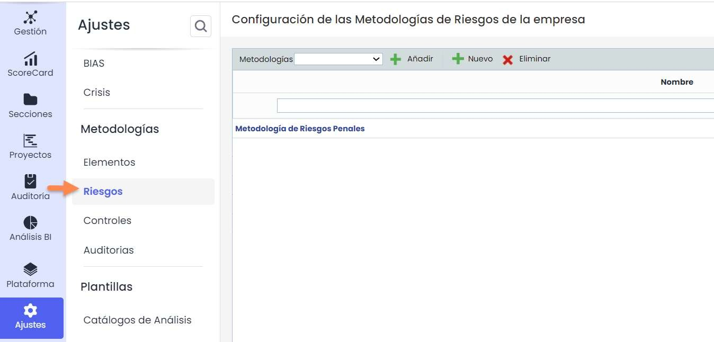

Al seleccionar una metodología, accedemos al formulario de configuración, organizado en distintas secciones, donde se podrán definir los parámetros con los que se calculará la probabilidad, el impacto y riesgo inherente; entre otros aspectos. También se podrá asociar la metodología de controles con la que se trabajará para mitigación de los riesgos.

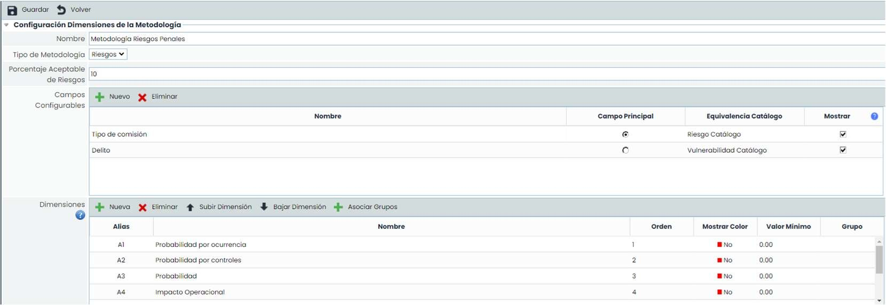

### Catálogos Análisis

Esta opción ofrece la posibilidad de disponer de un listado de los delitos y/o hechos delictivos con los que se podrá trabajar en el **Análisis de Riesgos Penales**.

Estos catálogos podrán ser generados por la herramienta o se podrán crear catálogos propios.

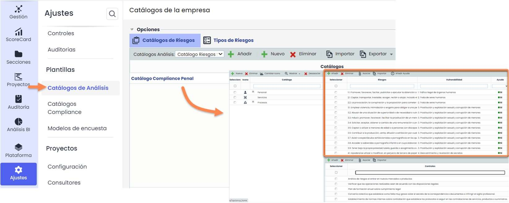

### Catálogos Compliance

Esta opción ofrece la posibilidad de disponer de catálogos de cumplimiento normativo ya generados en la herramienta o crear un catálogo propio.

Estos catálogos podrán ser utilizados en la opción de [Gap Analysis](https://help.globalsuitesolutions.com/es/globalsuite/v1/gap-analysis) y/o [Compliance](https://help.globalsuitesolutions.com/es/globalsuite/v1/compliance).

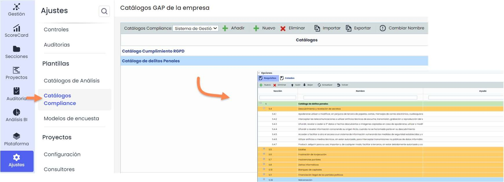

### Catálogo Servicios y Procesos

A través de ambas opciones, se podrá definir la estructura funcional de la entidad, por ejemplo, registrar los áreas o departamentos en el Catálogo de Servicios y/o los Procesos de los que se componen dichas áreas.

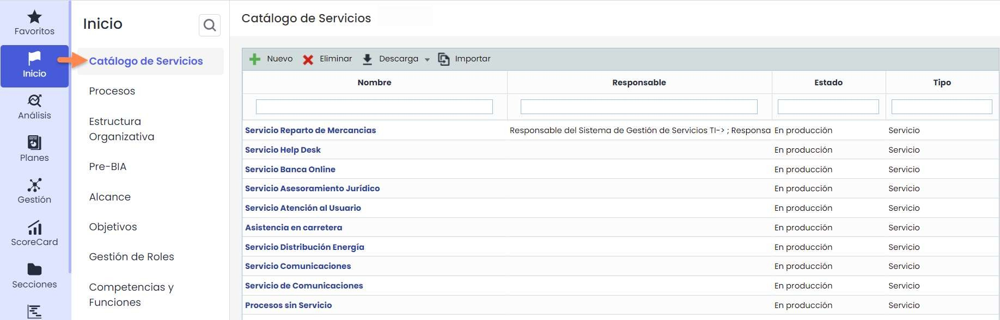

La relación Servicios - Procesos se puede definir en la pestaña **Árbol de Procesos** incluida dentro de la opción [Procesos](https://help.globalsuitesolutions.com/es/globalsuite/v1/procesos).

Los servicios (áreas o departamentos) y procesos que se registren podrán ser utilizados posteriormente como elementos dentro del Análisis de Riesgos Penales.

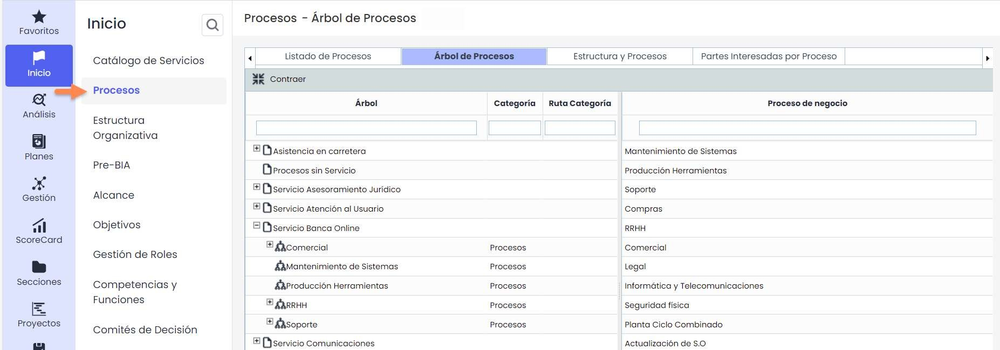

### Gestión de Roles

La opción de [Gestión de Roles](https://help.globalsuitesolutions.com/es/globalsuite/v1/gestion-de-roles) permite definir los roles identificados dentro de la entidad y que van a interactuar dentro del Sistema de Compliance Penal. Además, se pueden asociar los empleados que desempeñan dichos roles a través de los botones **Asociar/Desasociar**.

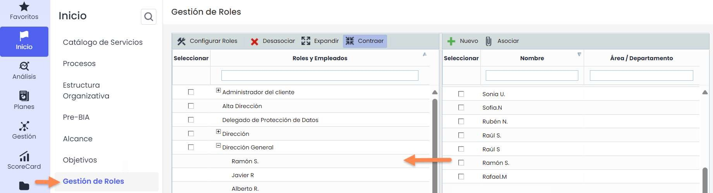

Para crear nuevos Roles, se debe acceder a Ajustes > Configuración > General > [Configuración de roles y Responsabilidades](https://help.globalsuitesolutions.com/es/globalsuite/v1/configuracion-de-roles-y-responsabilidades) y pulsar el botón de “Nuevo”. Los usuarios administradores tendrán habilitado además el botón “Configurar Roles” en la opción de Gestión de Roles, que les llevará automáticamente a la Configuración General en el panel de Administración.

También se podrán eliminar roles existentes pulsando en el botón de “Eliminar”. Una vez realizados los cambios, estos se verán reflejados en la opción de Gestión de Roles.

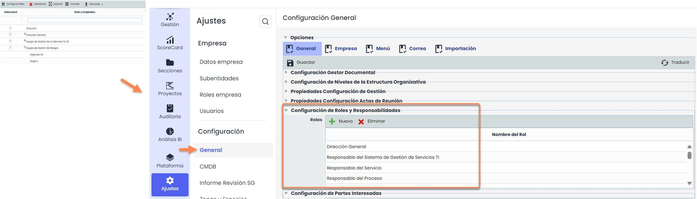

### GAP Analysis

GlobalSuite® Compliance Penal permite evaluar el estado del cumplimiento respecto a la norma UNE-ISO 19600 u otras normativas como la ISO 37301 de Sistemas de Gestión de Compliance. Para ello se debe hacer uso del menú Inicio > [Gap Analysis](https://help.globalsuitesolutions.com/es/globalsuite/v1/gap-analysis), pulsar en el botón de “Nuevo”, seleccionar el catálogo correspondiente y pulsar en el botón de “Crear”.

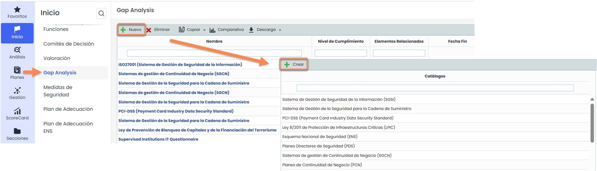


\*\*Nota\*\*
Para añadir un catálogo, este debe estar configurado en la ventana de Ajustes > Plantillas > [Catálogo de Compliance](https://help.globalsuitesolutions.com/es/globalsuite/v1/catalogos-compliance)


Dentro del catálogo se puede determinar el estado de cada una de las cláusulas mediante la columna **Estado Actual**. Sólo se podrán evaluar aquellas cláusulas que previamente se hayan definido como aplicables en la columna **Aplica**. Asimismo, se puede asociar documentación, controles y no conformidades de manera directa, previamente introducidos en GlobalSuite.

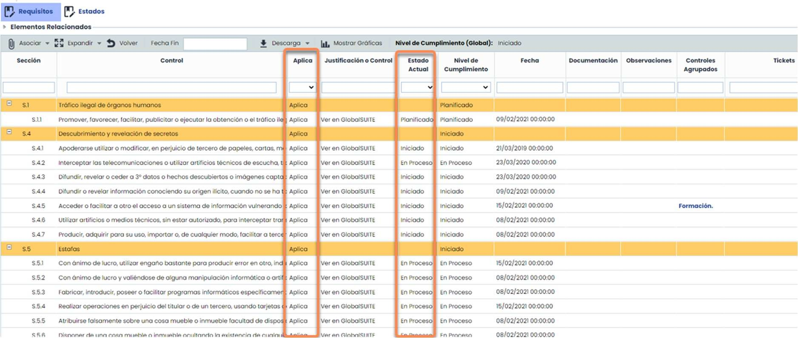

Completada la evaluación del estado del cumplimiento de la normativa, se pueden extraer gráficas del mismo que permitan conformar un informe del estado inicial del cumplimiento mediante el botón de **Mostrar gráficas**.

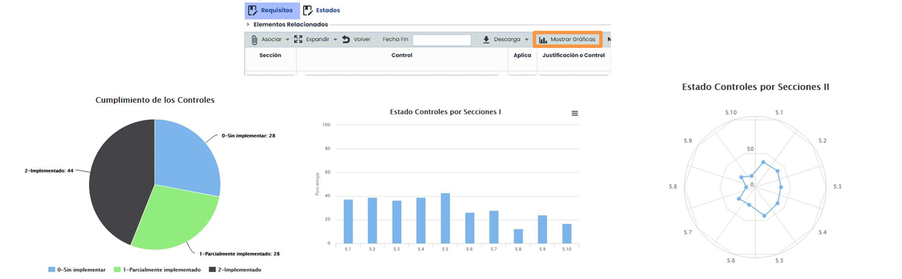

## Inicio

### Plan de Adecuación

Una vez evaluado el estado de cumplimiento de una normativa, en concreto mediante la opción de Gap Analysis, es posible realizar Planes de Adecuación que permitan establecer acciones para lograr nuestro estado de cumplimiento objetivo. Para ello se debe hacer uso del menú Inicio > [Plan de Adecuación](https://help.globalsuitesolutions.com/es/globalsuite/v1/plan-de-adecuacion) y seleccionar el Gap Analysis completado.

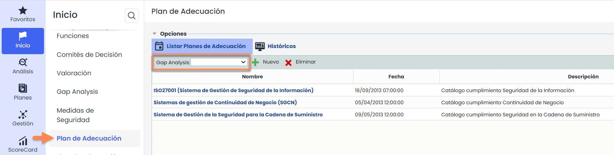

Para aquellas cláusulas que no hayan sido implementadas, se pueden establecer acciones que permitan su cumplimiento accediendo a cada una de ellas en la pestaña interna de **Plan de Adecuación**. Posteriormente se puede hacer un seguimiento de las mismas desde la pestaña de **Seguimiento**.

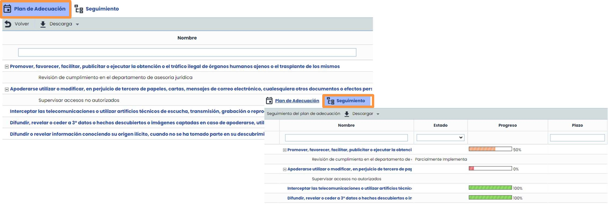

## Análisis

### Compliance

Esta opción permite realizar un seguimiento del estado de cumplimiento de la organización respecto a cualquier norma que se necesite evaluar.

Permite realizar un seguimiento continuo desde el punto de partida (GAP Analysis) hasta la adecuación total a la norma.

Para añadir un catálogo de Compliance (previamente configurado Ajustes) se debe pulsar en el botón de **Nuevo** y seleccionar el catálogo correspondiente.

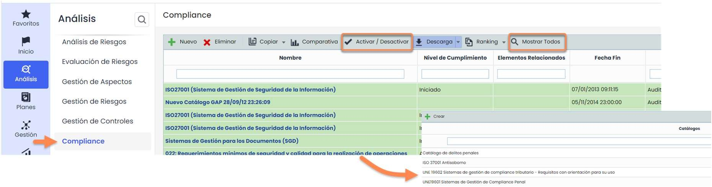

Por cada norma existe la versión activa (versión actual) y sus históricos. La versión activa se identifica por su color verde, es editable y es la única que aparece por defecto cuando se abre la opción de Compliance.

Se puede ver, no obstante, el resto de versiones -que no se pueden modificar- pulsando sobre el botón **Mostrar Todos**. Cuando se añada un nuevo Compliance, por defecto, se creará como versión activa, convirtiendo al último de la misma norma en inactivo. Las versiones siempre se pueden activar o desactivar seleccionándolas y pulsando el botón **Activar/Desactivar**.

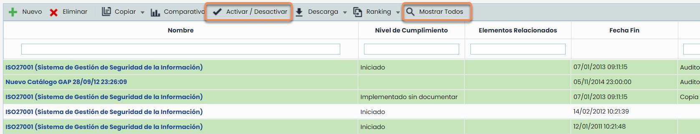

Al acceder al catálogo, se puede determinar el estado de cada una de las cláusulas mediante la columna **Estado Actual**. Sólo se podrán evaluar aquellas cláusulas que previamente se hayan definido como aplicables en la columna **Aplica**. Asimismo se puede asociar documentación, controles y no conformidades de manera directa, previamente introducidas en GlobalSuite.

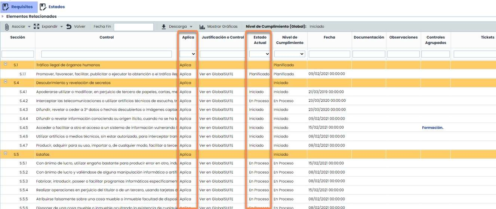

### Análisis de Riesgos

A través de esta funcionalidad se podrá realizar un análisis de riesgos sobre los elementos identificados previamente en el Catálogo de Servicios y Procesos.

Se pueden crear nuevos análisis, eliminar o crear copias de los existentes a través de los botones habilitados en la barra superior de la ventana.

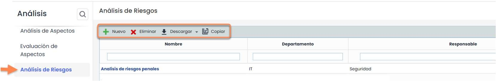

Para crear un análisis de riesgos, se tendrá que completar la información requerida en la pestaña **Información General**. Los campos importantes a completar son: Nombre, Metodología, Nivel de Riesgo Aceptable, Catálogo (en caso de trabajar con ellos) y los departamentos o procesos (elementos) a analizar.

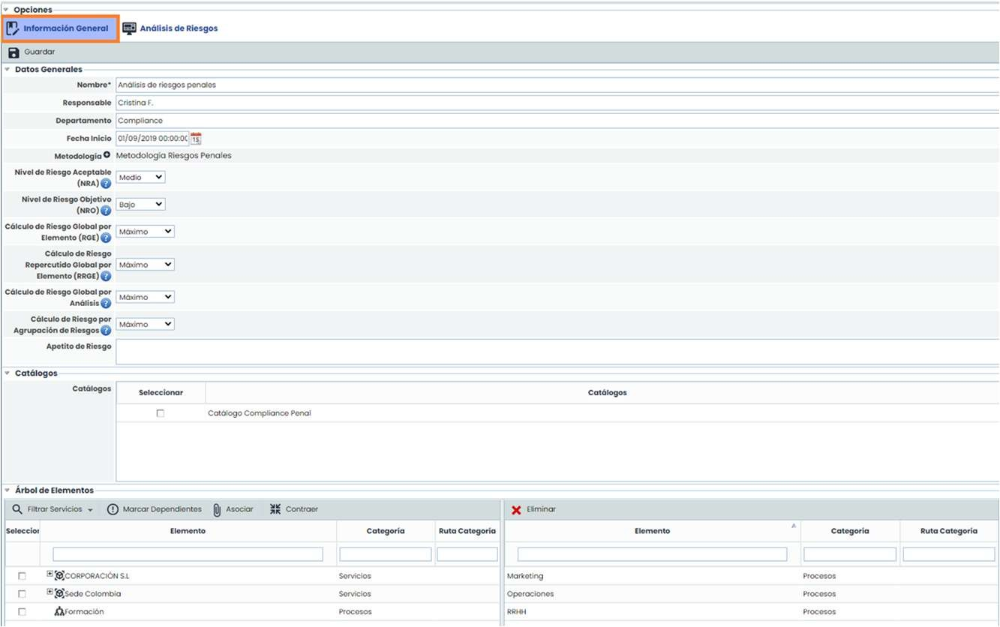

Una vez completados los campos requeridos en “Información General”, se podrá trabajar en la pestaña **Análisis de Riesgos** donde se procederá a añadir los riesgos identificados en cada departamento o proceso (elementos). Al seleccionar un elemento, se podrán revisar y evaluar los riesgos identificados y completar los campos definidos en la metodología añadida en el análisis, tales como la probabilidad, el impacto o el riesgo inherente, entre otros. Además, se podrán asociar los controles que mitigan el riesgo en concreto a través de la opción **Controles Implantados** , disponible en la barra inferior de la ventana.

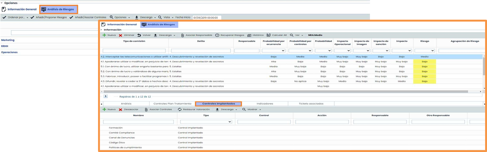

### Evaluación de Riesgos (Ver Mapa de Riesgos)

A través de esta opción se podrá revisar, de manera gráfica, los resultados obtenidos en el Análisis de Riesgos.

Por defecto, al seleccionar el análisis, se accede directamente a la pestaña **Ver Mapa de Riesgos** donde se visualizará un mapa de calor con los resultados del análisis de riesgos tras la evaluación. La configuración de esta vista está relacionada directamente con la metodología del análisis de riesgos seleccionado previamente.

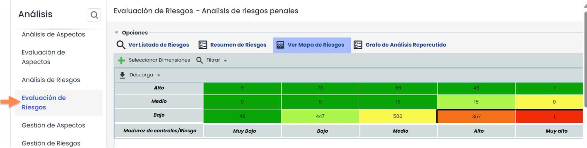

En la parte inferior se podrá obtener la información desglosada y de manera completa en lo que concierne a la relación elemento - riesgo - control. Esta información se podrá descargar con el botón de **Descarga** y se podrá añadir más información a la vista inicial (probabilidad, impacto, entre otros) seleccionando las dimensiones disponibles en el botón **Mostrar Dimensiones** o los campos textuales en **Mostrar Atributos**.

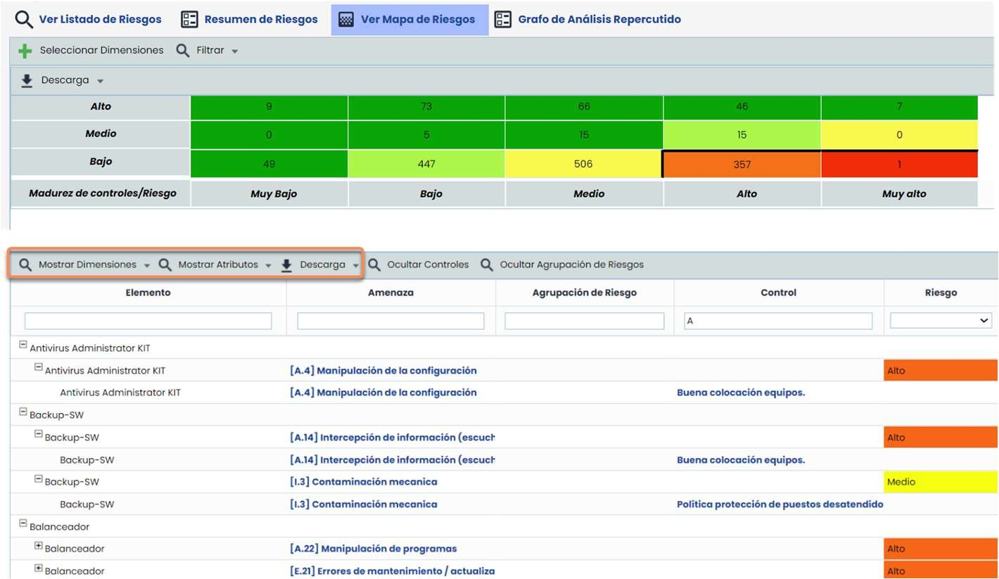

### Evaluación de Riesgos (Listado de Riesgos)

En la pestaña “Listado de riesgos”, GlobalSuite® Compliance Penal proporciona dos gráficas circulares sobre el nivel de riesgos respecto al NRA. También proporciona una gráfica de barras en el caso de que se esté trabajando con agrupadores o tipologías de riesgos. Para visualizar esta gráfica se debe seleccionar el botón “Vista > opción Riesgos”.

En la parte inferior de la ventana se puede visualizar la información desglosada y, utilizando los botones de la barra, se puede filtrar la información.

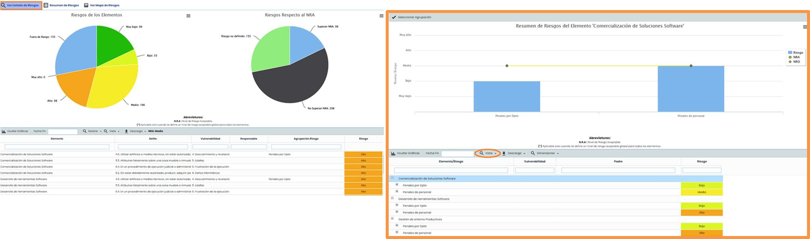

### Gestión de Controles

GlobalSuite® Compliance Penal permite realizar la gestión de los controles implantados en la organización. Para ello, hay que pulsar sobre la opción Análisis > [Gestión de Controles](https://help.globalsuitesolutions.com/es/globalsuite/v1/gestion-de-controles), disponible y escoger un análisis de riesgos.

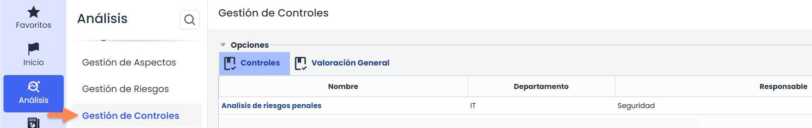

En la vista de controles se visualizarán por defecto todos los controles implantados pero se ofrece la posibilidad de filtrar el listado de controles a través del botón **Mostrar**, pudiendo optar entre visualizar Todos (Implantados y Planes de Tratamiento) o específicos, ya sean sólo los controles Implantados o los definidos en el Plan de Tratamiento. También se pueden añadir nuevos controles y eliminar los existentes.

Para acceder a la ficha del control y obtener información más detallada sobre el mismo, se debe seleccionar el botón de **Opciones > Detalles** disponible en la barra superior de la ventana.

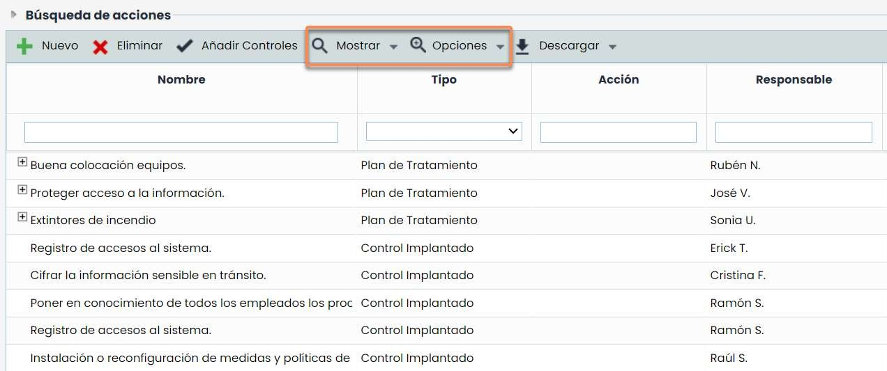

En la ficha del control se puede revisar la información o modificarla a través de las distintas secciones. Se pueden crear acciones, revisar los riesgos que mitiga, asociar evidencias, etc.

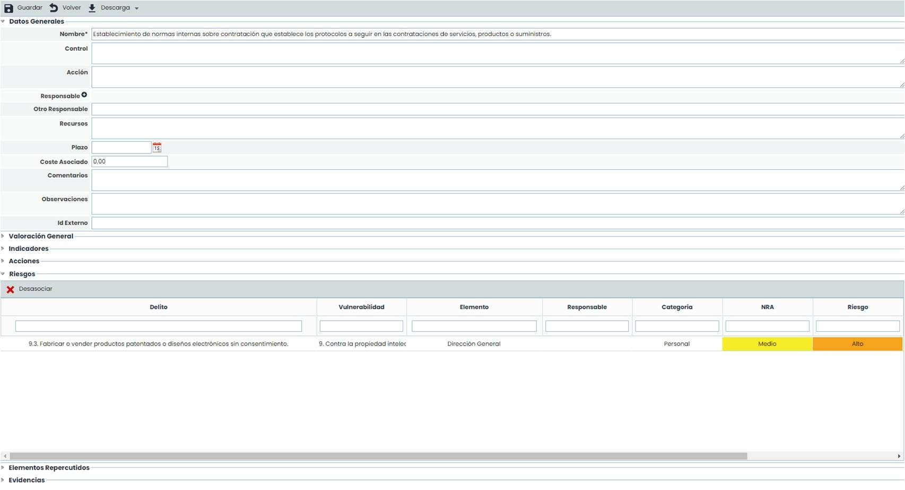

### Gestión de Evidencias

A través de esta opción se podrán crear evidencias que posteriormente se vincularán a los controles implantados o a los planes del tratamiento de riesgos. También se podrá asociar documentación disponible en la opción [Gestor Documental](https://help.globalsuitesolutions.com/es/globalsuite/v1/gestor-documental).

Por defecto, se mostrarán las evidencias activas. Para visualizar todas las evidencias se debe pulsar en el botón de **Mostrar > Todas**. Para acceder a la información detallada de la evidencia, se debe pulsar en el nombre de la evidencia. Al acceder al formulario, se podrá definir el tipo de evidencia (previamente configurado en Ajustes > Configuración > General > [Configuración de Evidencias](https://help.globalsuitesolutions.com/es/globalsuite/v1/configuracion-de-evidencias)), asociar documentación y vincularla con controles, entre otras opciones.

### Gestión de Riesgos

Esta funcionalidad permite establecer y gestionar los Planes de Tratamiento que van a mitigar los riesgos que se encuentren por encima del nivel de riesgo aceptable.

Se debe seleccionar uno de los análisis de riesgos disponibles para trabajar sobre ello.

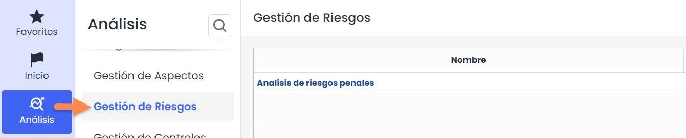

#### Planificación de la gestión de riesgos

Por defecto se accede a la pestaña “Planificación de la gestión de riesgos”.

En la ventana superior, se mostrarán todos los riesgos por encima del nivel de riesgo aceptable (NRA). Si se desea visualizar todos, se debe pulsar el botón de **Mostrar > Mostrar todos**. En la ventana inferior se visualizarán los planes de tratamiento: se podrán crear nuevos planes, eliminar los existentes o incluir controles implantados que, una vez seleccionados, pasarán a ser planes de tratamiento.

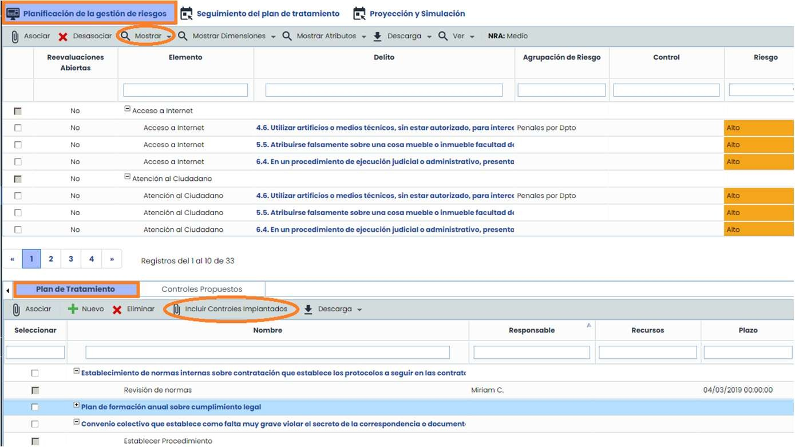

Para llevar a cabo la asociación del riesgo y sus respectivos planes de tratamiento, se debe marcar el riesgo en la ventana superior, el plan de tratamiento en la ventana inferior y pulsar el botón de **Asociar**.

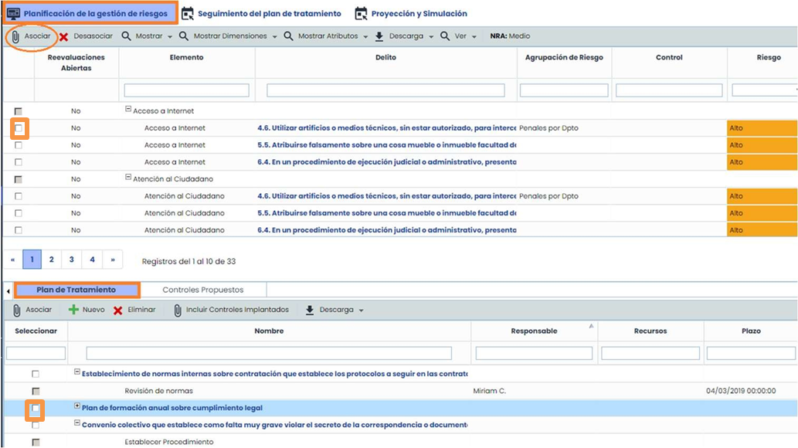

#### Seguimiento del Plan de Tratamiento

En la opción de “Seguimiento del plan de tratamiento”, se pueden ver los plazos definidos para la finalización de cada uno de ellos, junto con su progreso derivado de la completitud de las acciones que tengan asociados. Si el progreso de las acciones asociadas es 100%, indicará que el plan de tratamiento puede ser definido como control implantado. Para ello se debe pulsar el botón de **Implantar Controles Completos** y se traspasarán todos los planes de tratamiento con un progreso del 100% a la opción de Gestión de Controles, cambiando su categoría a “Control Implantado”. A la hora de implantar los planes, se deberá seleccionar si se quiere conservar las acciones o no al hacer el traspaso.

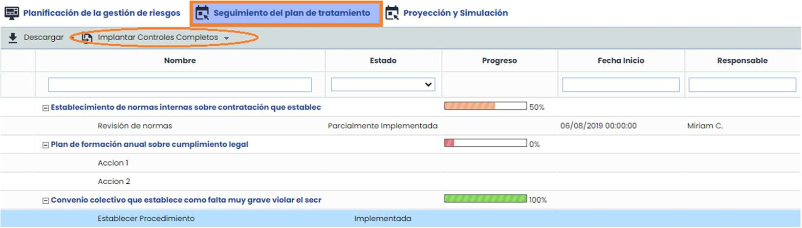

## Planes

### Auditorías

La opción Auditoría permite establecer la programación de auditoría a realizar, ver todas aquellas que han sido realizadas, así como establecer todos aquellos puntos del Sistema de Gestión.

En la pantalla principal se muestran por defecto las auditorías que están aprobadas y planificadas, las cerradas no aparecen. Para poder visualizarlas, se debe pulsar en el botón **Mostrar > Todos**. Además, en la columna **Informe** se podrán descargar los informes de las auditorías.

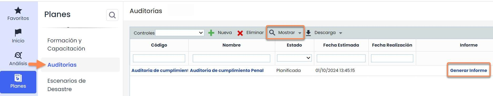

A través del botón de **Controles** que aparece en la barra superior de la ventana principal, se puede asociar un catálogo de Compliance que está siendo evaluado en la opción de “Compliance” y auditar el estado de cumplimiento respecto a la norma.

Al asociar y acceder a la auditoría, en la pestaña “Controles” se podrá registrar las observaciones del auditor.


\*\*Nota\*\*
Cuando no se está auditando un catálogo Compliance, esta pestaña no aparecerá.


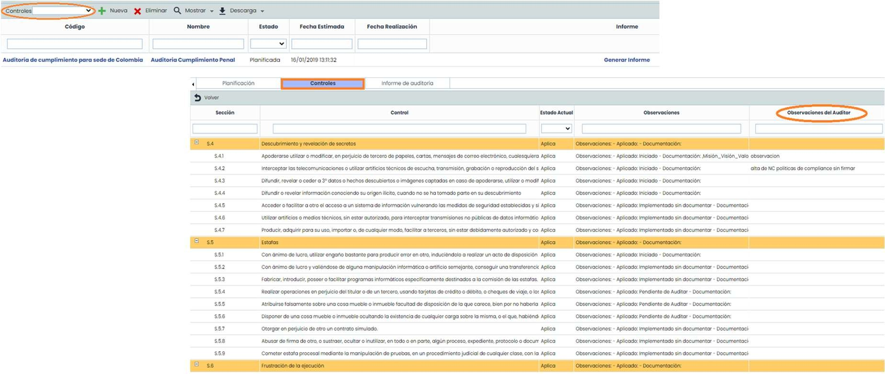

## Gestión

### Tickets

GlobalSuite® Compliance Penal dispone de una funcionalidad de Ticketing que está compuesta por un conjunto de opciones ubicadas en el apartado de [Gestión](https://help.globalsuitesolutions.com/es/globalsuite/v1/gestion). Estas opciones permiten gestionar diferentes tipos de tickets en función de su tipología:

* [Incidencias y Problemas](https://help.globalsuitesolutions.com/es/globalsuite/v1/incidencias-y-problemas): relativo a cualquier tipo de SG, incidencias detectadas en los mismos.
* [No Conformidades](https://help.globalsuitesolutions.com/es/globalsuite/v1/no-conformidades): ticket relativos a no conformidades detectados a nivel de compliance o auditoría.
* [Correctivas y Preventivas](https://help.globalsuitesolutions.com/es/globalsuite/v1/correctivas-y-preventivas): vinculados con las NC, son acciones correctivas tras la detección de una NC o bien preventivas ante la detección de una posible mejora.

### Formulario del ticket

Al acceder a cualquier opción de ticketing, se visualiza un listado de todos los tickets de dicha opción. Se pueden añadir nuevos o editar los existentes. Para acceder al formulario del ticket y consultarlo o editarlo, se debe pulsar sobre el asunto del mismo. En el formulario se mostrará una serie de campos organizados en diferentes secciones. Todos los campos y secciones se pueden configurar desde la opción de “Ajustes > Configuración > [Tickets](https://help.globalsuitesolutions.com/es/globalsuite/v1/configuracion-tickets).

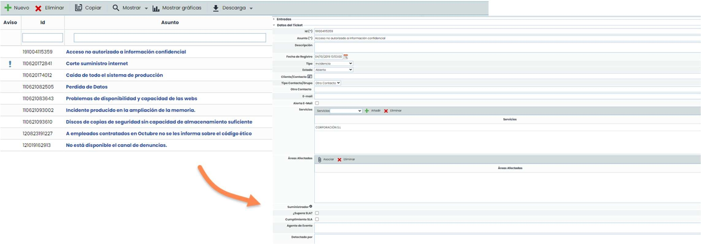

## Scorecard

### Métricas

La opción de métricas permite recoger distintos datos en la herramienta. Los datos de cada métrica serán representados dependiendo de su fecha y su valor. Será en la siguiente etapa cuando a partir de la combinación de las métricas se establezcan los indicadores.

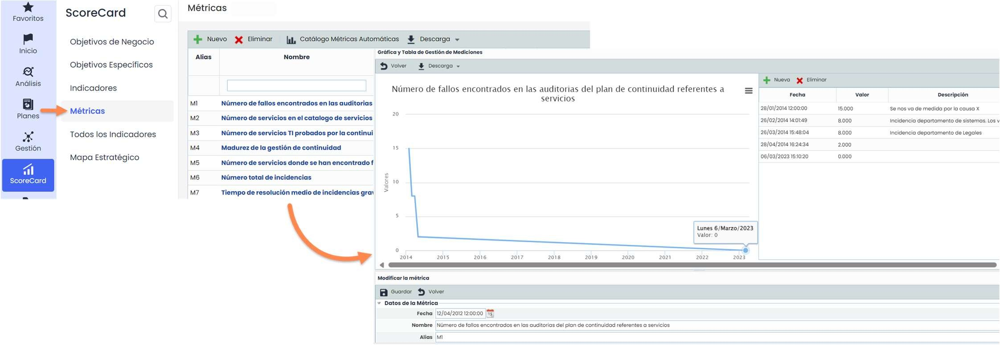

### Indicadores

A partir de la combinación de las métricas anteriormente establecidas, se elaborarán los indicadores. Para ello, deberemos establecer la relación de las mismas a través de una fórmula. Para poder utilizar los datos introducidos en las métricas, los indicadores deberán tener la misma frecuencia de recolección. Estos indicadores podrán ser utilizados en la extracción de informes (Secciones > Informes).

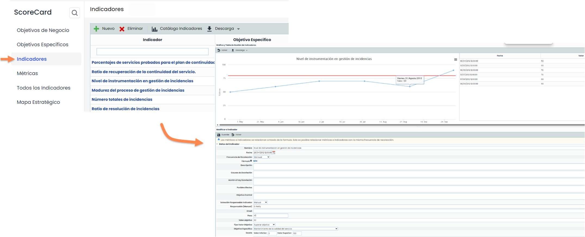

## Gestor Documental

Esta funcionalidad actúa como un repositorio compartido y único para concentrar toda la documentación derivada del Sistema de Gestión de la organización. Esta opción es transversal, siendo accesible desde cualquiera de las pestañas superiores (Home, Inicio, etc).

Al acceder a la opción se visualizarán las carpetas raíz y, dentro de ellas, las subcarpetas o los documentos que componen el gestor documental de la organización. En la parte superior hay una serie de botones que permite crear nuevas carpetas, subir documentos, acceder al detalle de los mismos para consultar versiones antiguas y descargar los documentos que se seleccionen o un zip de una carpeta con todo su contenido.

En la pestaña “Configuración de Workflows” se podrán crear los workflows con los que se desea trabajar en la subida/edición de los documentos.

Previamente debe estar activada esta opción en “Ajustes > Configuración > [General](https://help.globalsuitesolutions.com/es/globalsuite/v1/configuracion-general) > Activación workflow”.

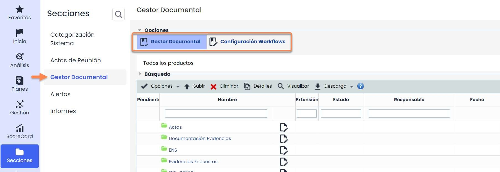
