# ¿Cómo configurar el BIA (Análisis de Impacto en el Negocio) en GlobalSuite®?

## Fases para la configuración del Análisis de Impacto en el Negocio (BIA)

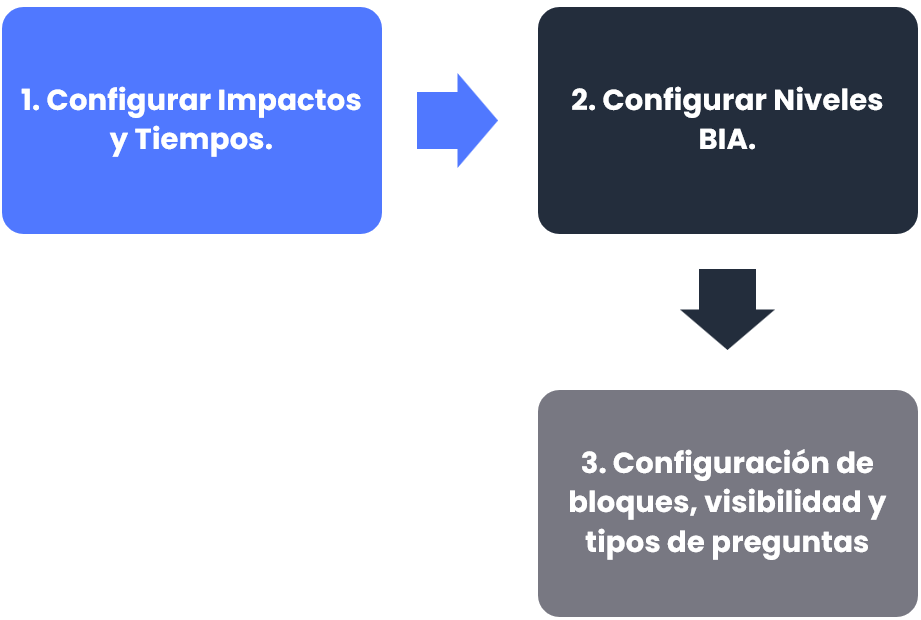

## Configuración de Impactos y tiempos

Para realizar ajustes en los formularios de los BIAs del módulo GlobalSuite® Bussines Continuity, se deberá acceder en la opción **Ajustes > Continuidad de negocio >** [**BIAs**](https://help.globalsuitesolutions.com/es/globalsuite/v1/configuracion-bia). Dentro, se encontrarán una serie de apartados, los cuales podrán ser personalizados para realizar los ajustes que sean necesarios.

A continuación, se mencionarán los pasos a seguir para realizar ajustes referentes a los impactos y tiempos en los BIAs.

En primer lugar, GlobalSuite® permite definir diferentes **Tipos de impacto** en el negocio.

El valor de cálculo de cada uno de estos impactos se fijará de un modo cualitativo en valor textual o bien cuantitativo de una manera numérica.

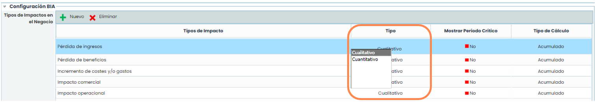

Además, es posible definir un **Tipo de cálculo** para cada tipo de impacto de cara al cálculo del impacto total:

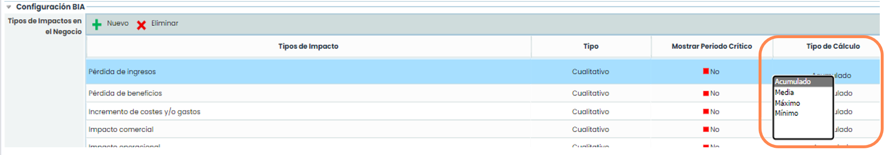

* **Acumulado**: sumaría los valores del impacto a lo largo de la escala temporal definida para obtener el total.
* **Media**: realizaría la media de los valores del impacto a lo largo de la escala temporal.
* **Máximo**: el valor total del impacto será el valor máximo de todos los registrados en ese tipo de impacto.
* **Mínimo**: análoga a la anterior, seleccionaría como valor final el valor mínimo de los valores de impacto.
* **Media ponderada**: se realizará una media de los valores totales de los impactos, pero será posible realizar una ponderación según pesos de cada tipo de impacto.

Dentro de un análisis en periodo crítico, se permite seleccionar cuales de los tipos de impacto en el negocio que se desea analizar, marcando la columna Mostrar Periodo Crítico en Sí o No.

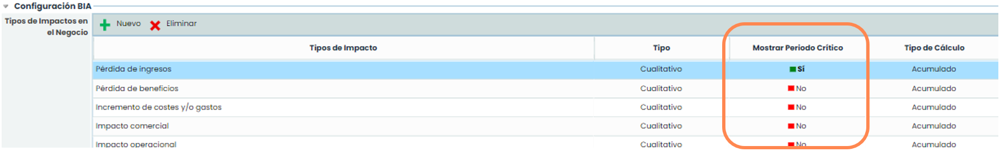

Adicionalmente, será posible definir el **Cálculo Global** del impacto de los siguientes modos:

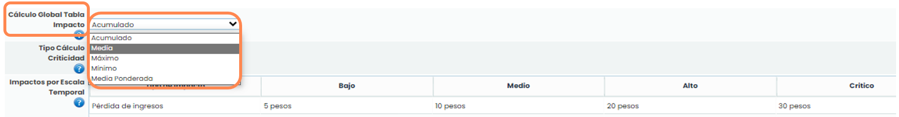

* **Acumulado**: la suma de todos los valores totales de cada tipo de impacto.
* **Media**: realizará la media de los valores totales de cada tipo de impacto para obtener el valor global.
* **Máximo**: seleccionará como valor global el máximo de todos los valores totales de cada impacto.
* **Mínimo**: a la inversa del anterior, el valor Global será el mínimo de los valores totales de los impactos.
* **Media ponderada**: se realizará una media de los valores totales de los impactos, pero será posible realizar una ponderación según pesos de cada tipo de impacto.

Una vez definidos los tipos de impacto y su cálculo, se deberá seleccionar el tipo de cálculo de la criticidad para realizar el valor global de la tabla de impactos en el campo **Tipo Cálculo Criticidad**. Se podrá realizar por filas, teniendo en cuenta sólo los tipos de impacto y las fórmulas, por columnas teniendo en cuenta la escala temporal, o por filas y columnas que será un combinado de las dos anteriores.

Tras esa configuración, se muestra una tabla de **Impactos por Escala Temporal** que contiene los tipos de impactos y se realizará su asociación con los diferentes niveles definidos para el BIA, que se mostrará en futuras diapositivas.

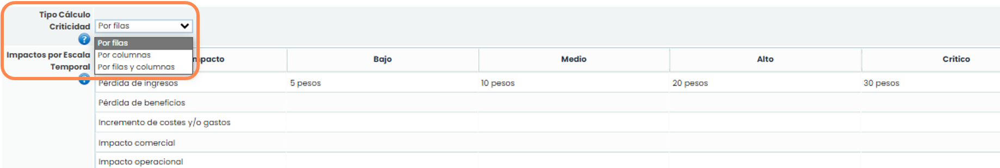

Las escalas temporales que se van a utilizar en el BIA se pueden configurar también en GlobalSuite®. Debajo de la tabla de impactos aparece una tabla denominada Escala Temporal que permite crear tiempos concretos a través de los botones **“Añadir” y “Eliminar”**.

Esta tabla permite para cada escala temporal indicar tanto la **Cantidad** (número específico) como la **Unidad** a utilizar (segundos, minutos, horas, días y semanas). Para ello, hay que hacer doble click sobre las celdas que se quieran modificar. Los tiempos indicados se ordenan automáticamente de menor a mayor.

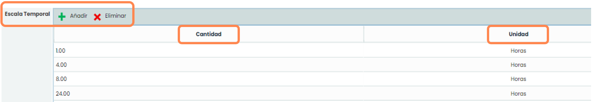

## Configuración de niveles BIA

Como ya se mencionó anteriormente para realizar ajustes en los formularios de los BIAs del módulo GlobalSuite® Bussines Continuity, se deberá acceder en la opción **Ajustes > Continuidad de negocio >** [**BIAs**](https://help.globalsuitesolutions.com/es/globalsuite/v1/configuracion-bia). Dentro, se encontrarán una serie de apartados, los cuales podrán ser personalizados para realizar los ajustes que sean necesarios.

A continuación, se mencionarán los pasos a seguir para realizar ajustes referentes a la configuración de niveles de los BIAs.

### Niveles de impacto

Además de los tipos de Impacto y la escala temporal, se podrá configurar los niveles para valorar cada tipo de impacto.

Para ello, la sección **Niveles** permite crear y eliminar niveles de impacto, mediante los botones “**Nuevo**” y “**Eliminar**”, ordenarlos entre sí con los botones “**Subir Nivel**” y “**Bajar Nivel**” e incluso asociar un color a cada uno de los niveles con el botón “**Cambiar Color.**”

Para editar el nombre de cada nivel, únicamente será necesario realizar doble click en la columna **Nombre**.

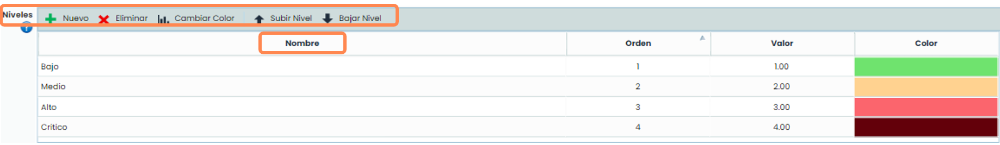

### Niveles de criticidad

Similar a los niveles de impacto comentados anteriormente, es posible definir Niveles de criticidad, así como un Nivel aceptable de criticidad. Para ello primero se tendrá que dar un click dentro de la casilla **Habilitar criticidad**, de esta manera se mostrarán las opciones donde se podrán configurar dichos niveles.

En la opción **Niveles de Criticidad** se podrá añadir o eliminar niveles, mediante los botones “**Nuevo**” y “**Eliminar**”. Automáticamente GlobalSuite® ordenará dichos niveles en función de los valores **Máximo** y **Valor** asignados a cada nivel de criticidad. Adicionalmente es posible asociar un color a cada uno de los niveles con el botón “**Cambiar Color**”.

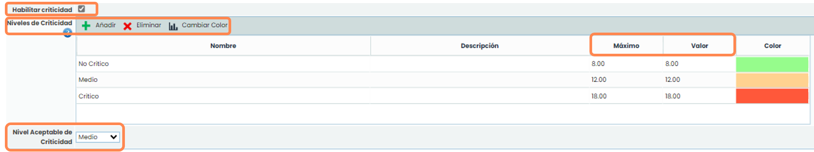

Finalmente, en la opción **Nivel Aceptable de Criticidad** se podrá seleccionar un nivel de criticidad de los configurados previamente.

## Configuración de bloques, visibilidad y tipos de preguntas

Continuando con la misma dinámica, para realizar ajustes en los formularios de los BIAs del módulo GlobalSuite® Bussines Continuity, se deberá acceder en la opción **Ajustes > Continuidad de negocio >** [**BIAs**](https://help.globalsuitesolutions.com/es/globalsuite/v1/configuracion-bia). Dentro, se encontrarán una serie de apartados, los cuales podrán ser personalizados para realizar los ajustes que sean necesarios.

A continuación, se mencionarán los pasos a seguir para realizar ajustes referentes a la configuración de bloques, visibilidades y tipos de preguntas de los BIAs.

### Bloques

Es posible definir diferentes preguntas que se considere oportuno para adecuar GlobalSuite® a las necesidades de la empresa en la realización del BIA, pero antes es posible actualizar los nombres de los bloques disponibles. Estos bloques son secciones que se mostrarán en el BIA, sólo en caso de tener preguntas que mostrar. Para editar los nombres, se deberá hacer doble click sobre el texto de cada bloque.

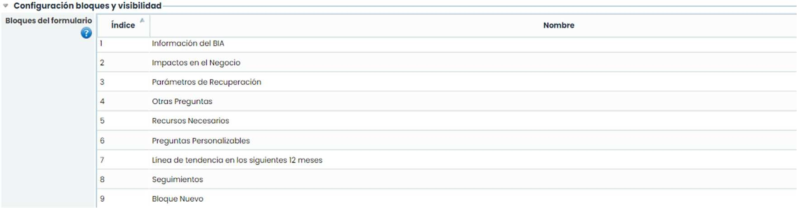

### Campos de los bloques

Análogos a los bloques, existen unos campos standard que propone GlobalSuite® dentro de éstos.

Desde la opción **Visibilidad y orden de campos** es posible definir su visibilidad, mediante la casilla Visible, seleccionar el bloque dónde se muestra dicho campo haciendo doble click sobre la columna **Bloque** y, finalmente, ordenar los campos dentro de cada bloque mediante los botones de “**Subir Orden**” y “**Bajar Orden**”.

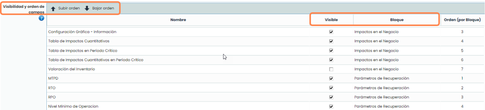

### Tipos de Preguntas

Adicionalmente es posible realizar preguntas personalizables en cada uno de los bloques comentados.

Con ayuda de la botonera superior, se podrán añadir nuevas preguntas o eliminar existentes, con el botón “**Añadir**“ y “**Eliminar**” y definir su orden en cada bloque con los botones “**Subir Orden**” o “**Bajar Orden**”.

Cada una de estas preguntas son editables en su texto, haciendo doble click en el campo **Nombre**, y se podrá seleccionar el bloque dónde se desea mostrar dichas preguntas.

Además de las acciones citadas, existen cuatro **Tipos de preguntas** configurables: Texto, Tabla, Select y Tabla de elementos.

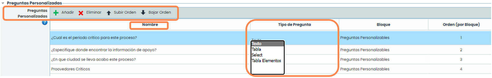

Las posibilidades para cada tipo de pregunta son las siguientes:

* **Texto**: responder con un texto libre.
* **Tabla o Select:** permitirá respuestas en función a un desplegable o a tabla con diferentes opciones en columnas. Estas opciones a configurar aparecerán en una tabla en la parte inferior:

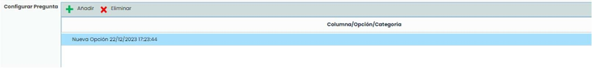

* **Tabla de elementos:** se podrá recuperar elementos del listado del inventario, creados previamente dentro de su pestaña específica dentro de GlobalSuite.

  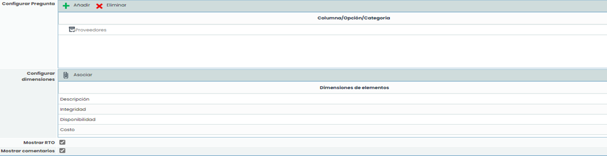
