# ¿Cómo configurar escenarios y planes de continuidad en GlobalSuite®?


Este tutorial explica, paso a paso, cómo crear y configurar los \*\*escenarios y planes de continuidad\*\* en GlobalSuite®, dentro del módulo de \*\*Continuidad de Negocio\*\*.
En esta guía se detalla cómo definir \*\*escenarios de desastre o crisis\*\*, asociar los \*\*recursos consolidados\*\*, vincular los \*\*elementos, procesos y riesgos afectados\*\*, y establecer los \*\*planes de continuidad\*\* que se activarán ante cada escenario.
Además, se describe cómo personalizar los \*\*planes de continuidad\*\*, incluyendo su información general, configuración del informe, control de cambios, anexos, objetivos y secciones, así como la posibilidad de generar una \*\*vista previa o descargar el plan\*\* en formato editable. También se explica cómo asociar roles y permisos para definir el acceso a las distintas secciones del plan


## 1. Escenarios

Dentro de **Planes > Opciones** la opción Escenarios permite establecer todas aquellas posibles situaciones de emergencia en las que sea necesario activar el plan de continuidad. Se podrá seleccionar dos tipos de escenarios: [**Escenario de Desastre**](https://help.globalsuitesolutions.com/es/globalsuite/v1/escenarios-de-desastre) o [**Escenario de Crisis**](https://help.globalsuitesolutions.com/es/globalsuite/v1/escenarios-de-crisis)

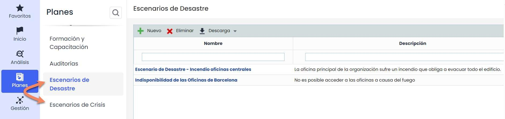

### 1.1 Tabla principal

En la pantalla principal de los Escenarios podrá identificar todas aquellas situaciones en las que se pueda ver afectado el servicio ofrecido por la organización.

Para crear una nueva entrada en Escenarios debe pulsar el botón “**Nuevo**”. Pulsando en el link de la nueva entrada, accedemos al formulario.

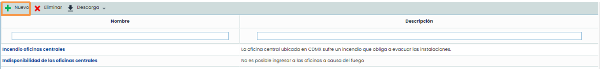

### 1.2 Datos generales

En la sección **Datos Generales** definimos el **Nombre** y una **Descripción** del Escenario.

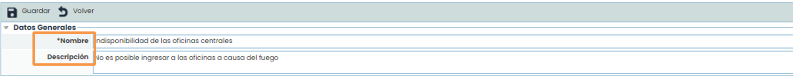

### 1.3 Recursos consolidados

En los **Recursos Consolidados**, definimos todos aquellos recursos que son necesarios en caso de ocurrencia del escenario. Estos recursos se deben definir en la opción de **Consolidación de Recursos**.

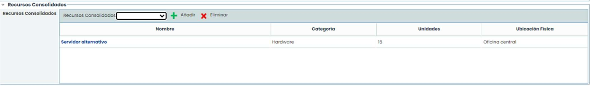

### 1.4 Elementos relacionados

Permite definir todos aquellos procesos que se ven afectados en caso de ocurrencia del Escenario. A su vez es posible determinar todos aquellos elementos asociados a los procesos que también se ven afectados en caso de ocurrencia del escenario.

Para hacerlo debe elegir de la lista desplegable del servicio y posteriormente del proceso a elegir y pulsar en el botón “**Añadir**”. Haciendo click en el proceso, se seleccionan y aparecen en la tabla de la derecha, los elementos de ese proceso. Marcando las casillas de los elementos deseados, los incluimos en la tabla inferior llamada **Elementos/ Riesgos a Gestionar.**

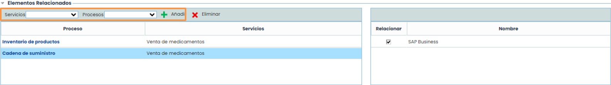

### 1.5 Elementos/Riesgos a gestionar

El presente apartado muestra los elementos y riesgos asociadas al escenario que tienen un nivel de riesgo por encima del nivel de riesgo aceptable. Este listado incluye también la lista de riesgos de los procesos seleccionados, así como la de los activos seleccionados y asociados a los procesos. De la misma forma es posible identificar tanto la categoría a la que pertenecen, el nivel de riesgo aceptable aprobado por la organización, como el nivel de riesgo de los riesgos asociadas a cada uno de los elementos.

Mediante esta opción se puede evidenciar aquellos riesgos que no están asociadas a ningún escenario de los definidos, identificadas a través de la columna asociadas que aparece en color rojo, tal y como indica la leyenda de la cabecera del presente apartado.

Todos aquellos riesgos asociados al escenario definido serán marcadas en la columna asociada. Todos los que no tomen en cuenta mediante este escenario no aparecerán marcados, identificándose en color rojo todos aquellos que no pertenecen o se hayan tenido en cuenta en ninguno de los escenarios definidos.

Por defecto, GlobalSuite® muestra tan sólo aquellos riesgos que superan el Nivel de Riesgo Aceptable (NRA), pero es posible representar todos mediante el desplegable **Mostrar**, seleccionando la opción **Mostrar Todas.**

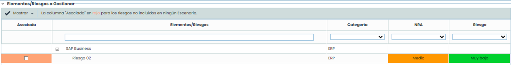

## 2. Planes de continuidad

La presente opción de GlobalSuite® permite asociar un plan de continuidad a cada uno de los escenarios establecidos en las opciones de **Escenarios**, así como determinar los objetivos a cumplir en caso de activar el plan de continuidad o cualquier otra información relevante ante el escenario asociado.

### 2.1 Tabla principal

En la pantalla principal de la opción del Plan de Continuidad, tendrá disponible el acceso a todos los planes de continuidad que se hayan definido en GlobalSuite®.

Las opciones que se pueden realizar en la tabla son las siguientes:

* **Nuevo**: Permite generar una nueva entrada en la tabla de planes de continuidad, para ello se deberá pulsar el botón “**Nuevo**”
* **Eliminar**: Ofrece la posibilidad de eliminar una entrada de la tabla. Para ello se ha de seleccionar la fila deseada y pulsar el botón “**Eliminar**”
* **Copiar**: Permite copiar un plan de continuidad ya generado en la tabla
* **Descarga:** Posibilita la descarga del listado de planes en formato editable (.xlsx) o en PDF.

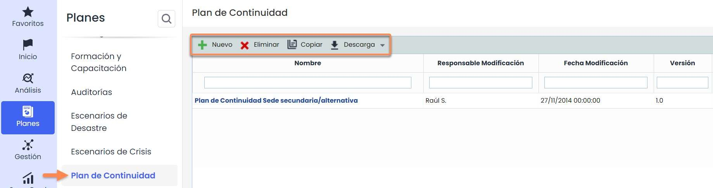

### 2.2 Información general

Permite al usuario definir los datos generales de los que va a estar compuesto el plan de continuidad.

* **Nombre**: Permite definir el nombre asociado al Plan de continuidad.
* **Descripción**: Permite incluir cualquier tipo de información que se considere necesaria para una adecuada definición del Plan de continuidad.
* **Código**: Campo texto que permite al usuario asignar un código al plan de continuidad
* **Tipo de responsable de creación**: Ofrece la posibilidad de insertar usuarios de manera manual o automática.
* **Responsable de creación**: Permite definir el responsable de la definición del plan de continuidad
* **Fecha de creación**: Posibilita definir la fecha de creación del plan de continuidad.
* **Tipo de responsable de modificación**: Ofrece la posibilidad de insertar usuarios de manera manual o automática.
* **Responsable de modificación**: Permite definir el responsable de modificación del plan de continuidad
* **Fecha de modificación:** Posibilita definir la fecha de modificación del plan de continuidad.
* **Versión**: Ofrece la posibilidad de establecer un versionado al Plan de continuidad
* **Estado**: Permite definir el estado de vigencia en el que se encuentra el Plan, pudiendo optar entre Borrador, Vigente o Histórico


NOTA: El seleccionar el estado Histórico los datos del Plan de continuidad quedarán almacenados sin posibilidad de modificar sus datos.


### 2.2 Información general

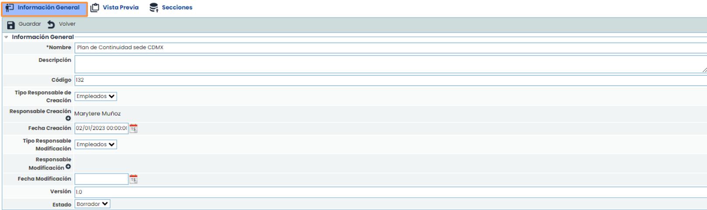

### 2.3 Configuración del informe

Esta sección permite al usuario configurar aspectos generales del plan de continuidad, tales como la portada, el tipo de letra o la información general que se desea mostrar en el mismo.

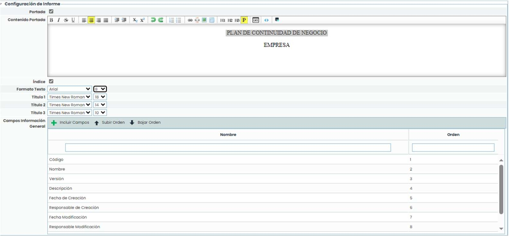

Esta sección permite al usuario configurar aspectos generales del plan de continuidad, tales como la portada, el tipo de letra o la información general que se desea mostrar en el mismo.

* **Portada**: Permite indicar si se desea configurar una portada para el plan de continuidad. Si se marca la casilla, se habilita un editor de texto que permite configurar la portada (incluyendo tanto texto como imágenes). Si el campo no está habilitado, se generará sin portada.
* **Índice**: Permite indicar si se desea mostrar el índice.
* **Formato Texto**: Permite seleccionar el tipo de letra y el tamaño deseado para el texto.
* **Título 1**: Permite seleccionar el tipo de letra y el tamaño deseado para los títulos de nivel 1.
* **Título 2**: Permite seleccionar el tipo de letra y el tamaño deseado para los títulos de nivel 2.
* **Título 3**: Permite seleccionar el tipo de letra y el tamaño deseado para los títulos de nivel 3.
* **Campos Información General**: Esta tabla permite indicar qué campos de información general del plan de continuidad se desea que estén visibles en el Plan. Por defecto, al crear un plan de continuidad se encuentran todos los campos incluidos, pero a través del botón “**Incluir Campos**” se permite seleccionar qué campos se desean incluir (a través de su selección en la ventana emergente que aparece). Los botones “**Subir Orden**” y “**Bajar Orden**” permiten establecer el orden deseado para que los campos se muestren de esta manera.


Nota: En la sección Vista Previa de un plan de continuidad se permite la visualización de este mismo para comprobar cómo se muestran estos campos, así como su descarga.



Nota: Los títulos 1, 2 y 3 se establecen en los editores de texto a través de los botones “\*\*H1\*\*”, “\*\*H2\*\*” y “\*\*H3\*\*” disponibles en los mismos.


La opción de control de cambios permite al usuario registrar diferentes modificaciones realizadas sobre el plan de continuidad pulsando sobre el botón “**Nuevo**”.

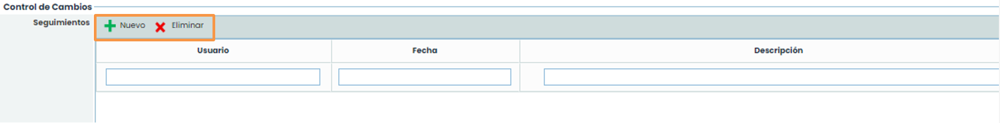

### 2.5 Archivos adjuntos

Se ofrece la posibilidad al usuario de adjuntar cualquier documento anexo, que ayude a completar el plan de continuidad pulsando sobre el botón “**Adjuntar**”. Una vez subidos, los documentos pueden ser descargados pulsando sobre el botón “**Descarga**”.

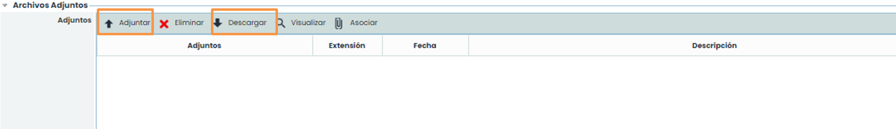

### 2.6 Escenarios asociados

A través de esta opción podrá asociar escenarios al plan de continuidad definido. Los escenarios que se pueden asociar han sido definidos en la opción de los tipos de **Escenarios**.

A través del botón “**Asociar Escenarios**” podrá establecer qué escenarios son aquellos por los que puede activarse el plan de continuidad definido.

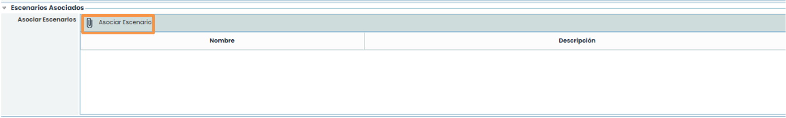

Seleccionando dicha opción se abrirá una ventana emergente, desde la cual se pueden seleccionar los escenarios necesarios. Una vez seleccionado el escenario, es necesario pulsar el botón “**Asociar**”, formando parte de esta forma del plan de continuidad que está siendo definido.

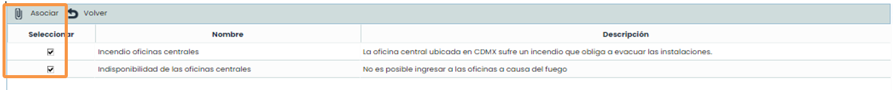

### 2.7 Procesos asociados

Esta sección permite asociar los procesos de negocio. Los procesos que se pueden asociar deben estar incluidos en los escenarios asociados previamente al Plan, no apareciendo los procesos de negocio que no se encuentren en los escenarios añadidos en la sección anterior.

Para asociar un proceso de negocio al plan de continuidad se debe seleccionar, en primer lugar, un servicio de la lista desplegable llamada **Servicios** y, posteriormente, seleccionar el proceso deseado en la lista desplegable llamada **Procesos**. Una vez seleccionado el proceso, se debe pulsar sobre el botón “**Añadir**”. Para eliminar un proceso del Plan, se debe seleccionar el proceso de la tabla y pulsar sobre el botón “**Eliminar**”.

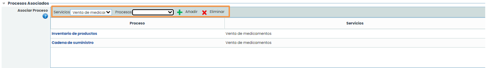

### 2.8 Objetivos

Esta sección permite establecer los objetivos a cumplir en caso de activación del plan de continuidad.

Dentro de estos objetivos se permite establecer:

* **Nombre**: Corresponde con la descripción del objetivo a cumplir en caso de activación.
* **Descripción**: Permite definir qué se quiere conseguir con el objetivo propuesto.
* **Anexos**: Permite asociar documentación de apoyo que permita facilitar la consecución del objetivo propuesto.

Para poder asociar cualquier anexo a los objetivos es preciso seleccionar el objetivo correspondiente y pulsar la opción “**Asociar Anexos**”, seleccionando el documento correspondiente del Gestor documental de GlobalSuite®.

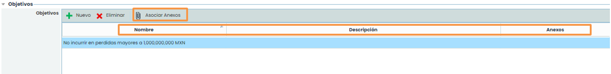

La opción de secciones permite al usuario definir los apartados de los que estará compuesto el Plan de continuidad, pudiendo realizar las siguientes opciones dentro de la tabla.

* **Nuevo**: Permite insertar una nueva sección en la tabla.
* **Eliminar**: Ofrece la posibilidad de eliminar una entrada de la tabla. Para ello se ha de seleccionar la fila deseada y pulsar sobre el botón “Eliminar”.
* **Subir**: Permite posicionar la sección seleccionada a una posición superior.
* **Bajar**: Permite posicionar la sección seleccionada a una posición inferior.
* **Asociar permisos**: Permite al usuario definir el/los roles que tendrán acceso a esta sección del plan de continuidad.
* **Editar Sección**: Permite al usuario definir el contenido de la sección.

Al pulsar sobre la opción, se muestra la siguiente pantalla sobre la que podemos definir lo anteriormente definido.

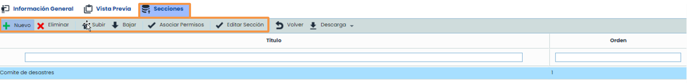

### 2.9 Secciones

Cuando se accede a la opción **Asociar permisos**, se abrirá una pantalla emergente, en la cual se podrá realizar las siguientes acciones:

* **Añadir**: Una vez seleccionado el rol deseado en el desplegable, permite asociar el mismo a la sección.
* **Eliminar**: Permite eliminar una asociación creada. Para ello se ha de seleccionar la fila deseada y pulsar sobre el botón “**Eliminar**”.

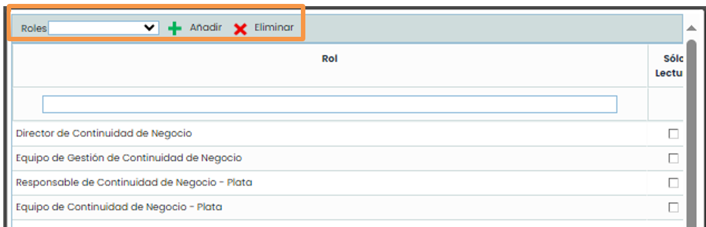

### 2.9 Secciones

Cuando se accede a la opción **Editar Sección**, se abrirá una pantalla en donde se visualiza un formulario que permite la edición del contenido del mismo.

Las opciones que permite la herramienta son las siguientes:

* **Guardar**: Permite almacenar todas las modificaciones realizadas sobre la sección.
* **Volver**: Al pulsar sobre el botón “**Volver**” la herramienta devuelve al usuario al listado de secciones del plan de continuidad.
* **Elementos**: Permite definir qué elementos va a contener la sección, pudiendo utilizar los siguientes:

  * **Texto**: Campo de texto libre donde poder incorporar la información deseada por el usuario.
  * **Orientación de la página**: Permite definir la orientación en la que se creará la sección, pudiendo optar entre Vertical u Horizontal.
  * **Gráfica**: Permite incorporar a la sección diferentes gráficas existentes en la plataforma, tal como se muestra en la imagen.
  * **Salto de Página**: Permite insertar un salto de página en la sección.
  * **Tabla**: Permite incorporar a la sección una tabla existente en la plataforma, pudiendo optar entre diferentes modelos de tabla (Continuidad, Disponibilidad, etc.). Para cada tabla insertada se permite configurar la información que se quiere mostrar, añadir filtros y ordenar la información bajo diferentes criterios.

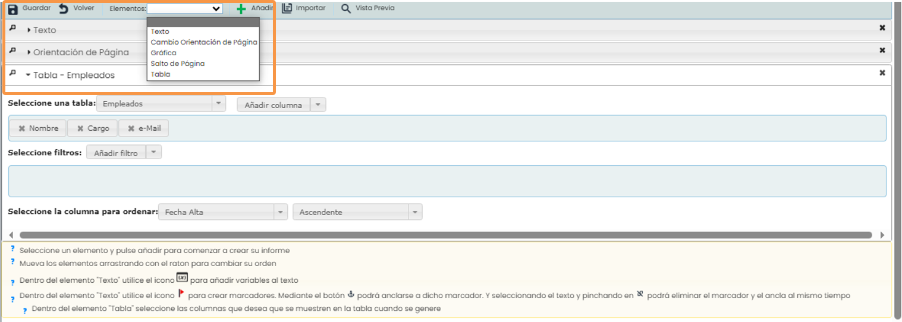

### 2.10 Vista previa

Esta opción permite al usuario visualizar la composición documental del plan de continuidad y su estructura definida, mostrando la composición de la portada, la información general y las diferentes secciones definidas.

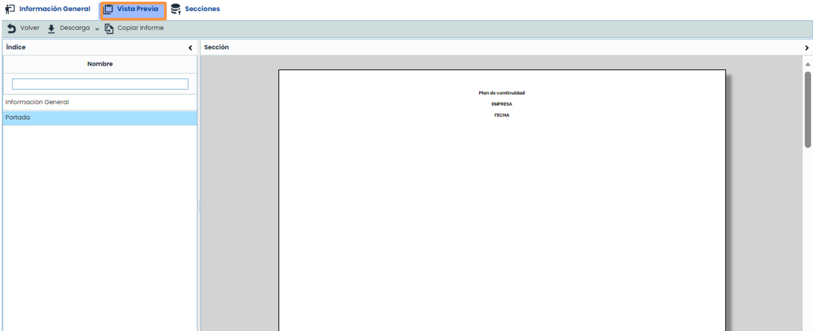

También el plan de continuidad se podrá descargar en formato editable (.docx), a través del botón “**Descarga**”.

Con el botón “**Copiar Informe**” se permite copiar la estructura del plan de continuidad actual en otros planes existentes en la herramienta. Para ello, al pulsar el botón se muestra una ventana emergente que contiene el listado del resto de planes de continuidad, permitiendo la selección de uno o varios planes. Una vez seleccionados, al pulsar sobre el botón “**Copiar informe**” se establecen en los planes seleccionados la Portada, la información general y las secciones del plan de continuidad actual, eliminando las secciones, si hubiera, de los planes seleccionados.

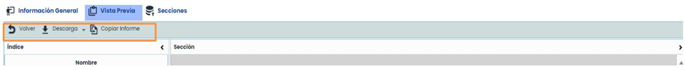
