# ¿Cómo configurar y activar un Plan de Gestión de Crisis en GlobalSuite®?


Este tutorial explica, paso a paso, cómo crear, configurar y activar un \*\*Plan de Gestión de Crisis\*\* en GlobalSuite®, dentro del módulo de \*\*Continuidad de Negocio\*\*.
En esta guía se detalla cómo definir los \*\*niveles e impactos de crisis\*\*, establecer la relación entre ellos y configurar los datos generales del plan: nombre, descripción, responsable y nivel de crisis asociado.
También se explica cómo \*\*asociar escenarios, servicios, procesos, infraestructuras y comités de decisión\*\*, definir los \*\*criterios de activación\*\* y gestionar los \*\*elementos, clientes, proveedores y planes interrelacionados\*\*.
Finalmente, se muestra cómo \*\*activar o simular un plan de gestión de crisis\*\*, ya sea desde una incidencia registrada o desde la propia opción de planes, generando automáticamente una nueva entrada en la sección \*\*Gestión de la Crisis\*\*


## Fases para la configuración inicial de la Gestión de la Crisis

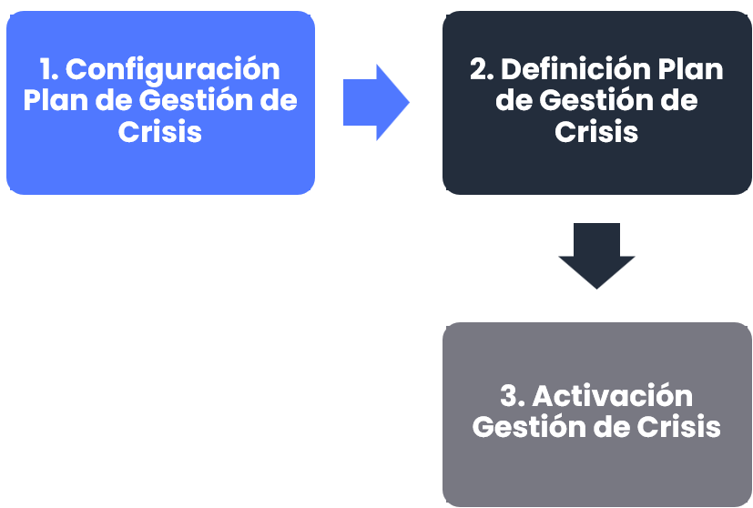

## Configuración del Plan de Gestión de Crisis

Antes de ver la definición del plan, se verá la configuración de Niveles e impactos de crisis. Se tendrá que definir los impactos, los niveles y posteriormente la relación entre ellos.

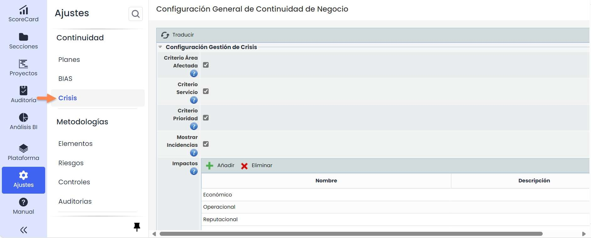

## Definición del Plan de Gestión de la Crisis

* En **Ajustes > Continuidad de Negocio >** [**Crisis**](https://help.globalsuitesolutions.com/es/globalsuite/v1/configuracion-gestion-de-crisis)en la opción de [**Impactos**](https://help.globalsuitesolutions.com/es/globalsuite/v1/configuracion-gestion-de-crisis#ConfiguraciónGestióndeCrisis-Impactos), se añadirán los impactos.
* En **Ajustes > Continuidad de Negocio >** [**Crisis**](https://help.globalsuitesolutions.com/es/globalsuite/v1/configuracion-gestion-de-crisis)en la opción de [**Niveles de crisis**](https://help.globalsuitesolutions.com/es/globalsuite/v1/configuracion-gestion-de-crisis#ConfiguraciónGestióndeCrisis-NivelesdeCrisis), se añadirán los niveles de crisis.
* En **Ajustes > Continuidad de Negocio >** [**Crisis**](https://help.globalsuitesolutions.com/es/globalsuite/v1/configuracion-gestion-de-crisis)en la opción de [**Niveles de crisis por Impacto**](https://help.globalsuitesolutions.com/es/globalsuite/v1/configuracion-gestion-de-crisis#ConfiguraciónGestióndeCrisis-NivelesdeCrisisporImpacto)**,** se relacionarán.

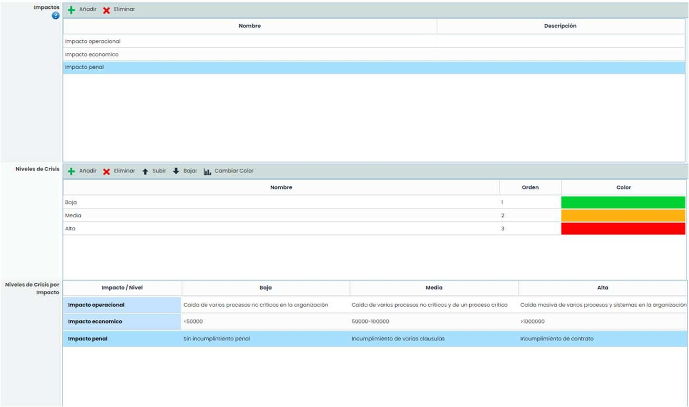

Posteriormente en **Planes >** [**Plan de Gestión de crisis**](https://help.globalsuitesolutions.com/es/globalsuite/v1/plan-de-gestion-de-crisis) dentro de un plan de gestión de la crisis se tendrá que establecer la siguiente información importante:

* **Datos Generales del Plan de Gestión de Crisis**: nombre, descripción, fecha y responsable.

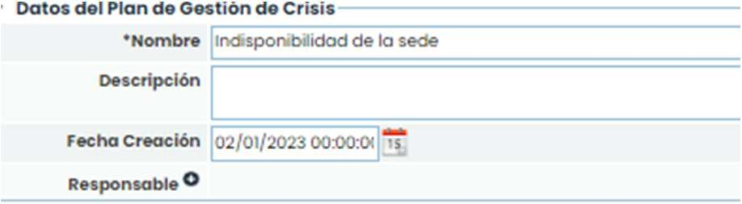

* **Niveles de Crisis:** Se elegirá que nivel de crisis podría generar la incidencia y se comprobarán los Impactos asociados.

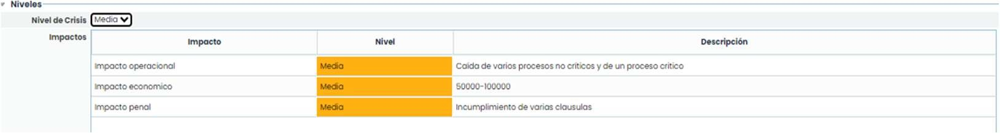

* **Escenarios**: Se podrá asociar Escenarios ya definidos en la opción de **Planes >** [**Escenarios de Crisis**](https://help.globalsuitesolutions.com/es/globalsuite/v1/escenarios-de-crisis). Para ello se pulsará sobre el botón “Asociar” y se elegirá el escenario relacionado. Además, se podrá ver las acciones de este escenario.

  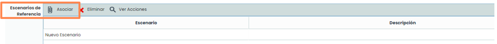
* **Asociar Servicios y Procesos**: Se podrá relacionar los servicios y procesos de la organización que pueden verse afectados por la incidencia. Seleccione uno de la lista de servicios y pulse el botón “**Añadir Servicio**”, posteriormente, seleccione el servicio en la tabla, busque un proceso y pulse el botón “**Añadir Proceso**”.

  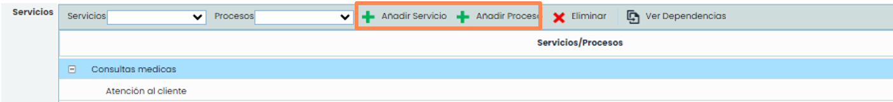
* **Infraestructuras**: Se podrá asociar Infraestructuras definidas en la opción de Inventario con dicha categoría.
* **Alertar**: Se pulsará este check para habilitar las alertas de GlobalSuite® mediante correo electrónico.
* **Comité**: Se relacionará con un comité de crisis creado en la parte de Inicio > Comités de Decisión. Se tendrá que elegir el comité de la lista desplegable y pulsar el botón “Guardar". A las personas de este comité le llegarán las notificaciones de activación del plan.

  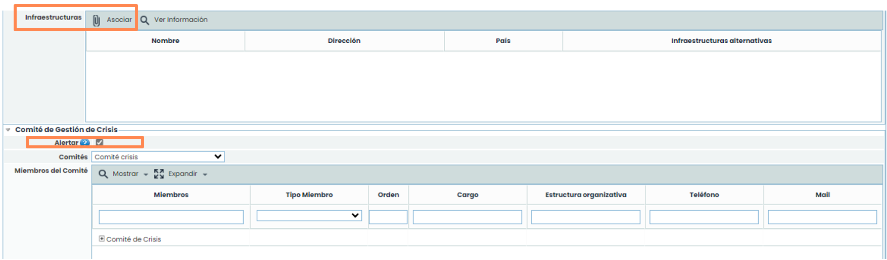
* **Criterios de Activación:** Se podrá asociar criterios para posteriormente poder identificar las incidencias de continuidad que cumplirían con estos criterios para poder activar los planes de gestión de crisis. Los criterios se podrán definir en **Ajustes >** [**Continuidad de Negocio**](https://help.globalsuitesolutions.com/es/globalsuite/v1/continuidad-de-negocio). Se elegirá una opción de la lista desplegable y se pulsará el botón añadir. Posteriormente realizando doble click en la celda **Valor** podrá cambiar el nivel de impacto. Si se registra una incidencia que cumpla con estas características, GlobalSuite® avisará que hay un plan de gestión de la crisis que coincide con los criterios de activación y podrá activarlos.

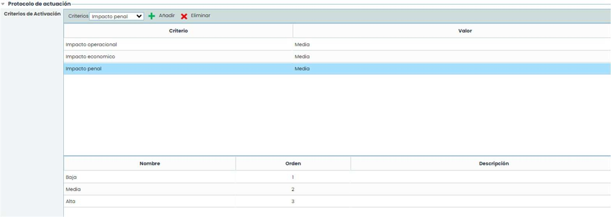

* **Elementos**: Podrá relacionar los Elementos definidos en la opción Análisis – Inventario. Para ello, se tiene que pulsar el botón “Asociar” y elegir desde donde se quiere asociar (árbol de dependencias o listado).
* **Objetivos**: Se podrá añadir los objetivos marcados para este plan de gestión de crisis.
* **Clientes**: Para asociar los clientes que pueden ver afectados, pulse el botón “**Nuevo**” en esta tabla, después podrá modificar la información, además si pulsa el cliente en la tabla y se pulsa el botón “**Nuevo Contacto**” se añade un nuevo contacto del cliente con información para ponerse en contacto con él.
* **Proveedores**: Se pueden asociar los proveedores que se pueden ver afectados. Estos proveedores están definidos en **Inicio >** [**Proveedores**](https://help.globalsuitesolutions.com/es/globalsuite/v1/proveedores). Al pulsar el botón “**Asociar**” se abrirá una ventana emergente.
* **Planes Interrelacionados**: Permite asignar los planes de continuidad que se utilizarán para tratar el incidente. Se selecciona el plan en la lista desplegable y se tiene que pulsar “**Añadir**”.

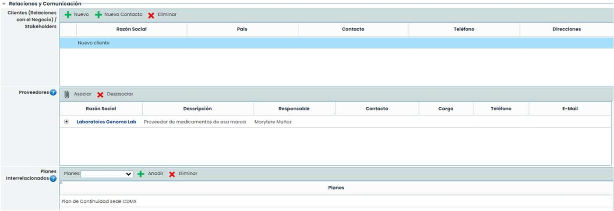

**Escalados**: En esta opción existen dos tablas, una para definir los planes de gestión de crisis en los que me puede derivar la incidencia en caso de agravarse. El botón “Asociar Planes” se abrirá una ventana con los otros planes de gestión de la crisis. Por otro lado, la tabla Convoca permite conocer que planes pueden escalar una crisis al plan de gestión actual.

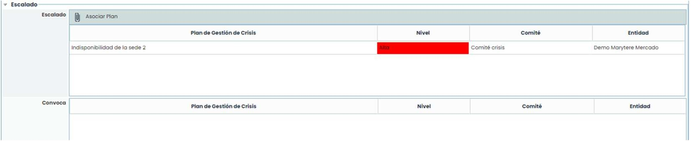

## Activación del Plan de Gestión de la Crisis

Para activar un Plan de Gestión de Crisis, existen dos opciones:

* **A través de una incidencia:** Al registrar la incidencia y los criterios de activación, se comprueba si existe un plan de gestión de crisis que cumpla con los requisitos, si es así, se puede activar desde la opción de Incidencias.


NOTA: En esta opción no se pueden simular los planes y se generaría una crisis “\*\*Real\*\*”. Se creará una nueva entrada en la tabla Gestión > [\*\*Gestión de la crisis\*\*](https://help.globalsuitesolutions.com/es/globalsuite/v1/gestion-de-la-crisis)\*\*.\*\*


* En la opción de planes de gestión de crisis. En la barra de herramientas hay dos botones “**Activar**” y “**Simular**”. Al pulsar en cualquiera de estos dos botones se crea una nueva entrada en la opción **Gestión >** [**Gestión de la crisis**](https://help.globalsuitesolutions.com/es/globalsuite/v1/gestion-de-la-crisis)**.**

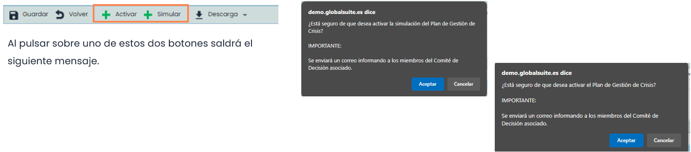
