# ¿Cómo importar datos en GlobalSuite®?


Este tutorial describe el uso del módulo \*\*Data Import\*\* de GlobalSuite®, que permite realizar \*\*cargas masivas de información\*\* en la plataforma mediante modelos Excel.
En la guía se explica el proceso de descarga del modelo, la carga del archivo, el \*\*mapeo de campos\*\*, la validación de datos y la revisión del \*\*informe de importación\*\*, así como su aplicación en distintos módulos del sistema.


## Fases para el proceso de importación

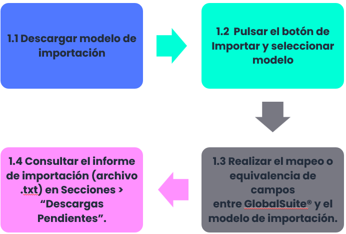

## Introducción

La licencia de GlobalSuite® Data Import permite realizar cargas de grandes volúmenes de datos en diferentes opciones de la herramienta GlobalSuite®. En función de lo que se tenga contratado, se dispondrá de más o menos opciones. Dentro de las opciones en las cuales se podrá contratar una licencia para cargas de datos masivos se encuentran: servicios, procesos, empleados, proveedores, inventario, gestión de controles, análisis de riesgos, y ticketing.

Si se tiene habilitada cierta licencia de importación para alguna de las opciones anteriormente mencionadas aparecerá en dicha opción **“Importar”**

## Descargar modelo

En la mayoría de las opciones de GlobalSuite® existe un modelo de importación, es decir, un fichero Excel que contiene todos los parámetros que se pueden importar en dicha opción y cuyos datos se podrán cargar de forma masiva. Estos modelos se obtienen a través del botón llamado Descarga.


Si no hay un modelo disponible, se deberá usar un archivo Excel en blanco y añadir manualmente los nombres de las columnas que se deseen.


Los modelos se generan en segundo plano, por tanto, para poder obtenerlos, tras la descarga es necesario ir a la opción de “Descargas”. Una vez descargado dicho modelo, se debe proceder a rellenar las columnas deseadas para posteriormente iniciar con la carga de datos. En diapositivas posteriores se mostrará los modelos de carga de cada una de las opciones de GlobalSuite®, así como las cargas de datos que permite realizar

## Importar y seleccionar modelo

Para hacer una importación o carga de datos, se pulsa el botón de **Importar** en la opción de GlobalSuite® deseada, después se deberá pulsar el botón Elegir el archivo para seleccionar el modelo previamente descargado y llenado. Una vez realizado lo anterior se pulsará en el botón Continuar.

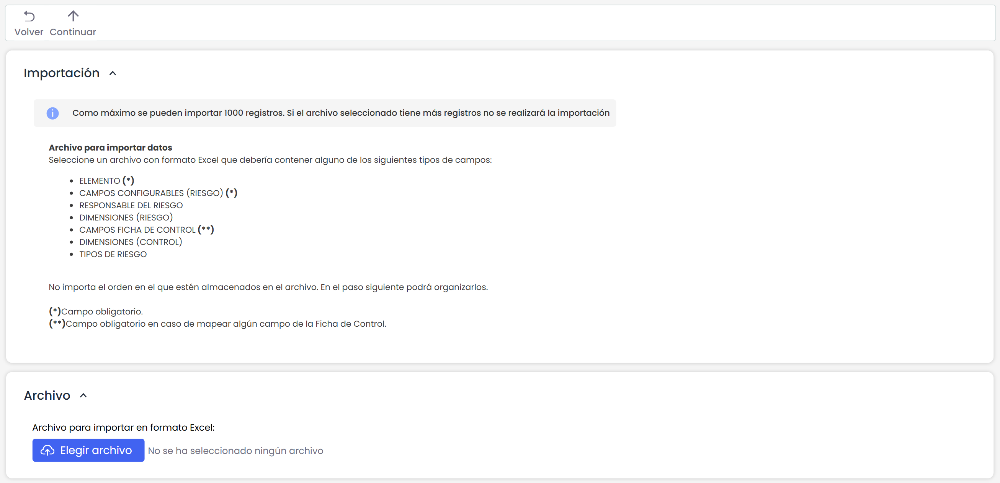


\*\*NOTA\*\*: Las columnas obligatorias estarán marcadas con un asterisco (\\*).



Se ha de tener en cuenta que solo se pueden realizar cargas de un máximo 1.000 registros (filas de Excel) por cada importación que se realice. Por tanto, si se desea importar 3.500 registros, será necesario preparar 4 modelos de importación (p.ej.: 3 de mil registros y 1 de 500). Este aviso siempre se muestra antes de que se suba el archivo de importación a la plataforma.


## Mapeo o equivalencia

**MUY IMPORTANTE!**

Durante el mapeo se realiza la siguiente pregunta:

Por defecto viene marcada la decisión de **Mantener**, lo que permite añadir nuevos registros conservando la información que existe actualmente en la opción donde se esté realizando la importación o carga de datos. Si el objetivo es actualizar registros existentes, se conservarán los que no estén incluidos en el modelo. Si se selecciona la casilla de **Eliminar**, se borrarán todos los datos que hay actualmente y solo se grabarán los que existan en el modelo de importación (archivo Excel).


Existen opciones que sólo permiten añadir y/o actualizar registros, pero no eliminarlos a través de la importación.


Por último, será necesario realizar un mapeo o una equivalencia de campos entre GlobalSuite® y el archivo de carga. Si los nombres de las columnas del modelo coinciden con los nombres de las dimensiones de la opción de GlobalSuite® en la que se desea hacer la carga, el mapeo se hará automáticamente, tal y como se indica en el mensaje recalcado en amarillo. Pulsando en las celdas blancas de la derecha, se desplegará un listado con las columnas del archivo anteriormente cargado, esto para que se pueda modificar la equivalencia a criterio propio. Por último, se deberá pulsar el botón **Importar**.

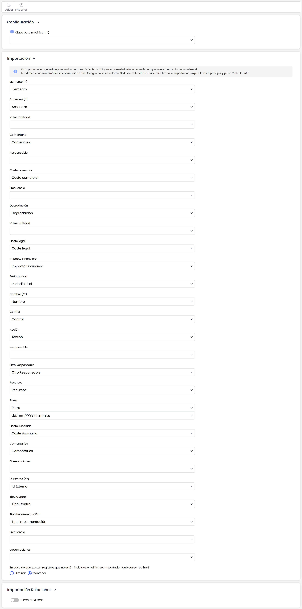

## Informe de importación

Cuando finalice la importación, se generará automáticamente un informe en **Descargas**, accesible desde el [**menú de usuario**](https://help.globalsuitesolutions.com/es/globalsuite/v1/area-de-usuario)

Este informe incluye información sobre:

* Los errores que haya podido haber en los datos introducidos en el modelo.
* Los campos que no hayan sido informados o cuyo valor sea erróneo.
* El número de registros importados.
* El número de registros modificados (solo en las opciones que disponen de esta función)

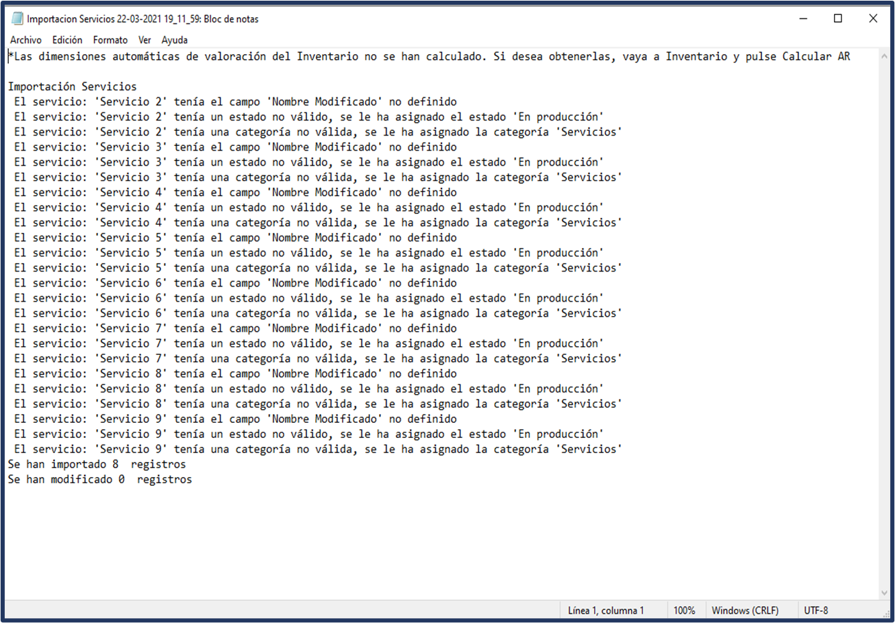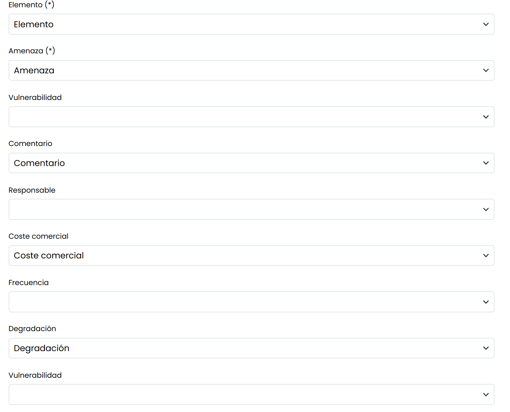

En el modelo de importación es importante prestar atención al formato y a los valores introducidos para que la carga se realice correctamente:

* Siempre que se complete un campo de tipo fecha, el formato de la celda deberá cambiarse a texto y para introducir el valor se deberá revisar que los campos de fecha del modelo de importación sean los mismos con respecto al formulario de importación. Regularmente en cada formulario de importación al contiguo del campo de fecha se encuentra un campo desplegable que nos permite modificar el formato para que este sea el mismo que en el modelo.

* Campos desplegables: los valores de los campos del modelo deberán corresponder con total exactitud (tildes, espacios, signos de puntuación) con las opciones que aparecen en GlobalSuite®
* Los campos que no se quieran cargar o actualizar se deben dejar el blanco en el modelo de importación y a su vez será necesario dejar vacío su mapeo, con el objetivo de no borrar el dato que ya esté cargado previamente en GlobalSuite®, en caso de que lo hubiese. Si se deja en blanco un campo en el modelo y no se quita el mapeo a la hora de realizar la carga, se borra el contenido en Globalsuite.

* En algunas opciones de GlobalSuite® como[**Inventario**](https://help.globalsuitesolutions.com/es/globalsuite/v1/inventario)**,** [**Controles**](https://help.globalsuitesolutions.com/es/globalsuite/v1/gestion-de-controles) **o** [**Análisis de Riesgos**](https://help.globalsuitesolutions.com/es/globalsuite/v1/analisis-riesgos) hay dimensiones manuales y automáticas (ver metodologías). Únicamente se pueden importar las dimensiones manuales. Siempre que haya una dimensión automática, será necesario lanzar el proceso de Calcular AR tras haber importado el modelo.

  
* Cuando se copien datos de otro Excel al modelo de importación, será imprescindible utilizar la opción de pegar valores para evitar que se copien metadatos en el modelo, ya que esto puede resultar en una importación fallida.

## Detalle de las importaciones

Como ya se ha mencionado anteriormente la licencia de GlobalSuite® Data Import permite realizar cargas masivas de grandes volúmenes de datos en diferentes opciones dentro de la propia herramienta, dentro de estas opciones se encuentran: **servicios, procesos, empleados, proveedores, inventario, gestión de controles, análisis de riesgos, y ticketing.**

A continuación, se mostrará el detalle de las importaciones de cada una de las opciones antes mencionadas.

### Servicios

Tras realizar la descarga del modelo de importación en la opción de **Inicio >** [**Catálogo de Servicios**](https://help.globalsuitesolutions.com/es/globalsuite/v1/catalogo-de-servicios) y al abrir dicho modelo se observará lo siguiente:

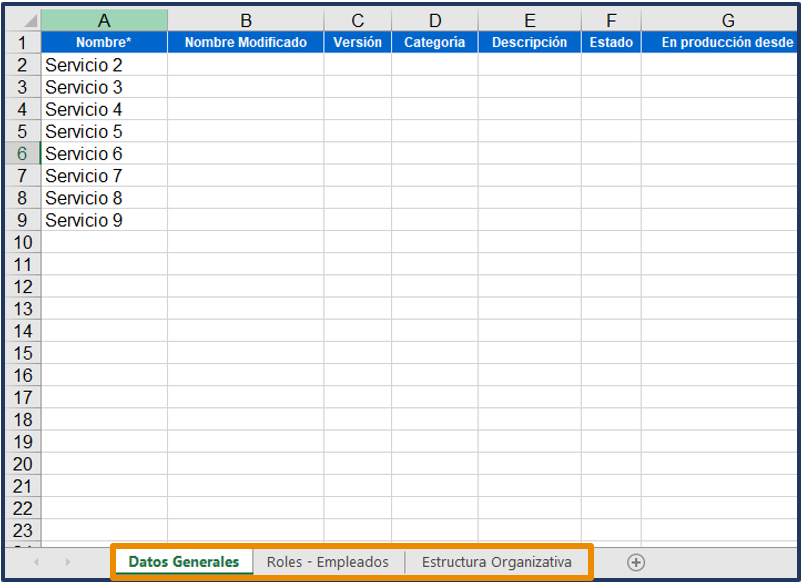

Dentro de la pestaña de **Datos Generales del modelo** sepermitirá añadir registros y también modificar el **Nombre\*** de los existentes si se completa la columna **Nombre Modificado,** además, si no se completan las columnas de **Categoría y Estado** la herramienta añadirá por defecto los valores de **Servicios y En producción.**

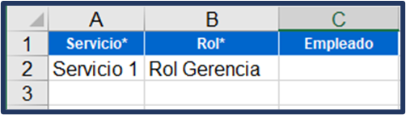

La pestaña **de Roles - Empleados** servirá para vincular los roles y empleados dados de alta en la herramienta. En ningún caso modificará o eliminará los valores existentes.

En la pestaña de **Estructura Organizativa** se podrá vincular las partes de la estructura que ya esté dada de alta dentro de GlobalSuite®. En ningún caso modificará o eliminará los valores existentes.

Posteriormente, dentro de la herramienta GlobalSuite® en la pantalla de mapeo, se podrán seleccionar las pestañas del modelo que se deseen importar. Por defecto, siempre se cargará la de **Datos Generales**. Si se desea añadir **Roles/Empleados** o vincular partes de la **Estructura Organizativa**, se ha de marcar la casilla correspondiente dentro de la opción **Importación Relaciones**.

En caso de no actualizar ni añadir Servicios, se deberán dejar sus correspondientes campos en blanco. Este último caso podría ocurrir solo si se quiere añadir **Roles/Empleados** o partes de la **Estructura Organizativa**.

Por último, para concluir se deberá pulsar el botón de **Importar.**

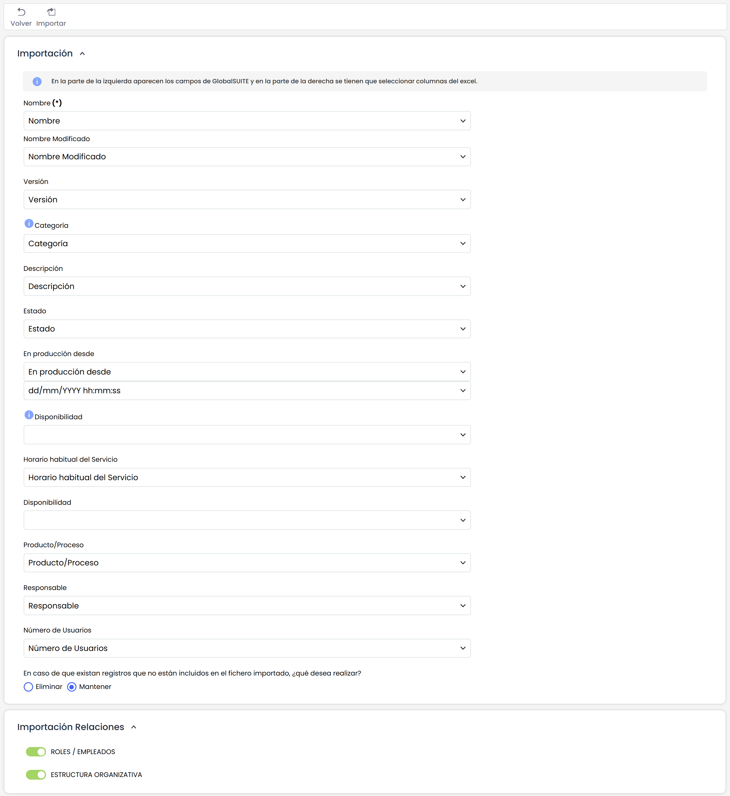

### Procesos

La importación en la opción de **Inicio >** [**Procesos**](https://help.globalsuitesolutions.com/es/globalsuite/v1/procesos) permite añadir nuevos registros y modificar los existentes excepto el campo **Nombre\*** en la pestaña de **Datos Generales**. Las demás pestañas del modelo permiten añadir, pero no modificar. Por ejemplo, las Dependencias desactualizadas deben eliminarse a mano desde el Árbol de Procesos.

En la pestaña de Dependencias es donde se indica la carga del Árbol de Procesos. Es necesario indicar siempre el Servicio o Proceso del que va a depender otro Proceso. Los Servicios no pueden depender de Procesos ni de otros Servicios. Si no se trabaja con grados de dependencia, en la última columna se deberá poner Totalmente dependiente.

En las demás pestañas del modelo de importación siempre se debe rellenar la columna de Proceso y los datos que se quiera importar, se debe recordar que las columnas que vienen marcadas con  asterisco(\*) son obligatorias.

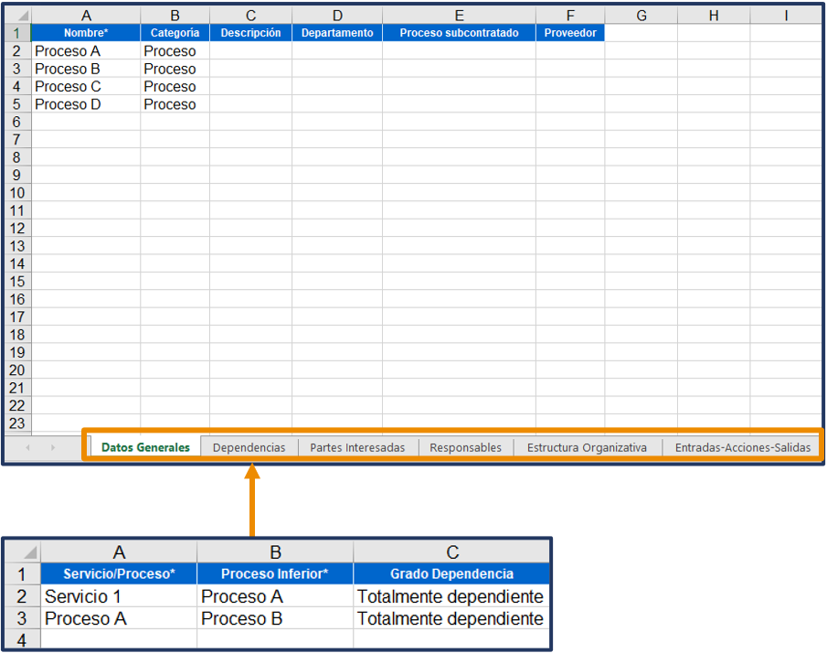

Posteriormente, dentro de la herramienta GlobalSuite® en la pantalla de mapeo se podrán marcar las pestañas del modelo que se desean importar. Por defecto, siempre se cargará la de **Datos Generales**. Si se van a **importar relaciones**, se han de marcar las casillas deseadas. En caso de no actualizar ni añadir Procesos y solo importar relaciones, se debería dejar en blanco todo el mapeo. Por último, para concluir se deberá pulsar el botón de **Importar**.

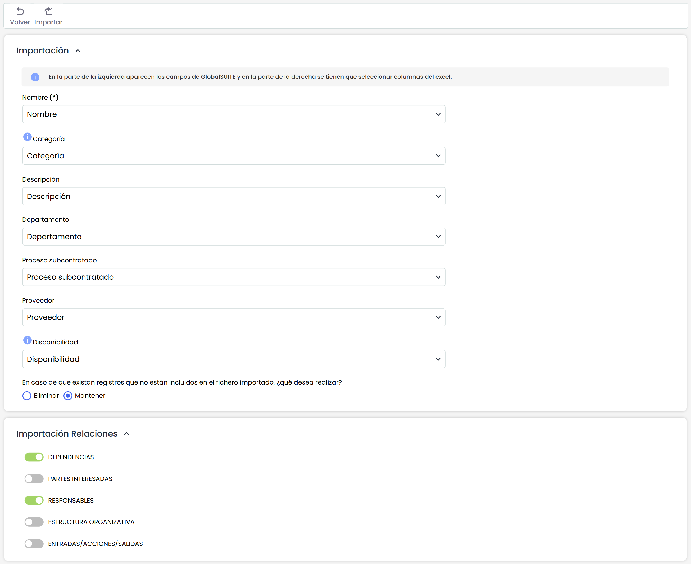

### Empleados

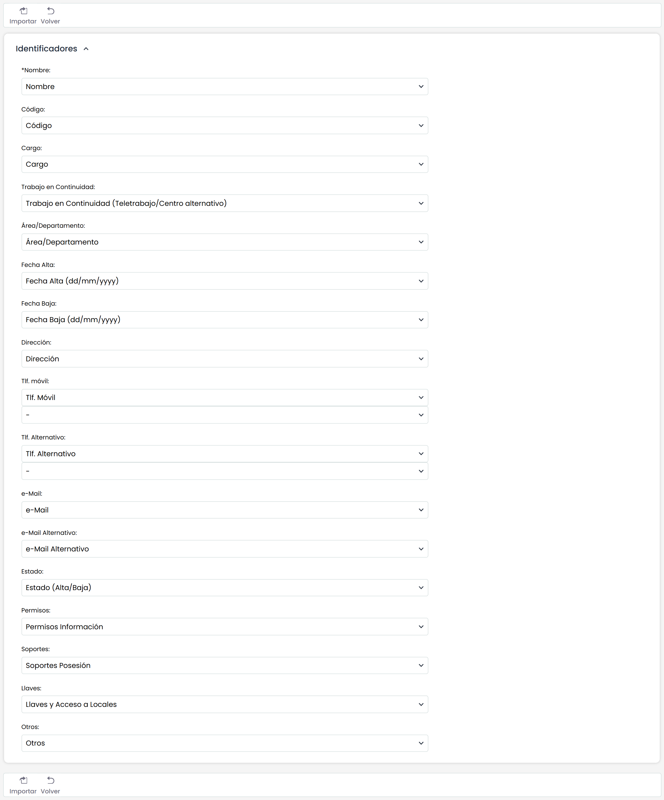

En la opción de **Gestión >** [**Empleados**](https://help.globalsuitesolutions.com/es/globalsuite/v1/empleados) también existe la posibilidad de hacer cargas masivas de datos. El modelo de importación para la opción **Empleados** se descarga directamente en el navegador y no en segundo plano en la opción **Descargas** del menú de Usuario

Pendientes como se vio en anteriores opciones.

A la hora de hacer el mapeo siempre habrá que indicar la equivalencia entre campos, ya que no vendrán por defecto, además como en todas las demás opciones se podrá elegir solo los campos que se deseen cargar.

En este mapeo solo se permite añadir registros, la eliminación se debe realizar directamente desde la opción de Empleados, esto debido a que no existe la opción de editar a través del modelo.

En los identificadores Tif. Móvil y Tif. Alternativo existen desplegables contiguos en donde se puede indicar el tipo de: ya sea fijo o móvil, y si se tuviesen más categorías estás también aparecerán en el desplegable. Por último, para concluir se deberá pulsar el botón de Importar.

### Proveedores

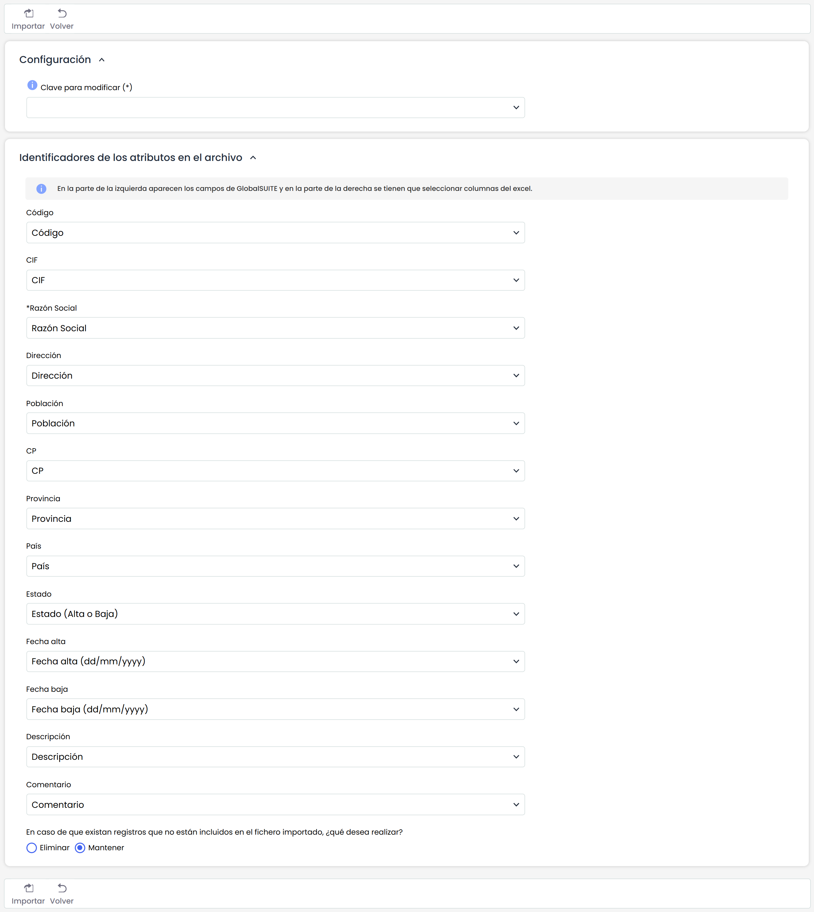

En la opción de **Inicio >** [**Proveedores**](https://help.globalsuitesolutions.com/es/globalsuite/v1/proveedores), el modelo para importar también se hará directamente desde el navegador y no en segundo plano.

De la misma forma a la hora de realizar el mapeo siempre habrá que indicar la equivalencia entre campos, ya que no vendrán por defecto, además como en todas las demás opciones se podrá elegir solo los campos que se deseen cargar.

En este mapeo solo se permite añadir registros, la eliminación se debe realizar manualmente desde la opción de **Proveedores**, esto debido a que no existe la opción de editar a través del modelo.

### Inventario

La importación en la opción de **Análisis >** [**Inventario**](https://help.globalsuitesolutions.com/es/globalsuite/v1/inventario) permite añadir registros y modificar los existentes incluido el campo **Nombre**\* (a través de Nombre **Modificado**) en la pestaña de **Datos**.

La pestaña de **Dependencias** permite añadir, pero no modificar. Por ejemplo, las Dependencias desactualizadas deberán eliminarse de forma manual desde el **Árbol de Elementos**.

En la pestaña de **Dependencias** es donde se indica la carga del **Árbol de Elementos**. Es necesario indicar siempre el Servicio/Proceso/Elemento del que va a depender otro Elemento. Los Servicios y los Procesos no se pueden relacionar entre sí desde esta opción. Si no se trabaja con grados de dependencia, en la última columna se deberá poner Totalmente dependiente.

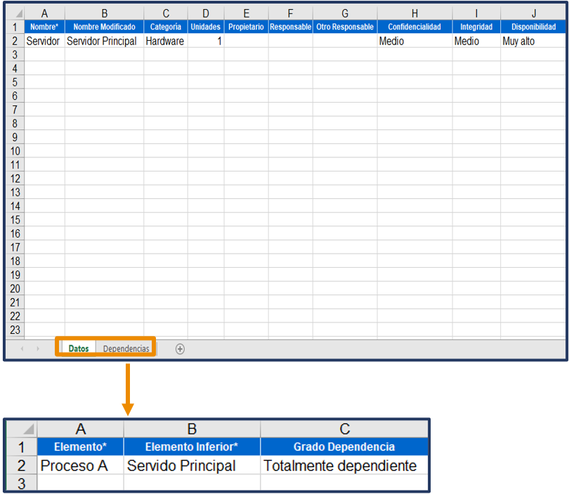

Una vez dentro de la pantalla de mapeo se podrá marcar la casilla de **Dependencias** si se desea cargar ya que, por defecto, siempre se cargará la de **Datos**. En caso de no actualizar ni añadir elementos y solo importar dependencias, se deberá dejar en blanco todo el mapeo, a excepción del campo **Nombre**.

Por último, para concluir se deberá pulsar el botón de **Importar**.

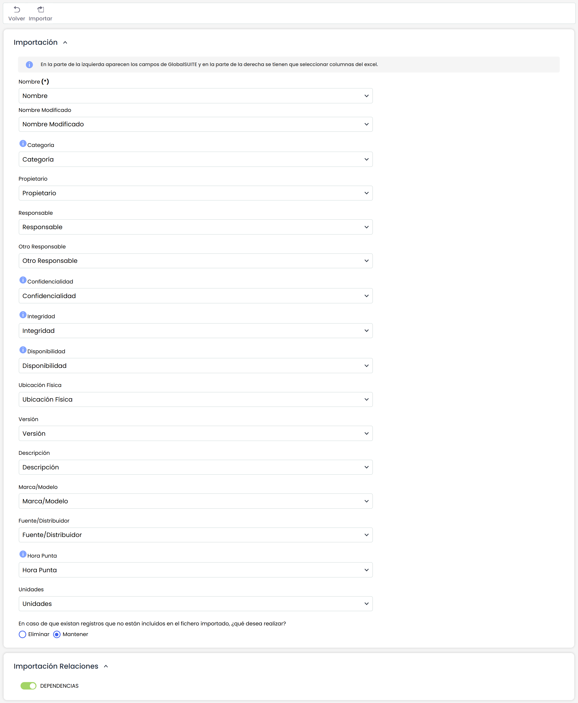

### Gestión de Controles

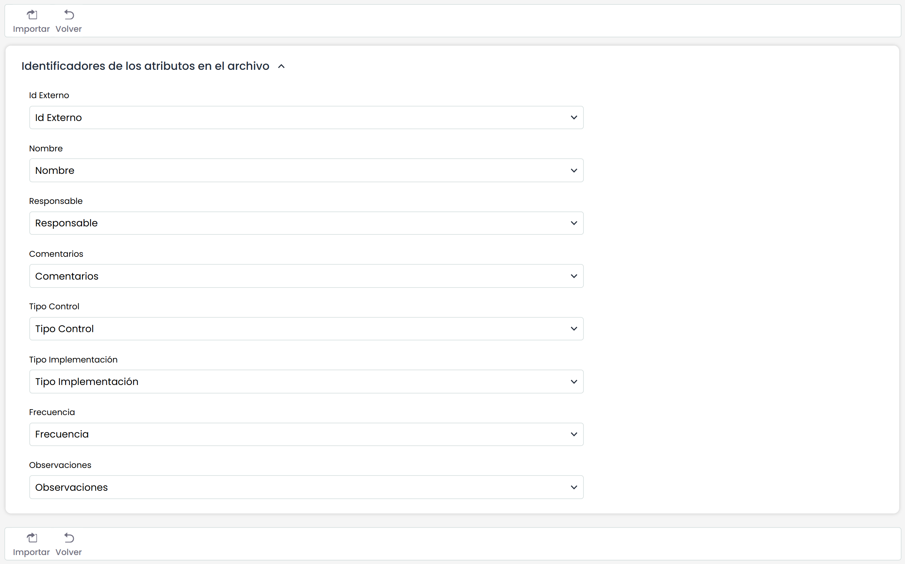

La importación en la opción de **Análisis >** [**Gestión de Controles**](https://help.globalsuitesolutions.com/es/globalsuite/v1/gestion-de-controles) permite añadir registros y modificar los existentes, a excepción del campo **Nombre**.

Es importante destacar que no existe un modelo de importación de controles, por tanto, se recomienda descargar el Informe Excel disponible en el botón **Descarga** para que pueda ser utilizado a modo de plantilla.

A la hora de hacer el mapeo siempre habrá que indicar la equivalencia entre campos, ya que no vendrán por defecto, además como en todas las demás opciones se podrá elegir solo los campos que se deseen cargar.

Por último, para concluir se deberá pulsar el botón de **Importar**.

**¡MUY IMPORTANTE!**

Todos los controles que se carguen deberán contar un **Id Externo**, es decir, un valor numérico que los identifique y diferencie. Este id se deberá asignar a cada control en el archivo Excel que se vaya a cargar, para ello se deberá que crear una columna adicional o usar la columna del propio **Id Externo** en caso de utilizar el Informe Excel de la opción.

En caso de que ya se tuviesen controles creados de forma manual dentro de la herramienta, también será necesario añadirles un **Id externo** por si en un futuro se requiriere hacer una actualización masiva de todos los controles de un análisis.

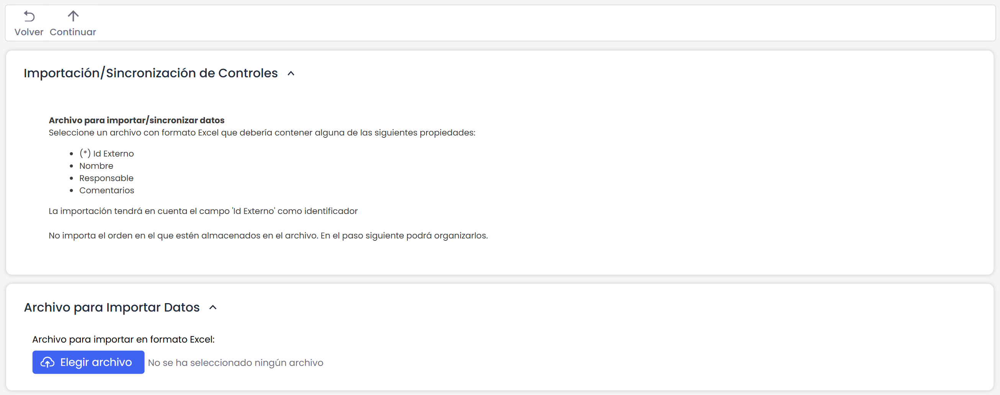

### Análisis de Riesgos

La importación en la opción de **Análisis >** [**Análisis de Riesgos**](https://help.globalsuitesolutions.com/es/globalsuite/v1/analisis-riesgos)permite añadir registros y modificar los existentes a excepción de la columna **Riesgo** de la pestaña de **Datos** del modelo. La pestaña de **Configuración** permite ver los posibles valores a seleccionar en las dimensiones manuales de la metodología de riesgos.

El modelo se divide en dos secciones:

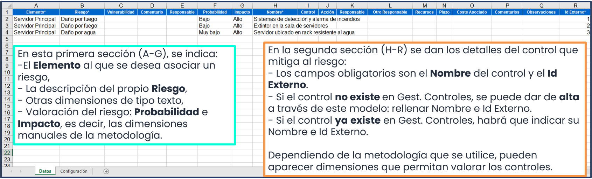

En el modelo deben existir **tantas filas como controles** haya asociados a los **riesgos** de todos los **elementos** que se quiera importar al **Análisis de Riesgos**. Se debe recordar que cada importación permite un máximo de 1.000 registros.

En la siguiente imagen se puede apreciar que al **elemento** Servidor Principal se han asociado dos **riesgos**: daños por fuego y daños por agua. Para el primer riesgo se tiene 2 **controles** y por tanto el riesgo con su valoración aparecen duplicados y para el segundo riesgo, solo se cuenta con un control por lo que aparece únicamente el propio riesgo con su valoración.

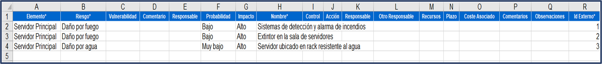

Dentro de la herramienta GlobalSuite® en la pantalla de mapeo se deberá seleccionar una **Clave para modificar**, que será el campo de referencia que se utilice para identificar los riesgos cuyas valoraciones o campos descriptivos se quieran actualizar (la dimensión riesgo no se puede actualizar). Normalmente se recomienda que la clave sea el campo **Amenaza**.

Por último, se pulsa el botón **Importar** para llevar a cabo la carga.

Tras realizar la carga del archivo o archivos, será necesario lanzar el proceso **Calcular AR** para que se calculen los valores de las dimensiones automáticas.

### Ticketing

Para acceder a la importación de los formularios de **ticketing** se deberá de ingresar a pestaña de **Gestión** , una vez estando ahí se ha de seleccionar el tipo de ticketing al que se desee acceder para iniciar el proceso de la data import. Esto se e realizará de la misma forma para todos los formularios, lo único que varía es el modelo de importación, es decir, los campos que contiene cada uno. Por ello siempre se debe descargar el modelo desde la opción de **ticketing** en la que se quiere realizar la importación.

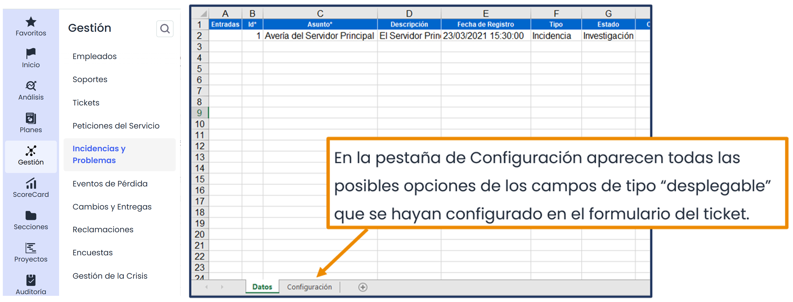

Para una correcta importación de tickets es imprescindible tener en cuenta 3 factores muy importantes:

* El punto y coma (;) se usa como separador, por ejemplo, cuando en el formulario se vincula con varios Servicios o Procesos. En la celda correspondiente será necesario indicarlo de la siguiente forma: Servicio 1;Servicio 2
* Las fechas siempre deben tener el formato indicado en el punto 1.5. A tener en cuenta de esta guía.
* Todos los seguimientos de un ticket deben registrarse en la misma celda y separarse por la cadena $$. Además, como cada seguimiento se compone de 3 diferentes campos (usuario, fecha y descripción), estos deberán separarse por la secuencia ||. No deben existir espacios por delante ni por detrás de $$ o ||. La fecha de los seguimientos debe tener el mismo formato indicado en el punto anterior. Por ejemplo: juan.perez||20/03/2021 10:00:00||Descripción del primer seguimiento$$juan.perez||23/03/2021 18:45:00||Descripción del segundo seguimiento.

En la pantalla de mapeo se debe seleccionar una **Clave para modificar**, que será el campo de referencia que se utilice para identificar los riesgos cuyas valoraciones o campos descriptivos se quieran actualizar. No se recomienda modificar el formato de los campos de tipo fecha. Al lado de los campos de mapeo aparecen indicaciones importantes, es recomendable leerlas antes de realizar la carga por si es necesario modificar el modelo. Por último, se pulsa el botón **Importar** para llevar a cabo la carga.

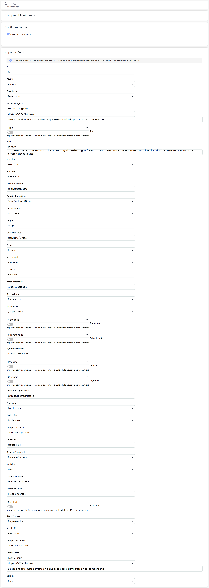
