# Cómo configurar encuestas de riesgos-controles en GlobalSuite®


Este tutorial explica, paso a paso, cómo crear y configurar las \*\*encuestas de riesgos-controles\*\* en GlobalSuite®.
En esta guía se describen las fases correspondientes al \*\*modelo de encuestas\*\* y a la \*\*configuración de encuestas de riesgos-controles\*\*, incluyendo la selección de metodologías, la \*\*definición de dimensiones visibles, editables u obligatorias\*\*, y la incorporación de \*\*documentos adjuntos de apoyo\*\*. También se detalla el proceso de \*\*asociación de elementos y controles\*\* desde el análisis de riesgos y la configuración final para su publicación


## Fases para la realización de Encuestas de Riesgos-Controles

En esta guía se explicarán fases 1 y 2 del transcurso de creación de una encuesta

## Modelos de Encuestas

GlobalSuite® permite identificar y clasificar el inventario de elementos, realizar el análisis de riesgos y evaluar los controles de la organización a través de encuestas enviadas a los distintos responsables de la organización. Para ello, en primer lugar, se debe crear el modelo de encuesta que se desea mandar. Se permite crear varios modelos y, además, se pueden configurar para poder adaptarlos a las necesidades de la organización.

Para ello, cada modelo de encuesta puede ser configurado indicando el tipo de la misma. Existen tres tipos de encuestas que se pueden considerar al crear un modelo:

* **Encuesta de Elementos**: Permite la identificación de los elementos, categorización de los mismos y su clasificación.
* **Encuesta de Riesgos**: Permite la identificación de los riesgos de cada elemento (incluidos servicios y procesos) así como la evaluación de los mismos según la metodología de la organización.
* **Encuesta de Controles**: Permite la identificación de los controles implantados en la organización así como su evaluación de madurez según la metodología correspondiente.

En esta guía se va a explicar el funcionamiento del tipo “Encuesta Riesgos-Controles”.

Para configurar un modelo de encuesta debe ser un usuario Administrador (Administrador Plataforma, Administrador Enterprise o Administrador Configuración), ya que se encuentra en el apartado **Ajustes>** [**Modelos Encuestas**](https://help.globalsuitesolutions.com/es/globalsuite/v1/modelo-encuesta-elementos-riesgos-y-controles).

En la opción se debe elegir qué tipo de modelo de encuesta se quiere crear en el botón “**Nueva Encuesta**” (en este caso, el tipo “**Elementos, Riesgos y Controles**”). Además, en esta opción se podrán eliminar modelos (botón “**Eliminar**”) y descargar un listado de los modelos configurados (botón “**Descarga**”).

En la última columna mostrará los modelos que están habilitados. Sólo se podrán crear encuestas de los modelos habilitados.

Dentro del modelo de encuesta se permite configurar aspectos como el nombre, el departamento o la fecha de creación, así como indicar si se requiere que el modelo esté habilitado para su utilización y si se quiere “Consolidar en último estado”, es decir, que desde el último estado del flujo se pueda consolidar directamente los datos de la encuesta en el análisis definitivo.

También es posible utilizar estados en la encuesta, la utilización de estos estados permite que diferentes personas puedan rellenar o validar información introducida en estado anteriores. Se podrá pasar de un estado a otro de forma automática si se marca el indicador (check automático) y también se podría pasar a un estado anterior de la misma manera, marcando el indicador correspondiente (check vuelta atrás).

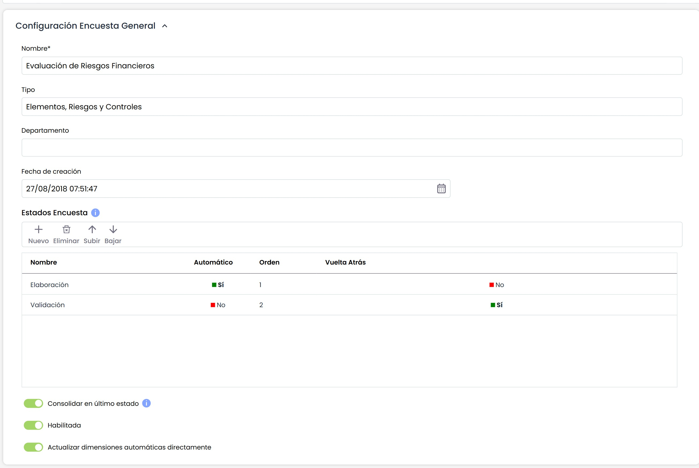

En la sección “Tipo de Encuesta” se debe elegir qué tipo de modelo se quiere crear.

En esta caso, el tipo de encuesta seleccionada es la más completa ya que contiene las tres combinaciones: Elementos, Riesgos y Controles.

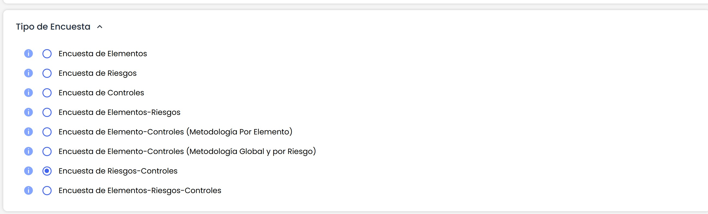

A continuación se visualizan dos secciones que permiten su configuración.

En primer lugar, se muestra la sección “Configuración Adicional”, donde se puede elegir qué opciones se quieren incluir en la encuesta:

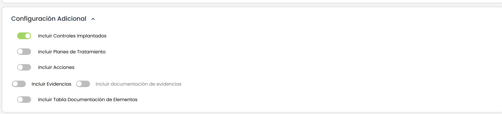

Por defecto viene marcado controles implantados para que en la encuesta se muestren este tipo de controles.

Para poder desmarcar este tipo de control, hay que marcar otro tipo, por ello, únicamente se podrá desmarcar cuando se marque también la opción de los planes de tratamiento, que son controles que están en proceso de estudio y mejora y aún no se han implantado.

Cuando se marcan los planes de tratamiento por defecto se marcan también las acciones, no es posible marcar planes de tratamiento sin acciones.

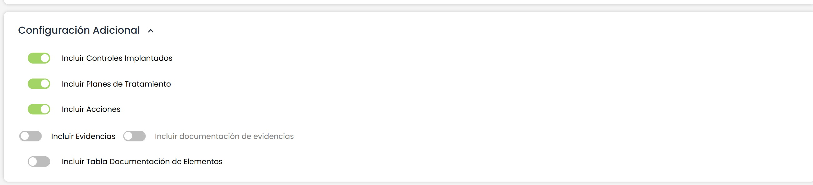

Se pueden incluir también acciones para los controles implantados y evidencias en la encuesta tanto para controles implantados como para planes de tratamiento.

De esta forma cuando se esté completando la encuesta y se esté valorando un control, o se cree uno nuevo, se pueda indicar las acciones de dicho control y anexar las evidencias del mismo.

En segundo lugar, la sección “**Taxonomía**” (Tipos / Agrupación de Riesgos), donde se puede seleccionar su configuración. Se puede seleccionar si se quiere que sea visible y editable en la encuesta. También es posible indicar en qué orden se quiere visualizar.

En las siguientes secciones, se muestra la configuración específica para Riesgos y Controles.

En la sección “**Encuesta de Riesgos**”, en primer lugar, se debe seleccionar qué metodología de riesgos se quiere utilizar en la encuesta. Una vez seleccionada, se muestran las dimensiones configuradas en al metodología de riesgos indicando el tipo de dimensión y si ésta es manual o automática. El usuario puede configurar las siguientes opciones de cada dimensión:

* **Visible**: permite definir si la dimensión se incluirá en la encuesta o no, pulsando sobre la celda.
* **Editable**: indica si la dimensión se podrá modificar en la encuesta, o sólo será visible en modo consulta.
* **Obligatoria**: indica la obligatoriedad de rellenar una dimensión al pasar de estado, en el caso de que se usen encuestas con estados.
* **Pregunta**: en el caso de encuestas de tipo "Formulario" (se verá más adelante), permite mostrar una pregunta explicativa, en lugar de únicamente el nombre de la dimensión.

  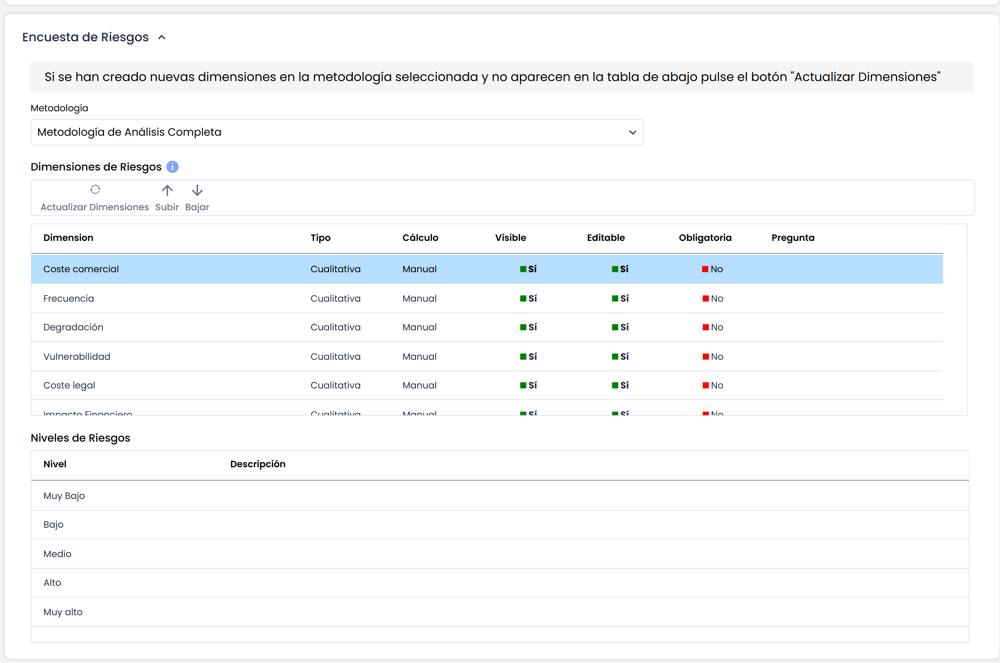

Al seleccionar una dimensión, en la tabla inferior (“Niveles de Riesgos”) se muestran a título informativo los niveles que tiene configurados en Ajustes.

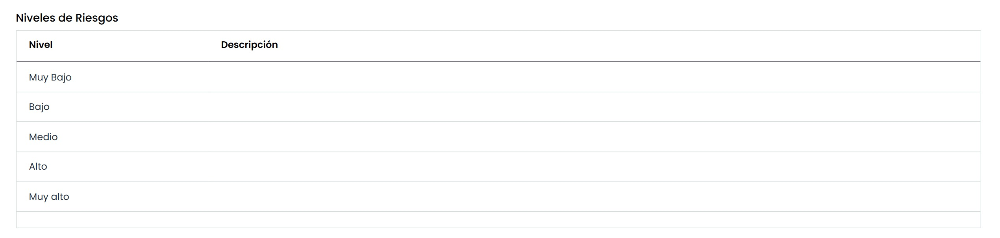

Si se selecciona una dimensión, se permite cambiar el orden en el que va a aparecer, utilizando los botones “Subir” y “Bajar” se puede posicionar en el lugar deseado.

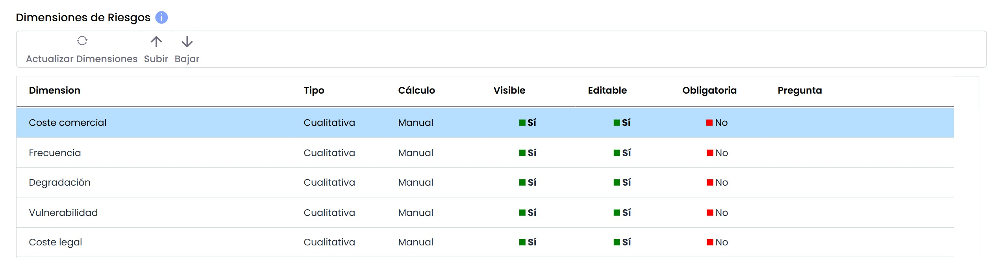

Con el botón “Actualizar Dimensiones”, tal y como indica el mensaje en amarillo, se actualiza el listado de las dimensiones de la metodología de riesgos por si se hubieran añadido nuevas dimensiones después de la creación del modelo.

Los ajustes sobre las dimensiones anteriores que ya existían se conservan, únicamente aparecen las nuevas dimensiones que se hayan creado en la metodología de riesgos para poder ser incluidas en la encuesta.

Por último, en la sección “Encuesta de Controles, ya viene marcada la metodología de controles asociada a la metodología de riesgos que se ha seleccionado en la sección anterior.

Al seleccionar la metodología se muestran las dimensiones configuradas en la misma, al igual que en la secciones de riesgos.

Con el botón “**Actualizar Dimensiones**”, tal y como indica el mensaje en amarillo, se actualiza el listado de las dimensiones de la metodología de controles por si se hubieran añadido nuevas dimensiones después de la creación del modelo.

Los ajustes sobre las dimensiones anteriores que ya existían se conservan, únicamente aparecen las nuevas dimensiones que se hayan creado en la metodología de controles para poder ser incluidas en la encuesta

En la sección “**Adjuntos**” se podrá adjuntar a la encuesta los archivos necesarios para que el receptor de la misma pueda consultar.

Las opciones disponibles son:

* **Seleccionar archivo**: permite buscar y seleccionar un fichero de nuestro explorador de archivos.
* **Adjuntar**: permite subir el archivo seleccionado.
* **Eliminar**: permite eliminar un archivo seleccionado en la tabla “Documentación Asociada”.
* **Descargar**: permite descargar el archivo seleccionado en la tabla “Documentación Asociada”.
* **Visualizar**: permite visualizar desde el navegador, el archivo seleccionado en la tabla “Documentación Asociada”. Únicamente es posible visualizar archivos con la extensión .pdf, .jpeg, .jpg, .bmp o .png.

## Configuración de Encuestas

Una vez configurado el modelo de encuesta, éste se puede utilizar para configurar tantas encuestas como se requiera. Para ello, hay que dirigirse a la opción **Gestión>** [**Encuestas**](https://help.globalsuitesolutions.com/es/globalsuite/v1/configurar-encuestas)

Para crear la configuración de una encuesta se debe filtrar por el tipo de encuesta y posteriormente elegir el modelo deseado.

Al pulsar el botón “**Nuevo**” se creará una encuesta del tipo y modelo elegido. Si desea eliminar la configuración de una encuesta tiene que pulsar el botón “**Eliminar**”. Hay que tener en cuenta que si se elimina una Configuración, todas las encuestas creadas a partir de esta Configuración también se eliminarán.

También se permite descargar el listado de configuraciones de encuestas tanto en formato Excel como pdf.

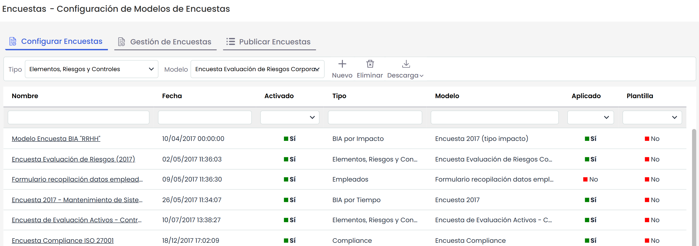

Al acceder a la configuración de la encuesta aparecen un conjunto de secciones que permiten su configuración.

En la primera sección, “Datos Generales Configuración”, se puede identificar el nombre de la configuración, visualizar el tipo y modelo de encuesta, cambiar la fecha y también permite activar o no el check “**Habilitado”** que permite indicar si la Configuración puede utilizarse para generar nuevas encuestas.

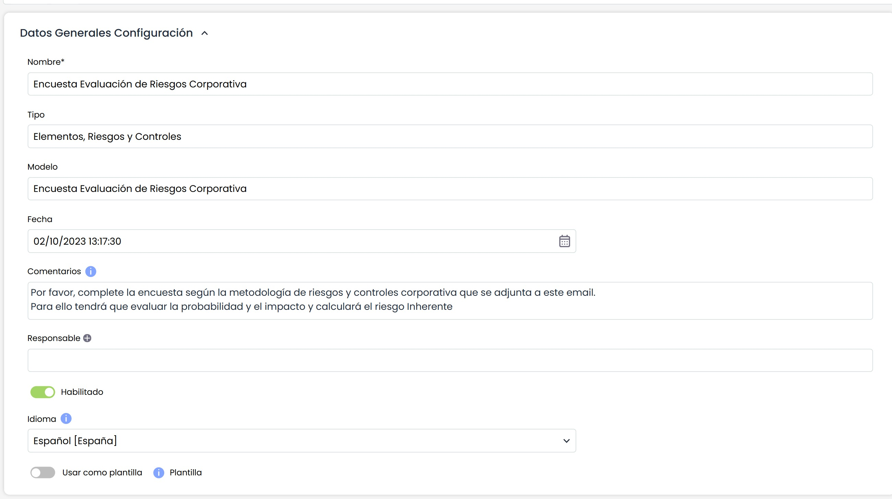

Si en el modelado se han incluido estados (Workflow), entonces en la configuración aparece también la sección de “Estados” para poder asignar un responsable a cada estado:

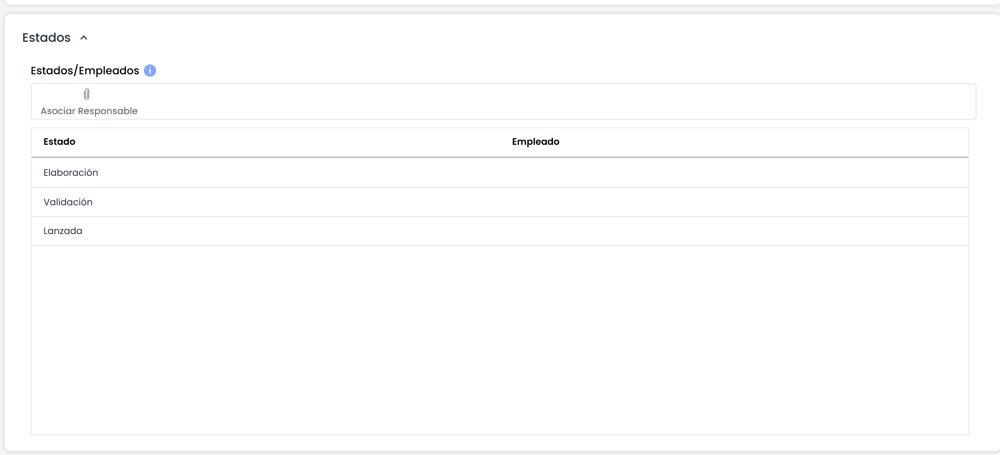

En la sección “**Configuración Riesgos**”, aparece la información relacionada con el tipo de encuesta seleccionada (Riesgos y Controles).

A continuación, se debe seleccionar sobre qué análisis de riesgos se quiere realizar la encuesta. El listado de análisis de riesgos contiene aquellos análisis de GlobalSuite® que se encuentran configurados con la misma metodología que tiene asociado el modelo de encuesta. Al seleccionar el análisis de riesgos aparece en la parte inferior el o los catálogos de riesgos asociados de manera informativa.

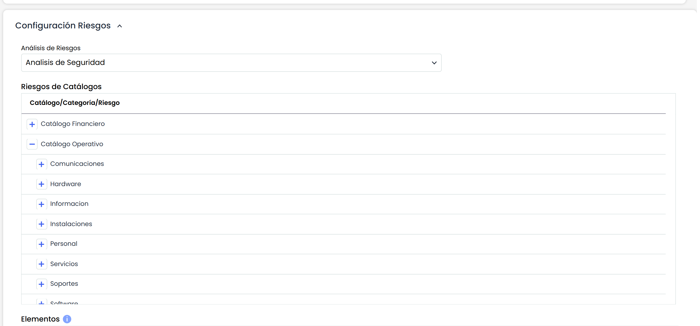

Otro aspecto que se debe configurar es la selección de los Elementos que se desean incorporar, de forma que el usuario que recibe la encuesta únicamente pueda valorar los elementos asignados (además de aquellos que añada como nuevos elementos).

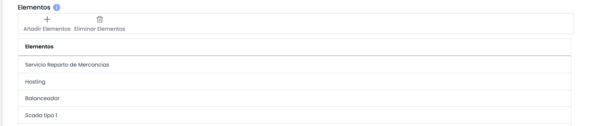

Al pulsar el botón “**Añadir Elementos**”, se abre una ventana emergente con todos los elementos que forman parte del inventario de elementos. Se pueden utilizar filtros, bien por el nombre del elemento o por la categoría como se muestra en la siguiente imagen:

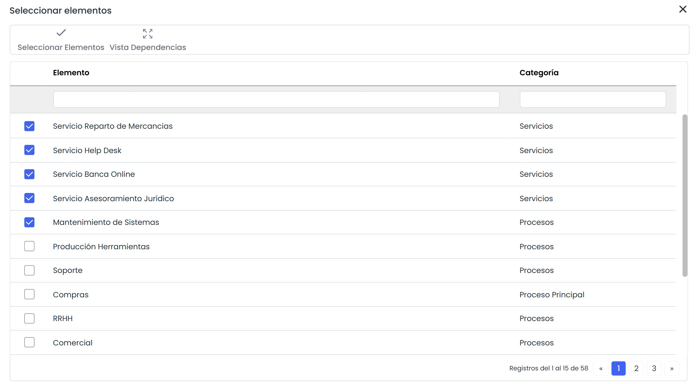

Para seleccionar los elementos que se quieren incluir, hay que pulsar el check que tiene cada elemento en la parte izquierda y una vez que se han marcado, pulsar el botón “Seleccionar Elementos”.

Con el botón “Vista Dependencias”, se muestra los elementos en el árbol de elementos para que se puedan ver las relaciones entre ellos.

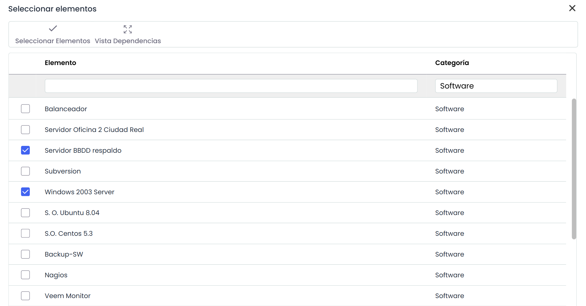

Una vez añadidos los elementos, en la parte inferior se encuentra la tabla “Riesgos” que muestra los riesgos de cada elemento. Por defecto, todos los riesgos aparecen habilitados de forma que el usuario de la encuesta los podrá evaluar, pero se permite seleccionar únicamente aquellos riesgos que se quieren publicar de cada elemento.

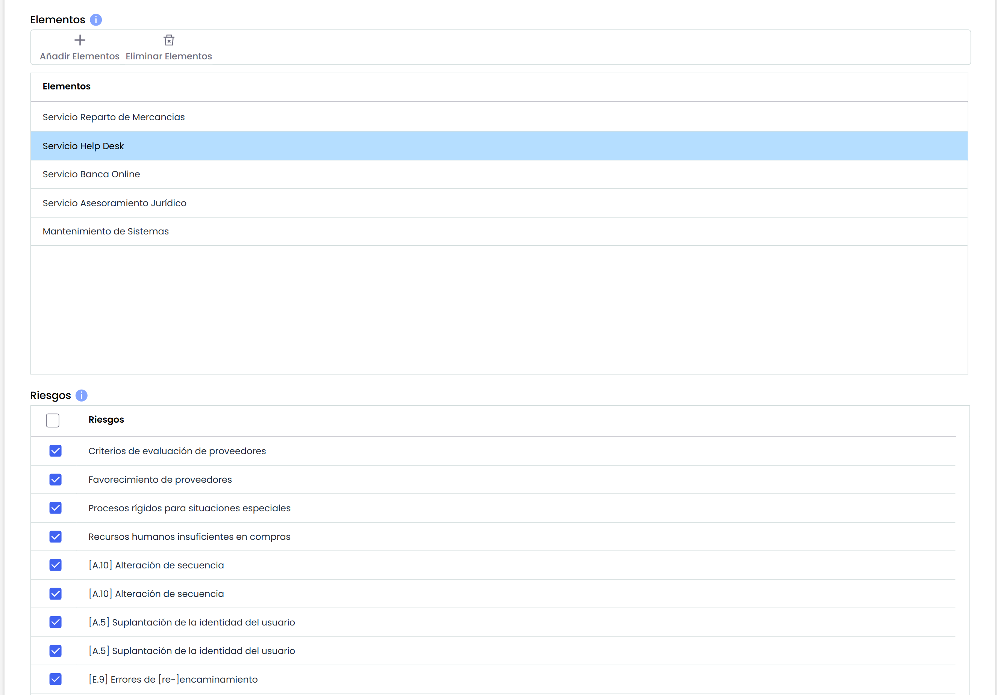

Por último, cuando se selecciona uno de los riesgos, se muestran todos los controles asociados.

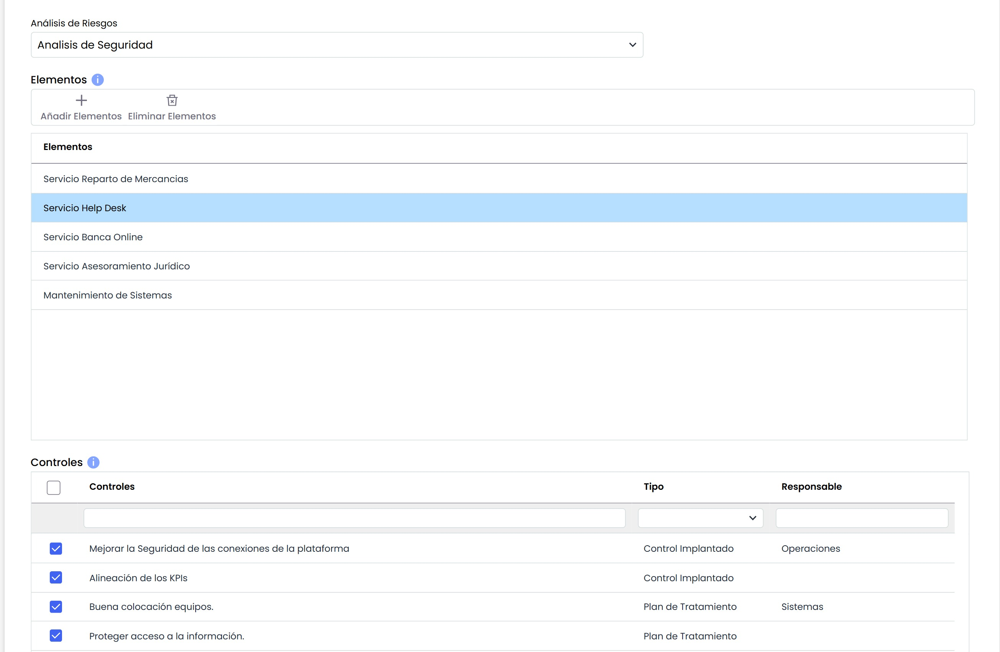

Una vez que se han cumplimentado todos los campos del formulario, se pulsa el botón “Guardar” y ya está lista la configuración para ser utilizada

Desde la sección “**Adjuntos**”, se podrá añadir documentos específicos a la propia configuración. A su vez, se podrá visualizar y/o gestionar los documentos heredados provenientes del modelo de encuesta.

