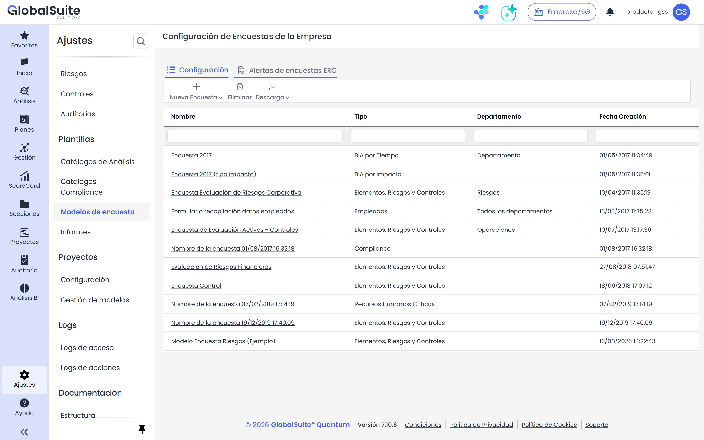
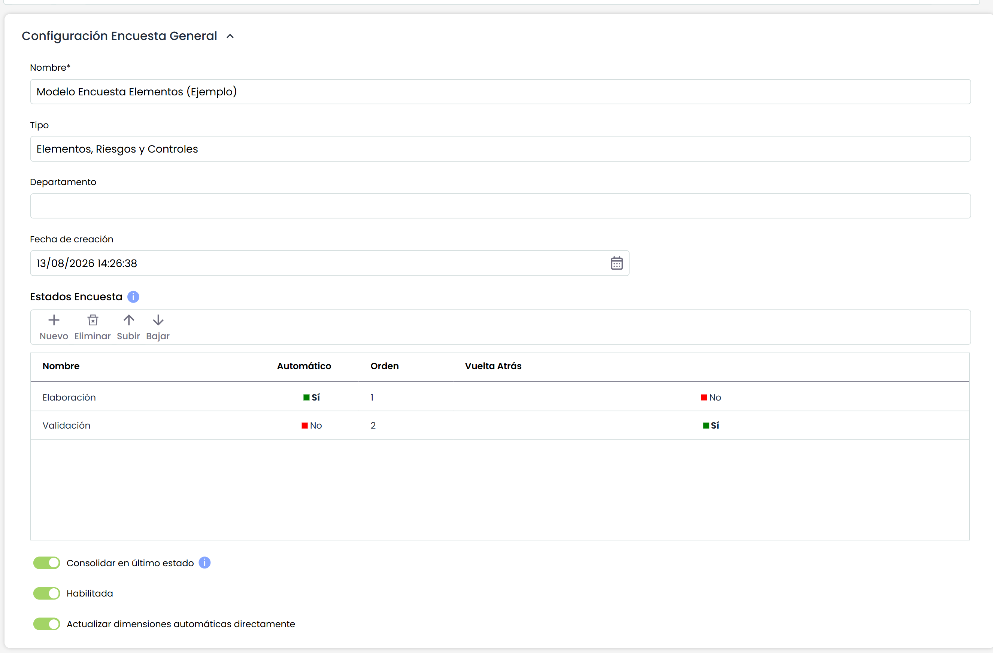
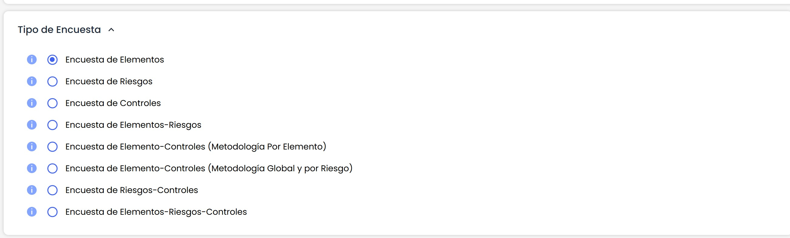
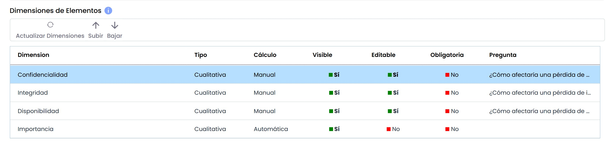
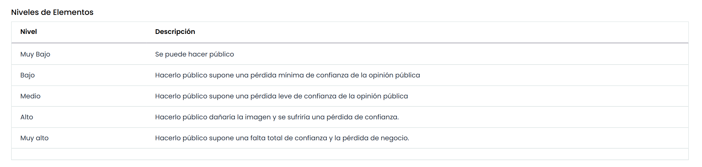
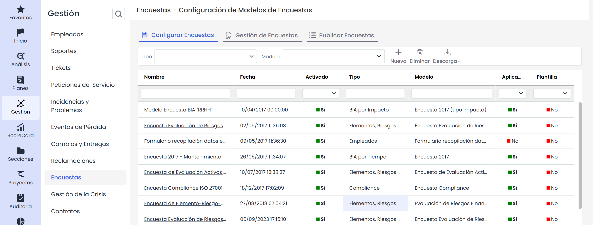
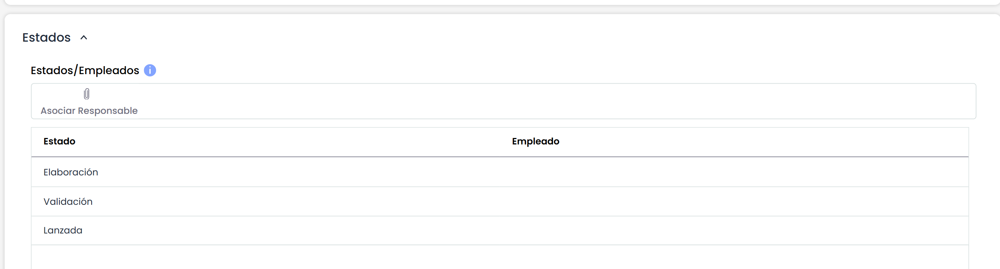
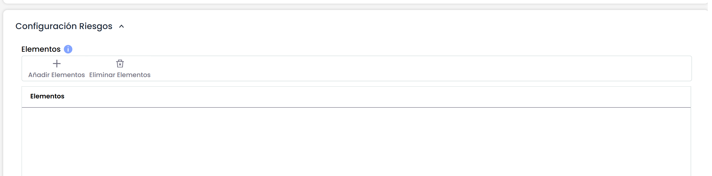
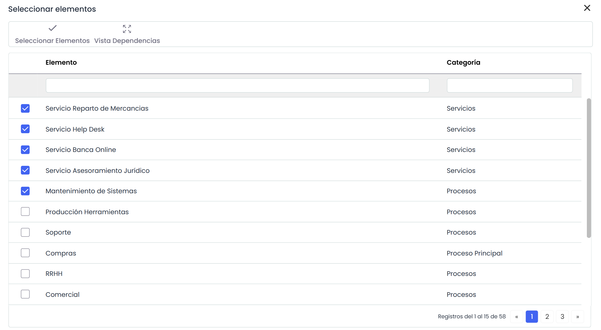
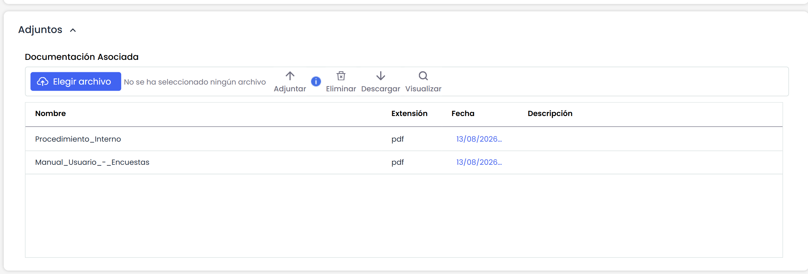

# Cómo configurar y gestionar encuestas de elementos en GlobalSuite®


Este tutorial explica, paso a paso, cómo crear y configurar las \*\*encuestas de elementos\*\* en GlobalSuite®.
En esta guía se detallan las fases correspondientes al \*\*modelo de encuestas\*\* y a la \*\*configuración de encuestas de elementos\*\*, incluyendo el proceso de definición del modelo, la \*\*selección y ajuste de dimensiones\*\*, la incorporación de \*\*adjuntos\*\* y la \*\*asociación de elementos\*\* desde el inventario para su evaluación.


## Fases para la realización de Encuestas de Elementos

En esta guía se explicarán fases 1 y 2 del transcurso de creación de una encuesta.

## Modelos de Encuestas

GlobalSuite® permite identificar y clasificar el **inventario de elementos**, realizar el **análisis de riesgos** y evaluar los controles de la organización a través de encuestas enviadas a los distintos responsables de la organización. Para ello, en primer lugar, se debe crear el modelo de encuesta que se desea mandar. Se permite crear varios modelos y, además, se pueden configurar para poder adaptarlos a las necesidades de la organización.

Para ello, cada modelo de encuesta puede ser configurado indicando el tipo de la misma. Existen tres tipos de encuestas que se pueden considerar al crear un modelo:

* **Encuesta de Elementos**: Permite la identificación de los elementos, categorización de los mismos y su clasificación.
* **Encuesta de Riesgos**: Permite la identificación de los riesgos de cada elemento (incluidos servicios y procesos) así como la evaluación de los mismos según la metodología de la organización.
* **Encuesta de Controles**: Permite la identificación de los controles implantados en la organización así como su evaluación de madurez según la metodología correspondiente.

En esta guía se va a explicar el funcionamiento del tipo “Encuesta de Elementos”.

Para configurar un modelo de encuesta debe ser un usuario Administrador (Administrador Plataforma, Administrador Enterprise o Administrador Configuración), ya que se encuentra en el apartado de **Ajustes**>[**Modelos de Encuestas**](https://help.globalsuitesolutions.com/es/globalsuite/v1/modelo-encuesta-elementos-riesgos-y-controles)

En la opción se debe elegir qué tipo de modelo de encuesta se quiere crear en el botón “**Nueva Encuesta**” (en este caso, el tipo “**Elementos, Riesgos y Controles**”). Además, en esta opción se podrán eliminar modelos (botón “**Eliminar**”) y descargar un listado de los modelos configurados (botón “**Descarga**”).

En la última columna mostrará los modelos que están habilitados. Sólo se podrán crear encuestas de los modelos habilitados.

Dentro del modelo de encuesta se permite configurar aspectos como el nombre, el departamento o la fecha de creación, así como indicar si se requiere que el modelo esté **habilitado** para su utilización y si se quiere “**Consolidar en último estado**”, es decir, que desde el último estado del flujo se pueda consolidar directamente los datos de la encuesta en el análisis definitivo.

También es posible utilizar estados en la encuesta, la utilización de estos estados permite que diferentes personas puedan rellenar o validar información introducida en estado anteriores. Se podrá pasar de un estado a otro de forma automática si se marca el indicador (check automático) y también se podría pasar a un estado anterior de la misma manera, marcando el indicador correspondiente (check vuelta atrás).

En la sección “**Tipo de Encuesta**” se debe elegir qué tipo de modelo se quiere crear. En este caso se va a seleccionar el tipo “Encuesta de Elementos”.

A continuación se visualiza una sección que permite su configuración.

Se muestran las dimensiones configuradas en el inventario de elementos indicando el tipo de dimensión y si ésta es manual o automática.

Si se selecciona una dimensión, se permite cambiar el orden en el que va a aparecer, utilizando los botones “Subir” y “Bajar” se puede posicionar en lugar deseado.

Con el botón “Actualizar Dimensiones”, tal y como indica el mensaje en amarillo, se actualiza el listado de las dimensiones de la metodología de elementos por si se hubieran añadido nuevas dimensiones después de la creación del modelo. Al pulsar este botón, se muestra el siguiente mensaje:

> *«Cambiar la metodología o el tipo de encuesta alterará las configuraciones especificas de encuestas creadas a partir de este modelo, ¿Desea Continuar?»*

Los ajustes sobre las dimensiones anteriores que ya existían se conservan, únicamente aparecen las nuevas dimensiones que se hayan creado en la metodología de elementos para poder ser incluidas en la encuesta.

El usuario puede configurar las siguientes opciones de cada dimensión:

* **Visible**: permite definir si la dimensión se incluirá en la encuesta o no, pulsando sobre la celda.
* **Editable**: indica si la dimensión se podrá modificar en la encuesta, o sólo será visible en modo consulta.
* **Obligatoria**: indica la obligatoriedad de rellenar una dimensión al pasar de estado, en el caso de que se usen encuestas con estados.
* **Pregunta**: en el caso de encuestas de tipo "Formulario" (se verá más adelante), permite mostrar una pregunta explicativa, en lugar de únicamente el nombre de la dimensión.

Al marcar una dimensión de tipo cualitativa, en la tabla inferior (“Niveles de Elementos”) se muestran a título informativo los niveles que tiene configurados en **Ajustes >**[**Metodología Elementos**](https://help.globalsuitesolutions.com/es/globalsuite/v1/metodologia-elementos)**.**

En la sección “**Adjuntos**” se podrá adjuntar a la encuesta los archivos necesarios para que el receptor de la misma pueda consultar.

Las opciones disponibles son:

* **Seleccionar** archivo: permite buscar y seleccionar un fichero de nuestro explorador de archivos.
* **Adjuntar**: permite subir el archivo seleccionado.
* **Eliminar**: permite eliminar un archivo seleccionado en la tabla “Documentación Asociada”.
* **Descargar**: permite descargar el archivo seleccionado en la tabla “Documentación Asociada”.
* **Visualizar**: permite visualizar desde el navegador, el archivo seleccionado en la tabla “Documentación Asociada”. Únicamente es posible visualizar archivos con la extensión .pdf, .jpeg, .jpg, .bmp o .png.

## Configuración de Encuestas

Una vez configurado el modelo de encuesta, éste se puede utilizar para configurar tantas encuestas como se requiera. Para ello, hay que dirigirse a la opción ubicada en **Gestión>** [**Encuestas**](https://help.globalsuitesolutions.com/es/globalsuite/v1/configurar-encuestas)

Para crear la configuración de una encuesta se debe filtrar por el tipo de encuesta y posteriormente elegir el modelo deseado.

Al pulsar el botón “**Nuevo**” se creará una encuesta del tipo y modelo elegido. Si desea eliminar la configuración de una encuesta tiene que pulsar el botón “**Eliminar**”. Hay que tener en cuenta que si se elimina una Configuración, todas las encuestas creadas a partir de esta Configuración también se eliminarán.

También se permite descargar el listado de configuraciones de encuestas tanto en formato Excel como pdf.

Al acceder a la configuración de la encuesta aparecen un conjunto de secciones que permiten su configuración.

En la primera sección, “Datos Generales Configuración”, se puede identificar el nombre de la configuración, visualizar el tipo y modelo de encuesta, cambiar la fecha y también permite activar o no el check “**Habilitado”** que permite indicar si la Configuración puede utilizarse para generar nuevas encuestas.

Si en el modelado se han incluido estados (workflow), entonces en la configuración aparece también la sección de “**Estados**” para poder asignar un responsable a cada estado:

En la sección “Configuración Riesgos”, aparece la información relacionada con los Elementos. Se pueden añadir los elementos que se quieren evaluar en la encuesta a través del botón “**Añadir Elementos**”, también se pueden eliminar con el botón “**Eliminar Elementos**”.

Al pulsar el botón “**Añadir Elementos**”, se abre una ventana emergente con todos los elementos que forman parte del inventario de elementos. Se pueden utilizar filtros, bien por el nombre del elemento o por la categoría, como se muestra en la siguiente imagen:

Para seleccionar los elementos que se quieren incluir, hay que pulsar el check que tiene cada elemento en la parte izquierda y una vez que se han marcado, pulsar el botón “Seleccionar Elementos”.

Con el botón “Vista Dependencias”, se muestra los elementos en el árbol de elementos para que se puedan ver las relaciones entre ellos.

Una vez completados los datos de la configuración, se pulsa “Guardar” y ya estaría lista para ser utilizada.

Desde la sección “**Adjuntos**”, se podrá añadir documentos específicos a la propia configuración. A su vez, se podrá visualizar y/o gestionar los documentos heredados provenientes del modelo de encuesta.

