# Cómo configurar y gestionar encuestas de elementos, riesgos y controles en GlobalSuite®


Este tutorial explica, paso a paso, cómo crear, configurar, publicar y consolidar las \*\*encuestas de elementos, riesgos y controles\*\* en GlobalSuite®.
El objetivo es mostrar cómo utilizar los \*\*modelos de encuesta\*\* para identificar elementos del inventario, analizar riesgos asociados y evaluar controles implementados dentro de la organización. Además, se detallan las fases de configuración, publicación a responsables, gestión de respuestas y consolidación final de la información para su integración en los análisis de riesgos y controles del sistema.


## Fases para la realización de Encuestas de Elementos, Riesgos y Controles

## Modelos de Encuestas para Elementos, Riesgos y Controles.

### Configurar Modelos Encuestas

GlobalSuite® permite identificar y clasificar el inventario de elementos, realizar el análisis de riesgos y evaluar los controles de la organización a través de encuestas enviadas a los distintos responsables de la organización. Para ello, en primer lugar, se debe crear el modelo de encuesta que se desea mandar. Se permite crear varios modelos y, además, se pueden configurar para poder adaptarlos a las necesidades de la organización.

Para ello, cada modelo de encuesta puede ser configurado indicando el tipo de la misma. Existen tres tipos de encuestas que se pueden considerar al crear un modelo:

* **Encuesta de Elementos**: Permite la identificación de los elementos, categorización de los mismos y su clasificación.
* **Encuesta de Riesgos:** Permite la identificación de los riesgos de cada elemento (incluidos servicios y procesos) así como la evaluación de los mismos según la metodología de la organización.
* **Encuesta de Controles:** Permite la identificación de los controles implantados en la organización así como su evaluación de madurez según la metodología correspondiente.

Para configurar un modelo de encuesta debe ser un usuario Administrador (Administrador Plataforma, Administrador Enterprise o Administrador Configuración), ya que se encuentra en el apartado de “**Ajustes**”. La opción se denomina “[**Modelos de Encuestas**](https://help.globalsuitesolutions.com/es/globalsuite/v1/modelos-de-encuestas)”.

En la opción se debe elegir qué tipo de modelo de encuesta se quiere crear en el botón “**Nueva Encuesta**” (en este caso, el tipo “**Elementos, Riesgos y Controles**”). Además, en esta opción se podrán eliminar modelos (botón “**Eliminar**”) y descargar un listado de los modelos configurados (botón “**Descarga**”).

En la última columna mostrará los modelos que están habilitados. Sólo se podrán crear encuestas de los modelos habilitados.

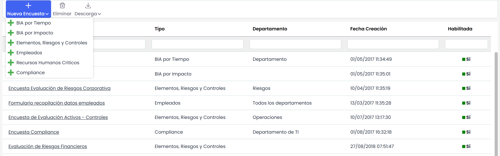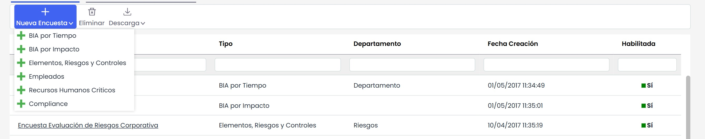

Dentro del modelo de encuesta se permite configurar aspectos como el nombre, el departamento o la fecha de creación, así como indicar si se requiere que el modelo esté **habilitado** para su utilización y si se quiere “**Consolidar en último estado**”, es decir, que desde el último estado del flujo se pueda consolidar directamente los datos de la encuesta en el análisis definitivo.

También es posible utilizar estados en la encuesta, la utilización de estos estados permite que diferentes personas puedan rellenar o validar información introducida en estado anteriores. Se podrá pasar de un estado a otro de forma automática desde la propia encuesta si se marca el indicador “Automático” y también se podría pasar a un estado anterior de la misma manera si se marca el indicador “Vuelta Atrás”.

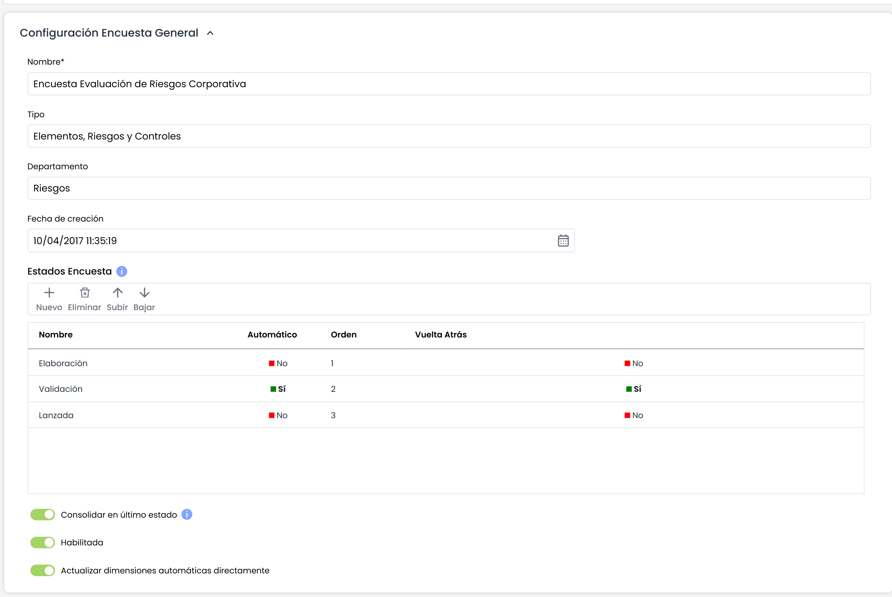

En la sección “**Tipo de Encuesta**” se debe elegir qué tipo de modelo se quiere crear.

* Si se selecciona un tipo de encuesta que contiene Riesgos, aparece la sección “**Taxonomía**”, que permite visualizar los Tipos/Agrupación de Riesgos en las encuestas.
* Si el tipo de encuesta contiene Controles, aparece la sección de “**Configuración Adicional**”, permitiendo editar las acciones y adjuntar evidencias en la misma.
* Para este ejemplo, la encuesta seleccionada es la más completa ya que contiene las tres combinaciones: Elementos, Riesgos y Controles.

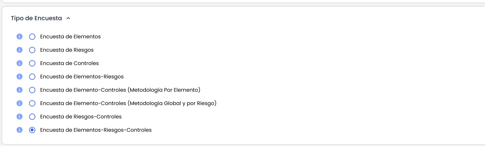

Si se selecciona una dimensión, se permite cambiar el orden en el que va a aparecer, utilizando los botones “**Subir**” y “**Bajar**” se puede posicionar en el lugar deseado

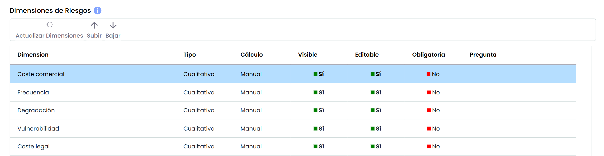

Con el botón “**Actualizar Dimensiones”,** tal y como indica el mensaje en amarillo, se actualiza el listado de las dimensiones de la metodología de elementos por si se hubieran añadido nuevas dimensiones después de la creación del modelo. Al pulsar este botón, se muestra el siguiente mensaje:

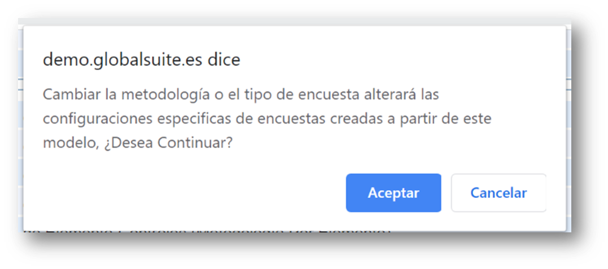

Los ajustes sobre las dimensiones anteriores que ya existían se conservan, únicamente aparecen las nuevas dimensiones que se hayan creado en la metodología de elementos para poder ser incluidas en la encuesta.

Si el tipo de encuesta incluye Elementos, aparece una sección que permite su configuración. Se muestran las dimensiones configuradas en el inventario de elementos indicando el tipo de dimensión y si ésta es manual o automática. El usuario puede configurar las siguientes opciones de cada dimensión:

* **Visible**: permite definir si la dimensión se incluirá en la encuesta o no, pulsando sobre la celda.
* **Editable**: indica si la dimensión se podrá modificar en la encuesta, o sólo será visible en modo consulta.
* **Obligatoria**: indica la obligatoriedad de rellenar una dimensión al pasar de estado, en el caso de que se usen encuestas con estados.
* **Pregunta**: en el caso de encuestas de tipo "Formulario" (se verá más adelante), permite mostrar una pregunta explicativa, en lugar de únicamente el nombre de la dimensión.

Al seleccionar una dimensión, en la tabla de abajo (“Niveles de Elementos”) se muestran a título informativo los niveles que tiene configurados en Ajustes.

Si el tipo de encuesta incluye **Riesgos**, aparece una sección que permite su configuración.

En primer lugar, se debe seleccionar qué metodología de riesgos se quiere utilizar en la encuesta. Al seleccionar la metodología se muestran las dimensiones configuradas en la misma, indicando el tipo de dimensión y si ésta es manual o automática. El usuario puede configurar las siguientes opciones de cada dimensión:

* **Visible**: permite definir si la dimensión se incluirá en la encuesta o no, pulsando sobre la celda.
* **Editable**: indica si la dimensión se podrá modificar en la encuesta, o sólo será visible en modo consulta.
* **Obligatoria**: indica la obligatoriedad de rellenar una dimensión al pasar de estado, en el caso de que se usen encuestas con estados.
* **Pregunta**: en el caso de encuestas de tipo "Formulario" (se verá más adelante), permite mostrar una pregunta explicativa, en lugar de únicamente el nombre de la dimensión.

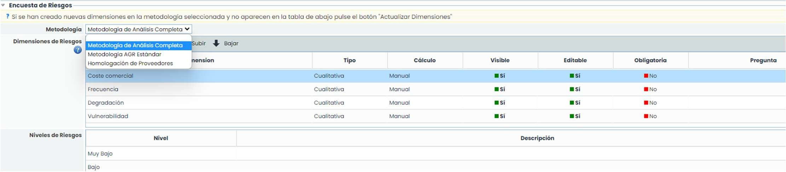

Si el tipo de encuesta incluye **Controles**, aparece una sección que permite su configuración.

En primer lugar, se debe seleccionar qué metodología de controles se quiere utilizar en la encuesta. Al seleccionar la metodología se muestran las dimensiones configuradas en la misma, indicando el tipo de dimensión y si ésta es manual o automática. El usuario puede configurar las siguientes opciones de cada dimensión:

* **Visible**: permite definir si la dimensión se incluirá en la encuesta o no, pulsando sobre la celda.
* **Editable**: indica si la dimensión se podrá modificar en la encuesta, o sólo será visible en modo consulta.
* **Obligatoria**: indica la obligatoriedad de rellenar una dimensión al pasar de estado, en el caso de que se usen encuestas con estados.
* **Pregunta**: en el caso de encuestas de tipo "Formulario" (se verá más adelante), permite mostrar una pregunta explicativa, en lugar de únicamente el nombre de la dimensión.

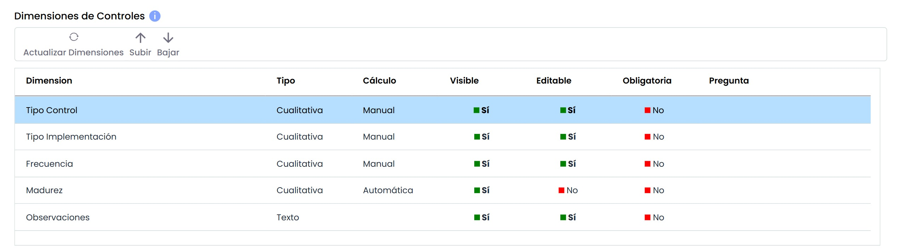

En la sección “**Adjuntos**” se podrá adjuntar a la encuesta los archivos necesarios para que el receptor de la misma pueda consultar.

Las opciones disponibles son:

* **Seleccionar archivo**: permite buscar y seleccionar un fichero de nuestro explorador de archivos.
* **Adjuntar**: permite subir el archivo seleccionado.
* **Eliminar**: permite eliminar un archivo seleccionado en la tabla “Documentación Asociada”.
* **Descargar**: permite descargar el archivo seleccionado en la tabla “Documentación Asociada”.
* •**Visualizar**: permite visualizar desde el navegador, el archivo seleccionado en la tabla “Documentación Asociada”. Únicamente es posible visualizar archivos con la extensión .pdf, .jpeg, .jpg, .bmp o .png.

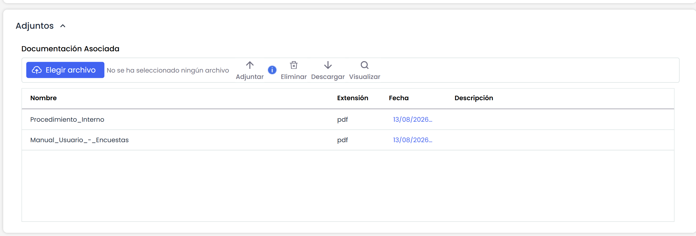

## Configuración de Encuestas de Elementos, Riesgos y Controles.

Una vez configurado el modelo de encuesta, éste se puede utilizar para configurar tantas encuestas como se requiera. Para ello, hay que dirigirse a la opción “[**Encuestas**](https://help.globalsuitesolutions.com/es/globalsuite/v1/configurar-encuestas)” ubicada en la pestaña “**Gestión**”.

Para crear la configuración de una encuesta se debe filtrar por el tipo de encuesta y posteriormente elegir el modelo deseado.

Al pulsar el botón “**Nuevo**” se creará una encuesta del tipo y modelo elegido. Si desea eliminar la configuración de una encuesta tiene que pulsar el botón “**Eliminar**”. Hay que tener en cuenta que, si se **elimina** una Configuración, todas las encuestas creadas a partir de esta Configuración también se eliminarán.

También se permite descargar el listado de configuraciones de encuestas en formato Excel.

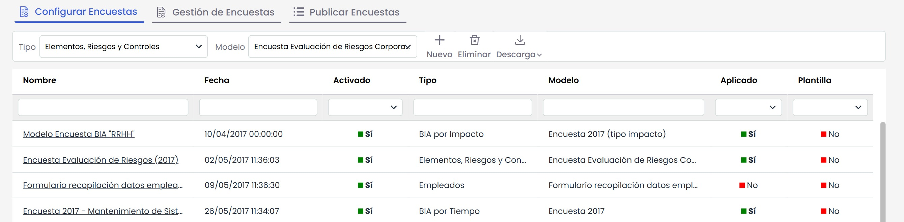

Al acceder a la configuración de la encuesta aparecen un conjunto de secciones que permiten su configuración.

En la primera sección, “Datos Generales Configuración”, se puede identificar el nombre de la configuración, visualizar el tipo y modelo de encuesta, cambiar la fecha y también permite activar o no el siguiente indicadore:

* **Habilitado**: Permite indicar si la Configuración puede utilizarse para generar nuevas encuestas.

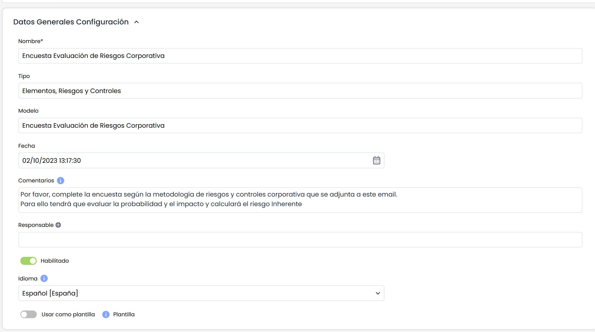

Si en el modelado se han incluido estados (Workflow), entonces en la configuración aparece también la sección de “Estados” para poder asignar un responsable a cada estado:

En la sección “Configuración Riesgos”, aparece la información relacionada con el tipo de encuesta seleccionada (Elementos, Riesgos y Controles).

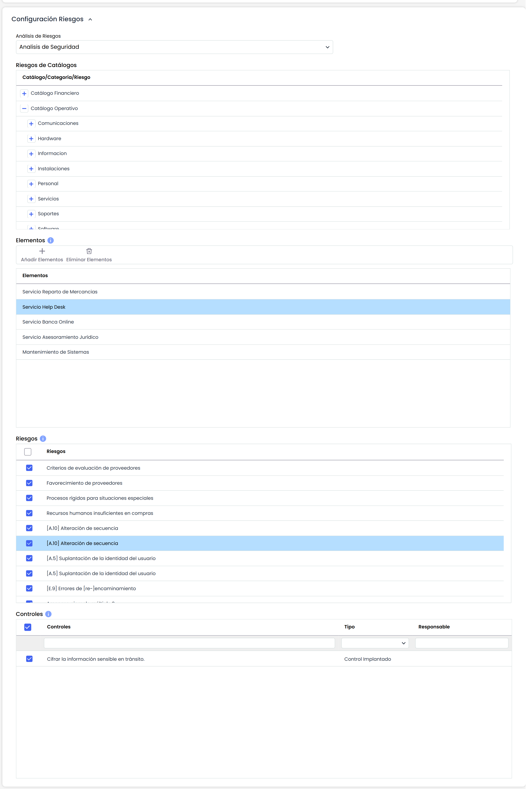

Para las encuestas de riesgos, se debe **seleccionar** sobre qué análisis de riesgos se quiere realizar la encuesta. El listado de **análisis de riesgos** contiene aquellos análisis de GlobalSuite® que se encuentran configurados con la misma metodología que tiene asociado el modelo de encuesta.

Al seleccionar el análisis de riesgos aparecen en la parte inferior lo**s catálogos de riesgos** asociados. Se permite indicar qué catálogos van a estar disponibles para el usuario, así como los riesgos que se quieren considerar. De esta forma, se puede incorporar a la encuesta un subconjunto de los riesgos que posee un catálogo.

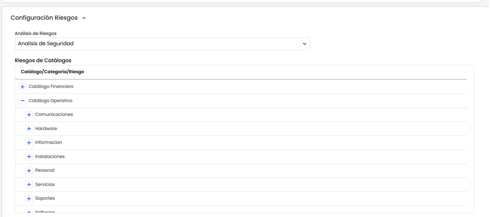

Otro aspecto que se debe configurar en una encuesta es la selección de los **Elementos** que se

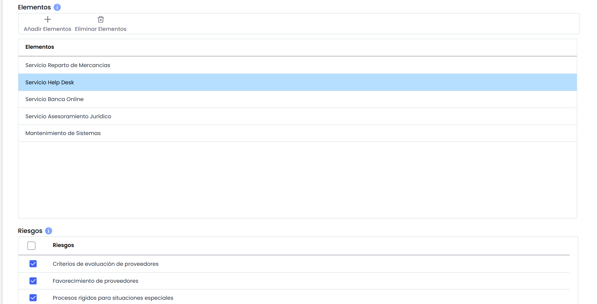

desean incorporar, de forma que el usuario que recibe la encuesta únicamente puede valorar los elementos asignados (además de añadir elementos nuevos). Para realizar esto se debe pulsar sobre el botón “**Añadir Elementos**”, apareciendo una ventana emergente que permite seleccionar los elementos deseados.

Una vez añadidos los elementos, en la parte inferior se encuentra la tabla “**Riesgos**” que muestra los riesgos de cada elemento. Por defecto, todos los riesgos aparecen habilitados de forma que el usuario de la encuesta los podrá evaluar, pero se permite seleccionar únicamente aquellos riesgos que se quieren publicar de cada elemento.

Para el caso de las encuestas que incorporan **Controles**, también se debe seleccionar el análisis de riesgos con el que se quiere realizar la encuesta.

Si se trata de una encuesta que también incluye Riesgos, el análisis de riesgos será el mismo para ambos casos; sin embargo, si se trata de una encuesta de sólo Controles, entonces se debe seleccionar qué análisis de riesgos se desea utilizar para la encuesta.

Al seleccionar el riesgo, se muestran todos los controles asociados.

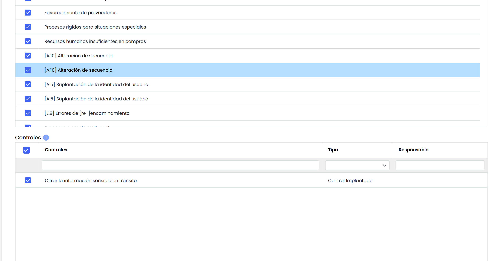

Desde la sección de **Adjuntos**, se puede añadir documentos específicos a esta configuración concreta y, a su vez, se pueden visualizar los documentos heredados del modelo, los cuales también se podrían eliminar para esta configuración.

## Publicación de Encuestas.

En la opción “**Publicar Encuestas**” se podrá configurar la publicación de la encuesta a los destinatarios deseados. En primer lugar, se debe proceder de la misma forma que la configuración, es decir, habrá que elegir el tipo y la Configuración de Encuesta, y pulsar el botón “**Nuevo**”.

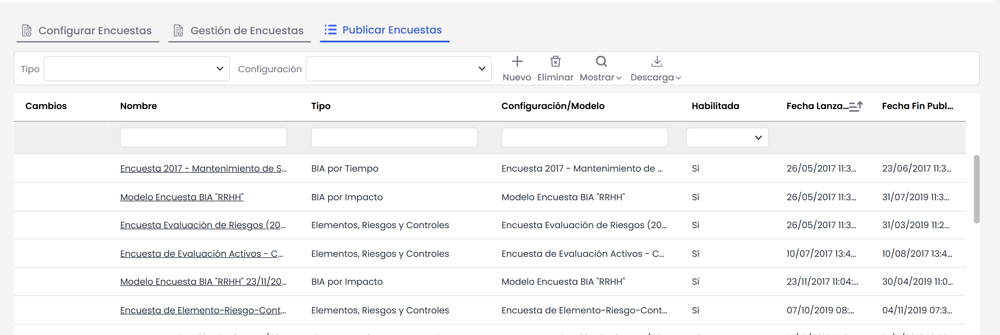

Al ingresar en un registro permite al usuario **configurar la publicación**. Los atributos más importantes son:

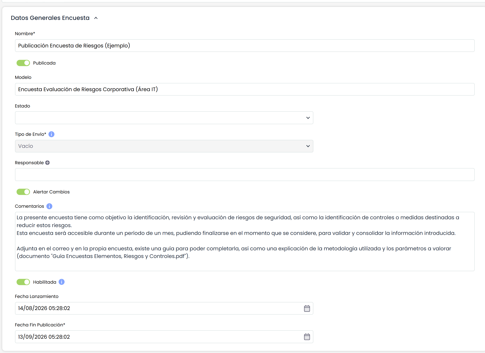

* **Estado**: Esta opción sólo aparece cuando se ha configurado la encuesta por estados en el modelado.
* **Tipo de envío**: Solo aplica a las encuestas de BIAs. En caso de una encuesta de elementos-riesgos-controles siempre se envía la información registrada en GlobalSuite en el momento de envío de la encuesta.
* 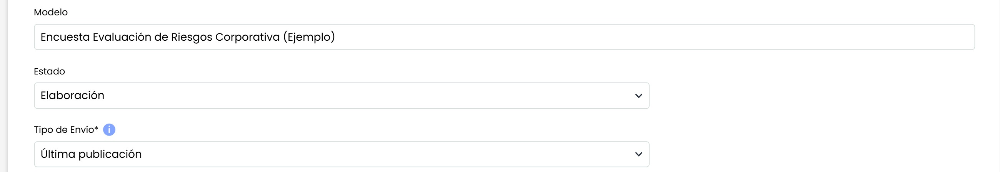

  **Responsable**: Corresponde al usuario de GlobalSuite encargado de recibir las respuestas de las encuestas.
* **Alertar Cambios**: Si se selecciona, el responsable será avisado mediante email de los cambios realizados.
* **Comentarios**: Permite ingresar un texto que se incorpora tanto en el email que recibe cada destinatario como en la página principal de la encuesta.
* **Habilitada**: Campo que permite habilitar la encuesta.
* Fecha Apertura: Es la fecha de inicio de la publicación, a partir de la cual las encuestas asociadas a la publicación están disponibles.
* **Fecha de Cierre**: Es la fecha de cierre de la publicación, a partir de la cual las encuestas asociadas a la publicación ya no están disponibles.

Una vez configurado los campos anteriores se tendrá que elegir a los **destinatarios de la encuesta**. Estos destinatarios recibirán un correo con un enlace para acceder a la encuesta. Para acceder al enlace no hará falta que el destinatario disponga de usuario de GlobalSuite®.

Para elegir los destinatarios se podrá elegir a un empleado ya registrado en la herramienta (botón “**Añadir Empleados**”) o a un nuevo empleado (botón “**Nuevo**”). En cualquier caso, se muestra una ventana emergente para configurar los destinatarios. Si se trabaja con una encuesta con estados, aparecerá por defecto el destinatario del primer estado.

En esta tabla también podrá eliminar (botón “**Eliminar**”), alertar a través de e-mail (botón “**Enviar Recordatorio**”) y crear una encuesta a partir de una encuesta anterior (botón “**Seleccionar Anterior**”).

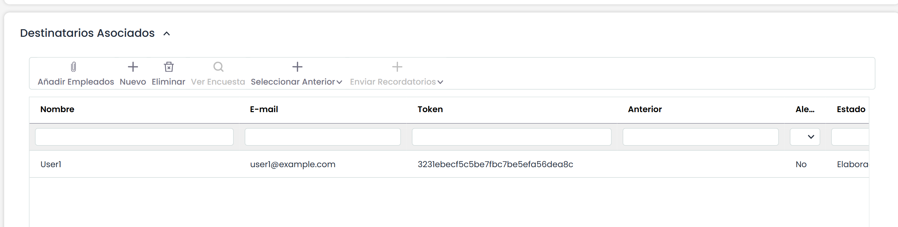

En el momento que se pulsa el botón “**Publicar**”, la herramienta envía un correo a los destinatarios con el enlace de la encuesta para poder completarla.

En la pantalla de publicación también aparece el enlace recibido por cada destinatario, de forma que el responsable puede acceder a la encuesta. También existe una tabla con los seguimientos de la encuesta.

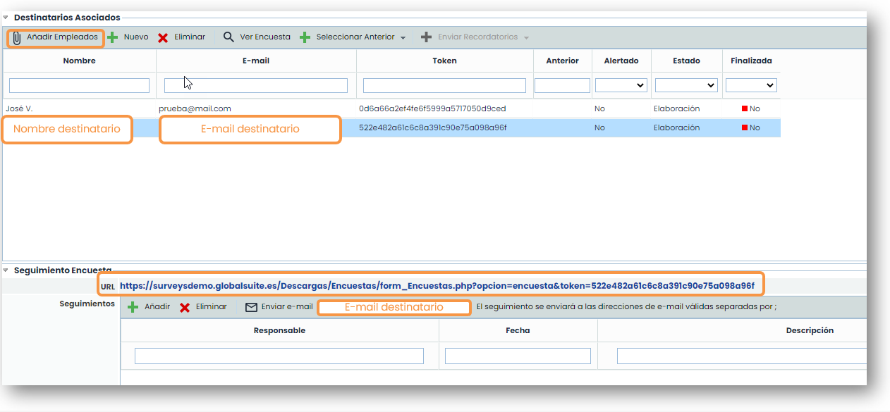

## Gestión Encuestas

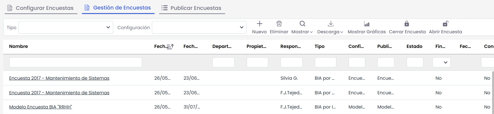

Esta opción permite gestionar todas las encuestas creadas en la publicación de encuestas. Al realizar la publicación, todas las encuestas enviadas a los destinatarios se generan en esta opción.

Además, en esta opción también podrá crear encuestas sin necesidad de que ésta sea publicada. La creación de una encuesta funciona igual que las opciones anteriores. Al acceder a una encuesta podrá ver los datos guardados actualmente.

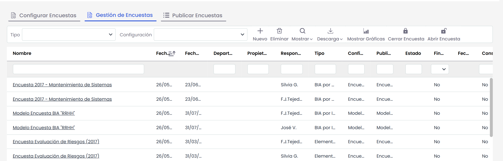

## Consolidación Encuestas

Las encuestas de Elementos, Riesgos y Controles se pueden consolidar desde la propia encuesta si se marca la opción correspondiente y desde las opciones de Inventario, Análisis de Riesgos y Gestión de Controles, respectivamente.

Si se desea más información, puede consultar la guía específica de consolidación de encuestas de Elementos, Riesgos y Controles.
