# ¿Cómo crear, publicar y consolidar encuestas de Compliance en GlobalSuite®?


En este artículo tratamos cómo configurar un modelo de encuesta de Compliance en GlobalSuite®, publicarlo a los destinatarios, recoger sus respuestas y consolidar los resultados en un Compliance activo. Se explican las cuatro fases de la encuesta —configuración, publicación, completado y consolidación— y cómo actualizar el nivel de cumplimiento a partir de las distintas valoraciones recibidas.


### Fases por las que pasa una Encuesta de Compliance

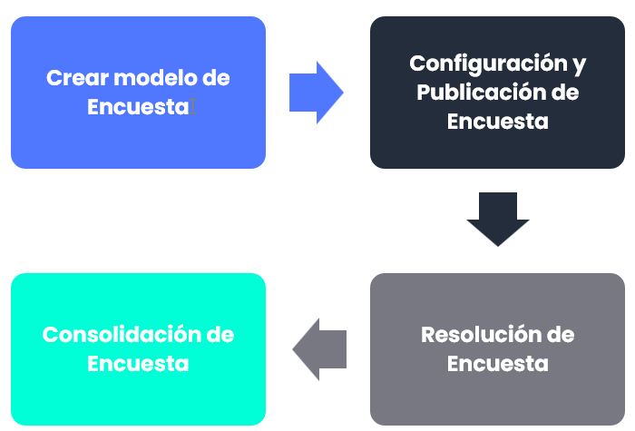

## Creación del modelo de encuesta

Esta opción permite configurar el modelo de encuestas que posteriormente se enviarán a los destinatarios deseados. Una vez configurado este modelo, se podrá utilizar en la opción de Encuestas de GlobalSuite®.

Para Generar una Encuesta de tipo Compliance, en **Ajustes > Plantillas >** [**Modelos de Encuestas**](https://help.globalsuitesolutions.com/es/globalsuite/v1/modelo-encuesta-compliance) hay que pulsar el botón Nueva Encuesta y Compliance.

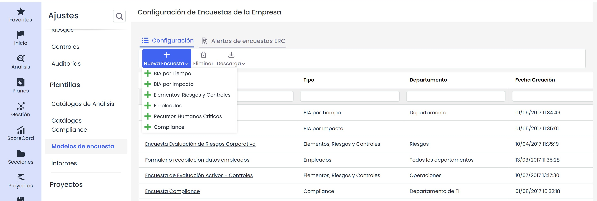

### Creación del modelo de encuesta

* Pulsando en el nombre de la encuesta, se abrirá una pantalla dónde se tendrá que definir el modelo de encuesta.
* Una vez completados los datos básicos (nombre, departamento, etc.), se podrá establecer un workflow de aprobación de encuestas. Además, se podrán definir los distintos niveles de aprobación del flujo; si no se definen estados, la encuesta se enviará a un destinatario.
* Para crear los estados se deberá pulsar el botón Nuevo y determinar el nombre de los estados.

  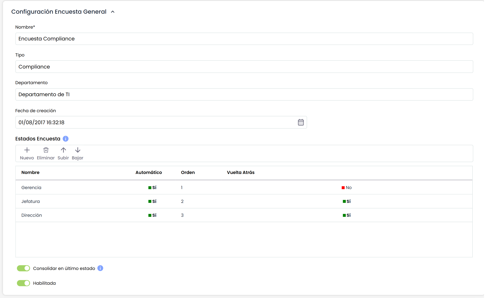
* Con Subir y Bajar se podrá cambiar el orden de los estados en el flujo de aprobación de la encuesta.
* Si se marca Automático, la encuesta irá asignándose automáticamente en cada cambio de estado, si no, el cambio de estado se tendrá que hacer de forma manual.

El aspecto fundamental de la encuesta consiste en elegir sobre qué catálogo/s se quiere cuestionar.

La encuesta se generará con los controles definidos sobre el catálogo seleccionado y que haya sido configurado en la opción de Catálogos Compliance (ver guía **¿Cómo crear y configurar un catálogo de Compliance en GlobalSuite®?**)

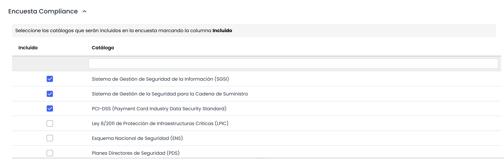

Después de seleccionar el catálogo, en la parte inferior aparecerán todos los controles que se van a actualizar en la encuesta, no obstante, se podrá hacer una selección previa de los controles que se quiera enviar en la encuesta, marcándolos o desmarcándolos en la columna “Incluido”.

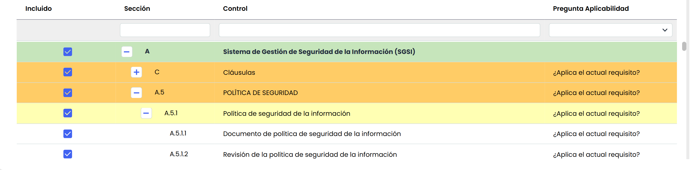

Además de elegir sobre qué controles se quiere generar la encuesta, se podrá modificar la pregunta para comprobar la aplicabilidad de los controles y el destinatario tendrá que elegir la respuesta. Pulsando dos veces sobre la celda se podrá editar el texto de la misma.

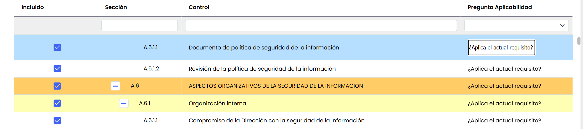

El primer aspecto a configurar será la pregunta realizada para conocer el % de completitud del control en la organización. Pulsando sobre el control deseado, se abrirá a la derecha una tabla para configurar dicha pregunta.

Por defecto viene una pregunta, pero se podrá modificar o añadir más preguntas/respuestas en función de la metodología de la organización.

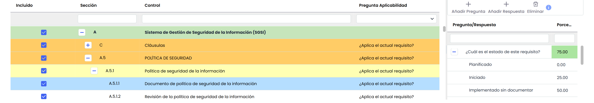

Se podrán añadir más preguntas sobre el porcentaje de completitud. Si se añaden más preguntas, se deberá elegir el peso de cada una en la fórmula del cálculo, ya que entre todas las preguntas deben sumar 100 (campos verdes en la imagen).

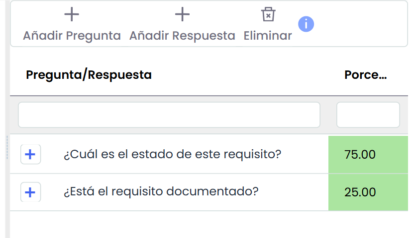

Continuando, en cada pregunta se podrán configurar las posibles respuestas: añadiendo o eliminando las existentes o modificándole el nombre.

Si solo se configura una pregunta, no habría que realizar ninguna acción, ya que todos los controles vienen por defecto con una pregunta.

Los estados que vienen por defecto son los configurados en el Catálogo Compliance.

## Configuración y Publicación de Encuesta

### 1. Configuración

Una vez configurado el modelo, se deberá crear una encuesta y asociar dicho modelo.  
En el menú superior aparecerán tres iconos. Por defecto, la aplicación siempre muestra la pestaña de “[**Gestión de Encuestas**](https://help.globalsuitesolutions.com/es/globalsuite/v1/gestion-encuestas)”, sin embargo, lo primero que se deberá hacer es entrar en [**Configurar Encuestas**](https://help.globalsuitesolutions.com/es/globalsuite/v1/configurar-encuestas)para crear una nueva encuesta con base al modelo generado previamente en **Ajustes**. Finalmente, se seleccionará el “tipo” de encuesta y el “modelo” a utilizar.

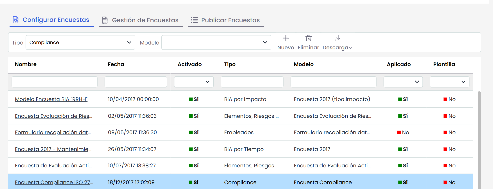

Después de definir los datos principales de la encuesta, si la misma encuesta cuenta con un workflow, saldrá una tabla adicional con los estados configurados en **Ajustes**. En este caso se deberá seleccionar a los responsables de los estados para que la encuesta les llegue automáticamente al publicarla.

Al seleccionar el estado y hacer click en el botón Asociar Responsable aparecerá una ventana emergente con los empleados definidos en la opción de **Gestión>** [**Empleados**](https://help.globalsuitesolutions.com/es/globalsuite/v1/empleados).

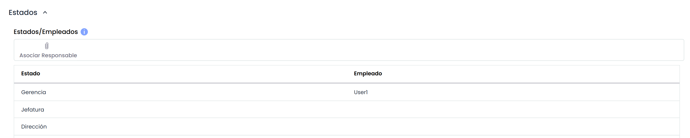

El siguiente paso es elegir sobre qué catálogos activos se quiere realizar la encuesta. Para ello hay que tener un catálogo activo en la opción de Análisis > Compliance.

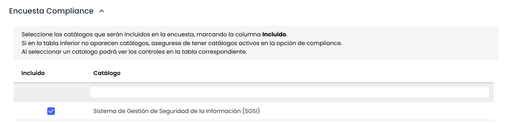

Si selecciona el catálogo en la tabla de abajo, se cargará dicho catálogo y le permitirá seleccionar los controles sobre los que se realizará la encuesta. En caso de querer eliminar una sección completa (naranja/amarilla), deberá eliminar todos los elementos que componen dicha sección (líneas blancas).

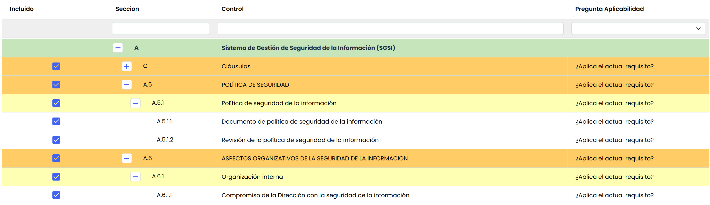

### 2. Publicación

Una vez configurada, se enviará la encuesta a los empleados para que la contesten.

Pulsando sobre el icono de [**Publicar Encuestas**](https://help.globalsuitesolutions.com/es/globalsuite/v1/publicar-encuestas), además de visualizarse aquellas encuestas que estén publicadas, se deberá elegir el modelo configurado anteriormente y pulsar el botón **Nuevo**.

Esta funcionalidad permite enviar la encuesta a cualquier persona (sin necesidad de tener usuario en la herramienta) para que conteste sobre los catálogos que se requieran.

El destinatario solo recibirá una URL por correo y al pulsar sobre ella se abrirá una ventana con la encuesta configurada.

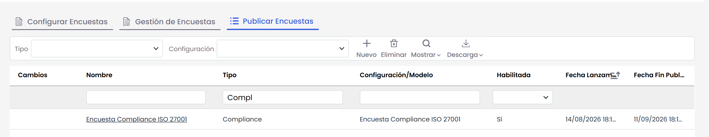

Para enviar la encuesta se deberán ingresar a la publicación antes creada y completar los siguientes campos:

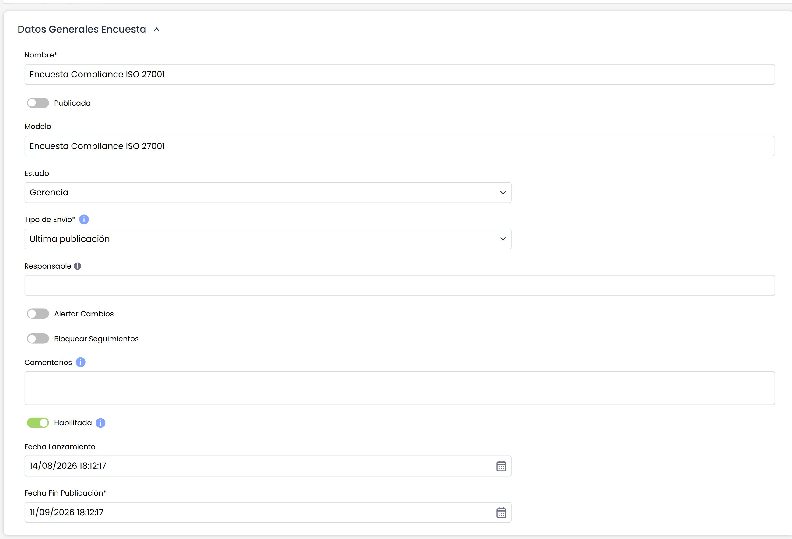

* **Nombre**: nombre de la encuesta a enviar.
* **Tipo de Envío**:

  * **Vacío** (estrella azul) Tomará los datos de la opción de GlobalSuite relacionada con el catálogo a enviar.
  * **Última publicación** (estrella azul) Se podrá asociar una encuesta anterior y la nueva se enviará con los datos de esa encuesta.
* **Responsable**: gestor y encargado de consolidar la encuesta (debe ser usuario de GlobalSuite)
* **Alertar Cambios**: alerta al gestor de la publicación ante cualquier cambio producido en la encuesta.
* **Comentarios**: instrucciones adicionales que recibirá el destinatario en el correo.
* **Fecha Cierre:** fecha límite hasta la cual la encuesta estará accesible

Si la encuesta tuviera workflow asociado, saldrá un elemento desplegable para poder elegir el estado del workflow. Además el destinatario asociado se insertará automáticamente y será el responsable del primer estado del workflow.

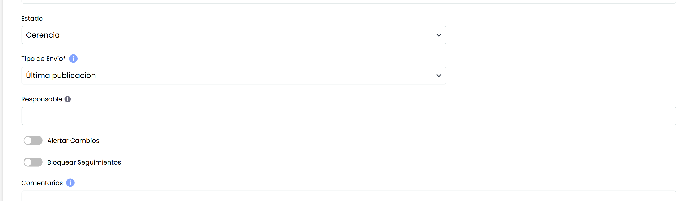

El siguiente paso será elegir a las personas (una o varias) a las que se enviará esta encuesta (recordar que si se tiene un flujo, los destinatarios se elegirán en la Configuración de la Encuesta)

Se podrán crear empleados en la parte de **Gestión>** [**Empleados**](https://help.globalsuitesolutions.com/es/globalsuite/v1/empleados) o añadir a cualquier persona que no estuviera definida en la aplicación:

* Si se pulsa en **Añadir Empleados,** saldrá una ventana emergente con los empleados registrados en GlobalSuite.
* Si se pulsa en **Nuevo**, aparecerá una ventana emergente solicitando el nombre y el correo del destinatario.

  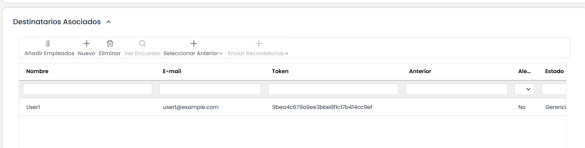

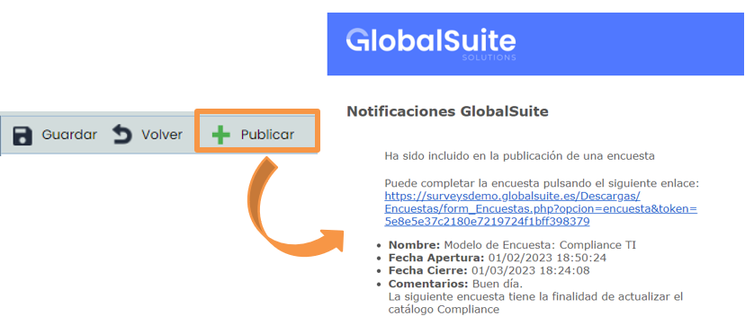

Una vez configurada toda la información se deberá pulsar el botón de **Publicar** para que el link generado en esta encuesta se habilite para el destinatario indicado:

* El enlace generado estará disponible hasta la fecha de cierreconfigurada.
* Al pulsar el botón de Publicar al destinatario le llegará un correo.

### 3. Completar

Al pulsar el enlace se abrirá la pantalla de la imagen. Si hubiera más de un catálogo, se podría seleccionar sobre qué catálogo contestar. En este ejemplo se realiza la encuesta sobre un catálogo.

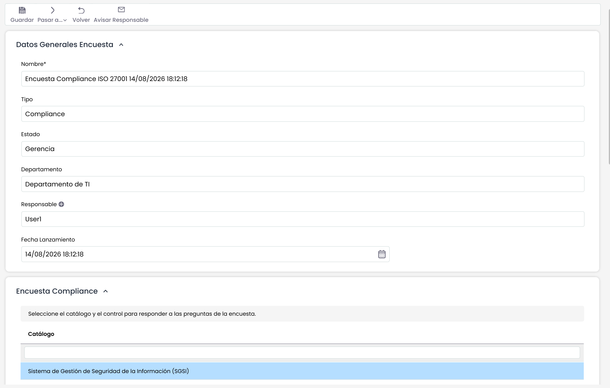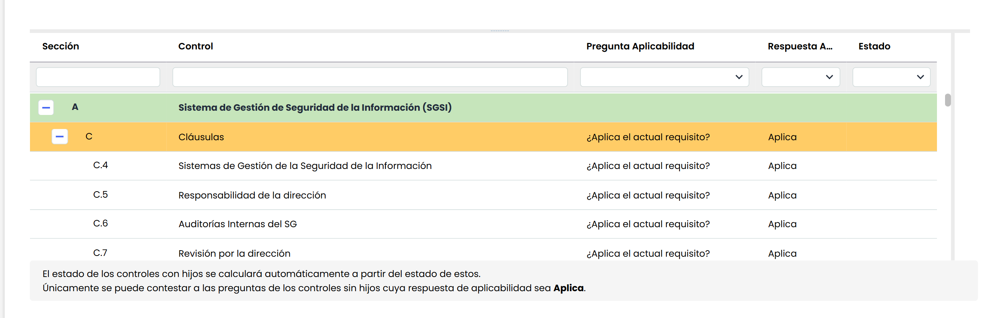

El destinatario tendrá que valorar los controles según la pregunta de aplicabilidad y la pregunta de % de completitud.

Se seleccionará control por control, pero la respuesta del % de completitud solo estará disponible para los controles que no tengan controles dependientes (en blanco). Por otro lado, la respuesta de aplicabilidad está disponible para todos los controles.

Para completar la encuesta se tienen que completar todos los controles que apliquen en la organización.

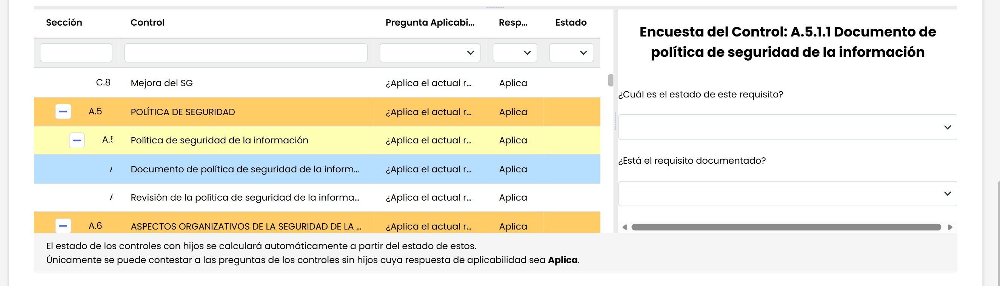

Una vez contestados todos los requisitos, el usuario pulsará el botón Finalizar y alertará al responsable de la publicación con un correo electrónico.

Si la encuesta tiene **workflow** asociado y en el modelo los estados configurados están en automático, al pulsar el destinatario en **“Pasar a Siguiente Estado”**, la encuesta se pasa automáticamente al destinatario del siguiente estado. Este proceso se repetiría tantas veces como estados haya en **Ajustes>** [**Modelos de encuestas**](https://help.globalsuitesolutions.com/es/globalsuite/v1/modelos-de-encuestas).

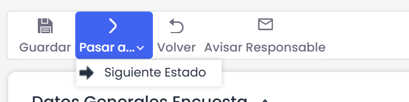

Si en el modelo se ha marcado el estado con posibilidad de vuelta atrás, los destinatarios de dichos estados podrán retroceder la encuesta al anterior. Cuando el destinatario del último estado termine la encuesta y pulse en “**Finalizar Encuesta”**, esta quedará registrada como finalizada.

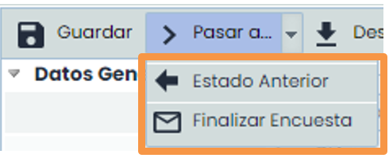

### 4. Consolidación

La funcionalidad de **Consolidación** sirve para actualizar los datos de un Compliance activo teniendo en cuenta las respuestas de una o varias encuestas. La Consolidación busca un consenso entre las diferentes opiniones de los responsables de la evaluación del Compliance.

El criterio de consolidación es modificable y permite actualizar la evaluación ya existente en GlobaSUITE® sobrescribiéndola con los valores máximos o mínimos, o aplicando una media aritmética, de todas las encuestas.

A continuación, se muestra a detalle la Consolidación de información.

En la opción de **Análisis >**[**Compliance**](https://help.globalsuitesolutions.com/es/globalsuite/v1/compliance)**,** tendrá que elegir el Compliance que quiera consolidar con las respuestas que vienen desde Encuestas. Pulsando en la versión activa para acceder (fila en verde – si no pincha en Mostrar Todos, solo se mostrarán las versiones activas). En la barra de herramientas tendrá que pulsar en el botón **Consolidar**.

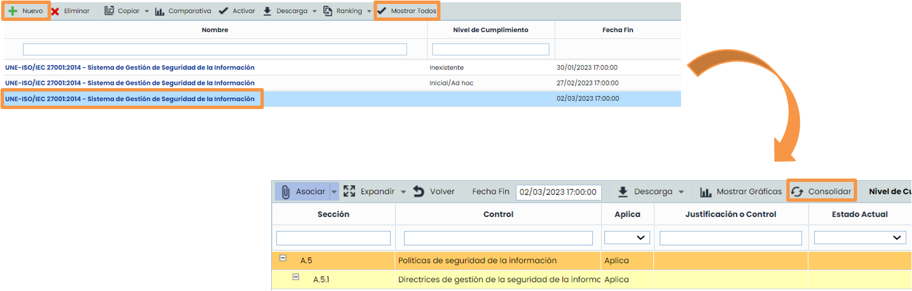

#### Opciones de Consolidación:

Una vez en la pantalla de consolidación hay que elegir las siguientes opciones para consolidar:

* **Encuestas publicadas sobre este catálogo**. Seleccionar la encuesta en la columna de la izquierda.
* **Criterio consolidación Aplicabilidad.**

  * **Aplica:** si una de las encuestas aplica el control, el resultado es aplica.
  * **No Aplica**: si una de las encuestas no aplica el control, el resultado es no aplica.
  * **No Consolida**: no toma en cuenta los controles con criterios diferentes.
* Criterio consolidación Estados

  * **Mínimo**: toma el valor mínimo del resultado de completitud para el mismo control.
  * **Máximo**: toma el valor máximo del resultado de completitud para el mismo control.
  * **Media**: calcula la media de las respuestas que haya tenido un control.

    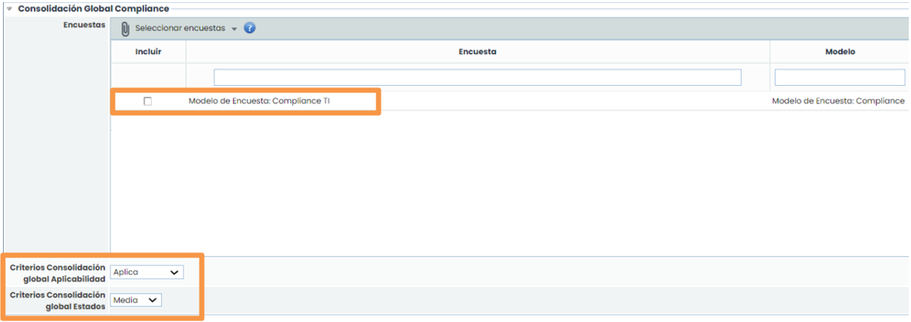


Nota: si en la consolidación hay solo una encuesta, el valor resultante del control será el mismo que el de la encuesta


#### Consolidación — selección y ejecución

Por último, quedaría **consolidar** el resultado de la encuesta.

* En primer lugar, se deberán elegir los controles que se quieran consolidar marcando en la columna de la izquierda los que se quieren incluir.
* 

  Después se deberá revisar control por control la respuesta del destinatario para tomar la decisión correcta.
* En la tabla de la derecha se podrán ver las distintas respuestas y se deberá elegir la decisión de utilizar la consolidación global (explicada en el punto [anterior](como-crear-publicar-y-consolidar-encuestas-de-compliance-en-globalsuite-r.md#Opciones-de-Consolidaci%C3%B3n%3A) ) o elegir la opción de consolidación individual para cada control.
* Seleccionando cada control se mostrarán dos tablas donde se podrán ver las distintas respuestas sobre el control (ver proximo punto “[Consolidar criterios por control](como-crear-publicar-y-consolidar-encuestas-de-compliance-en-globalsuite-r.md#Consolidar-Criterios-por-control)”)
* Cuando se pulse el botón **consolidar**, se copiará el resultado de la encuesta en el catálogo de GlobalSuite®.

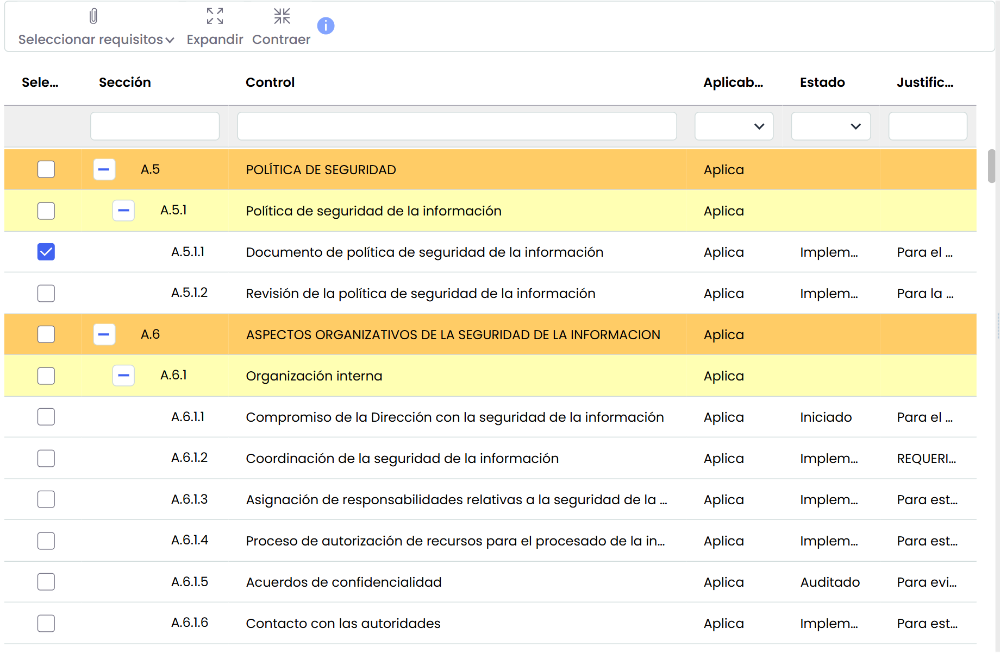

#### Consolidar Criterios por control

En la primera tabla se puede ver las respuestas de la pregunta de aplicabilidad, en la lista desplegable se puede elegir el criterio individual para ese control. Si no se elige nada, se tomará el criterio global.

En la segunda tabla se puede elegir la respuesta sobre el % de completitud, en la lista desplegable se puede elegir el criterio individual. Si no se elige nada, se tomará el criterio global

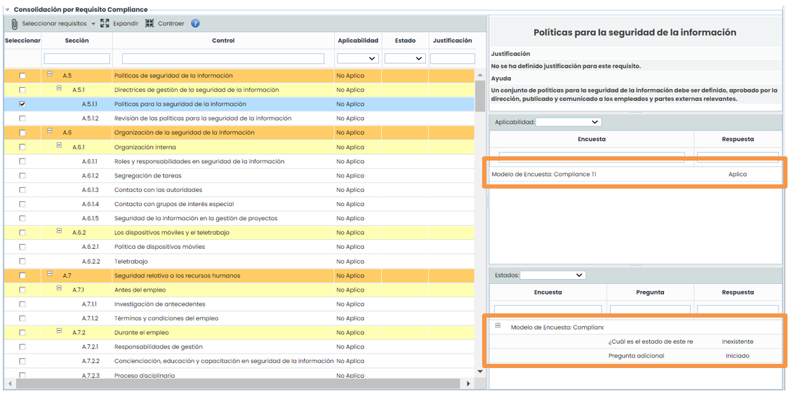
