# ¿Cómo implementar y gestionar el RGPD en GlobalSuite®?


En este artículo tratamos cómo configurar y poner en marcha el módulo de Protección de Datos en GlobalSuite®, incluyendo la definición de servicios y procesos, registro de tratamientos, análisis PIA, gestión de controles, planes de adecuación y auditorías, para asegurar el cumplimiento del Reglamento General de Protección de Dato


* [Configuración RGPD](#id-¿CómoimplementarygestionarelRGPDenGlobalSuite®?-ConfiguraciónRGPD)
  * [Apartado de Ajustes](#id-¿CómoimplementarygestionarelRGPDenGlobalSuite®?-ApartadodeAjustes)
  * [Catálogo de Servicios (Empresa)](#id-¿CómoimplementarygestionarelRGPDenGlobalSuite®?-CatálogodeServicios(Empresa))
* [Implementación del RGPD (Reglamento General de Protección de Datos)](#id-¿CómoimplementarygestionarelRGPDenGlobalSuite®?-ImplementacióndelRGPD(ReglamentoGeneraldeProteccióndeDatos))

  * [Inicio - Procesos de Negocio (Áreas organizacionales)](#id-¿CómoimplementarygestionarelRGPDenGlobalSuite®?-Inicio-ProcesosdeNegocio(Áreasorganizacionales))
  * [Inicio - Roles y Responsabilidades](#id-¿CómoimplementarygestionarelRGPDenGlobalSuite®?-Inicio-RolesyResponsabilidades)
  * [Inicio - Gap Analysis](#id-¿CómoimplementarygestionarelRGPDenGlobalSuite®?-Inicio-GapAnalysis)
  * [Inicio - Plan de Adecuación](#id-¿CómoimplementarygestionarelRGPDenGlobalSuite®?-Inicio-PlandeAdecuación)* [Tratamiento](#id-¿CómoimplementarygestionarelRGPDenGlobalSuite®?-Tratamiento)
    * [Tratamientos - Encargados de Tratamiento](#id-¿CómoimplementarygestionarelRGPDenGlobalSuite®?-Tratamientos-EncargadosdeTratamiento)
    * [Tratamiento - Registro de Actividades de Tratamientos](#id-¿CómoimplementarygestionarelRGPDenGlobalSuite®?-Tratamiento-RegistrodeActividadesdeTratamientos)
  * [Análisis PIA](#id-¿CómoimplementarygestionarelRGPDenGlobalSuite®?-AnálisisPIA)
    * [Análisis PIA - Inventario](#id-¿CómoimplementarygestionarelRGPDenGlobalSuite®?-AnálisisPIA-Inventario)
    * [Análisis PIA – Análisis de riesgos](#id-¿CómoimplementarygestionarelRGPDenGlobalSuite®?-AnálisisPIA–Análisisderiesgos)
    * [Análisis PIA – Análisis de Riesgos (Amenazas)](#id-¿CómoimplementarygestionarelRGPDenGlobalSuite®?-AnálisisPIA–AnálisisdeRiesgos(Amenazas))
    * [Análisis PIA – Evaluación de Riesgos](#id-¿CómoimplementarygestionarelRGPDenGlobalSuite®?-AnálisisPIA–EvaluacióndeRiesgos)
    * [Análisis PIA – Evaluación de Riesgos (Mapa de Riesgos)](#id-¿CómoimplementarygestionarelRGPDenGlobalSuite®?-AnálisisPIA–EvaluacióndeRiesgos(MapadeRiesgos))
    * [Análisis PIA – Gestión de controles](#id-¿CómoimplementarygestionarelRGPDenGlobalSuite®?-AnálisisPIA–Gestióndecontroles)
    * [Análisis PIA – Gestión de riegos](#id-¿CómoimplementarygestionarelRGPDenGlobalSuite®?-AnálisisPIA–Gestiónderiegos)
    * [Análisis PIA – Compliance](#id-¿CómoimplementarygestionarelRGPDenGlobalSuite®?-AnálisisPIA–Compliance)
  * [Planes](#id-¿CómoimplementarygestionarelRGPDenGlobalSuite®?-Planes)
    * [Planes – Formación y Capacitación](#id-¿CómoimplementarygestionarelRGPDenGlobalSuite®?-Planes–FormaciónyCapacitación)
    * [Planes – Auditoría](#id-¿CómoimplementarygestionarelRGPDenGlobalSuite®?-Planes–Auditoría)
  * [Scorecard](#id-¿CómoimplementarygestionarelRGPDenGlobalSuite®?-Scorecard)
    * [Scorecard– Métricas](#id-¿CómoimplementarygestionarelRGPDenGlobalSuite®?-Scorecard–Métricas)
    * [Scorecard – Indicadores](#id-¿CómoimplementarygestionarelRGPDenGlobalSuite®?-Scorecard–Indicadores)

## Configuración RGPD

GlobalSuite® dispone de una configuración por defecto, no siendo necesario este paso. Solo para aquellas organizaciones que deseen personalizar su configuración y, mediante usuarios que tengan privilegios para ello, podrán utilizar la funcionalidad que a continuación se detalla, la cual está accesible a través del apartado de **Ajustes**:

#### Apartado de Ajustes

El apartado de [**Ajustes**](https://help.globalsuitesolutions.com/es/globalsuite/v1/administracion) ofrece al usuario la posibilidad de configurar todos los aspectos relativos a su Sistema de Gestión de Protección de Datos, pudiendo parametrizar aspectos como los permisos de acceso a la herramienta, la metodología utilizada para el análisis de Riesgos sobre el tratamiento de datos personales, así como el catálogo a aplicar en éste.

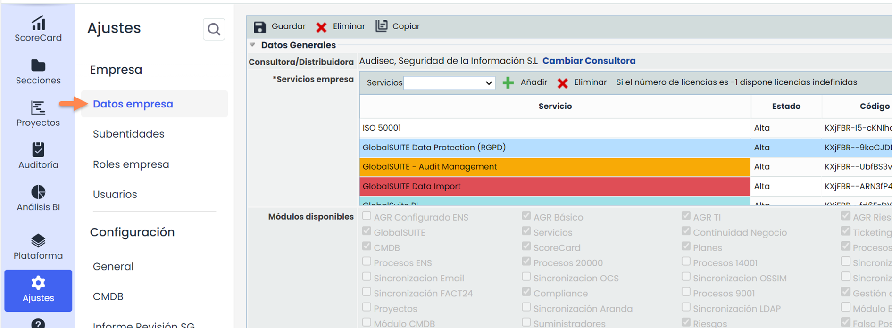

#### [**Catálogo de Servicios**](https://help.globalsuitesolutions.com/es/globalsuite/v1/catalogo-de-servicios) (Empresa)

GlobalSuite® identifica servicios o productos de la organización sobre la que se van a aplicar las medidas establecidas por el RGPD, y posteriormente establecer las dependencias con las diferentes áreas o departamentos de los que está compuesta la organización.

Para definir estos catálogos de servicios o productos, se deberá acceder a **Inicio >** [**Catálogo de Servicios**](https://help.globalsuitesolutions.com/es/globalsuite/v1/catalogo-de-servicios) y pulsar **Nuevo** para crear un registro, configurando a continuación la información relativa a la empresa y a cada servicio o producto.

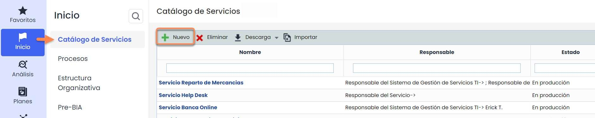

## Implementación del RGPD (Reglamento General de Protección de Datos)

#### Inicio - [Procesos de Negocio](https://help.globalsuitesolutions.com/es/globalsuite/v1/procesos) (Áreas organizacionales)

GlobalSuite® permite a la organización definir los servicios o productos que componen la empresa, la cual ha sido dada de alta en el apartado de “[**Servicios**](https://help.globalsuitesolutions.com/es/globalsuite/v1/catalogo-de-servicios)”. Partiendo de ello, se podrá desglosar dicha organización en los procesos, áreas, departamentos, divisiones o gerencias mediante la opción de “[**Procesos**](https://help.globalsuitesolutions.com/es/globalsuite/v1/procesos)”.

Para la definición de las áreas accedemos a la pestaña “Listado de Procesos” pulsando el botón “**Nuevo**”

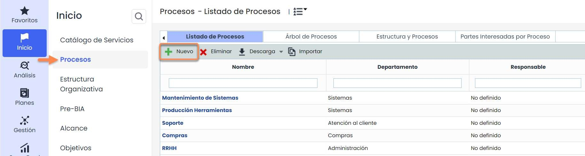

Una vez definidas las áreas-procesos y empresa, en la opción “**Árbol de Procesos**” se permite establecer la estructura de la organización, vinculado los servicios creados con las áreas organizacionales. Únicamente será necesario arrastrar las áreas de la tabla derecha a la jerarquía de la tabla izquierda hasta conformar las dependencias entre las distintas áreas de la organización.

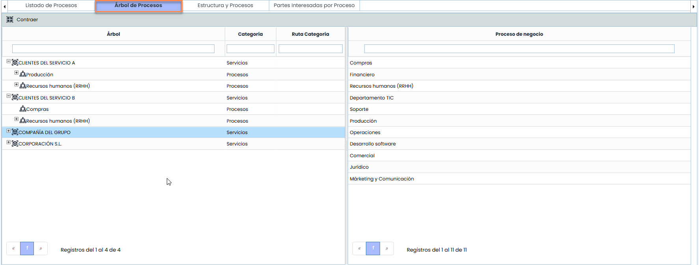

#### Inicio - [Roles y Responsabilidades](https://help.globalsuitesolutions.com/es/globalsuite/v1/gestion-de-roles)

Será necesario crear nuevos Roles, para ello GlobalSuite® permite configurar nuevos tipos de perfiles, en Inicio>[Gestión de Roles](https://help.globalsuitesolutions.com/es/globalsuite/v1/gestion-de-roles), presionando el botón **Configurar Roles** y, posteriormente en la nueva pestaña, definir aquellos perfiles requeridos por la organización con el botón Tras ello, se podrá asignar o asociar un empleado a cada rol como responsable del mismo.

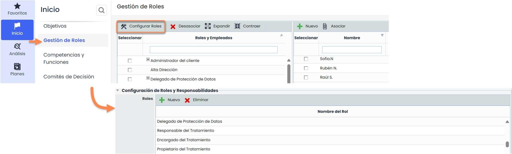

El RGPD requiere la definición de ciertos perfiles o responsabilidades, como puede ser el DPO (Delegado de Protección de Datos), etc. que van a formar parte del tratamiento y protección de los datos gestionados en la organización.

Esta definición se realiza en el menú de “[**Competencias y Funcione**s](https://help.globalsuitesolutions.com/es/globalsuite/v1/competencias-y-funciones)”, donde es posible asignar a los empleados y roles una serie de “Competencias” y “Funciones y Obligaciones”, tal y como se muestra en la figura.

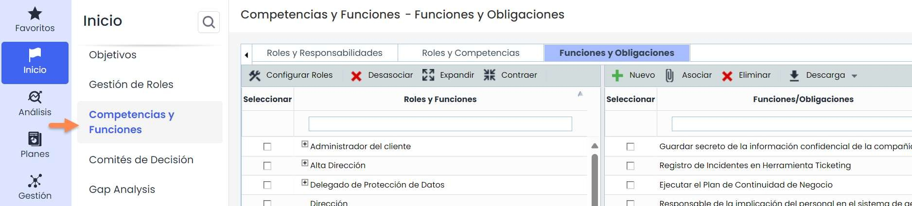

#### Inicio - [**Gap Analysis**](https://help.globalsuitesolutions.com/es/globalsuite/v1/gap-analysis)

GlobalSuite® permite evaluar el estado del cumplimiento respecto a algunas normativas propuestas por la Agencia Española de Protección de Datos. Para ello deberemos hacer uso del menú [**Gap Analysis**](https://help.globalsuitesolutions.com/es/globalsuite/v1/gap-analysis), seleccionar el catálogo proporcionado en el selector “Catálogos GAP” y accionando el botón

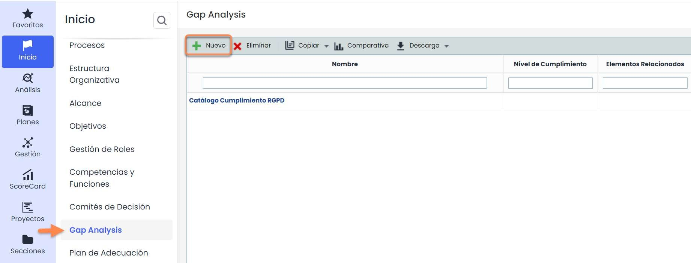

Dentro del catálogo podremos determinar el Estado de cada uno de los requisitos del RGPD mediante la columna “Estado Actual”. Asimismo, podemos asociar documentación, controles y no conformidades de manera directa, previamente introducidas en la misma herramienta GlobalSuite®.

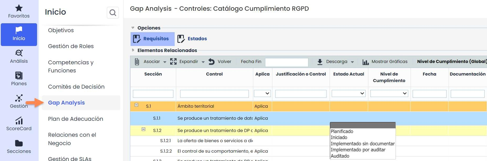

Una vez completo el GAP Analysis, podremos extraer gráficas del mismo que permitan conformar un informe del estado inicial del cumplimiento mediante la opción. Algunos ejemplos son los siguientes:

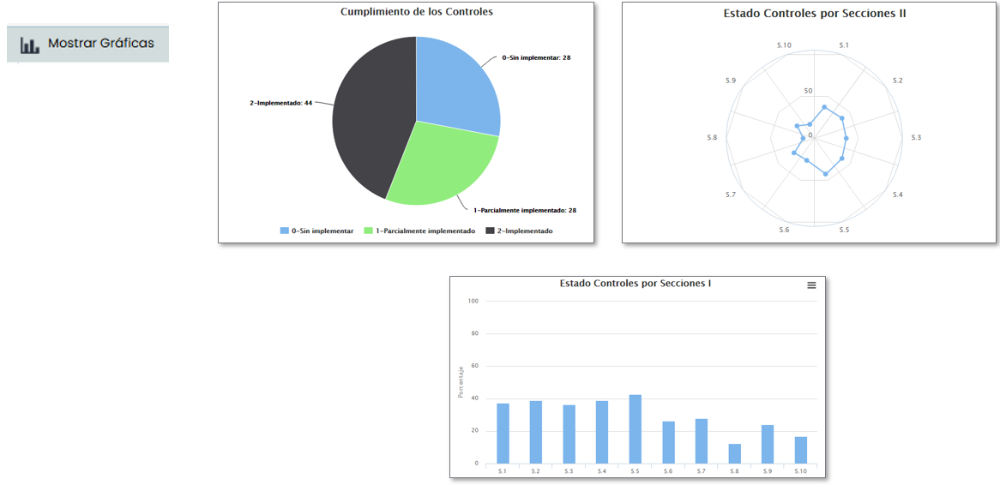

#### Inicio - [**Plan de Adecuación**](https://help.globalsuitesolutions.com/es/globalsuite/v1/plan-de-adecuacion)

Para los Análisis Gap realizados anteriormente, es posible realizar planes de adecuación que permitan establecer acciones de cumplimiento para lograr nuestro nivel de cumplimiento objetivo. Para ello deberemos hacer uso del menú [**Plan de Adecuación**](https://help.globalsuitesolutions.com/es/globalsuite/v1/plan-de-adecuacion) y seleccionar el Gap Analysis requerido

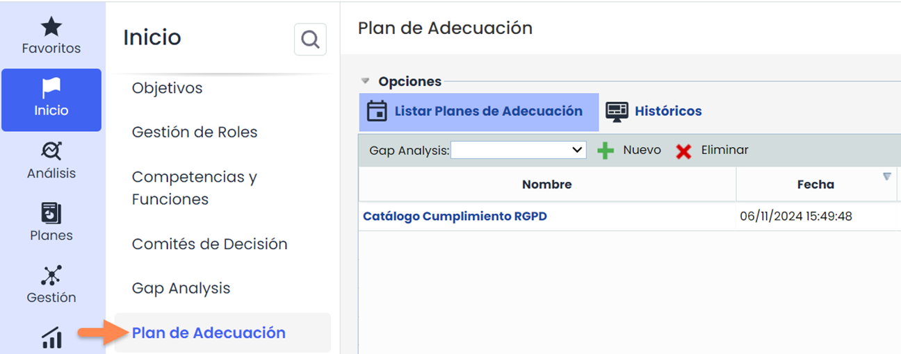

Para aquellos requisitos que no hayan sido implementados en la organización, GlobalSuite® permite establecer acciones para lograr su cumplimiento y hacer un seguimiento de las mismas desde el menú “**Seguimiento**”.

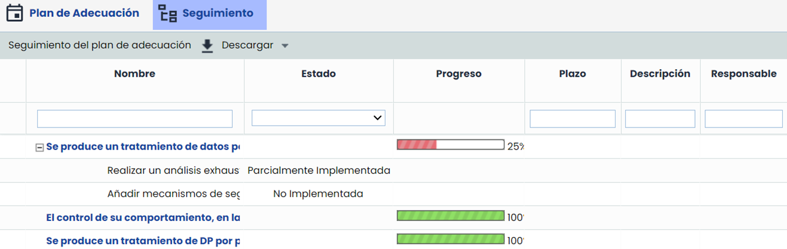

### Tratamiento

#### Tratamientos - [**Encargados de Tratamiento**](https://help.globalsuitesolutions.com/es/globalsuite/v1/encargado-de-tratamiento)

En la opción de “[**Encargados de Tratamiento**](https://help.globalsuitesolutions.com/es/globalsuite/v1/encargado-de-tratamiento)**”**, podemos registrar aquellos encargados del tratamiento de los datos personales.

Para ello, basta con pulsar sobre el botón “Nuevo” y dar de alta todos aquellos relacionados con nuestra organización.

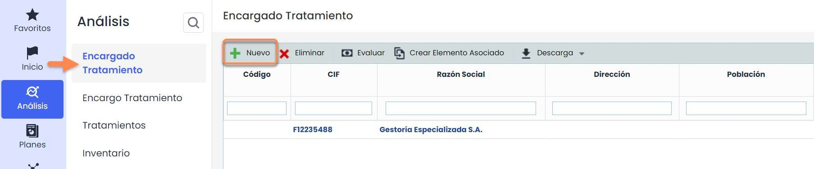

Como el RGPD exige realizar un seguimiento/evaluación de los encargados del tratamiento, GlobalSuite® permite registrar dicho análisis en la opción de “**Encargados de Tratamiento**”.

Para evaluar a un encargado de tratamiento, es necesario seleccionar el mismo sobre la tabla y pulsar sobre el botón “**Evaluar**”. Una vez se accede a la opción, en la opción de “**Tabla de Evaluaciones**” podremos dar de alta los registros relacionados con el encargado requerido, tal como se muestra en la siguiente imagen.

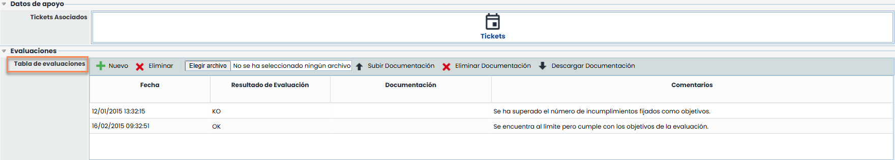

En esta opción de “Encargo de Tratamiento”, podemos registrar los tratamientos de los cuales nuestra empresa está encargada de su gestión.

Para ello, basta con pulsar sobre el botón “**Nuevo**” y dar de alta todos aquellos relacionados con nuestra organización.

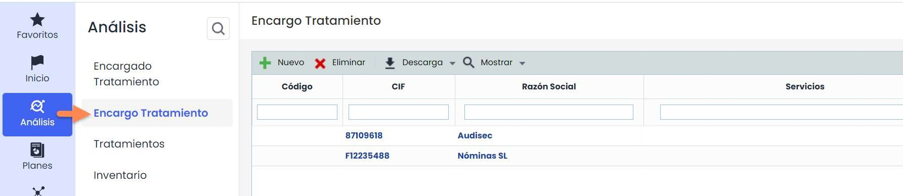

#### Tratamiento - Registro de Actividades de Tratamientos

Una vez definidas las áreas organizacionales, se han de inventariar, por cada una de ellas, los tratamientos de datos personales que se efectúan y los recursos técnicos que los soportan. Para insertar un nuevo tratamiento, se ha de pulsar sobre el botón en la tabla de la opción “[**Tratamientos**](https://help.globalsuitesolutions.com/es/globalsuite/v1/encargo-de-tratamiento)”.

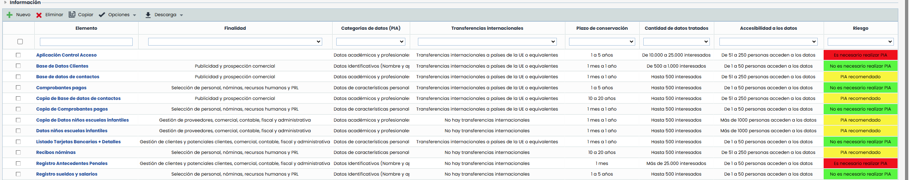

Cada uno de los tratamientos debe ser evaluado, en base a una serie de dimensiones, para determinar si se ha de realizar el PIA (Privacy Impact Assesment) o no. Las dimensiones de valoración son totalmente configurables en el apartado de **Ajustes**>[**Metodología Elementos**](https://help.globalsuitesolutions.com/es/globalsuite/v1/metodologia-elementos).

### Análisis PIA

#### Análisis PIA - [**Inventario**](https://help.globalsuitesolutions.com/es/globalsuite/v1/inventario)

Definidos los tratamientos, cada uno de ellos estarán localizados dentro de un proceso – elemento en concreto, por lo que con ayuda del [**Inventario**](https://help.globalsuitesolutions.com/es/globalsuite/v1/inventario) se añadirán los tratamientos al árbol de elementos según la jerarquía existente dentro de la organización. Además, podrán indicarse que aplicaciones, servidores o infraestructuras dan soporte a estos tratamientos

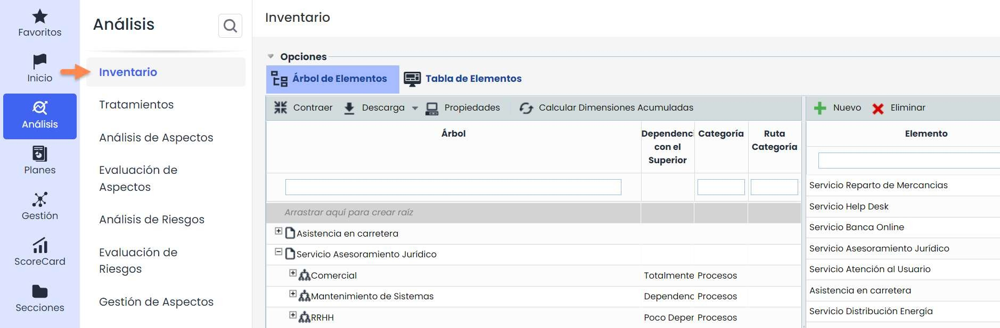

#### Análisis PIA – [Análisis de riesgos](https://help.globalsuitesolutions.com/es/globalsuite/v1/analisis-riesgos)

Para aquellos tratamientos que requieren realizar el PIA, GlobalSuite® permite analizar, por cada tratamiento de datos, las amenazas que le afectan y determinar el riesgo de exposición de la empresa a cada una de ellas dentro de la opción de [**Análisis de Riesgos**](https://help.globalsuitesolutions.com/es/globalsuite/v1/analisis-riesgos).

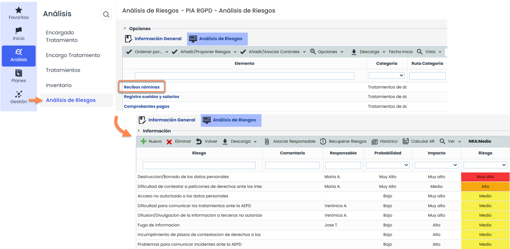

#### Análisis PIA – [Análisis de Riesgos](https://help.globalsuitesolutions.com/es/globalsuite/v1/analisis-riesgos) (Amenazas)

Para configurar el listado de amenazas asociadas a cada uno de los tratamientos de datos personales, deberemos ir al Menú de **Ajustes >“**[**Catálogos de Análisis**](https://help.globalsuitesolutions.com/es/globalsuite/v1/catalogos-analisis)**”.** En la tabla superior derecha podemos modificar el listado de amenazas existente (si la empresa quiere adecuarlo a sus requerimientos) y asociar al tratamiento de datos personales.

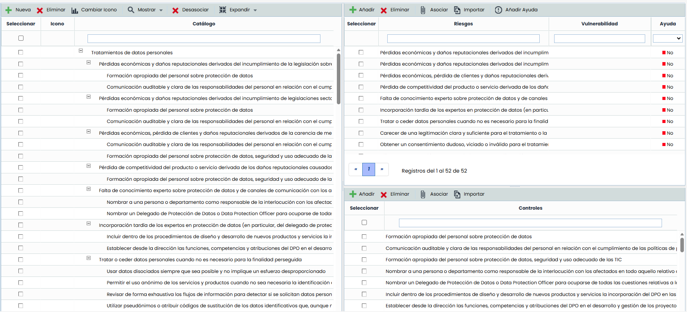

#### Análisis PIA – [**Evaluación de Riesgos**](https://help.globalsuitesolutions.com/es/globalsuite/v1/evaluacion-de-riesgos)

En el menú de “[**Evaluación de Riesgos**](https://help.globalsuitesolutions.com/es/globalsuite/v1/evaluacion-de-riesgos)” podremos ver un resumen de los resultados obtenidos en el análisis de riesgos. Con distintas gráficas que nos muestren los resultados de forma visual y posibilitando la descarga de dichas gráficas para incluirlas en distintos documentos.

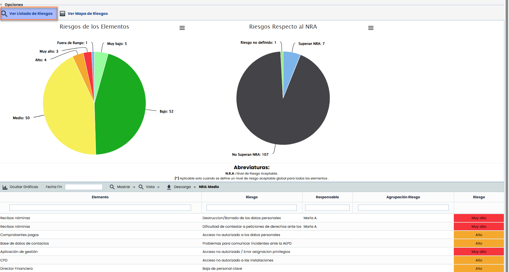

#### Análisis PIA – Evaluación de Riesgos ([Mapa de Riesgos](https://help.globalsuitesolutions.com/es/globalsuite/v1/ver-mapa-de-riesgos))

GlobalSuite® nos ofrece la posibilidad de mostrar nuestro análisis de riesgos, entre otras opciones, a partir de la representación de un “mapa de calor”. Todos estos datos podrán ser exportados mediante la opción “Descarga”.

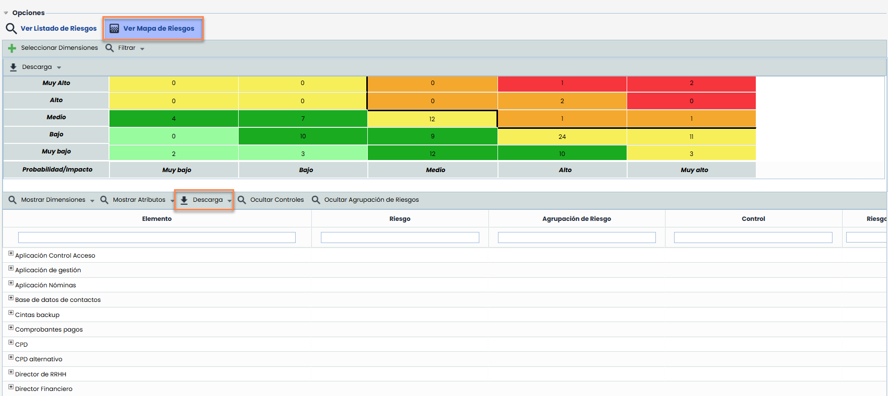

#### Análisis PIA – [Gestión de controles](https://help.globalsuitesolutions.com/es/globalsuite/v1/gestion-de-controles)

Una vez evaluadas las amenazas se podrá disponer y registrar los diferentes controles detectados e implantados que mitigarán dichas amenazas.

La metodología para el cálculo de la efectividad o la madurez de cada control podrá ser definida dentro del apartado de **Ajustes>**[Metodologías Controles](https://help.globalsuitesolutions.com/es/globalsuite/v1/metodologias-controles)de GlobalSuite®.

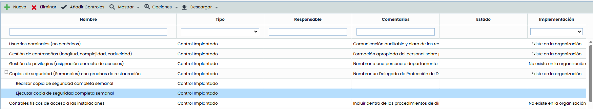

#### Análisis PIA – [Gestión de riegos](https://help.globalsuitesolutions.com/es/globalsuite/v1/gestion-de-riesgos)

Una vez evaluadas las amenazas será necesario establecer los distintos controles que permiten mitigar los riesgos detectados que estén por encima de nuestro Nivel de Riesgo Aceptable, lo que va a conformar el Plan de Tratamiento.

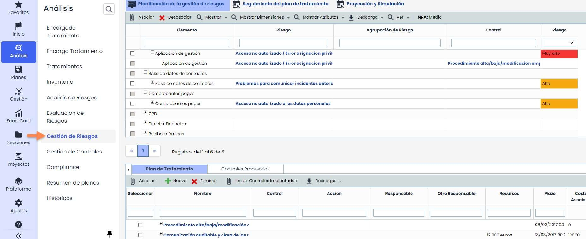

Para nuestro plan de tratamiento podremos proponer nuevos controles mediante el botón “**Nuevo**”, incluir los controles que ya hemos implantado mediante la opción “I**ncluir Controles Implantados**” o incluir nuevos controles propuestos según la configuración del Catálogo de Riesgos definidos, mediante la selección de la pestaña “**Controles propuestos.**”

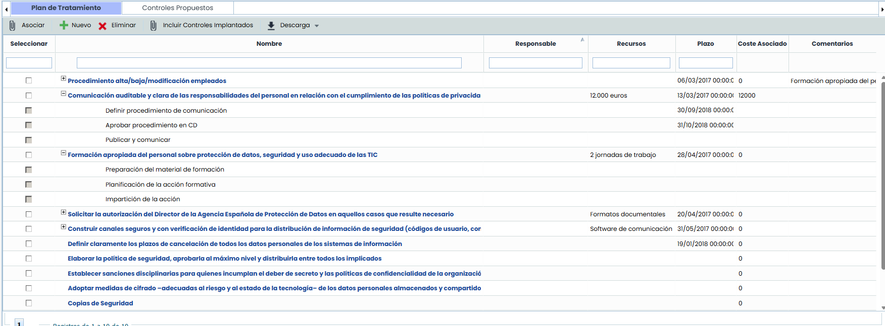

Una vez seleccionada la amenaza (ventana superior) y el control (ventana inferior), las asociaremos mediante la opción “**Asociar**”. En cuanto asociemos un nuevo control a una amenaza, éste será incluido de manera automática en el plan de tratamiento.

Es posible definir diferentes acciones para cada uno de los controles, una vez completadas se podrá implantar el control, según se muestra en la grafica izquierda.

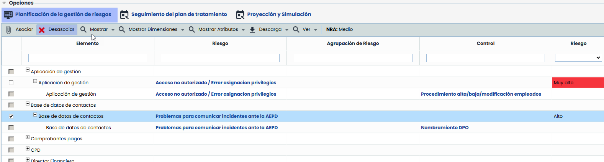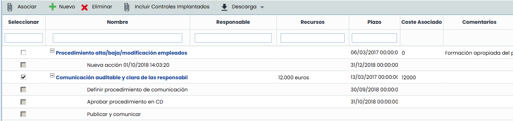

En la opción de “**Seguimiento del plan de tratamiento**”, podremos ver los plazos definidos para la finalización de cada uno de ellos, junto con su progreso derivado de la completitud de las acciones que tengan asociadas. Si el Progreso del Control es 100%, indicará que el control se considera implantado. Para que el control se considere implantado en GlobalSuite®, deberemos pulsar “**Implantar Controles Implantados**” (Se implantarán los controles con un progreso del 100%)

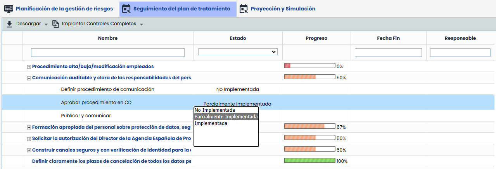

#### Análisis PIA – [**Compliance**](https://help.globalsuitesolutions.com/es/globalsuite/v1/compliance)

Similar a la opción GAP análisis, se podrá utilizar el [**Compliance**](https://help.globalsuitesolutions.com/es/globalsuite/v1/compliance) para tratar y actualizar a nivel normativo de cumplimiento de RGPD, así cómo tener activas diferentes versiones a lo largo de la vida de nuestro SG.

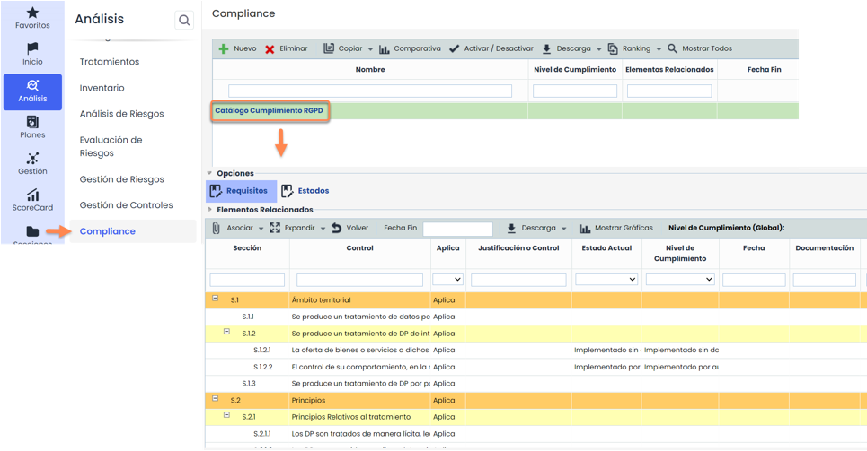

### Planes

#### Planes – [**Formación y Capacitación**](https://help.globalsuitesolutions.com/es/globalsuite/v1/formacion-y-capacitacion)

GlobalSuite® permite a la organización la gestión de sus planes de [**Formación y Capacitación**](https://help.globalsuitesolutions.com/es/globalsuite/v1/formacion-y-capacitacion). En éstos podremos incluir los distintos participantes, si finalmente se realizó, la documentación asociada a modo de repositorio y las fechas de realización.

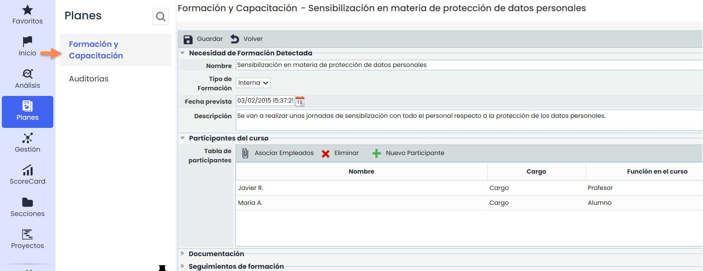

#### Planes – [Auditoría](https://help.globalsuitesolutions.com/es/globalsuite/v1/auditoria)

GlobalSuite®, como uno de los requisitos de analizar la protección efectuada en la organización respecto a los datos personales, ofrece la posibilidad de registrar dichas evaluaciones en la opción de **“**[**Auditoría**](https://help.globalsuitesolutions.com/es/globalsuite/v1/auditoria)**”.**

En la pestaña de “**Planificación**” podremos dar de alta los datos relativos a la auditoría a realizar.

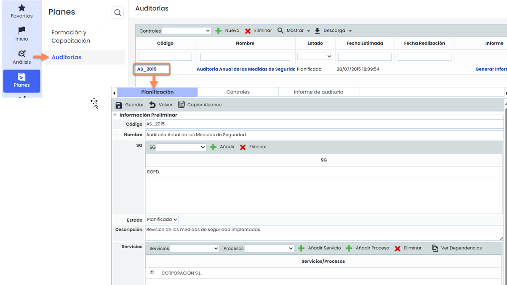

En la pestaña “**Controles**”, dentro de la opción de [**Auditoría**](https://help.globalsuitesolutions.com/es/globalsuite/v1/auditoria), se pueden registrar por cada uno de los requisitos del RGPD, los hallazgos detectados y anotar los mismos de manera concreta por cada uno de ellos.

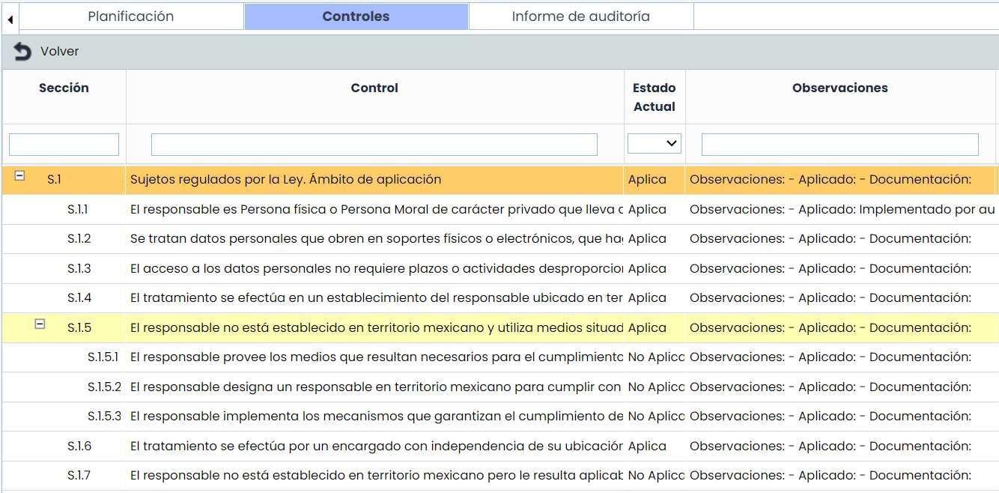

Por último, la pestaña de “**Informe**” permite documentar los resultados de la auditoría, registrando las No Conformidadesy Observaciones detectadas, así como los responsables, puntos de mejora, etc.

Destacar que, desde la opción de informe, se pueden gestionar las “**No Conformidades**” como un registro dentro de la herramienta, en la opción de “**Gestión**”>[**No Conformidades**](https://help.globalsuitesolutions.com/es/globalsuite/v1/no-conformidades).

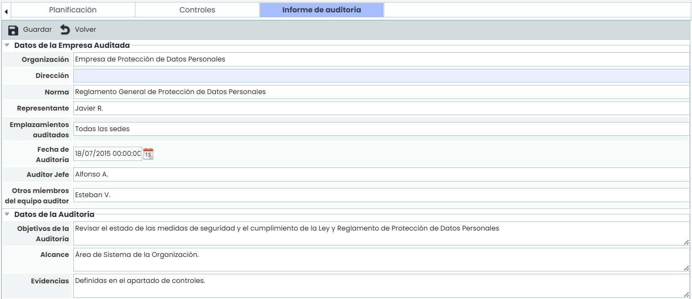

### Scorecard

#### Scorecard– [Métricas](https://help.globalsuitesolutions.com/es/globalsuite/v1/metricas)

GlobalSuite® permite establecer métricas que permitan recoger distintos datos en la herramienta. Los datos de cada métrica serán representados dependiendo de su fecha y su valor. Será en la siguiente etapa cuando a partir de la combinación de las métricas se establezcan los indicadores.

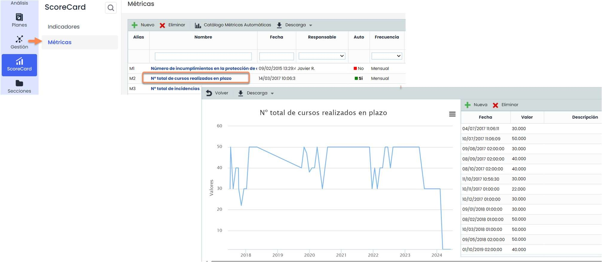

#### Scorecard – [Indicadores](https://help.globalsuitesolutions.com/es/globalsuite/v1/indicadores)

A partir de la combinación de las métricas anteriormente establecidas, se elaborarán los indicadores. Para ello, deberemos establecer la relación de las mismas a través de una fórmula. Para poder utilizar los datos introducidos en las métricas, los indicadores deberán tener la misma frecuencia de recolección. Estos indicadores podrán ser utilizados en la extracción de informes (**Secciones>** [**Informes**](https://help.globalsuitesolutions.com/es/globalsuite/v1/informes)).

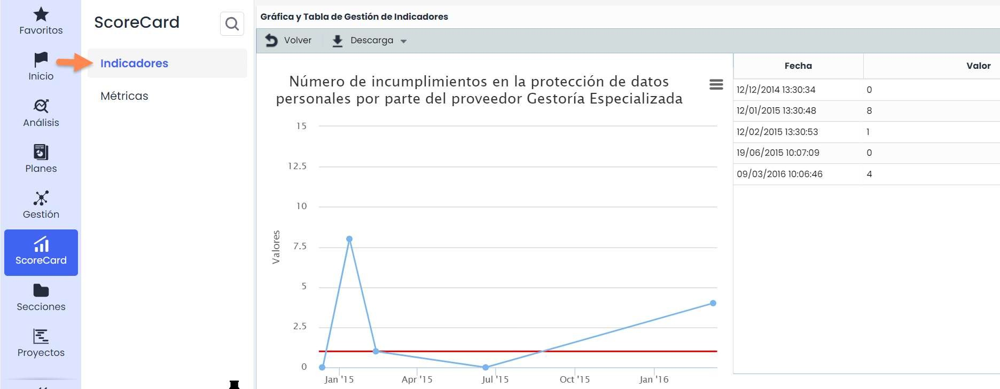
