# Cómo configurar la agrupación y tipos de riesgos en GlobalSuite®


Este tutorial explica, paso a paso, cómo configurar y utilizar la \*\*agrupación de riesgos\*\* en GlobalSuite®, también denominada \*\*tipos de riesgo\*\* o \*\*taxonomía de riesgos\*\*.
En esta guía se detalla cómo crear y vincular categorías de riesgo dentro del \*\*catálogo de análisis\*\*, cómo realizar la \*\*categorización automática y manual\*\* de riesgos en los análisis, y cómo obtener informes segmentados según las tipologías configuradas.
Además, se explica cómo asociar los catálogos de riesgos a los análisis, aprovechar la \*\*categorización jerárquica\*\*, y visualizar los resultados desde el \*\*Mapa de Riesgos\*\* y el \*\*Listado de Riesgos\*\* para facilitar la evaluación y toma de decisiones


## Introducción

GlobalSuite® permite llevar a cabo el análisis de los riesgos categorizando estos por tipología de riesgo, con la finalidad de poder obtener la información referente segmentada según esta discretización.

Cabe mencionar que en GlobalSuite® esta funcionalidad aparece con diferentes nomenclaturas, como son: “Agrupación de Riesgos”, “Tipos de Riesgos” y “Taxonomía de Riesgos”, haciendo odas ellas referencia a la misma opción.

Destacar también que la categorización de riesgos se podrá realizar de manera jerárquica, con la estructura y niveles que se requieran. Por ejemplo:

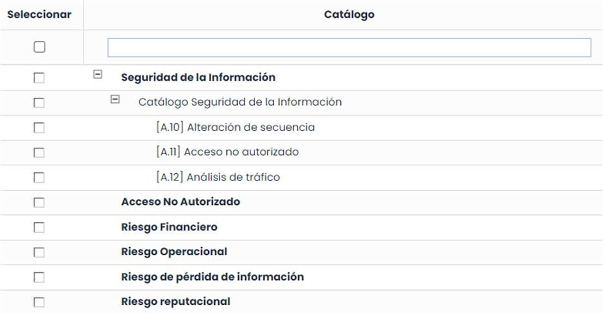

## Configuración. Agrupación y vinculación con el catálogo.

La configuración de esta funcionalidad se encuentra disponible desde **Ajustes > Plantillas >** [**Catálogos análisi**s](https://help.globalsuitesolutions.com/es/globalsuite/v1/catalogos-analisis), específicamente en la pestaña “Tipos de Riesgos”, tal y como se muestra en el ejemplo de la siguiente imagen:

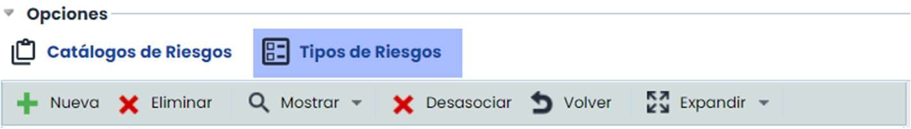

Para poder utilizar la categorización, es requisito la creación de las categorías de riesgos así como la asociación de éstas con el catálogo de riesgos que se vaya a utilizar en el análisis.

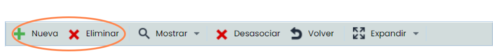

Desde esta opción se podrá, además, agrupar por categoría los riesgos de éstos. De este modo, cuando se propongan automáticamente riesgos desde un catálogo en el análisis, GlobalSuite® categorizará estos riesgos según esta configuración. Cabe mencionar, que desde el propio análisis también se podrá categorizar el riesgo de manera manual, siendo único requisito que el catálogo utilizado tenga asociadas estas categorías en la presente opción.

La asociación con el catálogo se realizará marcando las categorías, en la parte izquierda de la pantalla y el catálogo (o catálogos) en la parte derecha. Tras ello, basta con pulsar en el botón “Asociar”. También se podrán categorizar los riesgos. Seleccionando el catálogo, los riesgos se despliegan en la tabla inferior y se podrá seleccionar categoría y riesgos; pulsando esta vez en el botón “Asociar” de la tabla de riesgos, éstos quedarán categorizados.

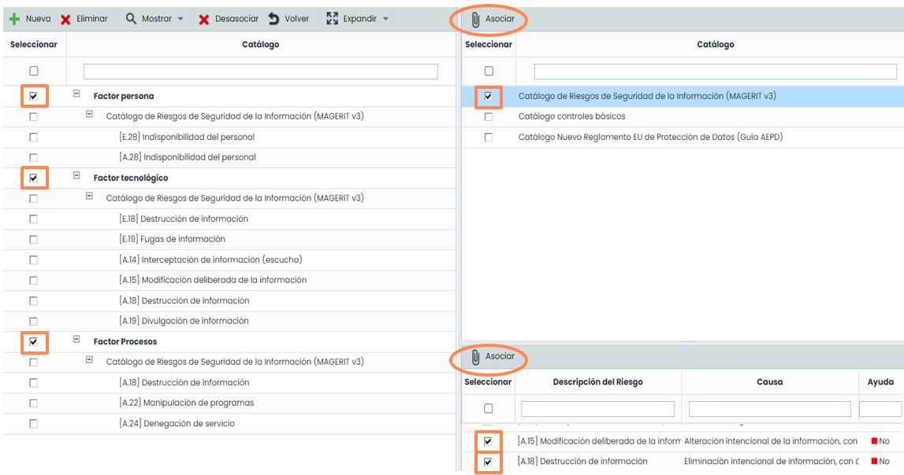

A modo de recordatorio. La asociación de catálogos a un análisis de Riesgos se realiza desde el propio análisis de riesgos, concretamente en la pestaña “Información General”. En la sección “Catálogos” aparece el listado de catálogos disponibles que se pueden utilizar para el análisis de riesgos. Es obligatorio utilizar un catálogo específico, al menos a título informativo, ya que así se permite que la herramienta asocie un conjunto de riesgos y vulnerabilidades a cada elemento, en función de su categoría definida.

Para seleccionar un catálogo, simplemente hay que pulsar sobre el “check” que aparece al lado de cada uno.

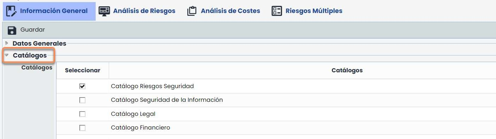

## Categorización automática de riesgos

Es posible realizar la categorización automática de los riesgos de un análisis aprovechando las funcionalidades de asociación automática de riesgos existentes dentro del propio análisis.

A modo de recordatorio, dentro del análisis de riesgos, entre otras, existen dos formas diferentes de asignar riesgos desde los catálogos asociados. En ambas se podrá aprovechar la categorización automática.

Tanto si se utiliza la funcionalidad de “Proponer o Añadir Riesgos Catálogo”…

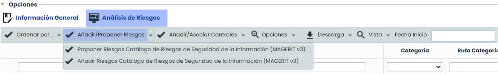

… como si se utiliza la funcionalidad de “Recuperar Riesgos”…

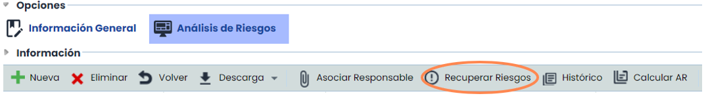

..., éstos se auto categorizarán respetando la configuración realizada en el apartado anterior.

## Categorización manual de riesgos.

Dentro de un [**Análisis de Riesgos**](https://help.globalsuitesolutions.com/es/globalsuite/v1/analisis-riesgos), seleccionando uno de los riesgos, aparece en la parte inferior de la pantalla en formato “formulario”, toda la información referente.

En la primera pestaña, “**Análisis**”, se encuentra el campo “**Riesgos**”, que informa de las categorías asociadas a éste y además permite la categorización manual.

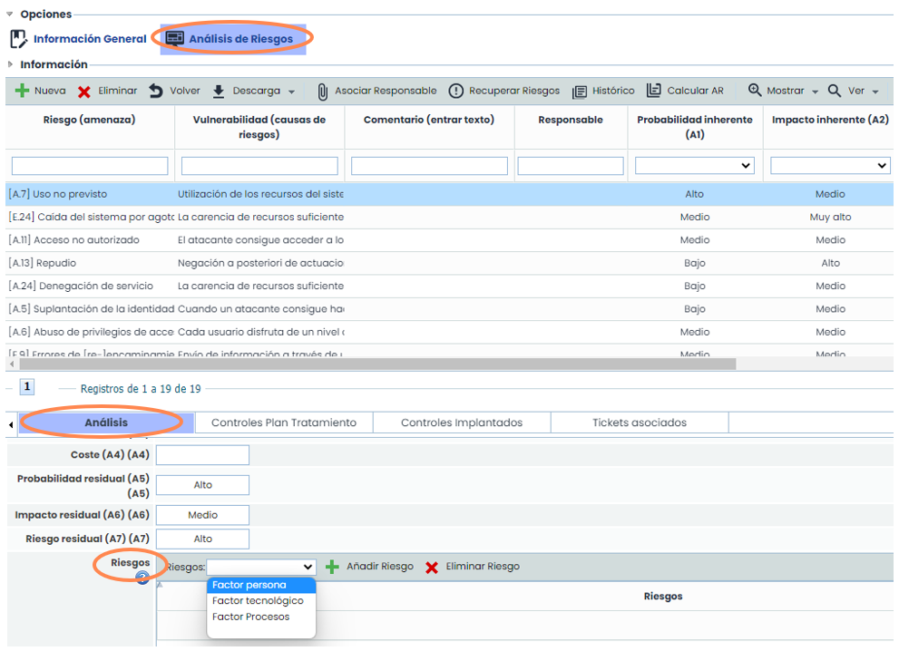

## Discretización y Evaluación.

Desde la opción Evaluación de Riesgos, se podrán obtener informes de resultados atendiendo a la categorización configurada. La pestaña “Ver Mapa de Riesgos”, permite elaborar informes filtrando los riesgos por niveles, disponiendo además de gran cantidad de información referente y atributos; siendo uno de ellos, el campo “**Agrupación de Riesgo**”, tal y como se muestra en la siguiente imagen:

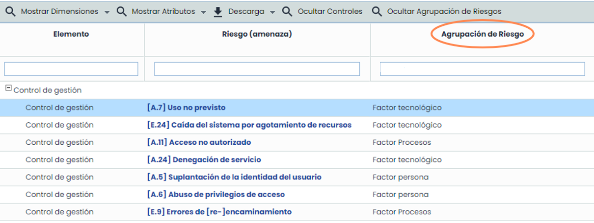

Desde la pestaña, “Ver Listado de Riesgos”, se podrán consultar tanto en forma de tabla como de manera gráfica, los riesgos del análisis por categoría o por elemento frente a los valores de NRA y NRO del análisis. En la siguiente imagen se puede observar la gráfica citada donde se ha realizado el filtro atendiendo a las categorías:

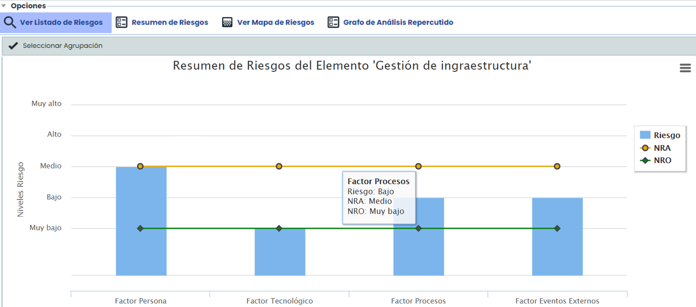

Las categorías mostradas en la gráfica se podrán filtrar utilizando el botón “**Seleccionar Agrupación**” que aparece en la esquina superior izquierda.

Tanto la gráfica de la imagen anterior, como la tabla que se muestra a continuación con la segmentación de los riesgos por categoría, se obtienen seleccionando en el botón “Vista” la opción “Riesgos”, tal y como se muestra a continuación.

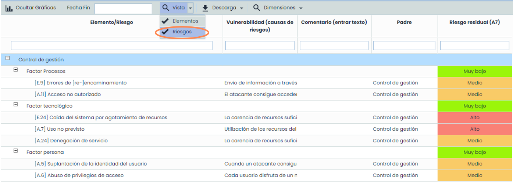
