# Cómo configurar metodologías de análisis de riesgos en GlobalSuite®


Este tutorial explica, paso a paso, cómo configurar las \*\*metodologías de análisis de riesgos\*\* en GlobalSuite®, abarcando los tres niveles principales: \*\*elementos, riesgos y controles\*\*.
En esta guía se detalla cómo definir la \*\*configuración general de análisis\*\*, establecer \*\*dimensiones y dependencias entre elementos\*\*, y crear metodologías personalizadas para el \*\*análisis y evaluación de riesgos\*\*. También se describe la configuración de \*\*dimensiones automáticas\*\*, el uso de \*\*fórmulas y productos cartesianos\*\*, la definición de \*\*niveles de eficacia de controles\*\*, y la forma de aplicar filtros temáticos o visibilidad de dimensiones para adaptar las metodologías a cada organización


## Fases para la Configuración de la funcionalidad de Análisis de Riesgos

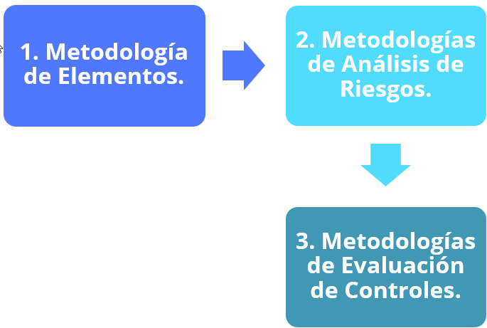

## Configuración de la Metodología de elementos

La opción **Ajustes> Metodologías** [**Elementos**](https://help.globalsuitesolutions.com/es/globalsuite/v1/metodologia-elementos), permite configurar aspectos generales del análisis de riesgos, en especial aquellos relacionados con el inventario de elementos de la organización.

La opción se divide en seis secciones generales: **Visibilidad de Opciones, Configuración General Análisis, Configuración Dimensiones, Configuración Visibilidad Dimensiones, Filtros predefinidos y Configuración de Campos de Controles.**

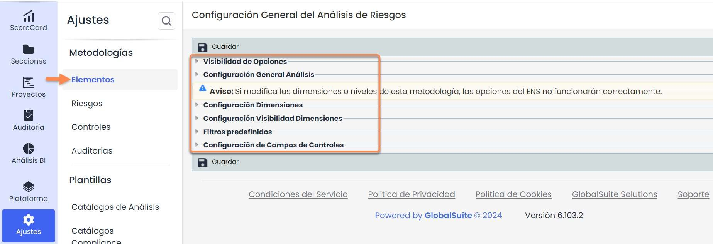

La sección “**Visibilidad de Opciones**” permite configurar qué opciones se pueden visualizar.

* **Análisis de Costes:** Si está activado, permite acceder a la funcionalidad de "Análisis de Costes" en la opción de Análisis de Riesgos.
* **Riesgos Múltiples:** Si está activado, permite acceder a la funcionalidad de "Riesgos Múltiples" en la opción de Análisis de Riesgos.
* **Mapa de Riesgos Repercutidos:** Si está activado, permite acceder a la funcionalidad de "Grafo de Análisis Repercutido" en la opción de Evaluación de Riesgos.
* **Indicadores en análisis de riesgos**: Si está activado, permite asociar Indicadores del cuadro de mando a los riesgos de los Análisis de Riesgos.

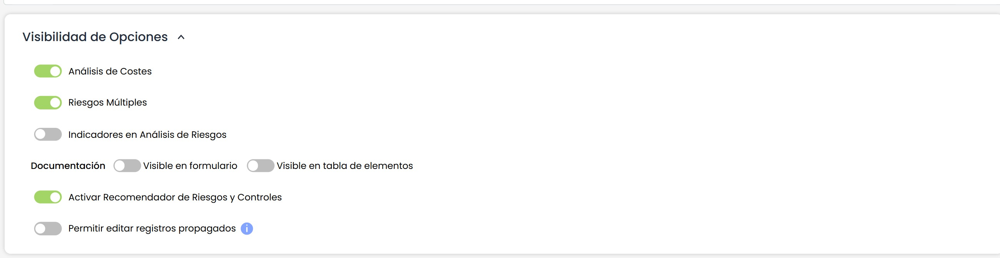

La sección “**Configuración General Análisis**” permite configurar, en primer lugar, las dependencias entre elementos. GlobalSuite® permite realizar un árbol de dependencias de elementos, de forma que los elementos identificados se pueden relacionar entre sí y también con los servicios y procesos que correspondan.

También se puede activar/desactivar la Tabla de Elementos en Dependencias que permite mostrar la tabla de elementos en la opción de Inventario junto al árbol de elementos.

Se puede configurar tanto el grado de las dependencias a utilizar como el modo de aplicar estas dependencias (global a todas las dimensiones del inventario de elementos o de manera independiente para las mismas).

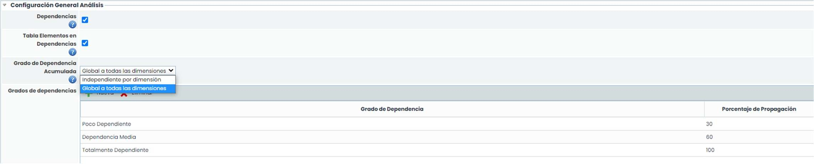

Otras opciones que se pueden configurar en la sección “**Configuración General Análisis**” son las siguientes:

Categorías: Corresponde a las categorías de que se pueden utilizar para clasificar los elementos. Algunas categorías especiales se configuran en el campo "Tipo", y permiten gestionar esos elementos desde su opción correspondiente.

* **Categoría Riesgos:** Permite establecer categorías/tipos de riesgos para clasificar los riesgos.
* **Atributos Configurables:** Permite establecer campos específicos adicionales a los campos existentes para el inventario de elementos. Sin embargo, se recomienda utilizar dimensiones de tipo "Texto" (se explican más adelante).

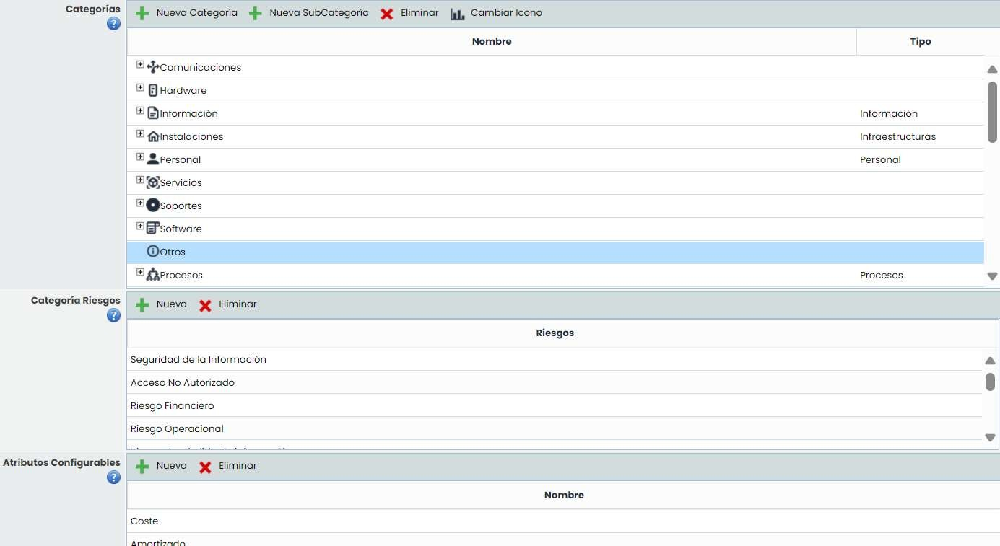

La sección “**Configuración Dimensiones**” permite configurar el conjunto de dimensiones que van a ser utilizadas para la valoración de los elementos identificados de la organización.

GlobalSuite® incorpora por defecto un conjunto de dimensiones con una serie de niveles. Tanto las dimensiones como los niveles de cada una de ellas se pueden configurar de manera individual. Concretamente se permite lo siguiente:

* **Tratamiento de valores Acumulados:** En caso de que se utilicen dependencias, esta opción permite indicar qué valor utilizar para cada dimensión: Propio (si existe, se toma este valor si no el acumulado, Acumulado (si existe, se toma este valor, si no el propio) y Mayor valor (se comparan los valores entre el valor propio y el acumulado y se queda con el mayor).
* **Dimensiones**: Esta tabla permite crear, modificar y eliminar las dimensiones del inventario de elementos, así como ordenarlas.

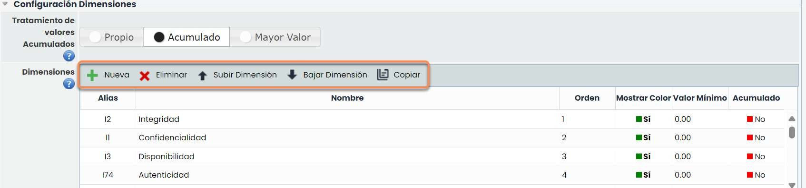

La información que nos ofrecen las columnas de la tabla es la siguiente:

* **Alias**: Identificador que genera la herramienta de manera automática.
* **Nombre**: Muestra el nombre de la dimensión. Pulsando 2 veces sobre la celda permite cambiar al nombre de la misma.
* **Orden**: Identifica el orden en el que la dimensión aparecerá en el inventario de elementos.
* **Mostrar Color**: Permite definir si queremos resaltar la dimensión en un color.
* **Valor Mínimo**: Identifica el número mínimo sobre el cual se calcula la fórmula de la dimensión seleccionada.
* **Acumulado**: Posibilita incluir y establecer las dependencias de la dimensión seleccionada (árbol de elementos) y visualizar los valores acumulados en el Inventario de Elementos.

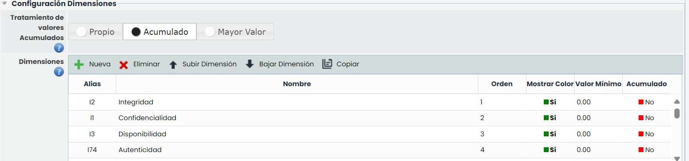

Cada dimensión se puede configurar de manera individual seleccionando una de ellas. Las opciones existentes son las siguientes:

* **Tipo de Dimensión:** Una dimensión puede ser Cuantitativa (valor numérico) o Cualitativa (lista de valores).
* **Valor**: El valor de una dimensión puede establecerse de forma Automático, es decir, que se evalúa en base a otras dimensiones, o de forma Manual, que son evaluadas manualmente por el usuario.
* **Tipo de Cálculo**: En caso de que el valor de la dimensión se obtenga Automático, se puede configurar una fórmula de cálculo o un producto cartesiano (el resultado viene predeterminado de dos dimensiones).

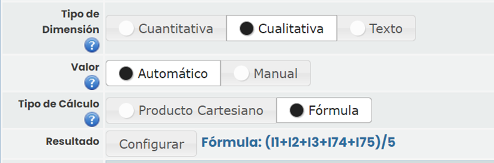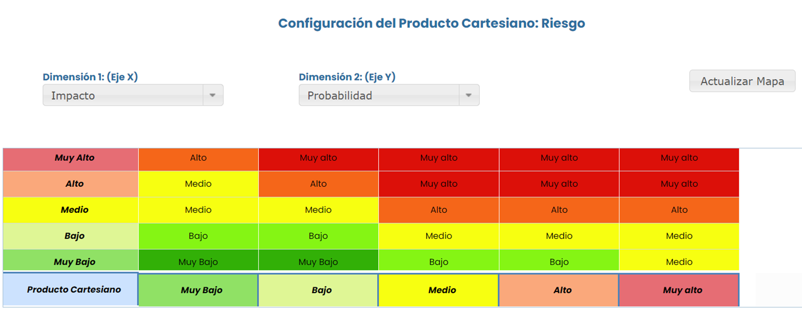

**Niveles de Dimensiones**: Para las dimensiones Cualitativas (tanto automáticas como manuales), se permite indicar los niveles que pueden tener así como un color asociado. En cada uno de los niveles se puede configurar las cantidades de las columnas “Valor” y “Máximo”:

* **Valor**: Es el valor específico que se le da a esa dimensión. Este valor se utilizará en las fórmulas de las dimensiones automáticas.
* **Máximo**: El valor máximo es utilizado únicamente en las dimensiones automáticas, de forma que en función del resultado obtenido en la fórmula de cálculo, la dimensión tendrá el nivel que corresponda.

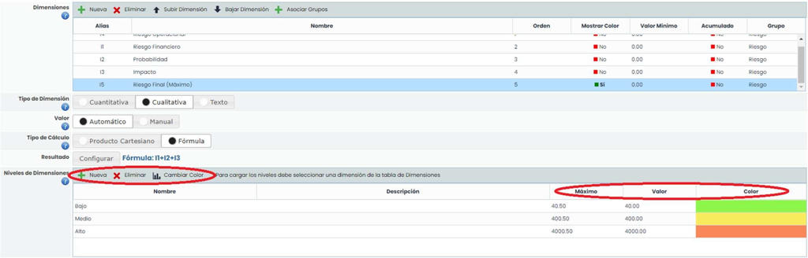

La sección “**Configuración Visibilidad Dimensiones**” permite configurar la visualización de las dimensiones. Se pueden crear Grupos de Dimensiones, los cuales se pueden asociar a las dimensiones.

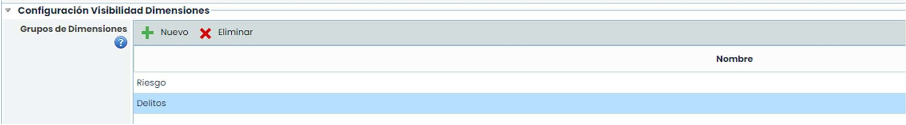

Para asociar las dimensiones a cada grupo, hay que hacerlo en la sección “**Configuración Dimensiones**”, se selecciona la dimensión deseada, se pulsa el botón “asociar grupos” y se indica el grupo.

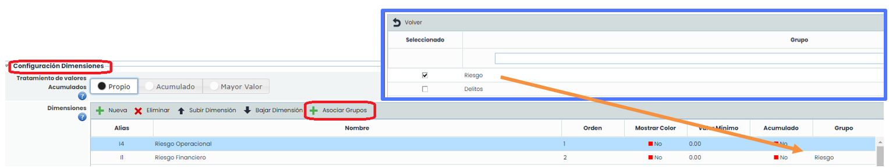

Una vez asociadas, se puede ver el grupo al que pertenece cada dimensión en la columna “Grupo”.

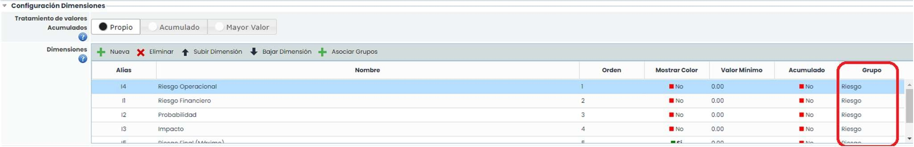

Para cada uno de los grupos configurados, tendremos la opción en el Inventario de elementos, de mostrar únicamente las dimensiones de ese grupo.

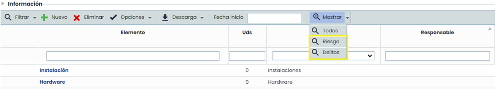

**Visibilidad Dimensiones (formularios)**: Esta tabla permite configurar GlobalSuite de forma que la visualización y/o valoración de algunos tipos de elementos (servicios, procesos, proveedores, infraestructuras, empleados, etc.) e incluso del formulario de los elementos en sí, se pueda realizar en la opción dónde se generan, de manera adicional a la opción 'Inventario’.

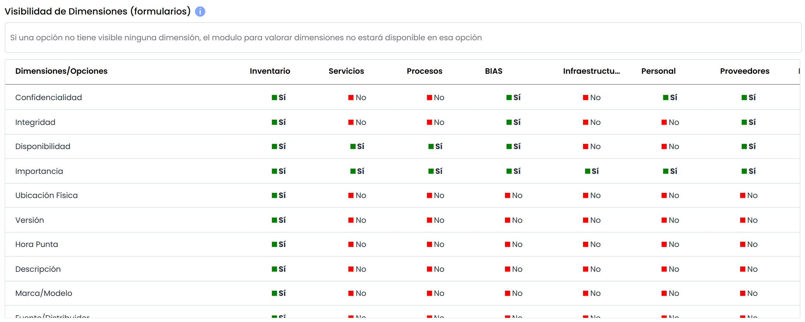

Como se puede observar en la imagen, se permite configurar algunas opciones de la herramienta (servicios, procesos, suministradores, infraestructuras y empleados) para indicar qué dimensiones del inventario se pueden valorar en la opción correspondiente de GlobalSuite. Para indicar 'Sí' o 'No', simplemente hay que pulsar sobre la celda correspondiente. Si alguna opción tiene todas las dimensiones con 'No', el formulario correspondiente no tendrá la sección que permite realizar la valoración.

**Visibilidad Dimensiones en Tablas**: Esta tabla permite configurar GlobalSuite de forma que la visualización de las dimensiones en las tablas de opciones determinadas pueda modificarse.

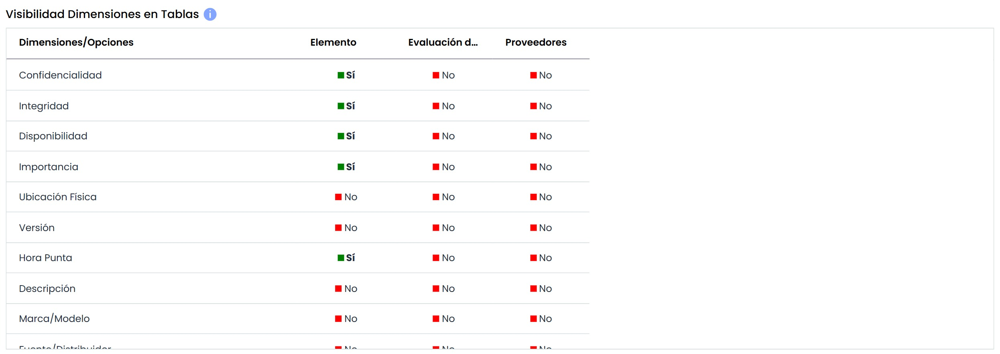

## Configuración de las metodologías de Riesgos.

La opción **Ajustes> Metodologías** [**Riesgos**](https://help.globalsuitesolutions.com/es/globalsuite/v1/metodologia-riesgos) permite configurar las metodologías de riesgos de la organización. GlobalSuite® permite generar varias metodologías de riesgos y éstas aplicarlas a los diferentes análisis de riesgos que se realicen.

La pestaña muestra al acceder una tabla con las metodologías existentes. Esta tabla permite generar nuevas metodologías (botón “**Nuevo**”) o eliminar alguna de las existentes (botón “**Eliminar**”). Además, se puede añadir una metodología ya existente (botón “**Añadir**”) realizándose una copia de la metodología seleccionada y, de esta forma, realizar su modificación posterior. Esto permite no comenzar desde cero la configuración de una metodología.

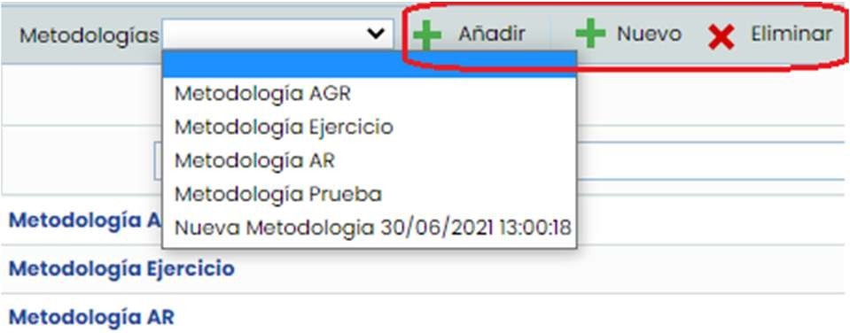

Al pulsar sobre el nombre de una metodología accedemos al formulario de configuración. Este formulario está formado por diferentes secciones que permiten configurar todos los aspectos de una metodología de riesgos.

La sección “**Configuración Dimensiones de la Metodología**” permite configurar tanto los campos para los riesgos (riesgo, vulnerabilidad, etc.) como las dimensiones utilizadas para su análisis (probabilidad, impacto, etc.).

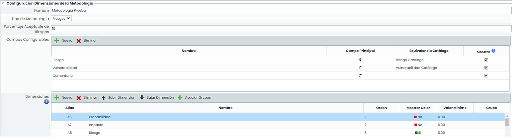

La configuración de las dimensiones del análisis de riesgos se realiza de la misma forma que las dimensiones del inventario de elementos (explicado en páginas anteriores).

Adicionalmente para el cálculo de las dimensiones automáticas, aparte del producto cartesiano y la definición de una fórmula de cálculo, se permite establecer una fórmula condicional. Este tipo de fórmulas están disponibles tanto para las metodologías de riesgos como para las metodologías de controles (ver ejemplo de fórmula creada en la metodología de controles).

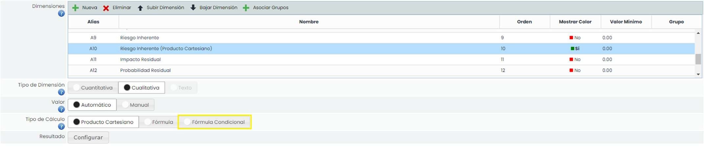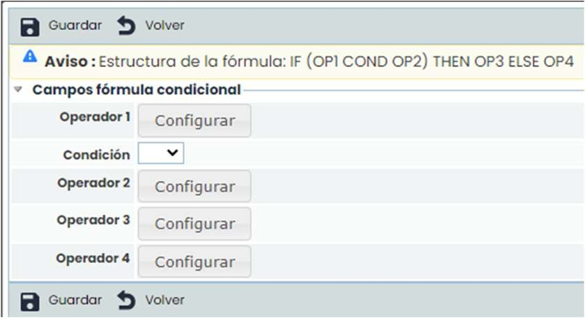

Para establecer una fórmula condicional, al pulsar el botón de “Configurar” una vez elegida este tipo de fórmula, nos aparecen las siguientes instrucciones

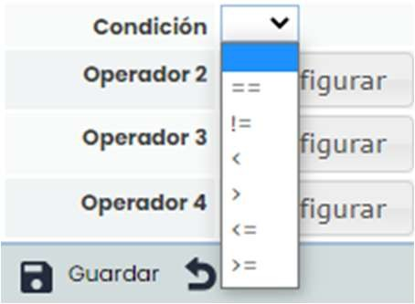

La estructura de la fórmula es la indicada en el cuadro amarillo: Si se cumple lo indicado en el operador 1, condición y operador 2, entonces se realizará la instrucción del operador 3, si no se cumple, entonces se realizará la del operador 4.

En el desplegable del botón “**condición**”, se pueden elegir las siguientes opciones:

Al pulsar el botón “**configurar**” de cada operador, se puede elegir el tipo de elemento al que se hace referencia, pudiendo elegir entre dimensiones del inventario de elementos, dimensiones del análisis de riesgos y dimensiones de la evaluación de controles, teniendo que escoger un cuantificador para éstas últimas.

En la parte de la derecha nos aparece la calculadora para poder insertar la fórmula y poder definir los signos correspondientes. Antes de guardar la fórmula, primero hay que pulsar el botón de validar fórmula.

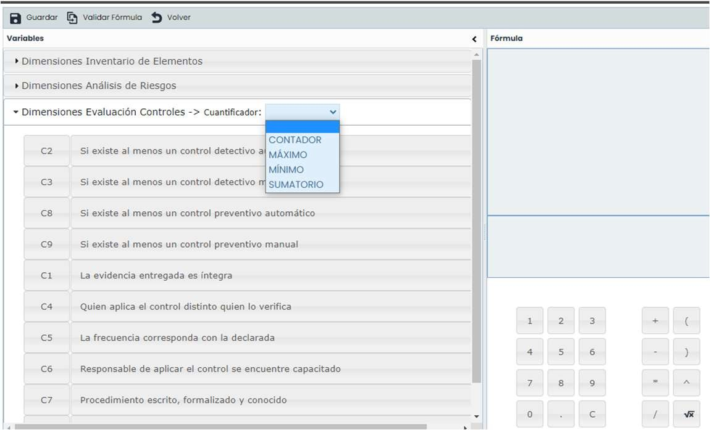

De manera adicional, en la metodología de riesgos se permite elegir qué dimensión corresponde al Riesgo y qué dimensión corresponde al Coste. La selección de la dimensión del Riesgo es importante ya que GlobalSuite® lo utiliza para la visualización de diferentes resultados. También se permite seleccionar cómo se va a establecer el Nivel de Riesgo Aceptable, si de manera Global o de manera particular a cada Elemento.

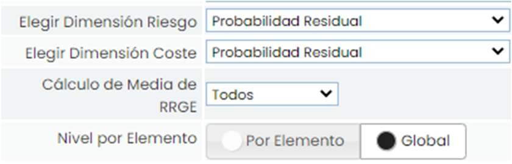

La sección “**Configuración Visibilidad Dimensiones**” permite configurar la visualización de las dimensiones.

Se pueden crear Grupos de Dimensiones, los cuales se pueden asociar a las dimensiones.

La asociación de dimensiones a un grupo se realiza de la misma manera que en la metodología de elementos

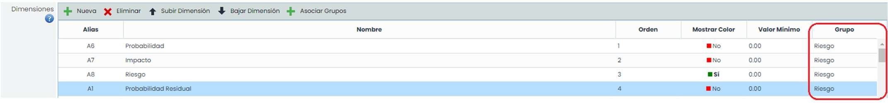

La sección “Filtros Temáticos de Riesgos” permite filtrar la visibilidad en la opción de Evaluación de riesgos.

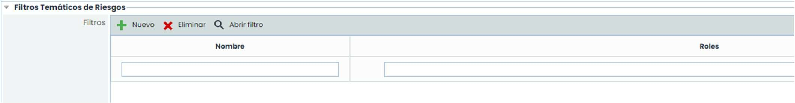

Pulsando el botón “**Nuevo**” se crea el filtro, se selecciona y se pulsa “**Abrir filtro**” para poder configurarlo. En el formulario se encuentran los siguientes campos:

* **Nombre**: Permite cambiar el nombre del filtro
* **Grupos** **de Dimensiones**: Si se ha creado algún grupo se puede seleccionar
* **Roles**: Se filtra un rol o varios roles a los empleados que tendrán aplicado dicho filtro
* **Dimensiones**: Se seleccionan las dimensiones que se pueden visualizar y si se desea la valoración también
* **Riesgos**: Es posible escoger qué riesgos se pueden visualizar.

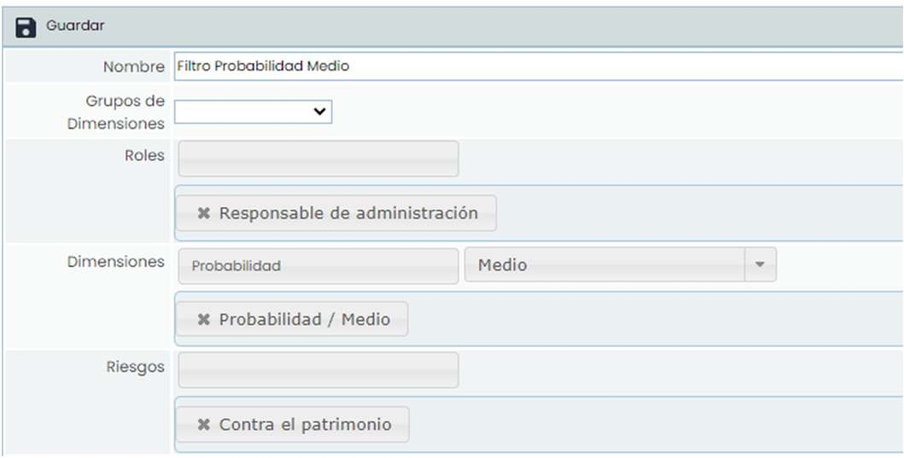

La sección “**Configuración de Costes**” permite configurar diferentes tipos de costes para asociar a los riesgos del análisis de riesgos.

Para cada uno de los costes se permite establecer rangos económicos (mínimo y máximo) para cada uno de los niveles de la dimensión seleccionada como “Coste”. Para este ejemplo, se utilizan los niveles de la dimensión “**Impacto**”, ya que es la dimensión seleccionada en el desplegable “**Elegir Dimensión Coste**”.

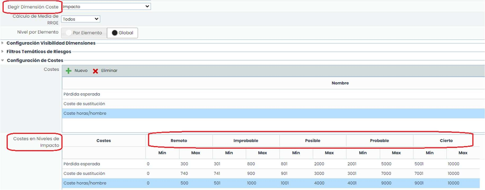

La sección “**Eficacia Controles**” permite configurar cómo se va a realizar el análisis de la eficacia de los controles que se encuentran implantados en la organización. Para ello, se permite configurar lo siguiente:

* **Tipo de Medición de Eficacia**: La eficacia se puede establecer de manera cuantitativa (a través de un número) o cualitativa (seleccionando un nivel establecido en la siguiente tabla).
* **Niveles de Eficacia:** Esta tabla permite registrar los niveles que serán utilizados para evaluar la eficacia de los controles en caso de que ésta haya sido configurada como “Cualitativa”.
* **Metodología de Controles**: Permite seleccionar una metodología para la evaluación de los controles. En las siguientes páginas se mostrarácomo se configura una metodología de estas características.

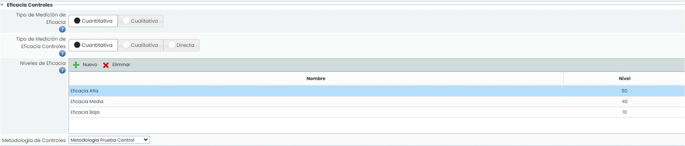

## Configuración de las metodologías de Controles.

La pestaña “**Controles**” ubicada en la sección “**Metodologías**” permite configurar las metodologías de evaluación de controles de la organización. GlobalSuite® permite generar varias metodologías de controles y éstas asociarlas a las diferentes metodologías de análisis de riesgos.

La pestaña muestra al acceder una tabla con las metodologías existentes. Esta tabla permite generar nuevas metodologías (botón “**Nuevo**”) o eliminar alguna de las existentes (botón “**Eliminar**”). Además, se puede añadir una metodología ya existente (botón “**Añadir**”) realizándose una copia de la metodología seleccionada y, de esta forma, realizar su modificación posterior. Esto permite no comenzar desde cero la configuración de una metodología.

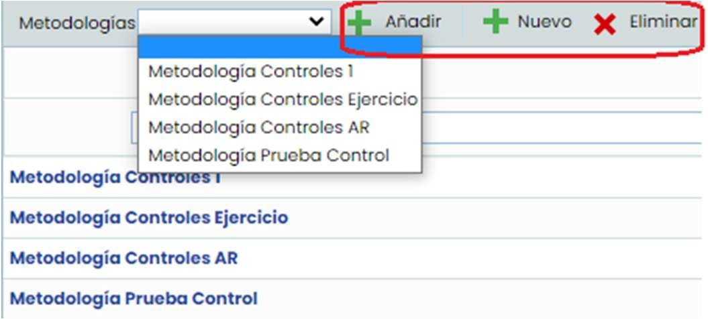

Al pulsar sobre el nombre de una metodología accedemos al formulario de configuración. Este formulario está formado por dos secciones dónde se encuentran todos los aspectos configurables.

En la sección “**Configuración Dimensiones de la Metodología**” aparte del nombre de la metodología, se permite crear las dimensiones que se consideren necesarias para evaluar la eficacia de los controles. La configuración de las dimensiones se realiza de la misma forma que las dimensiones del inventario de elementos (explicado en páginas anteriores).

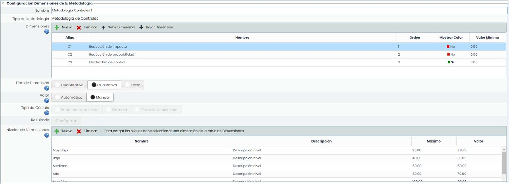

En esta tabla aparecen dos nuevas columnas:

* **Visible**: Identifica si la dimensión va a estar visible en Tablas (tablas de gestión de controles, análisis de riesgos, etc), Ficha de control o Todos (tanto en tablas como en la ficha de control).
* **Modificable**: Identifica si la dimensión puede ser modificada en Tablas (tablas de gestión de controles, análisis de riesgos, etc), Ficha de control o Todos (tanto en tablas como en la ficha de control).

Para el cálculo de las dimensiones automáticas, aparte del producto cartesiano y la definición de una fórmula de cálculo, se permite establecer una fórmula condicional. Este tipo de fórmulas están disponibles tanto para las metodologías de riesgos como para las metodologías de controles.

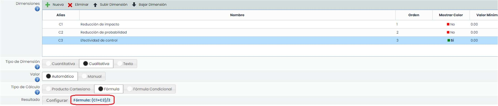

Por último cabe destacar que para la evaluación de los controles se puede optar por tres formas:

* **Global**: permite valorar un control una vez y de manera global para todos los riesgos.
* **Por Riesgo**: permite modificar las valoraciones por cada uno de los riesgos evaluados en el análisis de riesgos.
* **Por** **Elemento**: la valoración del control será la misma para todos los riesgos de un mismo elemento.

Además, también es importante configurar la dimensión que se va a utilizar para la madurez de los controles.

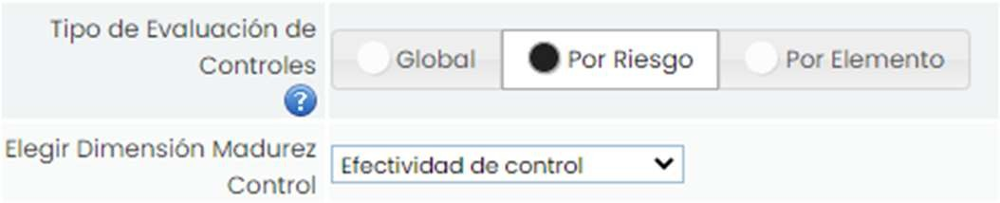

En la sección “**Filtros Temáticos de Riesgos**” (al igual que en las metodologías de riesgos), se permite filtrar la visibilidad en la opción de Evaluación de riesgos.

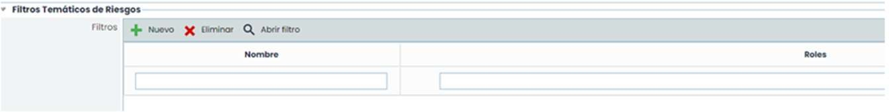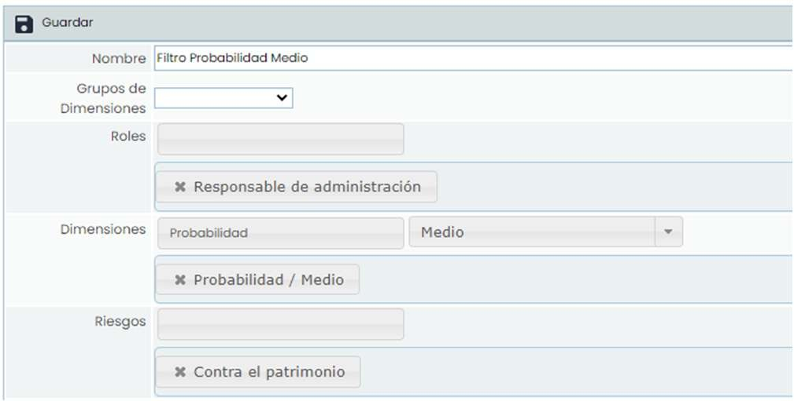

Pulsando el botón “**Nuevo**” se crea el filtro, se selecciona y se pulsa “Abrir filtro” para poder configurarlo.

* **Nombre**: Permite cambiar el nombre del filtro
* **Grupos de Dimensiones**: Si se ha creado algún grupo se puede seleccionar
* **Roles**: Se filtra un rol o varios roles a los empleados que tendrán aplicado dicho filtro.

* **Dimensiones**: Se seleccionan las dimensiones que se pueden visualizar y si se desea la valoración también
* **Riesgos**: Es posible escoger qué riesgos se pueden visualizar.
