# ¿Cómo evaluar riesgos en GlobalSuite®?


Este tutorial explica, paso a paso, cómo visualizar, analizar y reportar los resultados de los \*\*análisis de riesgos\*\* en GlobalSuite® a través de las opciones de \*\*Evaluación de Riesgos\*\*.
En esta guía se detalla cómo acceder al módulo para seleccionar el análisis deseado y utilizar las diferentes vistas disponibles: el \*\*Mapa de Riesgos\*\*, el \*\*Listado de Riesgos\*\* y el \*\*Resumen de Riesgos\*\*.
También se muestra cómo generar mapas de calor, gráficos comparativos y listados detallados por elementos, dimensiones o categorías, así como descargar informes en formato Excel o PDF. Además, se explica cómo interpretar los indicadores del \*\*Nivel de Riesgo Aceptable (NRA)\*\* y del \*\*Riesgo Global por Elemento (RGE)\*\* para obtener una visión integral del estado de los riesgos en la organización


## Evaluación de Riesgos

Para acceder a la **Evaluación de Riesgos** hay que pulsar sobre la opción **Análisis>** [**Evaluación de Riesgos**](https://help.globalsuitesolutions.com/es/globalsuite/v1/evaluacion-de-riesgos)” Al acceder, hay que seleccionar el análisis de riesgos que se quiere visualizar.

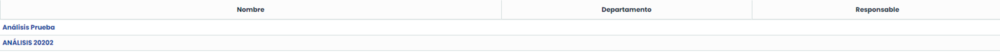

Una vez escogido, se muestran 3 pestañas en un menú superior, que permiten visualizar el resultado del análisis de riesgos en diferentes formatos. Por defecto, GlobalSuite® muestra la pestaña “**Ver Mapa de Riesgos**”.

Esta opción muestra el mapa riesgos (o mapa de calor) con los riesgos identificados en la opción “[**Análisis de Riesgos**](https://help.globalsuitesolutions.com/es/globalsuite/v1/analisis-riesgos)”.

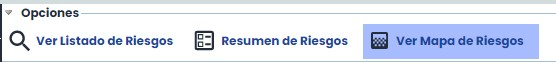

## Mapa de Riesgos

El **“Mapa de Riesgos”** se conforma de dos partes, el mapa de riesgos, propiamente dicho, en la parte superior y tabla de riesgos en la parte inferior. Esta opción nos muestra los “Riesgos” representados por las dos dimensiones que calculan el **“Riesgo”** (para visualizar esta opción de la manera explicada es necesario que el “Riesgo” este definido por dos dimensiones).

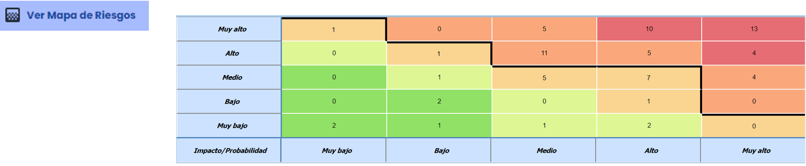

En la parte superior del Mapa de Riesgos existen varias opciones que permiten configurar la información a mostrar en el Mapa de Riesgos:

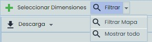

Seleccionar Dimensiones: Permite seleccionar varias dimensiones automáticas que estén definidas en base a otras dos dimensiones, para poder tener varios mapas de calor simultáneamente. Además, permite seleccionar si alguna de las gráficas se quiere representar como Mapa de Calor o como Gráfica de Burbujas.

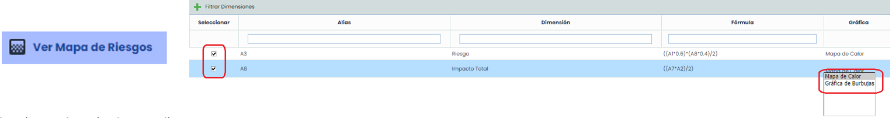

Seleccionando más de una dimensión y pulsando el botón “Filtrar Dimensiones”, es posible visualizar varios mapas de calor/ gráficas de burbujas, simultáneamente:

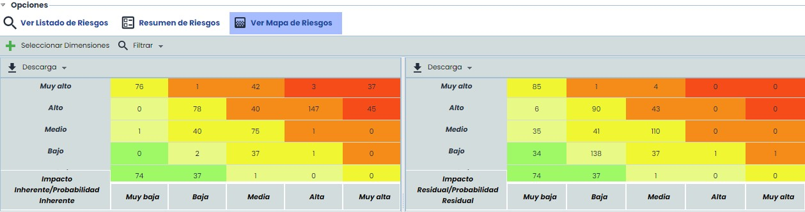

Las gráficas anteriores (mapa de calor y gráfica de burbujas) únicamente son seleccionables cuando se trata de dimensiones cualitativas, si la dimensión es cuantitativa entonces se muestra la gráfica de dispersión:

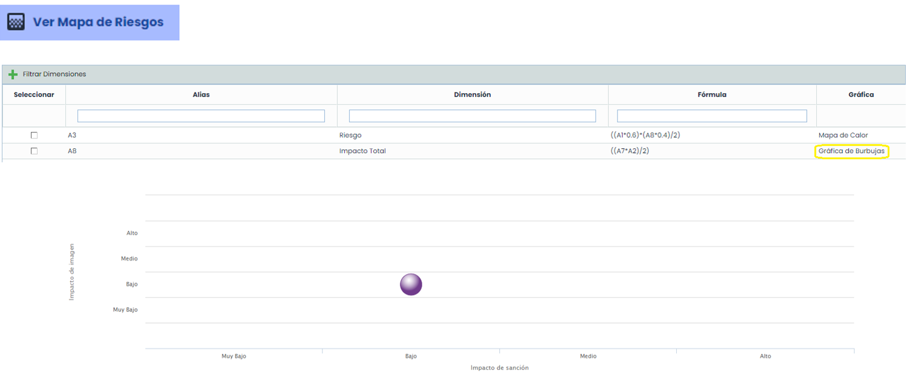

* **Filtrar**: esta opción permite Mostrar todo (se ejecuta por defecto al ingresar en la opción) o bien **Filtrar Mapa**, donde se permite seleccionar los elementos que formarán parte del Mapa de Riesgos. De esta forma se obtiene un Mapa de Riesgos con únicamente los riesgos asociados a los elementos seleccionados.

  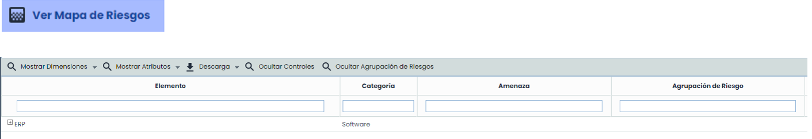

* **Descarga**: permite descargar el mapa de calor tanto en formato Excel como pdf.

Al hacer click en alguna celda del “**Mapa de Riesgos**” se cargarán en la parte inferior los riesgos pertenecientes a la sección que se ha seleccionado, es decir, si se pulsa en la celda que se corresponde con “Impacto” Bajo y “Probabilidad” Bajo, se cargarán los siguientes “Riesgos”:

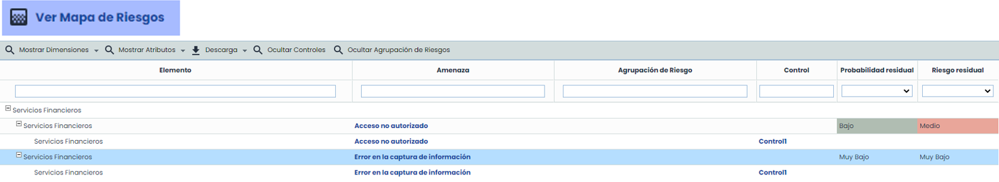

En la barra superior se encuentran las siguientes opciones:

* Mostrar dimensiones (Elementos/Riesgos/Controles): Permite seleccionar qué dimensiones (cuantitativas o cualitativas) van a aparecer en el listado.
* Mostrar Atributos (Elementos/Riesgos/Controles): Permite seleccionar qué dimensiones textuales (atributos) van a aparecer en el listado.
* Descarga: permite descargar la tabla en formato Excel y el informe de Riesgos.
* Ocultar controles: oculta de la tabla la columna “Control”.

### Ver Listado de Riesgos

En la primera pestaña de “**Evaluación de Riesgos**”, “Ver Listado de Riesgos” muestra dos gráficas. La primera representa la cantidad de riesgos por dimensión de riesgo y la otra representa la cantidad de riesgos que superan el “**NRA**” y las que no.


\*\*Nota\*\*: “NRA” son las siglas de Nivel de Riesgo Aceptable, valor definido para el análisis de riesgos.


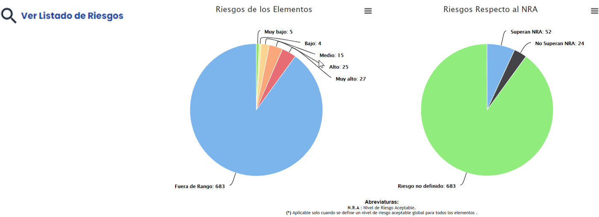

En la parte inferior nos encontramos el listado de riesgos, con la vista por defecto de **“Elementos”,** a los que pertenecen el nombre de la **“Amenaza”, “Responsable”, la “Agrupación Riesgo”** (en el caso de que pertenezca a alguno), el valor de **“NRA”** del elemento y el valor de **“Riesgo”** de la amenaza.

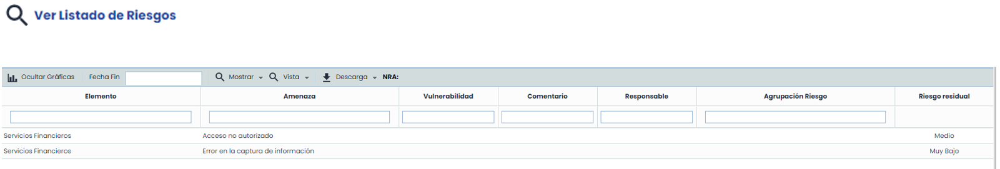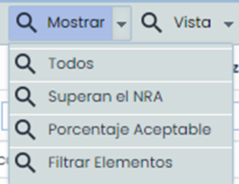

En un primer lugar en la tabla sólo se mostrarán los **“Riesgos”** que superen el **“NRA”.** Pero a través del botón “Mostrar” superior podemos mostrar lo siguiente:

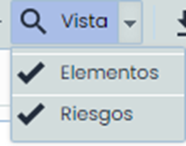

La herramienta también permite la vista por Riesgos **(“Agrupación Riesgo”)** utilizando el botón “Vista”:

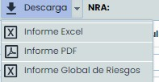

También se permite descargar el informe en dos formatos (Excel y pdf) y el informe Global de Riesgos en excel:

Si se cambia la vista, para marcar **“Riesgos”,** el contenido de la tabla varía, en las columnas se muestra el valor del **“Riesgo”,** y la información de “Padre”, que es el elemento al que pertenecen.

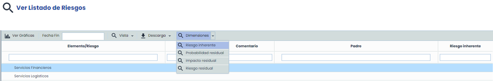

En esta vista en lugar del botón “Mostrar”, aparece el botón **“Dimensiones”,** que permite filtrar la información de la evaluación de Riesgos. El filtro se realiza sobre las dimensiones de la metodología.

Una vez pulsada la dimensión deseada, la información de la gráfica y de la tabla, es actualizada.

También cambia la gráfica, ahora no aparecerán todos los riesgos, ya que únicamente se muestran los de primer nivel. Si se quieren mostrar más riesgos, se tendrán que escoger en el botón "Seleccionar agrupación" donde se puede ver todo el árbol.

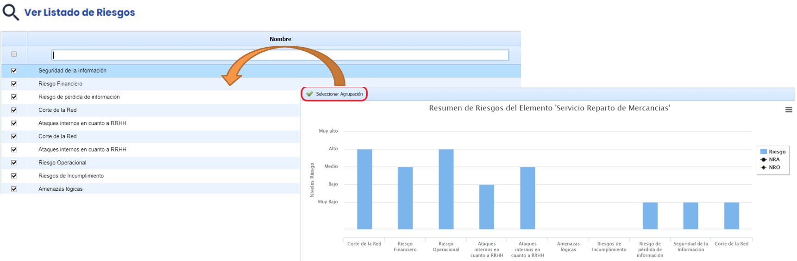

El “Resumen de Riesgos” se conforma de dos partes, gráfica superior y tabla inferior. Esta opción nos muestra los resultados respecto a los “Servicios” y “Procesos” involucrados en el análisis.

La gráfica superior representa el nivel de riesgo por servicio respecto a los siguientes términos:

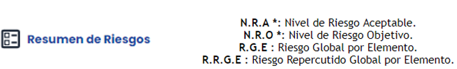

Se permite mostrar la **Gráfica de Servicios, la Gráfica de Procesos** y también se pueden **Seleccionar Elementos**, ya que si hay más de 15 servicios hay que seleccionarlos (en la ventana emergente se puede filtrar también por la taxonomía).

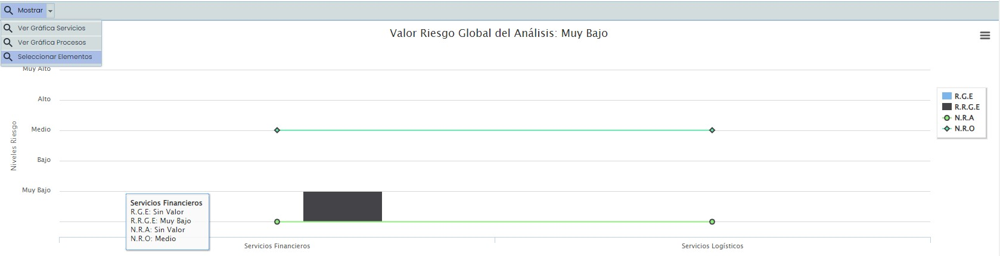

En la parte inferior se muestra el **“Árbol de Dependencias”** con los valores del **“RGE (Riesgo Global por Elemento)**” y **“RRGE (Riesgo Repercutido Global por Elemento)”**, así como si está incluido en el “Análisis”.

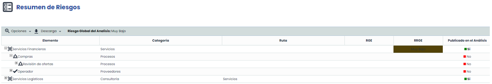

En la barra superior en las **“Opciones”,** nos permite **“Calcular el Riesgo Global del Análisis”** y ver los **“Riesgos Repercutidos”,** también se permite realizar una “Descarga” de la información tanto en formato Excel como pdf.

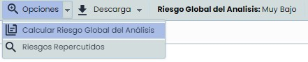
