# ¿Cómo gestionar controles en GlobalSuite®?


Este tutorial explica, paso a paso, cómo realizar la \*\*gestión de controles implantados\*\* en GlobalSuite®, incluyendo su creación, valoración y seguimiento dentro del módulo de análisis de riesgos.
En esta guía se detalla cómo acceder a la opción \*\*Gestión de Controles\*\*, crear nuevos controles o importar los definidos en el catálogo, y utilizar las opciones de \*\*mostrar, filtrar y valorar controles\*\*. También se explica cómo registrar \*\*datos generales, acciones, riesgos asociados, indicadores, evidencias y elementos repercutidos\*\*, así como configurar \*\*notificaciones automáticas\*\*, recalcular la \*\*eficacia de controles (EC)\*\* y visualizar los \*\*resultados de encuestas de controles\*\*


## Gestión de controles

GlobalSuite® permite realizar la gestión de los controles implantados en la organización. Para ello, hay que pulsar sobre la **opción Análisis>** [**Gestión de Controles**](https://help.globalsuitesolutions.com/es/globalsuite/v1/gestion-de-controles)**”** y escoger un **análisis de riesgos**. La vista que se muestra por defecto es la de la pestaña “**Controles**”.

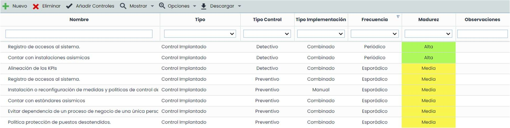

Las acciones que permite realizar la tabla de controles son las siguientes:

* **Nuevo/Eliminar**: Permite crear nuevos controles o bien eliminarlos.
* **Añadir Controles**: Permite importar los controles definidos en el catálogo de análisis seleccionado, si el control ya existe en Gestión de Controles, no lo duplicará.
* **Mostrar**: Ofrece la posibilidad de filtrar el listado de controles, pudiendo optar entre visualizar **Todos** (Implantados y Plan de Tratamiento) o específicos, ya sean sólo los controles Implantados o los definidos en el **Plan de Tratamiento**. También permite expandir o contraer la información que aparece en la tabla.

La información de este desplegable se muestra cuando el Tipo de Evaluación de Controles (Ajustes > Metodologías > Controles) es “Global” o “Por Riesgo”:

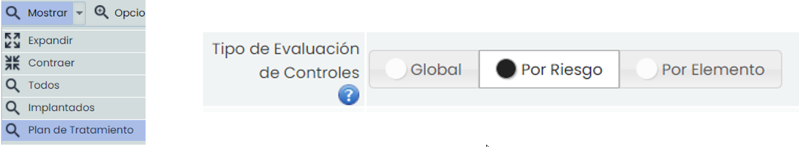

Si el Tipo de Evaluación de Controles es “Por Elemento”, también se muestra en el botón la opción **Elemento/Control**, donde se visualizan los controles agrupados en los elementos a los que están asociados.

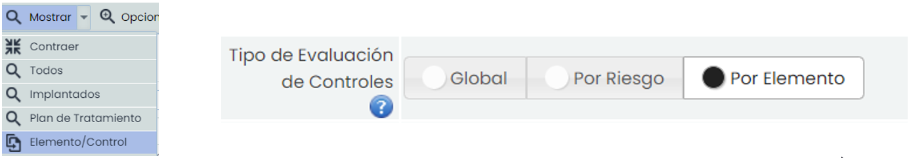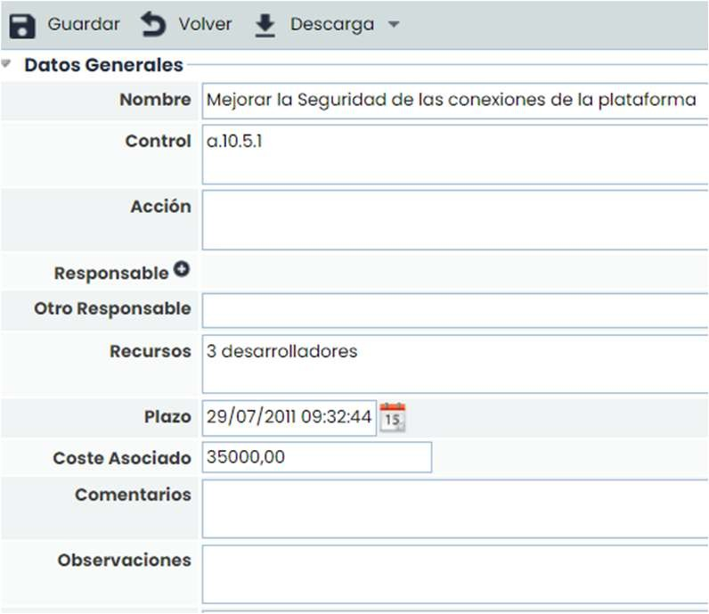

**Opciones - Restaurar Valoración**: Permite, en el caso de que la valoración de los controles implantados sea especifica por riesgo, restaurar de manera general todas las valoraciones efectuadas en cada uno de los controles.

Opciones - Detalles: Ofrece la posibilidad de visualizar y/o definir detalles más específicos del control.

* **Datos Generales:** Permite llevar a cabo la descripción del plan, así como el responsable de implantarlo, costes, plazos en los que ejecutarlo y asignación de indicadores para realizar su seguimiento.

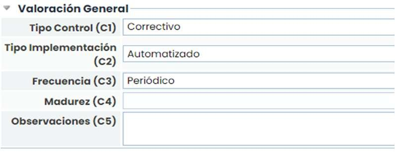

* **Valoración General:** Permite valorar las dimensiones del control que se han configurado para mostrarse en el mismo.

* **Indicadores**: Permite asociar uno o varios indicadores definidos en el apartado **ScoreCard>** [**Indicadores**](https://help.globalsuitesolutions.com/es/globalsuite/v1/indicadores)**.**

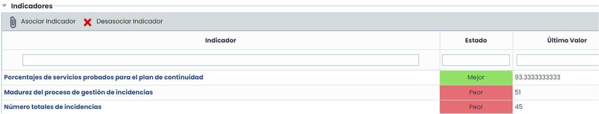

* **Acciones**: Permite establecer las tareas necesarias para la implantación del control o acción.

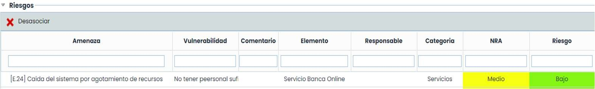

* **Riesgos**: Permite realizar la consulta de los riesgos que son tratados por el plan(control) definido.
* **Elementos Repercutidos**: Permite realizar la consulta de los elementos que se verán afectados por el control definido.

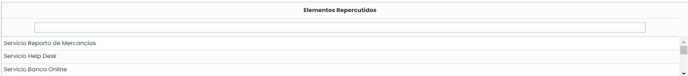

* **Evidencias**: Permite asociar una o varias evidencias al control que se está definiendo. Para ello, a través del botón "Asociar Evidencias" se accede a una ventana emergente que contiene todas las evidencias registradas en la opción "Gestión de Evidencias" del menú de Análisis. Se permite asociar una o varias evidencias del listado.

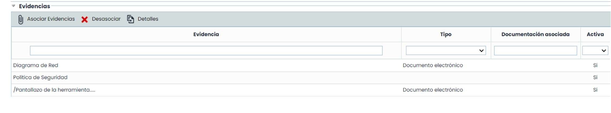

* **Notificaciones automáticas**: Es posible establecer notificaciones. Este tipo de alertas, se lanzan cuando se asigna a un empleado como responsable de un control o de una acción, y para avisar del cumplimiento del plazo.

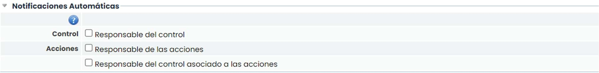

* **Opciones - Calcular EC**: Permite al usuario volver a calcular la Eficacia/Valoración de los Controles. Si se producen cambios en la metodología de controles, pulsando sobre este botón se recalcula el valor de las dimensiones automáticas.
* **Opciones - Resultados de Encuestas:** Permite acceder a una pantalla que muestra el resultado de las encuestas de controles, dónde se puede revisar y consolidar la información obtenida.
* **Descarga**: Ofrece la posibilidad de descargar el listado de controles en formato editable (.xlsx) o en formato .PDF

## Valoración General

GlobalSuite® permite valorar las dimensiones de un control y aplicar estos cambios en todos los análisis en los que esté incluido el control, siempre que los análisis utilicen la misma metodología.

Para ello, hay que pulsar sobre la opción **Análisis>** [**Gestión de Controles**](https://help.globalsuitesolutions.com/es/globalsuite/v1/gestion-de-controles)y pulsar sobre “Valoración General”.

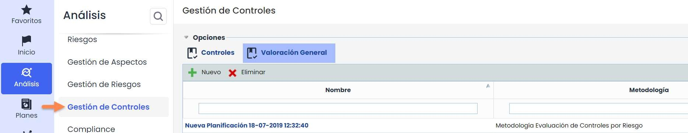

Las acciones que permite realizar esta vista son las siguientes:

* **Nuevo / Elim**: Permite crear tantas valoraciones como se necesiten, es necesario elegir la metodología del control.
* **Eliminar**: Elimina las valoraciones creadas.

Al crear una nueva valoración, pulsando sobre el nombre se accede al formulario:

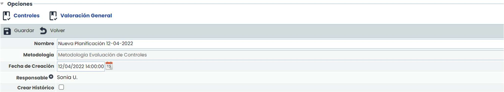

En el formulario se puede modificar el nombre, elegir un responsable del control creado, y se puede marcar el check en “Crear Histórico”, si se marca, cada vez que se realice una valoración se creará un histórico del estado de los controles.

En esta vista, se permiten realizar las siguientes acciones:

* **Nuevo**: Se crean nuevos controles, por búsqueda de nombre hace la comparativa con los controles existentes para aplicar los cambios en los análisis de riesgos seleccionados.

  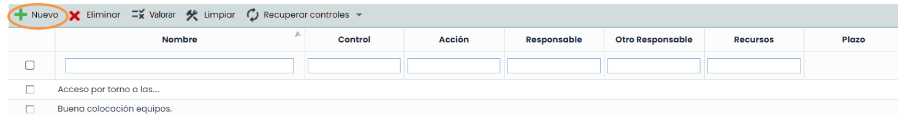
* **Eliminar**: Permite eliminar los controles creados.

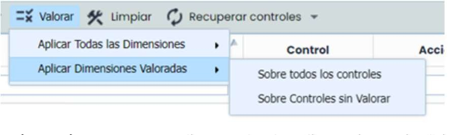

* **Valorar**:

  * **Aplicar Todas las Dimensiones**: se actualizan todas las dimensiones, incluidas las que estén en blanco (sin valorar), y se puede elegir si se quiere aplicar a todos los controles o sólo a los controles sin valorar.
  * **Aplicar Dimensiones Valoradas**: se actualizan únicamente las dimensiones que están valoradas, se puede elegir si se quiere aplicar a todos los controles o sólo a los controles sin valorar. Una vez que se elige la forma de valorar, se muestran los análisis que tienen la misma metodología seleccionada en la valoración para marcar en cuáles se quiere aplicar dicha valoración:

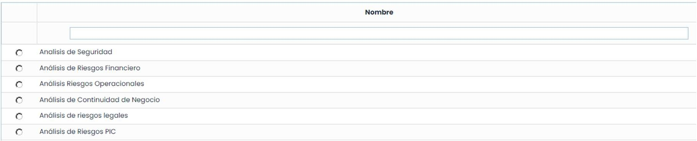

* **Limpiar**: Deja en blanco las valoraciones realizadas en el control.
* **Recuperar controles**: Permite obtener el control bien a través del catálogo o desde el análisis de riesgos.
