# ¿Cómo gestionar riesgos en GlobalSuite®?


Este tutorial explica, paso a paso, cómo realizar la \*\*gestión de riesgos\*\* en GlobalSuite® una vez completado el análisis.
En esta guía se detalla cómo acceder a la opción \*\*Gestión de Riesgos\*\* para planificar el tratamiento de los riesgos detectados, definir \*\*controles y acciones correctivas\*\*, realizar el \*\*seguimiento de los planes de tratamiento\*\* y, finalmente, ejecutar la \*\*proyección y simulación de riesgos\*\*.
Además, se explica cómo crear y asociar controles, establecer responsables, plazos y costes, vincular evidencias y realizar el seguimiento de la implantación de las acciones. También se describe cómo generar informes, aplicar filtros por \*\*nivel de riesgo aceptable (NRA)\*\* y consolidar la información de seguimiento dentro del ciclo completo de gestión de riesgos


## Fases para la Gestión de Riesgos

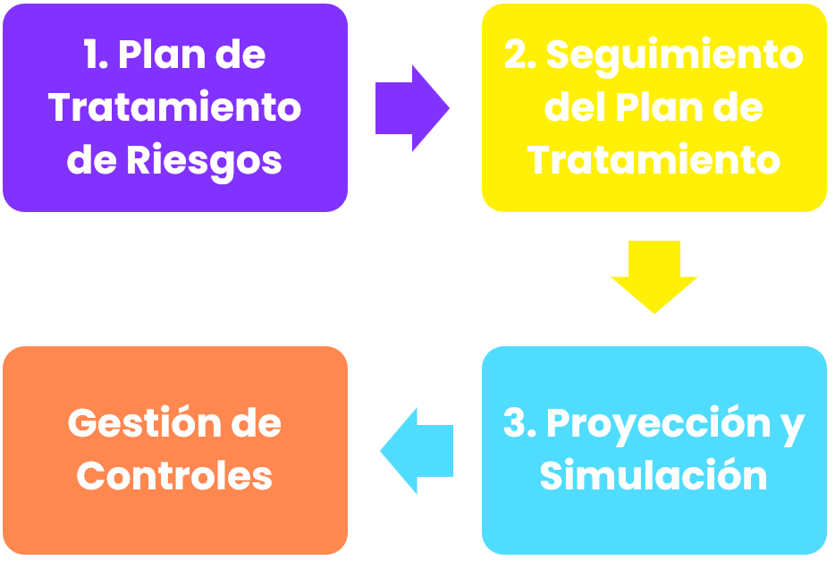

## Gestión de Riesgos

Para llevar a cabo la gestión de los riesgos detectados, GlobalSuite® proporciona la opción “**Gestión de Riesgos**”, donde se mostrará el listado de todos los riesgos que deben ser tratados, asociados a sus correspondientes elementos, así como los planes de tratamiento a aplicar sobre los mismos.

El listado de riesgos a tratar (accesible dentro de un análisis de riesgos particular), depende del **Nivel de Riesgo Aceptable (NRA)** definido en el Análisis de Riesgos. Concretamente, se define en la pestaña “**Información General**”.

El objetivo de la gestión de riesgos es asociar diferentes tipos de controles o acciones de tratamiento a los riesgos detectados, que permitan minimizar dichos niveles.

Una vez identificados todos los controles o acciones de tratamiento, se podrá realizar el seguimiento de las mismas, manteniendo actualizado el estado del proceso.

**Paso 1**

Para acceder a la Gestión de Riesgos hay que pulsar sobre la opción “**Gestión de Riesgos**”, disponible en la pestaña “**Análisis**”. Al acceder tras seleccionar el análisis de riesgos, GlobalSuite® muestra la pestaña “**Planificación de la gestión de riesgos**”.

En la parte superior de esta pestaña aparece el listado de elementos y riesgos asociados que tienen un nivel de riesgo superior al nivel aceptable (NRA). Aparte de los riesgos que se muestran por defecto (los que superan el NRA), se pueden visualizar también los demás riesgos pulsando el botón Mostrar (“Mostrar todos”).

De forma complementaria, GlobalSuite® contiene dos pestaña adicionales para realizar el seguimiento del plan de tratamiento y realizar la proyección de los riesgos tras la implantación de los controles.

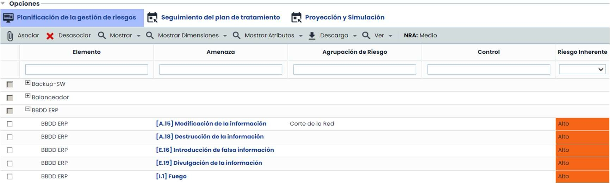

**Paso 2**

La definición del Plan de Tratamiento de Riesgos se realiza en la pestaña “Planificación de la gestión de riesgos”. Para llevarlo a cabo disponemos de dos cuadros principales, el superior donde se muestran los riesgos y niveles de riesgos, y uno inferior donde establecer los controles. En la zona inferior existen dos pestañas principales:

* **Plan de Tratamiento:** Permite generar nuevos controles o acciones de tratamiento a asociar posteriormente sobre los riesgos identificados en el nivel superior.
* **Controles Propuestos**: Proporciona un listado de controles propuestos desde GlobalSuite® en función de los catálogos definidos. Los controles que se proponen dependen de cada riesgo.

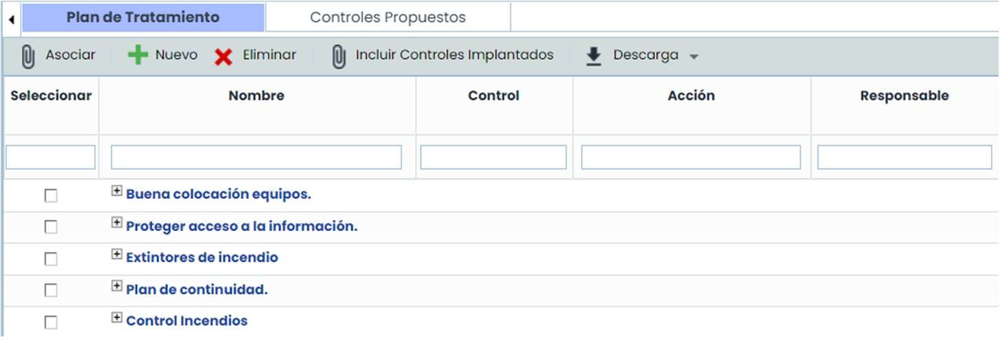

Paso 3

El establecimiento de controles y acciones de tratamiento se puede realizar pulsando el botón “**Nuevo**”. Al pulsar aparece una nueva línea, desde la cual se puede acceder a un formulario para la definición completa del control, pulsando directamente sobre su nombre. Una vez accedido, aparece una ventana complementaria, donde sus opciones se organizan por las siguientes secciones:

* Datos Generales: Permite llevar a cabo la descripción del plan mediante los siguientes datos:

  * **Nombre, control, acción, recursos, comentarios y observaciones:** campos descriptivos.
  * **Responsable** (interno, del listado de empelados) u Otro responsable (texto) de la implantación.
  * **Plazo**: fecha de finalización prevista del plan. En base a esta fecha se podrán enviar Alertas.
  * **Costes** derivados de la implantación (campo numérico).

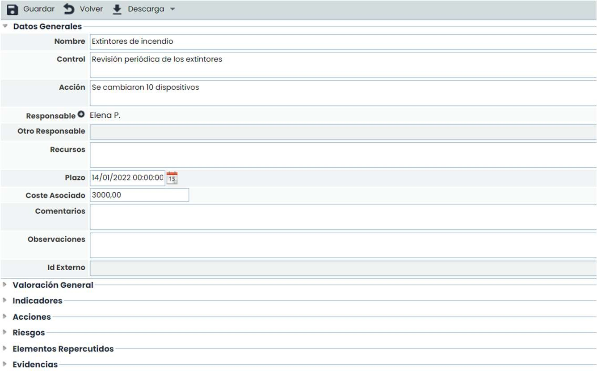

* **Valoración General:** Permite valorar las dimensiones del plan que se han configurado para mostrarse en el plan de tratamiento.

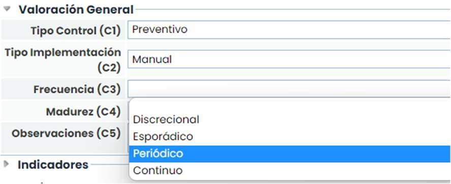

* **Indicadores**: Permite asociar uno o varios indicadores definidos en el apartado ‘ScoreCard/Indicadores’.

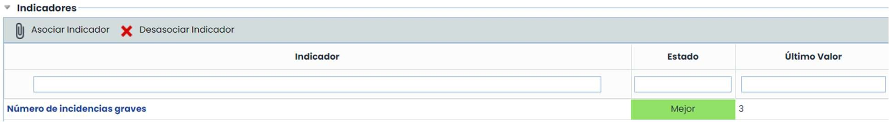

* **Acciones**: Permite establecer las tareas necesarias para la implantación del control o acción de tratamiento.

  * Plazo: fecha de finalización prevista de la acción. En base a esta fecha se podrán enviar Alertas.
  * Fecha fin: fecha real en la que se completó la acción.

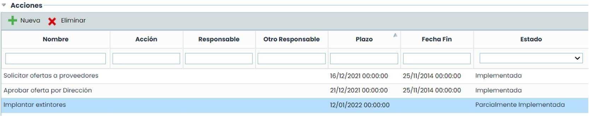

* **Riesgos**: Permite realizar la consulta de los riesgos que son tratados por el plan (control) definido.

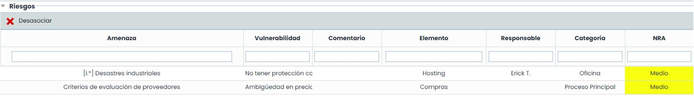

* **Elementos Repercutidos:** Permite realizar la consulta de los elementos que se verán afectados por el control definido.

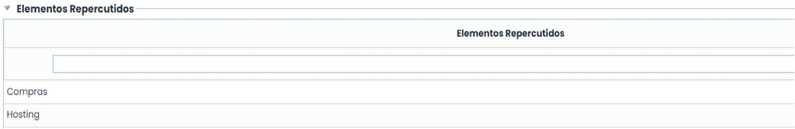

* **Evidencias**: Permite asociar una o varias evidencias al plan de tratamiento que se está definiendo. Para ello, a través del botón "Asociar Evidencias" se accede a una ventana emergente que contiene todas las evidencias registradas en la opción "Gestión de Evidencias" del menú de Análisis. Se permite asociar una o varias evidencias del listado.

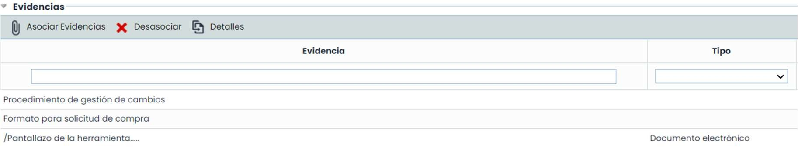

* **Notificaciones automáticas:** Es posible establecer notificaciones cumpliendo una serie de requisitos.

**Paso 4**

En la pestaña inferior “**Controles Propuestos**”, GlobalSuite® permite asociar controles y acciones de tratamiento concernientes a los catálogos de riesgos y vulnerabilidades que posee la organización.

Para seleccionar los controles, es necesario determinar tanto la “**Categoría**” del elemento como el “**Riesgo**” correspondiente. Esta selección se puede realizar a través de las listas desplegables o seleccionando directamente el riesgo en la parte superior.

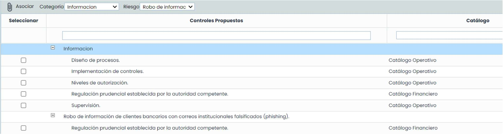

Paso 5

De forma complementaria a los puntos anteriores, GlobalSuite® dispone de varias opciones que le permiten ejecutar otras tareas. Estas opciones se muestran en la parte superior de la opción “Gestión de Riesgos”:

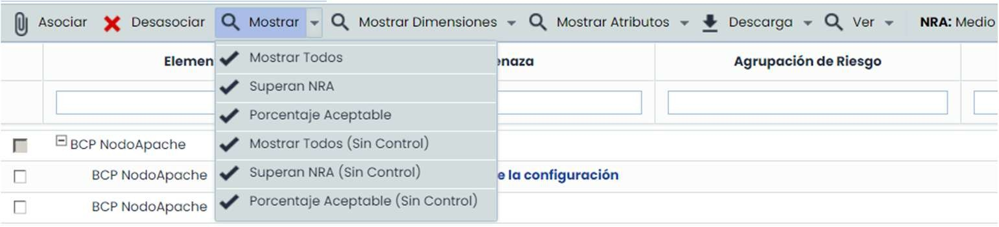

**Asociar y Desasociar:** Permite realizar la asociación de controles, así como la correspondiente desvinculación entre los mismos y los riesgos.

**Mostrar**: Permite realizar filtrado de los riesgos a mostrar en la parte superior de la opción. Para poder realizar el filtrado nos proporciona diferentes tipos de características para llevarlo a cabo.

* **Mostrar Todos:** Muestra todos los riesgos analizados.
* **Superan NRA:** Muestra los riesgos que superan el nivel del riesgo aceptable.
* **Porcentaje Aceptable:** Muestra los riesgos que no superan el nivel establecido para el tratamiento.

* **Mostrar Todos (Sin Control)**: Muestra todos los riesgos que no disponen de controles establecidos.
* **Superan NRA (Sin Control)**: Muestra los riesgos que superan el nivel permitido y a los que no se le ha establecido un control para su tratamiento.
* **Porcentaje Aceptable (Sin Control)**: Muestra aquellos aspectos sin control asociado que no disponen de controles operacionales asociados.
* **Mostrar dimensiones**: Permite seleccionar las dimensiones cuantitativas/cualitativas que se mostrarán en la tabla, tanto para los Elementos, los Riesgos o los Controles.
* **Mostrar Atributos**: Permite seleccionar las dimensiones textuales que se mostrarán en la tabla, tanto para los Elementos, los Riesgos o los Controles.

* **Descarga**: Permite realizar la descarga del listado de riesgos y controles definidos en un informe Excel.
* **Dependencias**: Muestra las dependencias de los elementos que se hayan seleccionado.

**Paso 6**

Para llevar a cabo la asociación de los controles con los riesgos, es necesario realizar la selección tanto del control, en la opción inferior, como del riesgo asociado al elemento, disponible en la parte superior.

Una vez seleccionadas ambas opciones, es necesario pulsar sobre el botón “**Asociar**”, de tal forma que se vinculará de forma automática el control establecido en la parte superior, pudiéndose consultar dicho control en un nivel inferior al del riesgo que está siendo tratado.

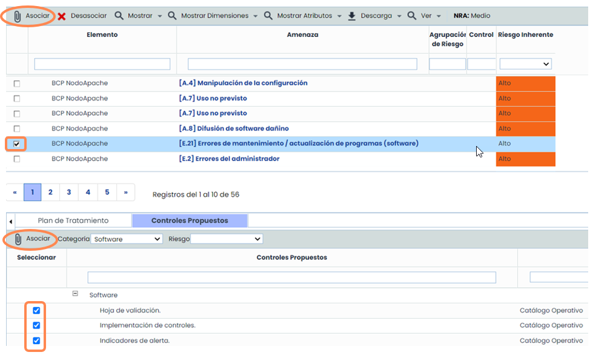

**Paso 7. Seguimiento del Plan de Tratamiento**

Al acceder en la pestaña “**Seguimiento del plan de tratamiento**”, se permite realizar el seguimiento de cada uno de los controles. Para indicar el progreso de un control, es necesario actualizar el estado de cada una de las acciones del control, y se actualizará la barra de Progreso.

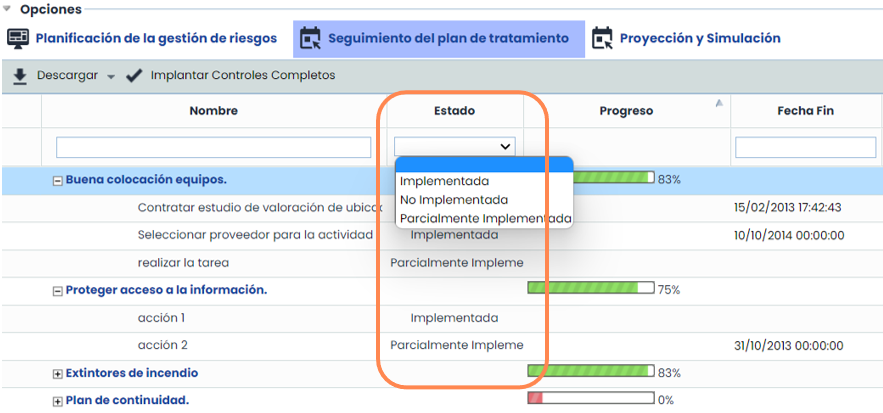

Los estados son configurables a través de **Ajustes > Metodologías >** [**Elementos**](https://help.globalsuitesolutions.com/es/globalsuite/v1/metodologia-elementos):

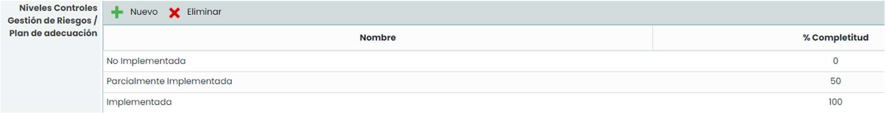

En la vista “**Seguimiento del plan de tratamiento**”, además de permitir valorar los planes de tratamiento y controles propuestos, cambiando el estado de las acciones que los componen, también ofrece la posibilidad de realizar la descarga del informe en formato docx e implantar los controles completos.

Los controles propuestos o planes de tratamiento que no tienen acciones aparecen ya completados al 100%.

Una vez que las acciones de un control o plan se han completado al 100%, mediante el botón “Implantar Controles Completos”, se permite mover los controles que están completados al listado de controles del sistema como controles implantados, y por tanto, las acciones que tuvieran se eliminan ya que se han completado.

Por este motivo, es recomendable realizar un histórico antes de implantar los controles para no perder la información de las acciones.

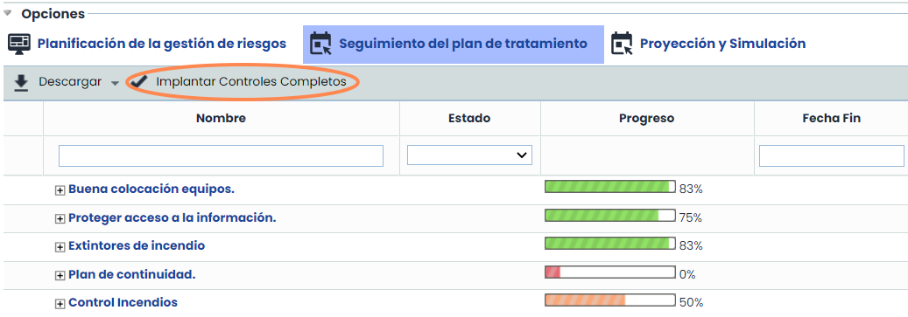
