# ¿Cómo realizar un análisis de riesgos en GlobalSuite®?


GlobalSuite® permite llevar a cabo el \*\*análisis de riesgos\*\* de cualquier tipología, pudiéndose desarrollar a través de las diferentes opciones presentadas, desde el inventario de elementos hasta la realización del seguimiento de las acciones definidas para la reducción de los riesgos detectados.
La funcionalidad de GlobalSuite® que permite realizar un análisis de riesgos completo se encuentra en la opción “\*\*Análisis\*\*”, de manera concreta, en la opción de “[\*\*Análisis de Riesgos\*\*](https://help.globalsuitesolutions.com/es/globalsuite/v1/analisis-riesgos)”. Ésta se encuentra inmediatamente después de la opción “[\*\*Inventario\*\*](https://help.globalsuitesolutions.com/es/globalsuite/v1/inventario)” del menú izquierdo.


## Creación del análisis.

**Paso 1**

Una vez definido el listado de elementos de los servicios y procesos, podemos realizar el siguiente paso, correspondiente con el propio análisis de riesgos.

Para la generación de un nuevo análisis de riesgos hay que pulsar el botón “**Nuevo**”, generándose una nueva línea. Esta línea corresponde a un análisis de riesgos específico se debe configurar siguiendo los siguientes pasos.

En la pantalla principal de la opción “**Análisis de Riesgos**” se permite también eliminar un análisis concreto, descargar el listado completo en formato Excel y copiar un análisis ya creado.

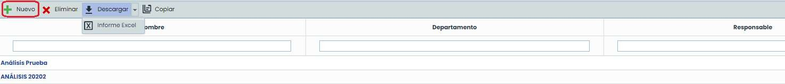

## Configuración del análisis.

**Paso 2**

La primera vez que se accede a un análisis de riesgos se carga la pestaña “**Información General**”, que permite la configuración del análisis de riesgos.

Para ello, es necesario completar la información de las tres secciones que aparecen.

* Datos Generales
* Catálogos
* Árbol de Elementos

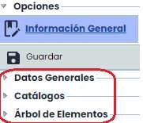

**Paso 3**

La definición de la sección “**Datos Generales**” permite indicar toda la información relacionada con el análisis.

Cabe destacar el campo desplegable “**Metodología**”, el cual permite seleccionar la metodología a utilizar para el análisis de riesgos. El listado de metodologías que aparece corresponde al conjunto de metodologías que posee la Entidad en el apartado de **Ajustes> Metodologías de** [**Elementos**](https://help.globalsuitesolutions.com/es/globalsuite/v1/metodologia-elementos)

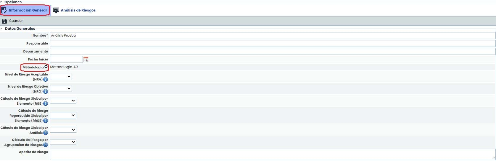

**Paso 4**

Una vez seleccionada una metodología, los campos “**NRA**” y “**NRO**” permiten definir un Nivel de Riesgo Aceptable y Objetivo, respectivamente. Estos valores son importantes ya que la evaluación y gestión de riesgos tendrán en cuenta este nivel.

De manera adicional, se puede definir el criterio que se utiliza para obtener los niveles de riesgos globales a partir de los riesgos específicos.

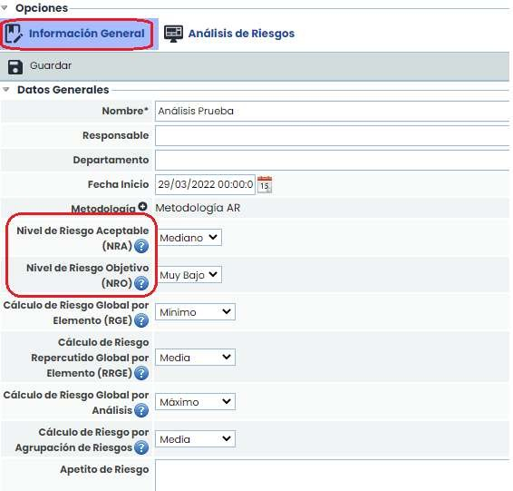

**Paso 5**

En la sección “**Catálogos**” nos aparece el listado de catálogos disponibles que se pueden utilizar para el análisis de riesgos. No es obligatorio utilizar un catálogo específico, pero sí es recomendable ya que permite que la herramienta asocie un conjunto de riesgos y vulnerabilidades a cada elemento, en función de su categoría definida.

Para seleccionar un catálogo, simplemente hay que pulsar sobre el “check” que aparece al lado de cada uno.

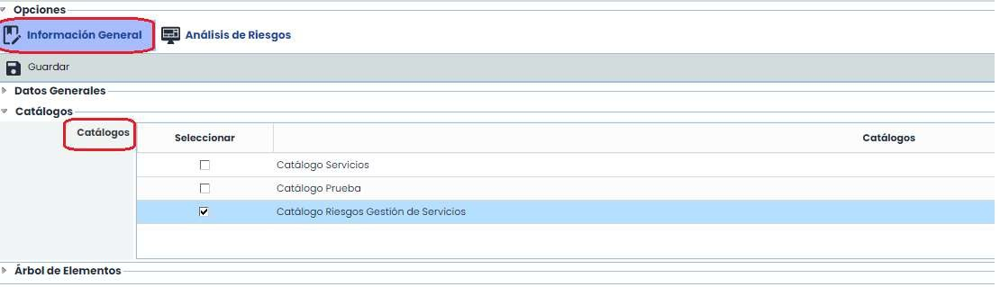

**Paso 6**

El último paso para configurar el análisis de riesgos concierne a la selección de elementos. Para ello, en la sección “**Árbol de Elementos**” aparece el árbol de elementos definido en la opción “[**Inventario**](https://help.globalsuitesolutions.com/es/globalsuite/v1/inventario)”.

Para realizar la selección de elementos sobre los que realizar el análisis, es necesario seleccionarlos a través de la columna “**Seleccionar**” marcando el cuadro que se encuentra a la izquierda de cada elemento. Una vez marcados, pulsando sobre el botón “**Asociar**” todos los elementos pasan a la tabla de la derecha. Esta tabla contiene todos aquellos elementos (servicios, procesos y elementos) seleccionados para realizar su análisis.

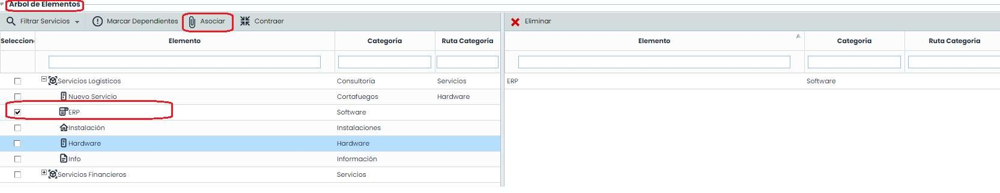

**Paso 7**

Una vez configurado el análisis de riesgos, aparecen nuevas pestañas en la parte superior. Pulsando sobre la pestaña “**Análisis de Riesgos**” se accede a la tabla que permite realizar el análisis de los riesgos de los elementos seleccionados en la pestaña “**Información General**” (según el paso 5).

Para la identificación de los riesgos que se van a analizar para cada elemento hay tres opciones: cargar automáticamente los riesgos de los catálogos, registrar manualmente todos los riesgos o bien a través de la opción recuperar riesgos.

Para el primer caso, hay que pulsar sobre el botón “**Añadir/Proponer Riesgos**”. Al pulsar sobre dicho botón se asociarán los riesgos de forma automática a todos los elementos, en función de los catálogos seleccionados para el análisis de riesgos y de la categoría a la que pertenecen cada elemento.

La diferencia entre proponer y añadir consiste en que cuando se **proponen** los riesgos, se añaden todos los que hay en el catálogo para esa categoría independientemente de si ya están asociados o no, sin embargo, si se **añaden**, el sistema comprueba si el riesgo ya está asociado al elemento, y en ese caso no lo vuelve a asociar, únicamente inserta los riesgos que no tiene asociados el elemento.

**Paso 7 (I)**

Una vez propuestos los riesgos para un elemento, la última columna (Propuestas) de los elementos a los que se han incluido los riesgos pasará a ser “**Sí**”. Para volver a proponer riesgos a algún elemento, hay que cambiar dicho campo a “**No**”.

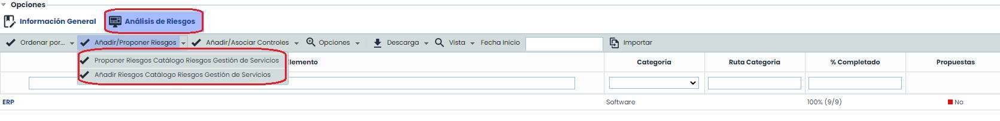

En esta vista, también se puede observar la información de la columna:

% Completado: Muestra el grado de completitud del análisis de riesgos de cada elemento. Entre paréntesis se indica el número de dimensiones valoradas para ese elemento y el número total de dimensiones a valorar.

En la última opción de obtener los riesgos, a través del botón recuperar riesgos (se encuentra dentro del análisis de riesgos, una vez que se ha seleccionado un elemento), permite insertar uno o varios riesgos del listado previamente definidos en el apartado **Ajustes > Plantillas >** [**Catálogos Análisis**](https://help.globalsuitesolutions.com/es/globalsuite/v1/catalogos-analisis).

**Paso 7 (II)**

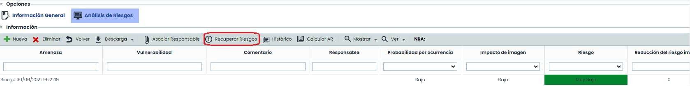

Al pulsar sobre el botón se muestra un listado con todos los riesgos definidos y resaltados en color rojo aquellos que aplican al elemento por la categoría a la que pertenece.

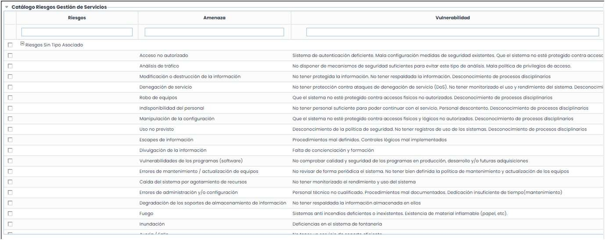

**Paso 8**

En dicha vista, es posible calcular valores agrupados de riesgos en función de los criterios establecidos en la configuración (Ver Paso 4). Estos valores son:

* **Riesgo Global por Elemento**: Valor del riesgo específico para cada elemento, obtenido a partir de sus riesgos.
* **Riesgo Repercutido Global por Elemento**: Valor del riesgo para cada elemento, calculado a partir de los riesgos inferiores (del Árbol de Elementos).
* **Riesgo Global por Análisis:** Valor del riesgo único para todo el análisis, obtenido a partir de los riesgos de todos los elementos involucrados.

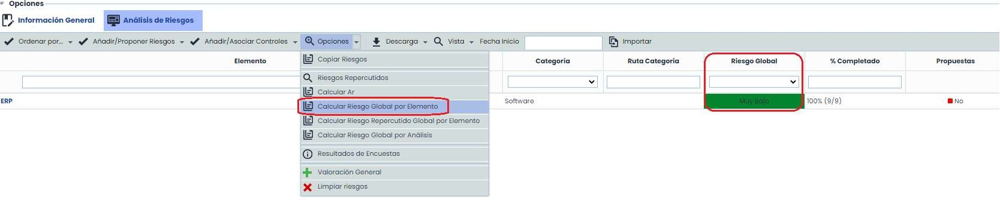

**Paso 9**

Al pulsar sobre el nombre de un elemento, aparece la tabla que permite realizar el análisis de riesgos. Esta tabla permite las siguientes opciones:

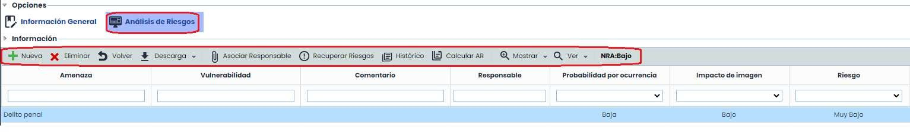

* **Nueva**: Generar nuevos riesgos que no han sido cargadas de forma automática.
* **Eliminar**: Permite eliminar riesgos ya generados.
* **Volver**: Permite volver a la pantalla principal, donde se muestra el listado de elementos a analizar.
* **Descarga**: Permite realizar la descarga del listado de los riesgos asociados a los elementos.
* **Asociar responsable**: Permite definir el responsable del riesgo, para ello, es necesario seleccionar el riesgo que se quiera asignar, y pulsar el botón. Al hacerlo, se mostrará el listado de Empleados y se podrá definir el que se desee, o en su caso, para eliminar el responsable, se deberá pulsar el botón "Limpiar Selección".
* **Recuperar riesgos**: Muestra el listado de todos los riesgos de los catálogos, pudiendo asociar uno o varios.
* **Histórico**: Permite consultar históricos de análisis de riesgos realizados anteriormente.
* **Calcular AR**: Permite forzar el cálculo de todas las fórmulas asociadas a las dimensiones automáticas (a utilizar en caso de que se haya modificado la metodología de análisis de riesgos).

**Paso 10**

Para realizar las valoraciones de **Probabilidad e Impacto** que permitan calcular el nivel de riesgo que afecta a las actividades de la organización, es necesario establecer los niveles de forma individual por cada uno de los riesgos identificados.

Para establecer los niveles, es necesario desplegar (haciendo doble click) el campo de probabilidad e impacto en cada uno de los riesgos, asociando el nivel correspondiente en cada caso.

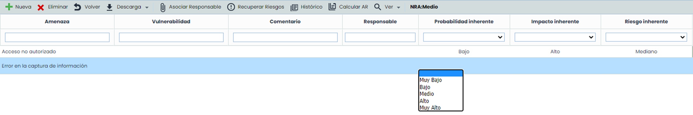

Una vez identificado cada uno de los niveles de probabilidad e impacto, se calculará automáticamente el nivel de riesgo asociado al riesgo en función de la fórmula definida en la metodología de riesgos.

**Paso 11**

En la parte inferior de la pantalla se muestra un resumen del análisis de riesgos en formato “formulario”. Para poder utilizar esta vista, hay que seleccionar previamente uno de los riesgos de la tabla.

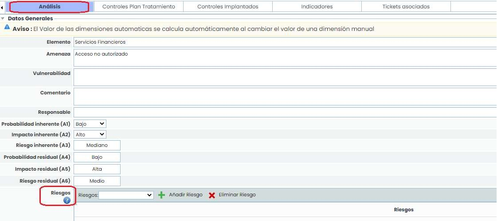

Al final del formulario de la parte de análisis, en Riesgos, se permite insertar los tipos de riesgos (configurados previamente en **Ajustes > Metodologías > Elementos >** [**Categoría Riesgos**](https://help.globalsuitesolutions.com/es/globalsuite/v1/metodologia-elementos#MetodologíaElementos-CategoríaRiesgos:)).

**Paso 11 (I)**

En la parte inferior también se permite consultar la información de las siguientes pestañas:

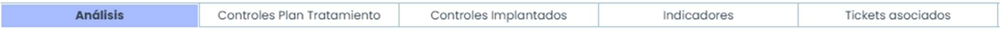

* **Controles Plan Tratamiento**: Ofrece la posibilidad de visualizar los controles del Plan de Tratamiento (Análisis > Gestión de Riesgos) que han sido asociados a este riesgo concreto.
* **Controles Implantados**: Permite asociar los controles que ya están implantados en la organización a un riesgo concreto.
* **Indicadores**: Esta pestaña permite fijar los Indicadores Clave de Riesgos o KRIs a cada uno de los riesgos del Análisis de Riesgos. Esta pestaña no se muestra por defecto, para que aparezca hay que configurarla desde **Ajustes > Metodologías >** [**Elementos**](https://help.globalsuitesolutions.com/es/globalsuite/v1/metodologia-elementos).
* **Tickets asociados**: En esta sección nos muestra si el riesgo está asociado algún ticket.

En la vista de **Valoración General** (dentro del menú de opciones), al igual que ocurre en el Inventario, existe la posibilidad de valorar la **Probabilidad** y el **Impacto** de múltiples riesgos de manera directa, así como la categoría de los elementos donde se va a aplicar.

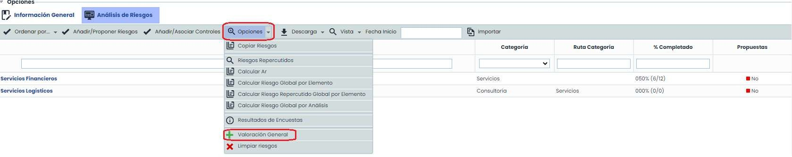

Para ello se podrán recuperar los riesgos que se van a valorar de manera general, bien del total de catálogos habilitados, o de los utilizados en el análisis, y proceder a valorarlos en términos de las dimensiones manuales configuradas. Esta valoración se podrá aplicar a todos los riesgos con el mismo nombre o sobrescribir las valoraciones existentes para todos los riesgos pertenecientes a elementos con esas categorías.

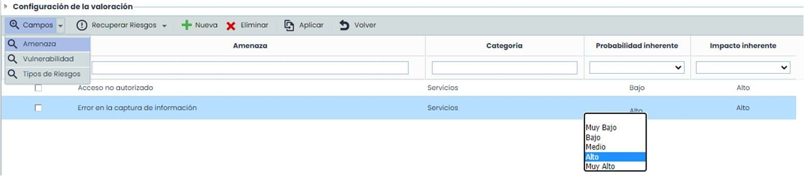
