# ¿Cómo crear y analizar escenarios de riesgos con simulación Monte Carlo en GlobalSuite®?


Este tutorial muestra cómo crear, configurar y analizar Escenarios de Riesgos, utilizando simulaciones Monte Carlo sobre riesgos previamente identificados en los análisis de riesgos. A través del nuevo módulo de Escenarios de Riesgos, se puede definir el alcance de la simulación, configurar los parámetros de cálculo, seleccionar los riesgos que se quieren incluir, ajustar sus distribuciones de frecuencia e impacto, ejecutar la simulación y consultar los resultados obtenidos. Además, el módulo permite analizar recomendaciones generadas mediante IA, simular el impacto de aplicar controles mediante el simulador What-if, comparar el escenario actual frente a un escenario mejorado y descargar un informe ejecutivo con las principales conclusiones.


## Vídeo tutorial: Creación y configuración del escenario de riesgo

En este vídeo se muestra el flujo desde el acceso al módulo hasta la ejecución de la simulación. Incluye los pasos:

* Acceder al módulo.
* Crear un nuevo escenario desde el Centro de Simulaciones.
* Completar la Información básica.
* Definir el Alcance de simulación.
* Seleccionar los riesgos
* Revisar el resumen y ejecutar simulación.

## 1. Acceder al módulo

Para acceder al módulo, entra en:

Análisis > [Escenarios de Riesgo](https://globalsuitesolutions.atlassian.net/wiki/spaces/GlobalSUITEes/pages/1943535622/Escenarios+de+riesgos)

Al acceder, se muestra el Centro de Simulaciones, desde el cual se pueden consultar los escenarios existentes y crear nuevos escenarios de riesgo.

## 2. Crear un nuevo escenario desde el Centro de Simulaciones

Desde el Centro de Simulaciones se pueden consultar los escenarios de riesgo existentes y crear nuevos escenarios.

Para crear un nuevo escenario, pulsa la opción de creación de escenario.

A continuación, se abrirá un asistente guiado que permitirá definir la información básica del escenario, seleccionar el análisis de riesgos de origen, escoger los riesgos que se van a simular y revisar la configuración antes de ejecutar la simulación.

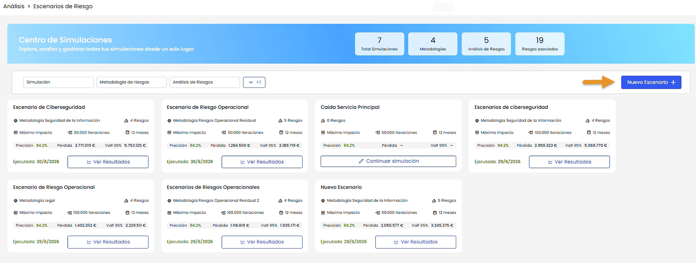

## 3. Completar Información básica

En el primer paso del asistente se debe completar la Información básica del escenario.

Este paso se divide en dos bloques:

* Información del escenario.
* Parámetros de simulación.

### 3.1. Información del escenario

1. Informa el Nombre del escenario.
2. Selecciona el Período de tiempo.
3. Selecciona la Moneda.
4. Indica la Finalidad de la simulación.
5. Añade la Descripción o contexto de la simulación. (Opcional)
6. Completa la Información adicional sobre la finalidad, si aplica.

### 3.2. Parámetros de simulación

En este bloque se configuran los valores que determinarán cómo se ejecutará el cálculo Monte Carlo.

Este bloque incluye tres parámetros principales:

1. Número de iteraciones.

Define cuántas simulaciones se ejecutarán para calcular los posibles escenarios.

El sistema propone tres opciones por defecto:

* 10.000 iteraciones.
* 50.000 iteraciones.
* 100.000 iteraciones.

También es posible personalizar el número de iteraciones, indicando un valor entre 1.000 y 1.000.000.

2. Método de agregación.

Define cómo se combinarán los resultados de los riesgos seleccionados para obtener el resultado final del escenario.

Este parámetro es importante, ya que influye directamente en el cálculo de los riesgos.

Los métodos de agregación disponibles son:

* Suma
* Promedio
* Promedio ponderado
* Máximo

La selección del método de agregación debe realizarse en función del criterio de análisis que se quiera aplicar al escenario.

3. Semilla aleatoria.

Define el valor utilizado para inicializar la generación aleatoria de la simulación.

Este valor no puede editarse.

## 4. Definir el Alcance de simulación

En este paso, se define la base metodológica (metodología de análisis y dimensiones), y el/los análisis sobre los que se ejecutará la simulación.

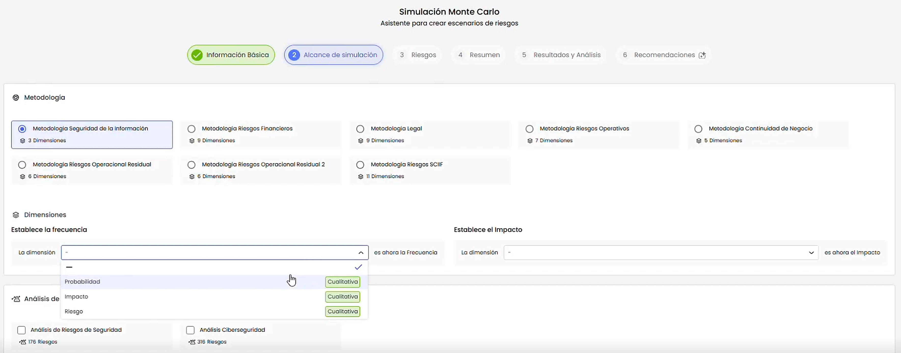

1. Selecciona la metodología de riesgos que se utilizará para la simulación.
2. Mapea los campos de frecuencia e impacto con las dimensiones correspondientes de la metodología, si las dimensiones configuradas son cualitativas. Si las dimensiones configuradas son cuantitativas, no será necesario realizar este mapeo, ya que los valores podrán utilizarse directamente en el cálculo.
3. Selecciona uno o varios análisis de riesgos sobre los que se realizará la simulación.
4. Pulsa Siguiente para continuar.

## 5. Seleccionar los Riesgos

En este paso se seleccionan los riesgos concretos que se incluirán en la simulación y se revisan los parámetros de cálculo de cada uno de ellos.

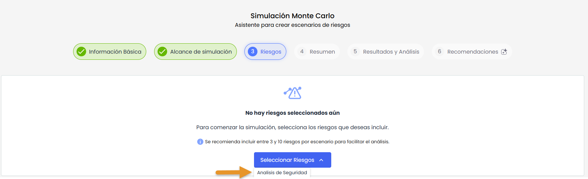

1. Revisa el listado de riesgos disponibles a partir de los análisis de riesgos seleccionados en el paso anterior.
2. Selecciona los riesgos que quieres incluir en la simulación.

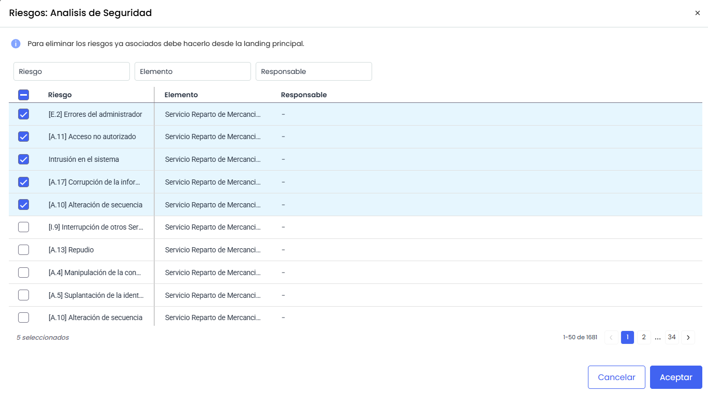

3. Para cada riesgo incluido, revisa la configuración de frecuencia e impacto.
   1. Selecciona la distribución que se utilizará para el cálculo de la frecuencia.
   2. Selecciona la distribución que se utilizará para el cálculo del impacto.
   3. Revisa los valores mínimo, probable y máximo de frecuencia e impacto.
   4. Modifica los valores si es necesario.

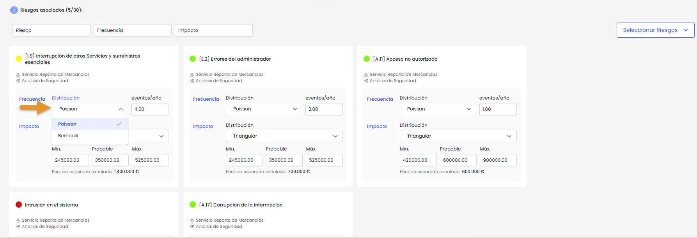


Para facilitar la configuración, el sistema propone valores por defecto . La frecuencia y el valor probable del impacto provienen del análisis de riesgos.


4. Pulsa Siguiente para continuar.

## 6. Revisar el resumen previo

En el paso **Resumen** se muestra la configuración completa del escenario antes de ejecutar la simulación Monte Carlo. En esta pantalla se consolida la información configurada.

1. Revisa la Información básica del escenario.
2. Revisa los Parámetros de simulación.
3. Revisa el Alcance de simulación.
4. Revisa los riesgos seleccionados.
5. Comprueba la pérdida esperada estimada antes de ejecutar la simulación.
6. Si la información es correcta, ejecuta la simulación.
7. Si necesitas corregir algún dato, vuelve al paso correspondiente del asistente y realiza los ajustes necesarios.

Si detectas algún dato incorrecto o incompleto, vuelve al paso correspondiente del asistente y realiza los ajustes necesarios.

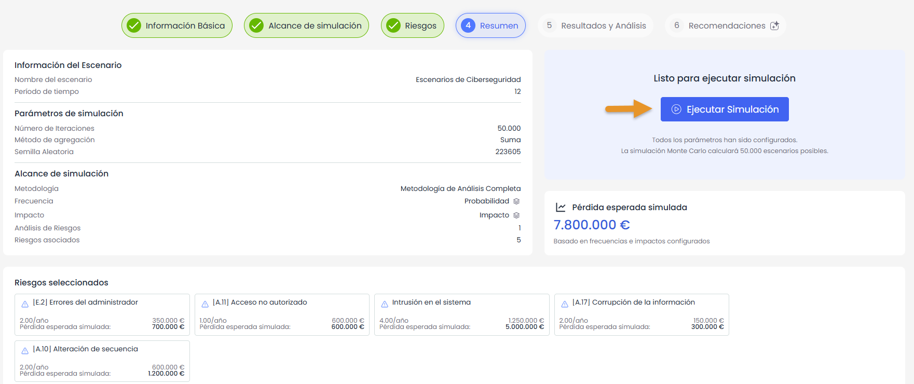

## 7. Ejecutar la simulación y acceder a Resultados

Una vez revisado el resumen, ejecuta la simulación.

1. Pulsa la opción para ejecutar la simulación.
2. Al ejecutarse la simulación, se habilitan las secciones de Resultados y recomendaciones.

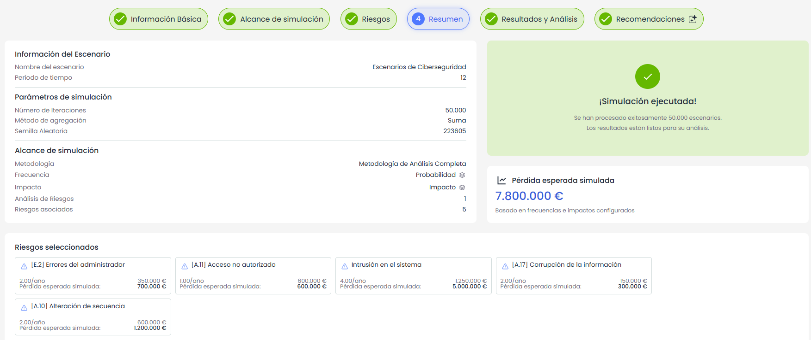

## Vídeo tutorial 2: Resultados y recomendaciones

En este vídeo se muestra cómo consultar los resultados y recomendaciones generadas. Incluye los pasos:

* Consultar Resultados y análisis.
* Revisar las Recomendaciones.

## 8. Consultar Resultados y análisis

Desde esta vista se pueden consultar los resultados obtenidos a partir de la simulación Monte Carlo y analizar la exposición económica del escenario desde diferentes perspectivas.

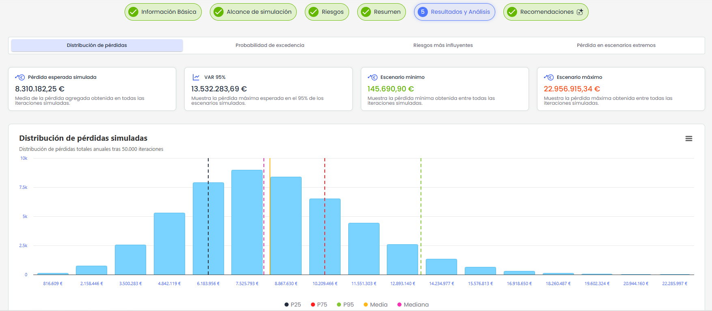

Las vistas disponibles son:

* Distribución de pérdidas.
* Probabilidad de excedencia.
* Riesgos más influyentes.
* Pérdida en escenarios extremos.

Estas vistas permiten analizar la pérdida esperada, la variabilidad de los resultados, la probabilidad de superar determinados umbrales, los riesgos que más influyen en el resultado y la composición de los escenarios de mayor severidad.

En el caso de la Probabilidad de excedencia, el sistema mostrará como **umbral analizado** por defecto, el valor correspondiente al VaR 95 %. No obstante, este valor podrá editarse para analizar la probabilidad de superar otros umbrales.

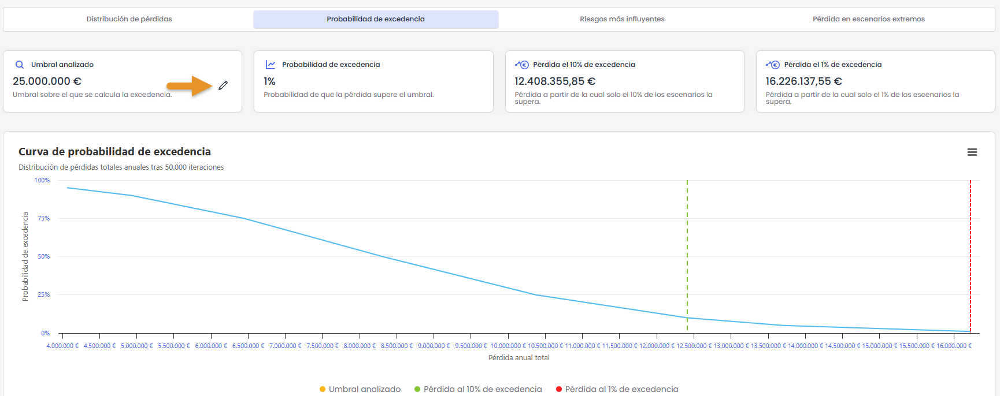

## 9. Revisar las recomendaciones

Accede a la sección de recomendaciones para consultar los controles o medidas de mitigación propuestas para los riesgos simulados.

Esta vista se divide en tres bloques:

* Controles recomendados.
* Simulador What-if.
* Comparativa.

### 9.1. Controles recomendados

En este bloque se muestran los controles propuestos para los riesgos simulados.

Estas recomendaciones se generan mediante IA, utilizando como referencia los controles ya existentes en los análisis de riesgos seleccionados.

1. Revisa los controles propuestos para cada riesgo.
2. Consulta la información asociada a cada control recomendado.
3. Selecciona los controles que quieras incorporar al análisis.
4. Pulsa el botón Añadir controles para incorporarlos.
5. El sistema añadirá los controles seleccionados al análisis de riesgos y los asociará al riesgo y elemento correspondiente.


Los controles añadidos se tratarán como controles de tipo Plan de tratamiento.


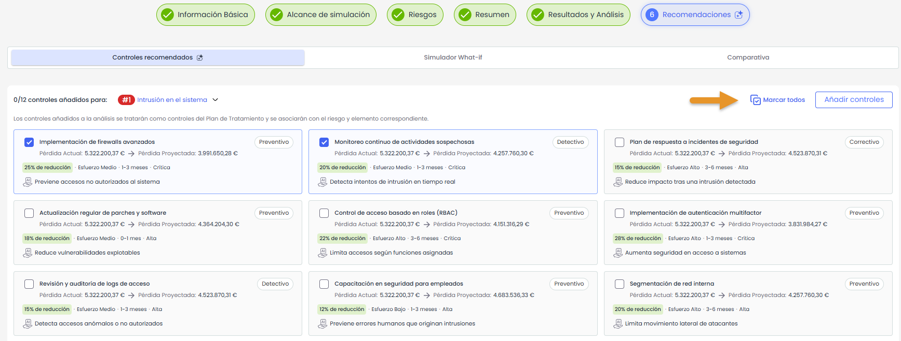

### 9.2 Utilizar el simulador What-if

El simulador What-if permite analizar el impacto esperado de implantar los controles propuestos por la IA antes de incorporarlos definitivamente al análisis de riesgos.

A partir de los controles recomendados, será posible indicar un **presupuesto disponible** y definir la **inversión** estimada necesaria para implantar cada control. Con esta información, el sistema calcula automáticamente indicadores como el ahorro esperado, el beneficio neto, el ROI y el payback, tomando como base la propuesta de reducción asociada a cada control.

1. Revisa los controles propuestos por la IA.
2. Indica o ajusta el presupuesto disponible para la implantación de controles.
3. Informa o ajusta la inversión estimada de cada control.
4. Selecciona los controles que quieres simular.
5. Al seleccionar cada control, el sistema aplicará automáticamente la reducción propuesta sobre frecuencia e impacto.
6. Revisa cómo se actualizan las métricas del escenario.
7. Si lo necesitas, ajusta manualmente la reducción de frecuencia y la reducción de impacto.
8. Analiza cómo cambiaría la simulación si se implantaran esos controles con los valores ajustados.

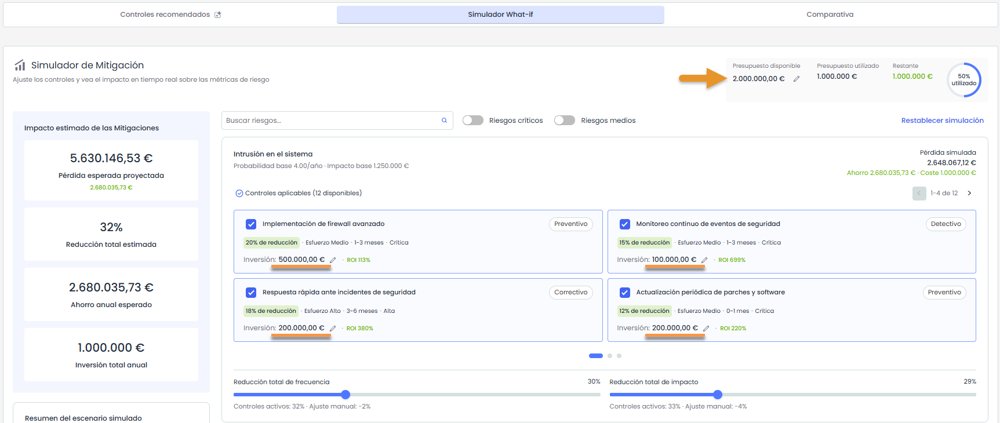

### 9.3. Comparar el escenario actual frente al escenario mejorado

Una vez seleccionadas las recomendaciones accede a la comparativa del escenario.

En este bloque se muestra la diferencia entre el escenario actual y el escenario mejorado, considerando las recomendaciones seleccionadas.

Además, se podrá descargar un informe ejecutivo, que resume los resultados de la simulación, la comparativa entre el escenario actual y el escenario mejorado, los controles seleccionados y las principales métricas económicas del análisis.

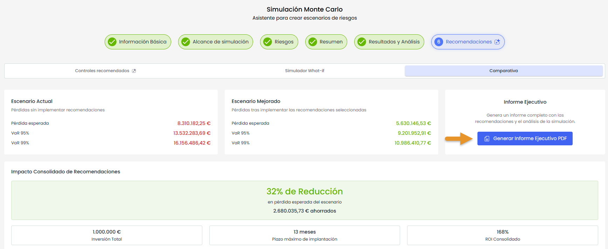

## Vídeos


Escenarios de riesgos parte 2.mp4



Escenarios de riesgos parte 1.mp4

