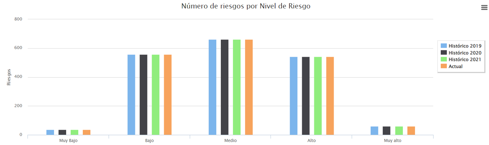
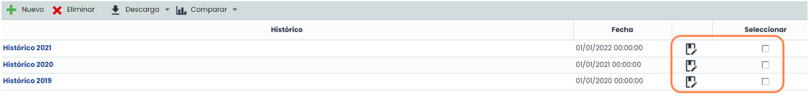
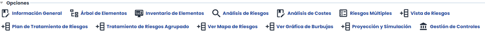
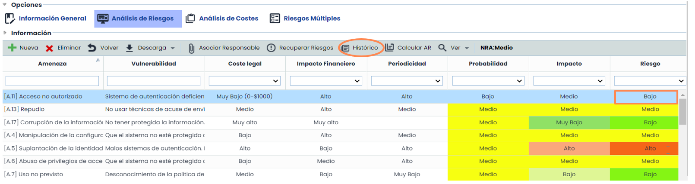
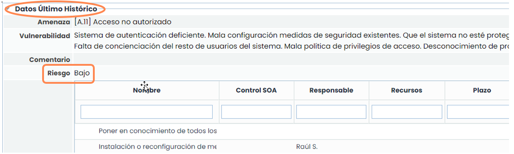
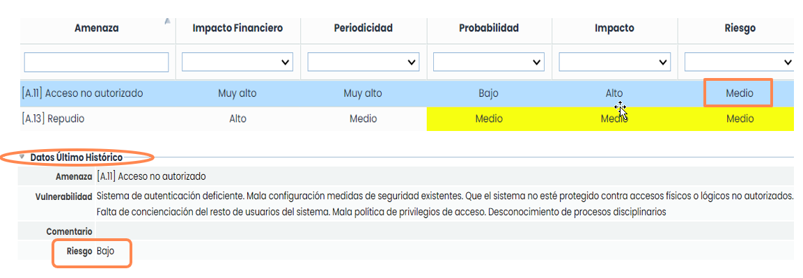

# ¿Cómo gestionar históricos de análisis de riesgos en GlobalSuite®?


Este tutorial explica, paso a paso, cómo crear y consultar los \*\*históricos de análisis de riesgos\*\* en GlobalSuite®, permitiendo conservar y comparar versiones anteriores de los análisis realizados. En esta guía se detalla cómo acceder al módulo de \*\*Históricos\*\*, generar un nuevo histórico antes de actualizar los datos de un análisis, y consultar los valores de riesgo registrados en versiones anteriores. Además, se muestra cómo acceder a la información almacenada en modo \*\*solo lectura\*\*, visualizar los cambios entre históricos mediante gráficas comparativas y comprobar la evolución de cada riesgo en el tiempo dentro del análisis


## Creación de Histórico.

**Paso 1**

Desde la opción **Análisis >**[**Históricos**](https://help.globalsuitesolutions.com/es/globalsuite/v1/historicos) se permite consultar todos los históricos que se han almacenado en GlobalSuite® a lo largo del tiempo.

Al acceder se muestra por defecto el listado de los “**Históricos**”, donde se muestra en la parte superior una gráfica de barras Riesgo/Nivel para cada histórico registrado y en la parte inferior una tabla con el nombre y la fecha del histórico.

**Paso 2**

Para la “**Actualización del Análisis de Riesgos**” es necesario crear un “**Histórico**” para guardar la información del “**Análisis de Riesgos**” antes de actualizar sus datos.

Para ello, hay que pulsar el botón nuevo, por defecto el histórico se crea con la fecha y hora actuales en el nombre, si se quiere renombrar hay que seleccionar el registro y pulsar el icono marcado.

El “Histórico” creado almacena toda la información que tenemos en nuestro “Análisis de Riesgos” actual, de forma que permita consultar la información en el futuro.

**Paso 3**

Al acceder a un histórico, pulsando directamente sobre el nombre, en la parte superior aparecen todas las opciones que permiten consultar la información.

Se crea una foto de todas las funcionalidades que se muestran en el cuadro anterior, en el momento de la creación del histórico. Al pulsar sobre cada una de ellas se puede visualizar el estado en el que se encontraban en ese momento, esta consulta es únicamente en modo de **sólo lectura**, ya que no es modificable.

## Consulta del valor histórico de un Riesgo.

**Paso 4**

Cuando se ha registrado un histórico, es posible comprobar el valor anterior de la dimensión de riesgo elegida en el análisis de riesgos.

Dentro de la opción **Análisis / Análisis de Riesgos**, cuando ya se ha seleccionado un análisis, se selecciona un elemento, y en los riesgos de este elemento se puede consultar el valor del riesgo que se registró en el último histórico.

Una vez marcado el riesgo y pulsando el botón histórico, nos muestra la última valoración del Riesgo.

**Paso 5**

Como no ha sufrido variación desde el último histórico, el valor es el mismo que el actual.

Si se cambia el valor actual del riesgo, se puede comprobar que el valor del histórico se sigue manteniendo:
