# ¿Cómo valorar controles y calcular el riesgo residual en GlobalSuite®?


En esta guía, se explicarán los pasos a seguir para parametrizar una metodología de cálculo de \*\*Riesgo residual\*\* a través de una correcta implementación de la [\*\*Metodología de Controles\*\*](https://help.globalsuitesolutions.com/es/globalsuite/v1/metodologias-controles).


La primera fase en relación a los análisis de riesgos de la compañía, consiste determinar el Riesgo inherente referente a los procesos, activos, elementos… en definitiva, el riesgo propio de todo aquello que se requiera tener en consideración.

La segunda fase, reside en aplicar o conocer la implicación que tienen, los planes de acción o controles, con la finalidad de mitigar el riesgo inherente, obteniendo de este modo el llamado **Riesgo residual**.

## Metodología de Riesgos. Riesgo Inherente.

El **Riesgo Inherente**, aunque su metodología de cálculo depende de manera particular de cada organización, regularmente es resultado de la interacción entre la “**Probabilidad**” y el “**Impacto**”.

En la siguiente imagen se puede observar un ejemplo al respecto de un análisis de riesgos en GlobalSuite®:

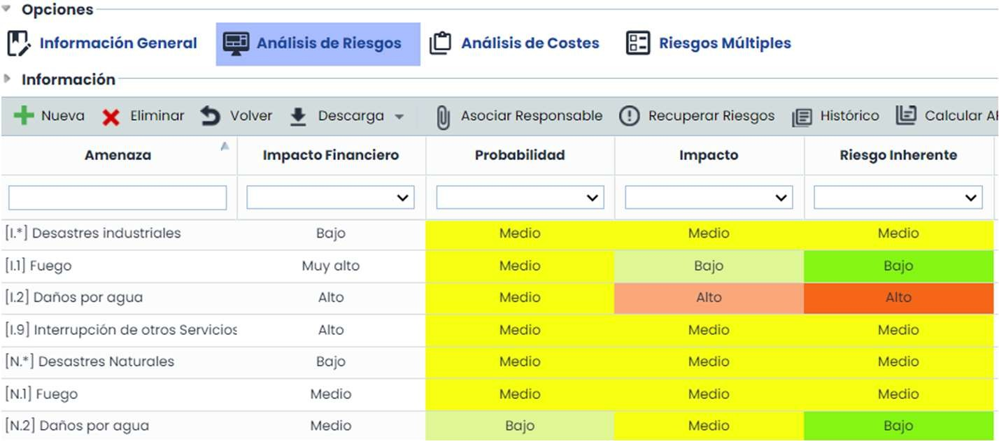 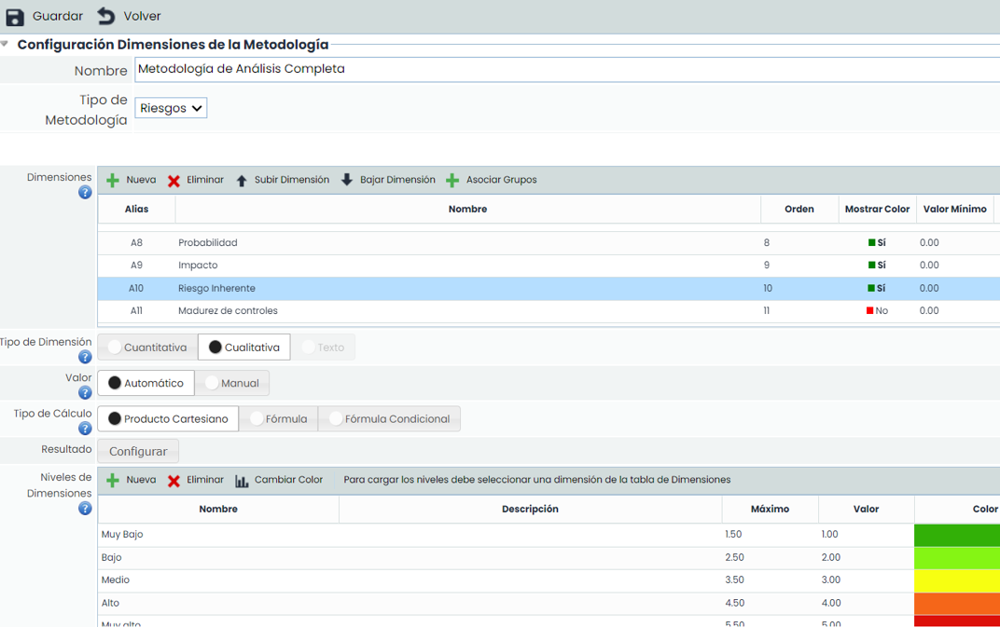

A modo de recordatorio, la configuración de la Metodología de Riesgos se realiza desde el apartado de Ajustes, concretamente desde la sección **Metodologías >** [**Riesgos**](https://help.globalsuitesolutions.com/es/globalsuite/v1/metodologia-riesgos)**.**

En la imagen de la derecha se puede observar la metodología de riesgos que hay detrás del análisis de riesgos mostrado anteriormente, en la que se pondera un poco más el “**Impacto**”.

El **Riesgo Inherente** puede ser obtenido mediante una Fórmula entre **Impacto y Probabilidad** como en el ejemplo anterior:

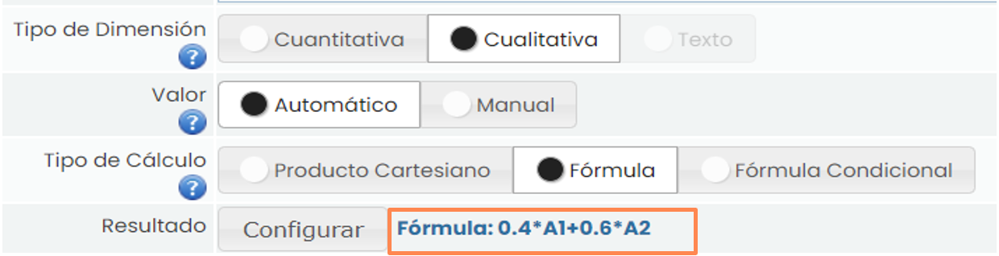 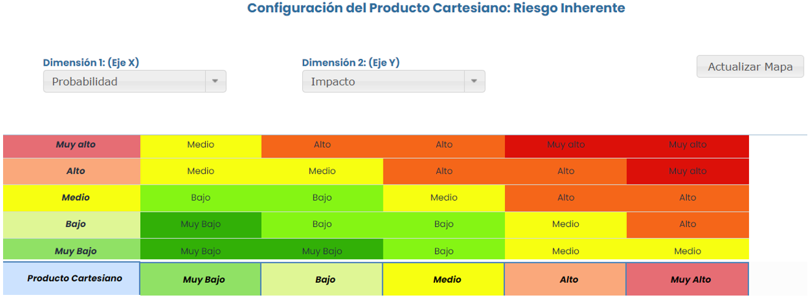

o bien, entre otras opciones, es posible su cálculo a través de la configuración de un Producto Cartesiano:

## Metodología y Valoración de Controles.

Tras disponer del **Riesgo Inherente**, cabe pensar en los planes de acción o controles definidas con el objetivo de mitigar aquellos riesgos que superen el NRA o Apetito de riesgos. En definitiva, consiste en conocer la eficacia que tienen los **controles aplicados** sobre el **Riesgo Inherente**. Desde **Ajustes > Metodologías >** [**Controles**](https://help.globalsuitesolutions.com/es/globalsuite/v1/metodologias-controles), se configurará la dimensión referente a la **Efectividad del control**. En el ejemplo, la **Madurez del control** se calcula en base a otras dimensiones, propiedades y/o condiciones propias del control en cuestión.

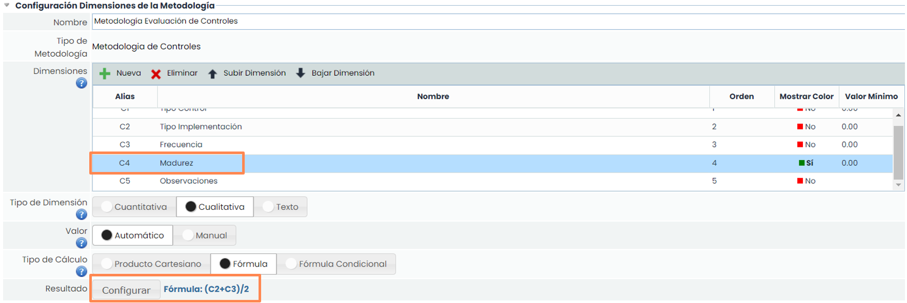

Para un diagnóstico más detallado de la efectividad del control, se puede identificar la naturaleza del mismo, es decir, si es de tipo “Preventivo” o “Correctivo”.

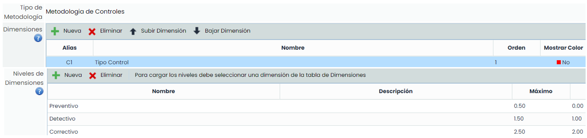

El objetivo será conocer si la mitigación afecta a la Probabilidad, o bien, al Impacto. Para ello se generan las dimensiones “**Reducción Probabilidad**” y “**Reducción Impacto**”.

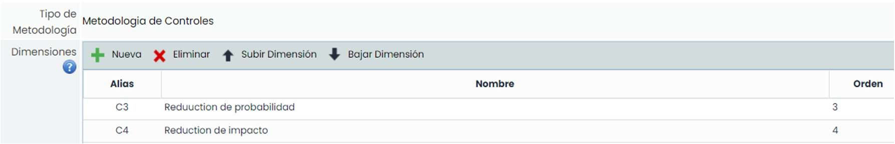

A continuación, se detalla el cálculo de las dimensiones “Reducción Probabilidad” y “Reducción Impacto”.

1. Para el cálculo de la dimensión “**Reducción Probabilidad**”, se ha utilizado la siguiente fórmula:

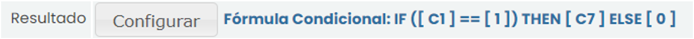

Siendo **C1** = “Tipo de Control” y **C7** = “Efectividad del Control”.

Con esta formulación se consigue almacenar en la dimensión “Reducción Probabilidad” la efectividad del control siempre que éste sea de carácter preventivo, por ello en la condición de la fórmula se comprueba esta característica, **C1** = 1.

2. Para el cálculo de la dimensión “Reducción Impacto”, se ha utilizado la siguiente fórmula:

Siendo **C1** = “Tipo de Control” y **C7** = “Efectividad del Control”.

En este caso, en la dimensión “Reducción Impacto” se almacena el valor de la efectividad del control, siempre que éste sea de carácter correctivo, **C1** = 2.

Con ello, se consigue disgregar en dos dimensiones diferentes la efectividad del control según su tipología.

Paralelamente, se registrará un contador, separando los controles igualmente entre preventivos y correctivos, con el objetivo de tener almacenados y diferenciados en otras dos dimensiones el número de controles de cada tipo.

Para ello se han utilizado las dimensiones “**Aplica Probabilidad**” para controles de tipo preventivo (**C1** = 1)

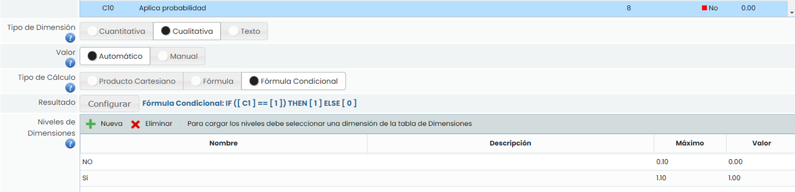

Y del mismo modo la dimensión “**Aplica Impacto**”, para los controles de tipo correctivo (C1 = 2):

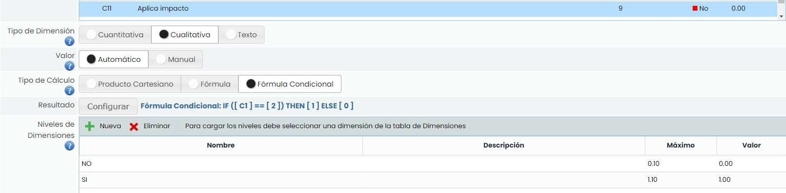

El siguiente paso será valorar las dimensiones que se han configurado en la metodología de controles. Para ello, se accederá desde **Gestión de Controles**, pudiendo valorar las dimensiones manuales directamente desde la pantalla y obteniendo de esa manera el valor de aquellas que son automáticas.

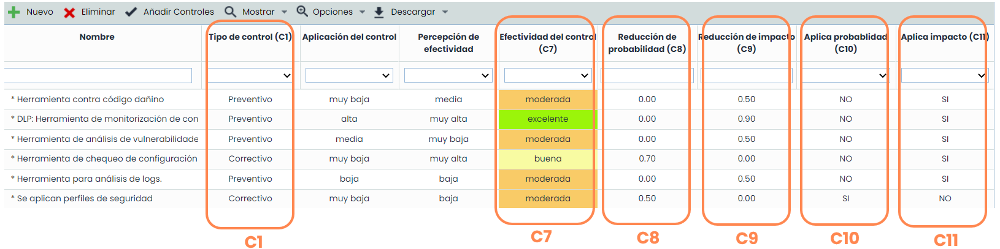

## Riesgo Residual.

La última fase, tras haber configurado y aplicado la Metodología de Controles en el análisis, es configurar la dimensión **Riesgo Residual**, atendiendo al efecto que tendrá la **Eficacia del Control** sobre el **Riesgo Inherente**. Desde **Ajustes > Metodologías >** [**Riesgos**](https://help.globalsuitesolutions.com/es/globalsuite/v1/metodologia-riesgos) se generan las dimensiones residuales “Probabilidad Residual”, “Impacto Residual” y “Riesgo Residual” tal y como se muestra en la siguiente imagen:

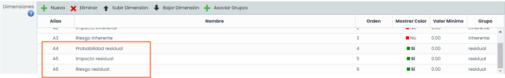

Las dimensiones residuales tendrán las mismas características de diseño que sus homólogas inherentes (cualitativas con los mismos niveles definidos), con la diferencia de que en este caso su cálculo será automático a través una formulación que relacione las dimensiones inherentes con la efectividad de los controles.

En la siguiente imagen se puede observar el efecto de los controles implantados sobre sobre la probabilidad inherente e impacto inherente de los riesgos; y por consiguiente sobre el riesgo inherente:

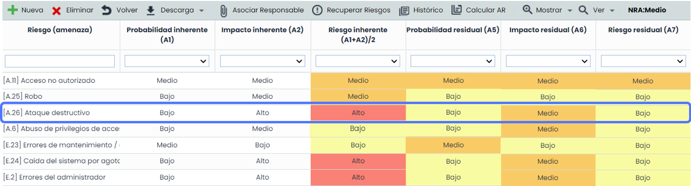 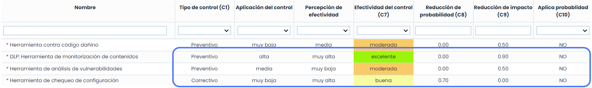

En el ejemplo: **Prob. Residual = Prob. Inherente – Media de efectividad de los controles (Probabilidad).**

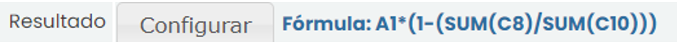

**C8** = Reducción de Probabilidad (Efectividad de los controles que mitigan la probabilidad).

**C10** = Aplica Probabilidad (Controles que aplican a la Probabilidad).

Del mismo modo: **Impacto Residual = Impacto Inherente – Media de efectividad de los controles (Impacto).**

**C9** = Reducción de Impacto (Efectividad de los controles que mitigan el Impacto).

**C11** = Aplica Impacto (Controles que aplican a la Probabilidad).

Finalmente: **Riesgo Residual = Suma ponderada de Probabilidad Residual e Impacto Residual.**

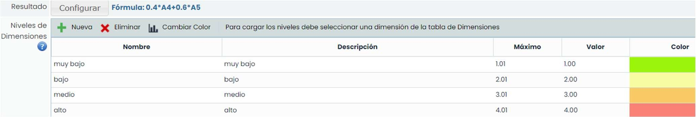

Desde el [**Análisis de Riesgos**](https://help.globalsuitesolutions.com/es/globalsuite/v1/analisis-riesgos), se podrá constatar la incidencia que tienen los **controles** sobre el **Riesgo Inherente**.

Tras asociar uno o varios controles a los riesgos, estos podrán actuar sobre el **Riesgo Inherente** pudiéndose observar este efecto en el **Riesgo Residual**, tal y como se puede observar en la imagen.

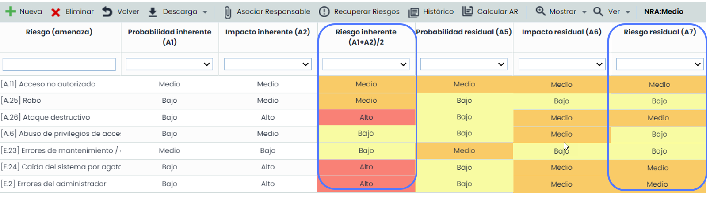

Por último, desde **Evaluación de Riesgos / Ver Mapa de Riesgos**, adicional a toda la información referente a los análisis, se puede obtener una comparativa visual entre los mapas de calor de **Riesgo Inherente y Riesgo Residual**, que ofrece una visión muy clara de la efectividad de los controles implantados, tal y como se muestra en la siguiente imagen:

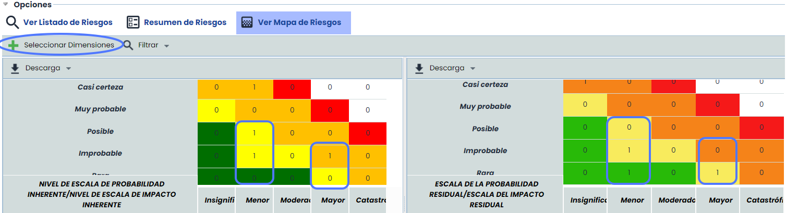

Para poder obtener esta comparativa, basta con pulsar en el botón “Seleccionar Dimensiones” y seleccionar las dos dimensiones que se requiere comparar, en este caso “Riesgo Inherente” (Izquierda) y “Riesgo Residual” (derecha).
