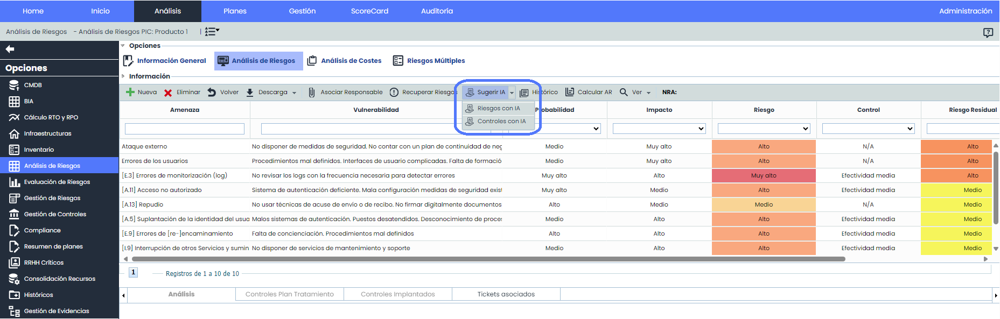
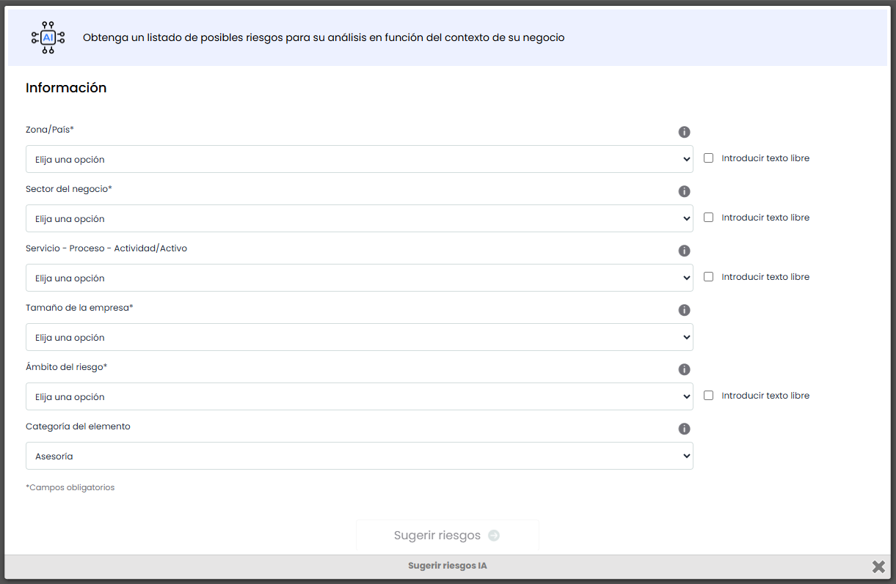
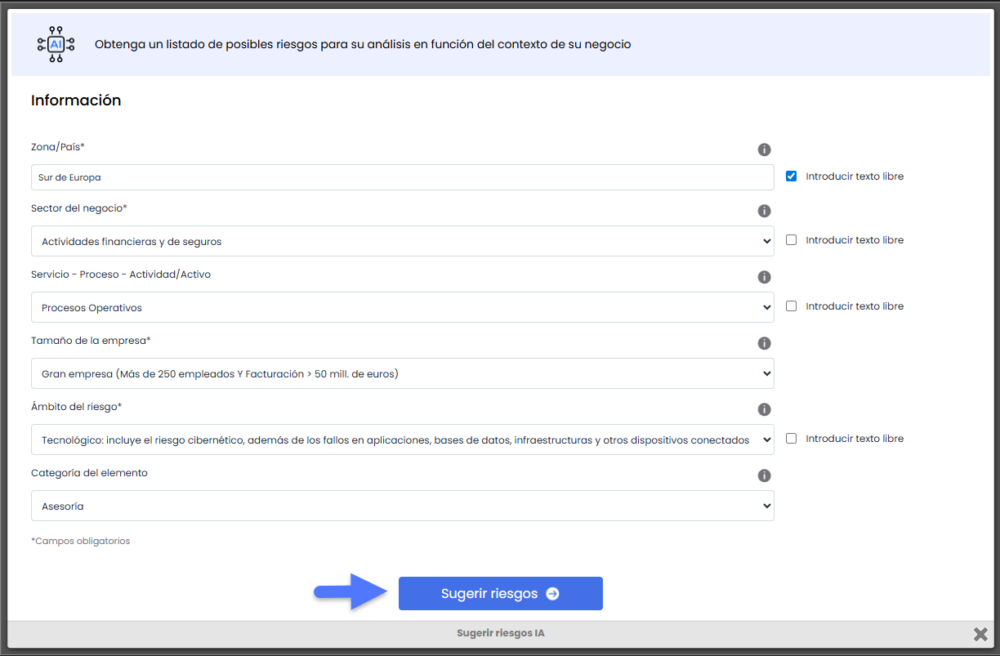
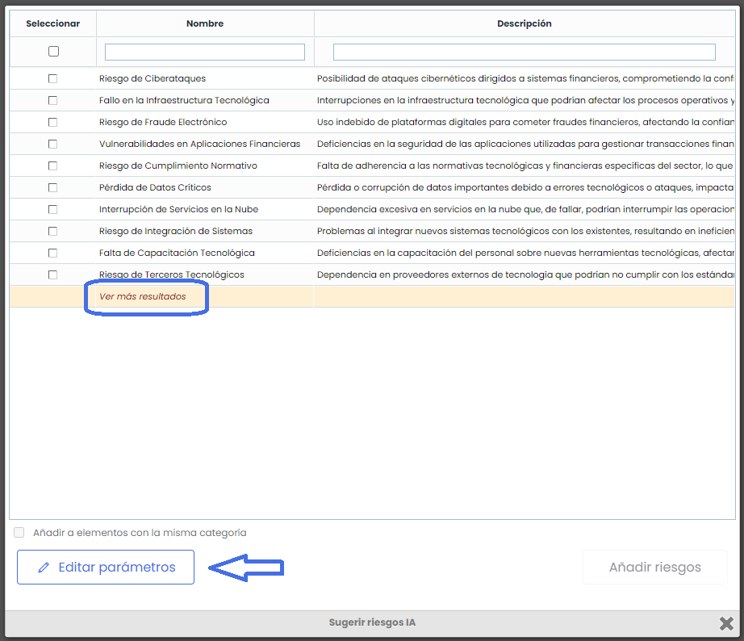
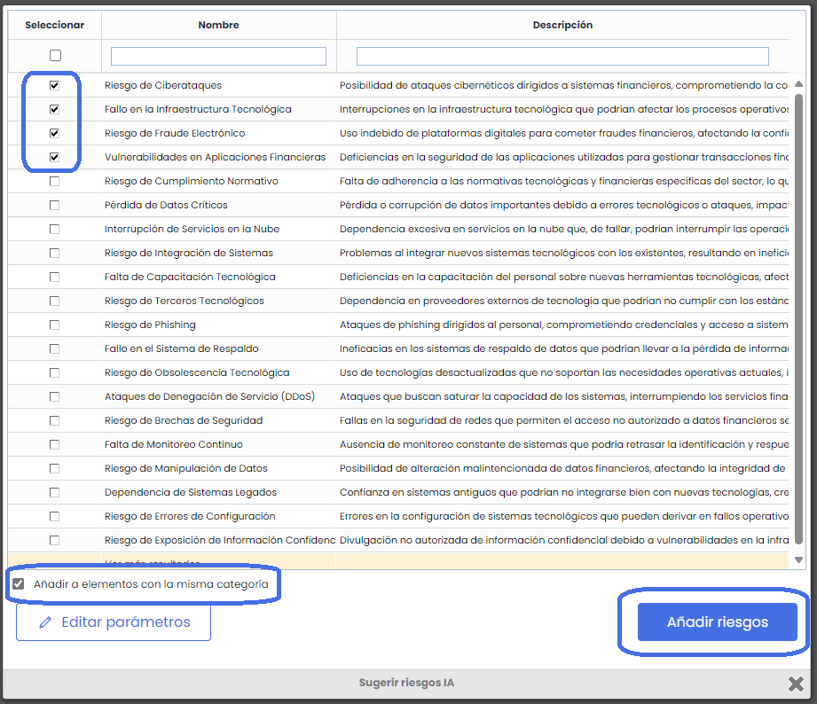
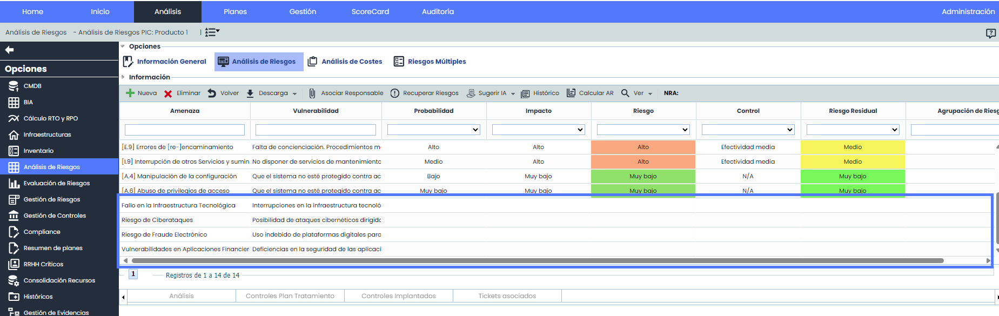
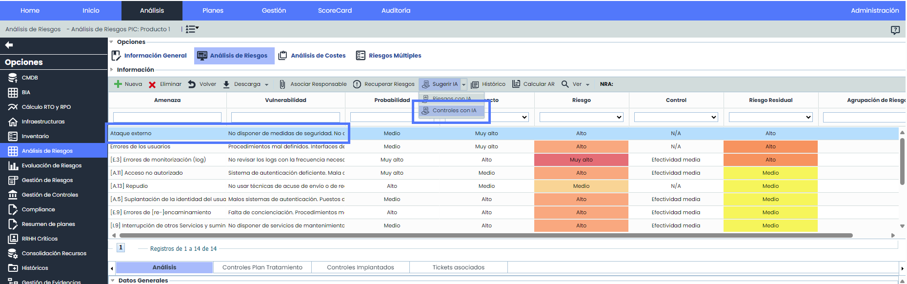
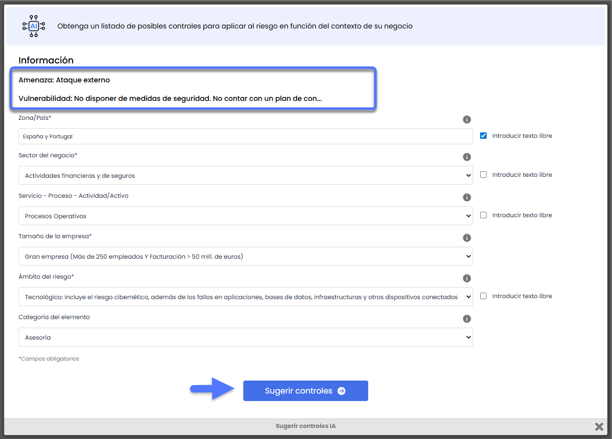
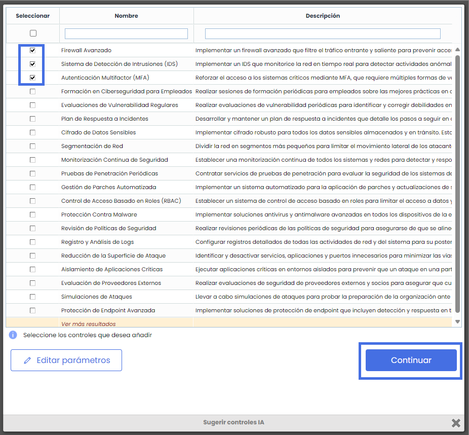
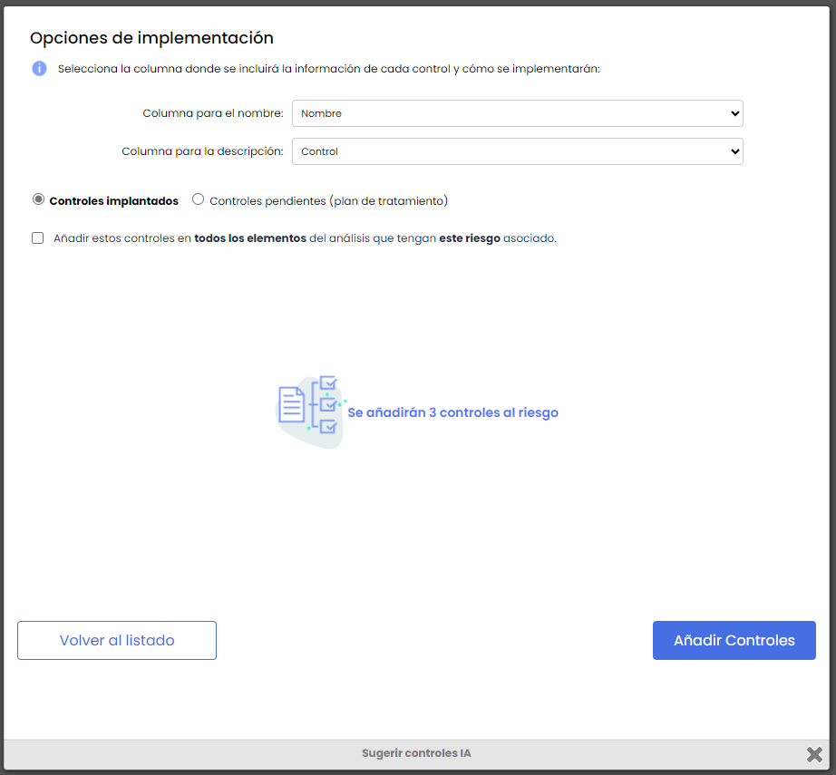

# Descubre Nuestro Recomendador de Riesgos y Controles Potenciado por Inteligencia Artificial

Hoy en día, debido a negocios cada vez más complejos, interrelacionados y cambiantes, la Gestión de riesgos en una compañía gana importancia y es crucial para la gobernanza corporativa. Para poder realizar esta gestión de manera eficiente, colaborativa y segura, es imprescindible poder contar con una solución GRC que te ayude a automatizar al máximo este proceso.

Uno de los retos que puede suponer la identificación de riesgos es que es una tarea que puede ser muy compleja y demandante, y requerir un conocimiento de otras áreas de las que no se tiene experiencia.

Para ello, en GlobalSuite® hemos incorporado un motor basado en Inteligencia Artificial que permite, proporcionando la información de contexto de la compañía y el ámbito de riesgos a tratar, obtener posibles riesgos y controles que incorporar a nuestro análisis de riesgos.

Aprovechando la potencia de la IA, cada vez más madura, vamos a poder obtener resultados precisos que podamos aplicar a los elementos que estamos evaluando, minimizando el tiempo y el esfuerzo para realizar esta tarea.

## Regístrate en Nuestro Webinar Exclusivo para Conocer Más

_No te quedes atrás. Inscríbete en nuestro próximo webinar y aprende cómo utilizar esta herramienta innovadora en tu empresa._

***

[**Webinar Online**](https://events.teams.microsoft.com/event/b74284d3-97fe-40ee-b477-16849a6550f6@db6d54ae-b406-4e61-93c7-8585360c3549)

* jue, 12 sept
* 16:00 - 17:00 CEST

[Regístrate aquí](https://events.teams.microsoft.com/event/b74284d3-97fe-40ee-b477-16849a6550f6@db6d54ae-b406-4e61-93c7-8585360c3549)

***


\*\*NOTA:\*\* Esta solución de Recomendación de Riesgos y Controles por Inteligencia Artificial está disponible en GlobalSuite® a partir de la versión v6.102 del producto. Puedes ver más información en nuestro [Changelog](https://changelog.globalsuitesolutions.com/changelog/).


## ¿Cómo obtener recomendaciones de riesgos adaptados a nuestro negocio?

Dentro de la solución de GlobalSuite® GRC hemos incorporado un nuevo motor basado en Inteligencia Artificial para obtener recomendaciones de riesgos y controles.

Esta funcionalidad amplía la que ya disponíamos de poder utilizar [catálogos](https://help.globalsuitesolutions.com/es/globalsuite/v1/catalogos-analisis) de riesgos y controles estáticos, permitiendo una identificación de riesgos dinámica y sin necesitar ese know-how previo.

Para poder comenzar a utilizar esta solución debemos acceder a la opción de [Análisis de Riesgos](https://help.globalsuitesolutions.com/es/globalsuite/v1/analisis-de-riesgos), y dentro del análisis con el que queramos trabajar, ir a uno de los elementos a evaluar.

Aquí dispondremos de las dos acciones que ofrece esta nueva capacidad, que es Sugerir Riesgos o Controles con IA.

**¿Cómo definir el contexto de la compañía?**

Cuando accedemos a la ventana del recomendador de riesgos, lo que deberemos realizar es introducir el contexto de la compañía, lo que permitirá obtener recomendaciones de riesgos precisas para nuestra situación.

Los parámetros a completar son los siguientes:

* **Zona / País\***: Permite introducir en qué país opera la compañía. Por defecto ofrece un listado de países, aunque es posible introducir texto libre para indicar varios países o una región. Por ejemplo, “España y Portugal“ ó “Sur de Europa“.
* **Sector del negocio\***: Se refiere a qué actividad se dedica principalmente la empresa, pudiendo elegir entre un conjunto de opciones. Por ejemplo, “Minería extractiva del carbón“ ó “Energía fotovoltáica“.
* **Servicio - Proceso - Actividad**: De forma opcional podemos indicar, dentro de la compañía, a qué proceso, departamento o área concreta se aplicarán los riesgos.
* **Tamaño de la empresa\***: Además, también será necesario indicar el tamaño de la empresa, lo cual puede afectar a su exposición a determinados riesgos.
* **Ámbito del riesgo\***: Este campo fundamental permite establecer de qué temática se obtendrán los riesgos, pudiendo ser de algunas de las definidas. Riesgo Tecnológico o Ciber, Riesgo Reputacional, de Privacidad o de Cumplimiento, entre otros. Por defecto ofrece un listado de opciones, aunque es posible introducir texto libre para especificar una o más temáticas concretas.
* **Categoría del elemento**: Por defecto, este campo tendrá la categoría asignada al elemento sobre el que voy a obtener la sugerencia de riesgos, aunque podré no utilizar ese campo, o seleccionar otra de las categorías definidas en mi sistema de gestión.

\*Los campos marcados con asterisco son imprescindibles para poder obtener sugerencias de riesgos, y sin completarlos no podremos continuar el proceso.

Una vez que completemos todos los campos (al menos los obligatorios), pulsando el botón de “Sugerir Riesgos” el motor de Inteligencia Artificial procederá a obtener un listado de riesgos sugeridos.

**¿Cómo filtrar más resultados?**

Los riesgos que nos ofrecerá el sistema se mostrarán en un listado, detallado en dos campos, un **nombre** o resumen del riesgo, y una **descripción** más detallada incluyendo causas o vulnerabilidades que lo provoquen.

Por defecto, se muestran los 10 primeros resultados, pudiendo obtener riesgos adicionales al pulsar en la banda de “Ver más resultados”.

También, si se quiere cambiar los parámetros que se han introducido del contexto para obtener otros resultados se puede hacer mediante el botón de “Editar parámetros”, lo cual nos llevará a la ventana anterior para modificar el campo que queramos y volver a sugerir riesgos.


Actualmente el Recomendador de Riesgos y Controles está limitado a 60 propuestas al mes. Una vez alcanzado ese límite no se podrá utilizar el recomendador por IA hasta el mes siguiente.


**¿Cómo aplicar las recomendaciones de riesgos?**

Una vez que tengamos los riesgos que se proponen, podremos añadirlos al análisis de riesgos, para lo cual podremos seleccionar uno o varios de ellos para incluirlos en el elemento que estamos analizando.

En el momento en que tengamos seleccionado al menos un registro, se nos habilitará el botón de “Añadir riesgos“ para poder aplicar estos riesgos, los cuales quedarán listos para valorar según la metodología que tengamos definida.

Además, marcando el check de “Añadir a elementos con la misma categoría“ podremos aplicar estos riesgos a todos los elementos incluidos en el alcance del análisis.

Por ejemplo, si estamos identificando riesgos para un servidor (categoría Hardware), si así queremos, podremos añadir esos mismos riesgos a todos los elementos de esa misma categoría que tengamos en el análisis de riesgos.

## ¿Cómo obtener recomendaciones de controles?

Para la otra característica que incorpora esta nueva solución de Recomendador por IA y que permite obtener sugerencias de controles, el funcionamiento es muy parecido a lo visto hasta ahora, con algunas salvedades.

La primera diferencia es que al tener como objetivo el obtener recomendaciones para un riesgo concreto de nuestro análisis, es necesario seleccionar el riesgo antes de poder comenzar con el proceso.

Una vez que tenemos elegido el riesgo sobre el que proponer controles, podremos abrir la ventana de elección de parámetros, los cuales son los mismos que para la propuesta de riesgos, aunque también tendremos visible la información del riesgo que estamos tratando.

Los nombres de los campos Amenaza y Vulnerabilidad corresponden a los que se tengan configurados en la metodología.

Una vez pulsado en Sugerir controles, se nos mostrarán los resultados para poder elegir cuáles aplicar, para lo cual, una vez marcado el check de al menos uno de los controles, podremos pulsar en “Continuar”

**¿Cómo incluir las propuestas de controles en el análisis?**

Para poder aplicar los controles seleccionados se tendrá que elegir en cuál de los campos generales de la ficha del control queremos añadirlo, para ello aparecerán los selectores.

También, otra de las cosas que se podrán elegir es en qué tipo de control se consolidará.

* Controles Implantados: Estos controles aparecerán en Gestión de Controles además de asociarse al riesgo origen.
* Controles pendientes: Si se marca esta opción se mantendrá como Planes de Tratamiento para programar su implantación, y estarán visibles en Gestión de Riesgos
