# Gestión de la CMDB


Este tutorial explica cómo configurar y gestionar la CMDB en GlobalSuite®: desde el acceso al módulo y la creación/importación de elementos, hasta su relación con activos del inventario, visualización del grafo de relaciones y uso de las pestañas de detalle (datos, relaciones, procesos, historial y líneas de referencia). El objetivo es que puedas mantener un repositorio confiable de elementos de configuración (CI) y sus dependencias para soportar ITSM, análisis de riesgos y control de cambios.


## Introducción

GlobalSuite® permite llevar a cabo el proceso de gestión de la configuración a través del establecimiento de una CMDB alineada con el inventario de elementos de la organización. Permite registrar de forma exhaustiva los elementos de configuración, así como las relaciones entre los mismos. Además, se pueden consultar todas las incidencias, problemas y cambios asociados a cada elemento de manera centralizada.

La funcionalidad de GlobalSuite® que permite realizar la gestión de la CMDB se encuentra en la Análisis > [CMDB](https://help.globalsuitesolutions.com/es/globalsuite/v1/cmdb). Ésta se encuentra en primera posición en el menú izquierdo de la herramienta.

## Paso 1

Al acceder al apartado de la CMDB se muestra un listado con todos los elementos de configuración que están almacenados en la Base de Datos.

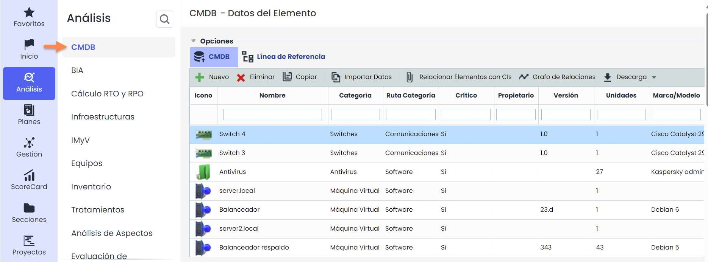

## Paso 2

Las opciones que permite la herramienta son las siguientes:

* **Nuevo**: Permite incluir un nuevo elemento en la base de datos.
* **Eliminar**: Permite eliminar uno o varios elementos almacenados en la base de datos. Para ello se ha de seleccionar la fila o filas deseadas y pulsar el botón "Eliminar".
* **Copiar**: Posibilita crear un nuevo elemento con todos los atributos del elemento seleccionado, a excepción de los servicios y archivos que se hayan subido.
* **Importar Datos**: Permite incluir varios elementos mediante un archivo “.csv”.

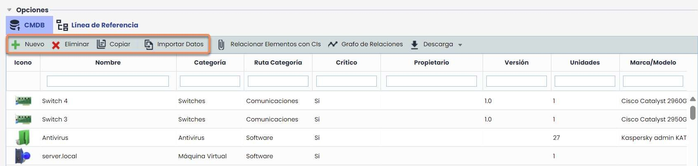

## Relacionar Elementos con Activos

Permite incorporar los elementos de configuración deseados en la opción de Análisis > Inventario, para realizar el análisis de riesgos sobre esos elementos. Para ello se ha de seleccionar el elemento de configuración en la columna derecha y arrastrar el elemento a la columna izquierda. El listado de activos mostrado en la columna izquierda es el mismo que va a mostrarse en el apartado "Análisis > [Inventario](https://help.globalsuitesolutions.com/es/globalsuite/v1/inventario).

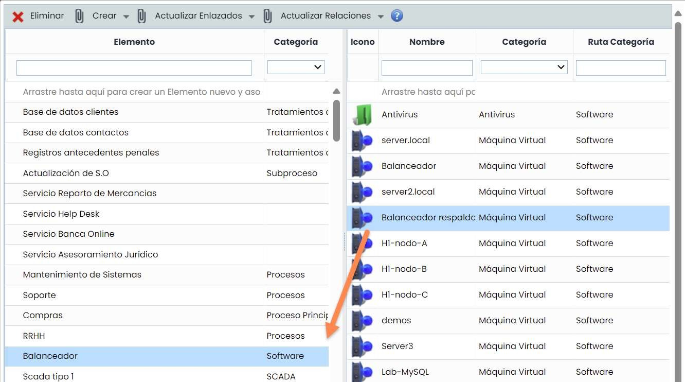

En la cabecera de la ventana de "Relacionar Elementos con CIs" se permiten las siguientes opciones:

* **Crear Elementos desde CMDB**: Se crea un Elemento en el Inventario por cada CI que no tenga elementos enlazados (que estén solo en la CMDB).
* **Crear CIs desde Inventario**: Se crea un CI en la CMDB con el nombre del elemento como campo principal del CI, y la categoría del mismo.
* **Actualizar Enlazados - CIs CMDB**: Actualiza la información del campo principal y la categoría de los CIs que tengan asociado un solo Elemento con los datos del mismo.
* **Actualizar Enlazados - Elementos**: Actualiza el nombre y la categoría de los Elementos que tengan enlazado un solo CI con los datos del mismo.
* **Actualizar Relaciones - Árbol de Elementos desde CMDB**: Se actualizan las dependencias entre elementos añadiendo y quitando dependencias en función de los CIs asociados.
* **Actualizar Relaciones - CMDB desde Árbol de Elementos**: Se actualizan las relaciones entre CIs añadiendo y quitando dependencias en función de los Elementos asociados.

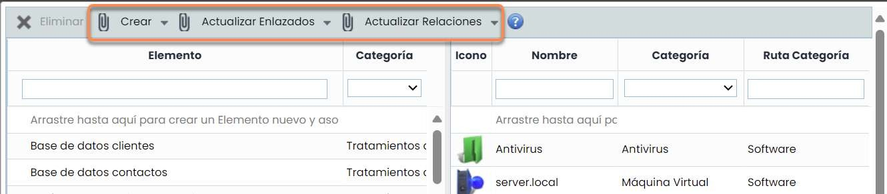

## Grafo de Relaciones

Permite visualizar las relaciones del elemento seleccionado de manera gráfica.

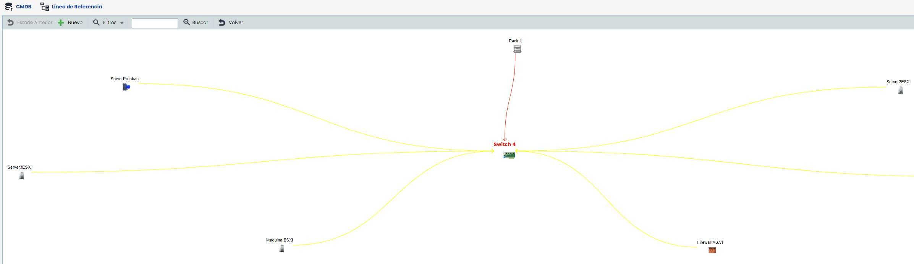

## Grafo de Relaciones

* **Nuevo**: Permite incluir un nuevo elemento de configuración en el gráfico.
* **Filtros**: Permite realizar filtros para visualizar las distintas relaciones del elemento seleccionado. **Nivel 1** muestra las relaciones del elemento con aquellos más directos. Nivel 2, muestra las relaciones del elemento seleccionado con los más directos y las relaciones de estos últimos con los suyos propios, etc. El filtro Relacionados muestra todos los elementos de la CMDB que están relacionados entre sí y la opción de Todos muestra el listado de todos los elementos de la CMDB estén o no relacionados.
* **Buscar**: Permite realizar una búsqueda de un elemento de configuración en el grafo.
* **Volver**: Permite volver a la pantalla principal, donde se muestra el listado de elementos de configuración.

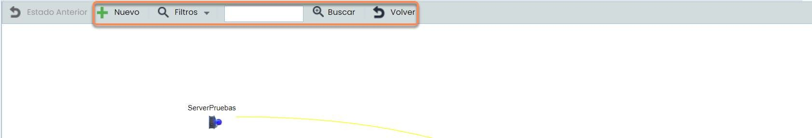

## Pestañas inferiores

Al pinchar sobre un elemento del listado, se cargan en la parte inferior una serie de pestañas que permiten editar información relativa al elemento de configuración.

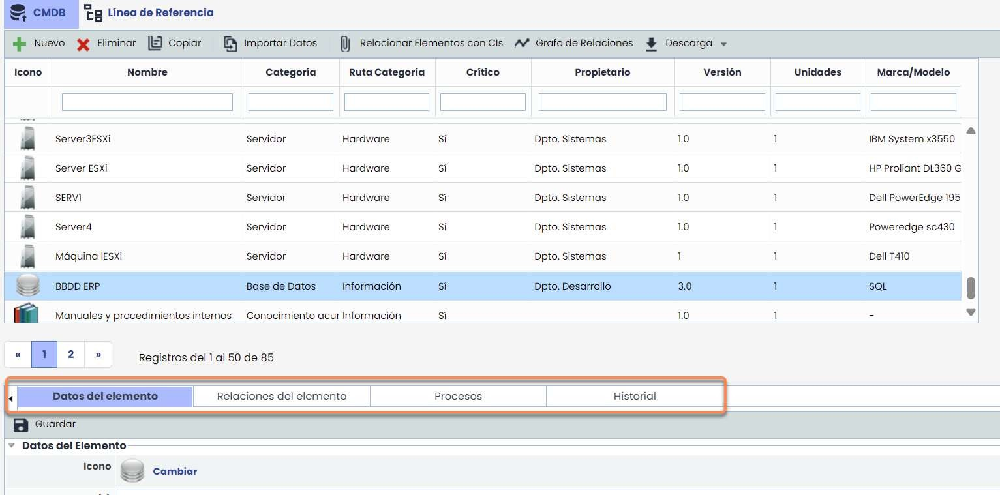

### Datos del Elemento

Permite detallar la información específica del elemento seleccionado en la tabla. Está dividido en tres secciones:

1. Datos del Elemento
2. Configuración del Elemento
3. Datos Adicionales

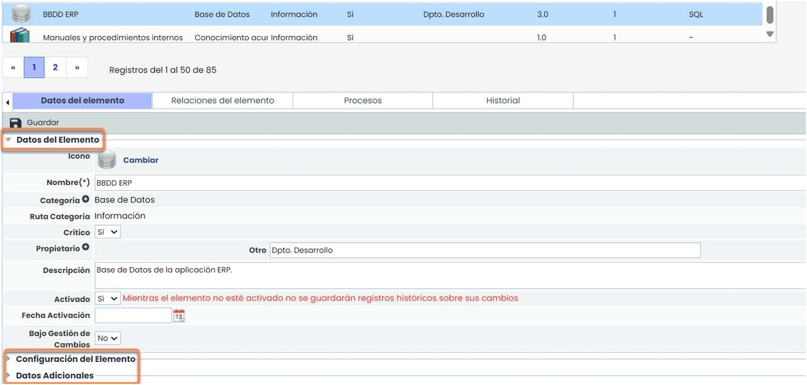

### Relaciones del Elemento

Permite establecer las distintas relaciones entre elementos almacenados y activados en la CMDB.

Para ello se ha de pulsar “Añadir”, y seleccionar el elemento deseado en Origen, seguido del tipo de relación en el desplegable, y por último indicar el elemento con el que se establece la relación en Destino. Una vez establecidos los parámetros deseados se pulsa el botón “Añadir” lo que genera una nueva fila de relación.

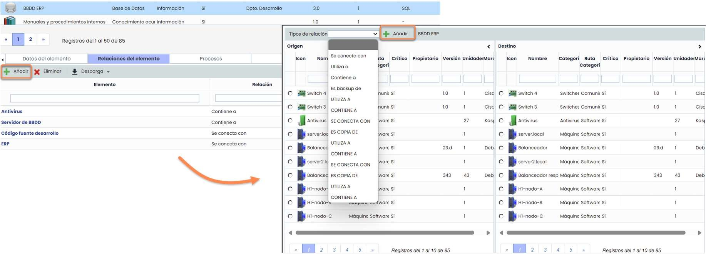

• Las relaciones del elemento se pueden modificar en “Ajustes”.

### Procesos

Muestra de manera específica aquellos incidentes que se han producido y que tienen como recurso afectado el elemento seleccionado. Para ello se debe establecer el control automático de los incidentes, problemas y cambios en la opción de “Ajustes” y registrar los tickets correspondientes en GlobalSuite.

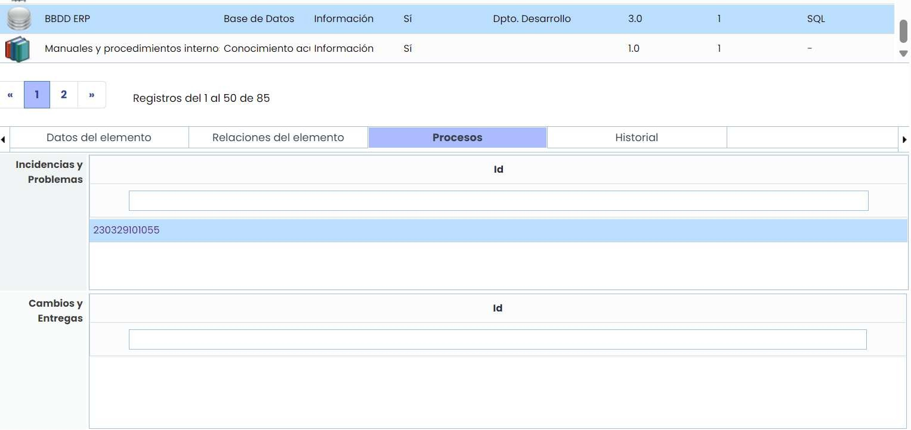

### Historial

Muestra un listado ordenado con las modificaciones que ha sufrido el elemento desde el momento que fue activado.

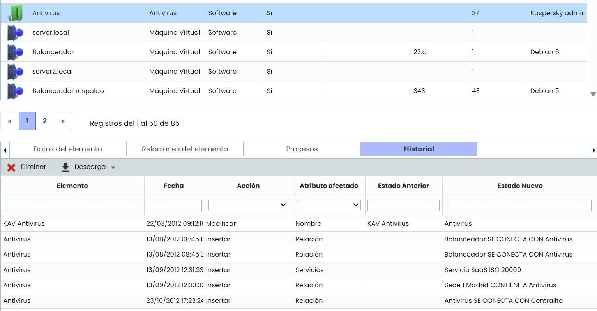

## Líneas de Referencia

La opción de Líneas de Referencia permite al usuario generar y almacenar un archivo con el estado de los elementos de configuración en el momento de la creación. Esto permite llevar un control de los cambios en la configuración y relaciones del elemento tras la creación de las RFC’s.

Cuando se pulsa el botón “**Nueva**”, se accede a un formulario para introducir la información relativa a una línea de referencia

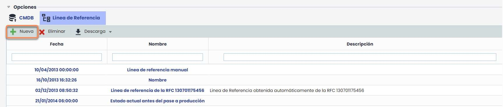

* Se puede introducir la información relativa a la fecha, nombre, descripción, RFCs relacionadas con la Línea de Referencia.
* Además, se pueden seleccionar el listado de elementos de configuración que formarán parte de la Línea de Referencia.
* Una vez rellenada la información, se debe pulsar el botón “Guardar”, y esta línea ya será accesible desde el listado.

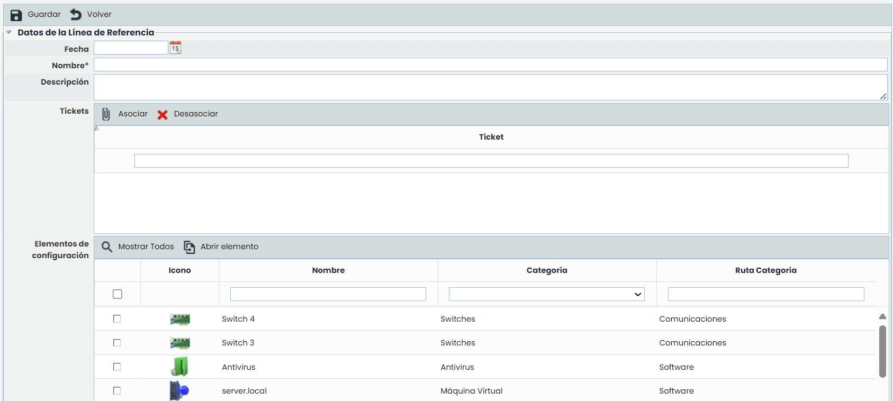
