# Inventario de Elementos en GlobalSuite®


Este tutorial describe cómo identificar, registrar y valorar los elementos que forman parte del alcance del sistema de gestión en GlobalSuite®. En la guía se explica cómo estructurar el \*\*árbol de elementos\*\*, asociarlos a servicios y procesos, realizar su \*\*valoración individual o general\*\* en términos de confidencialidad, integridad y disponibilidad, y gestionar sus relaciones de dependencia dentro del análisis de riesgos.


## Definición del Inventario de Elementos

GlobalSuite® permite llevar a cabo la identificación y valoración de los elementos incluidos en la operación de los procesos que engloban el alcance del sistema de gestión. Esta identificación incluye la carga de elementos y su clasificación según las categorías configuradas. También, es posible modelar las relaciones de dependencia existentes entre los elementos, así como valorar los mismos en los términos que se hayan definido en la configuración.

## Árbol de Elementos

Desde la opción **Análisis >** [Inventario](https://globalsuitesolutions.atlassian.net/wiki/spaces/GlobalSUITEes/pages/266864248/Inventario) se permite registrar todos los elementos o actividades que intervienen de forma directa en los procesos.\
Al acceder, se muestra por defecto la pestaña **“Árbol de Elementos”**, donde se visualiza en la parte derecha el listado de todos los elementos con su categoría correspondiente y en la parte derecha el árbol de elementos definido

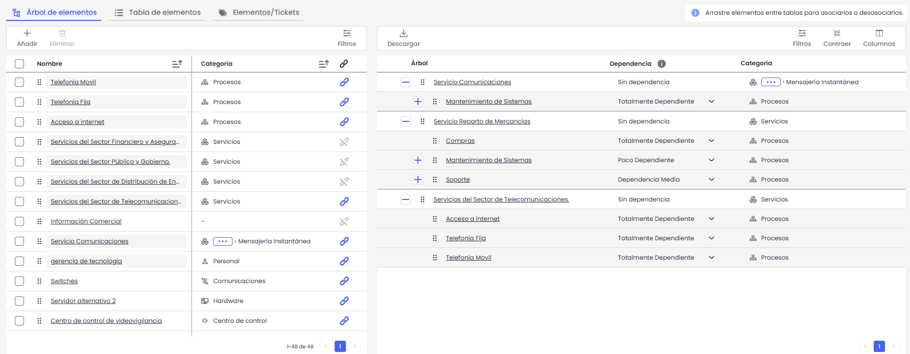

### Listado de elementos:

Desde el listado de elementos es posible crear nuevos elementos adicionales a los generados desde otras opciones de GlobalSuite®.

Para dar de alta un nuevo elemento, pulse el botón **“Añadir”**. El sistema mostrará un modal donde deberá introducir el **nombre del elemento**. Una vez guardado, el nuevo elemento se mostrará en la primera posición del listado.

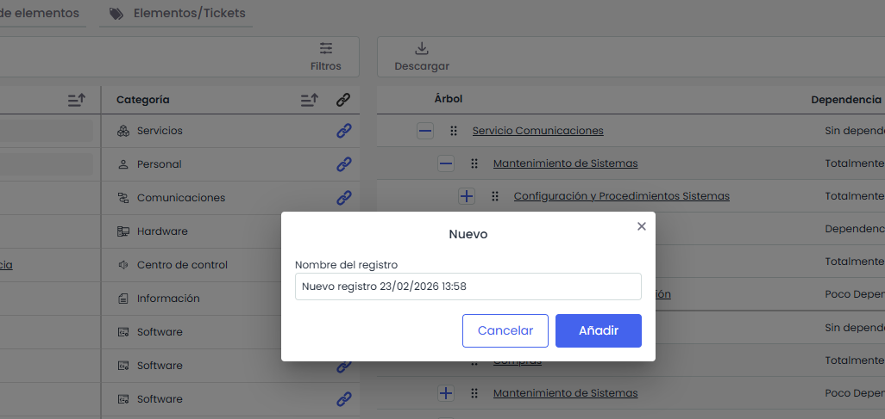

Asimismo, desde este listado se podrá:

* **Editar el nombre** de aquellos elementos que no pertenezcan a una categoría especial.
* **Asignar o modificar la Categoría** del elemento:
  * Si la categoría está vacía, se mostrará la opción **“Añadir”**.
  * Si la categoría ya está informada, se mostrará el icono de **lápiz** para su edición.

En ambos casos, al pulsar la opción correspondiente, se abrirá una ventana emergente desde la que podrá seleccionar la categoría deseada haciendo doble clic sobre la columna **“Categoría”**.

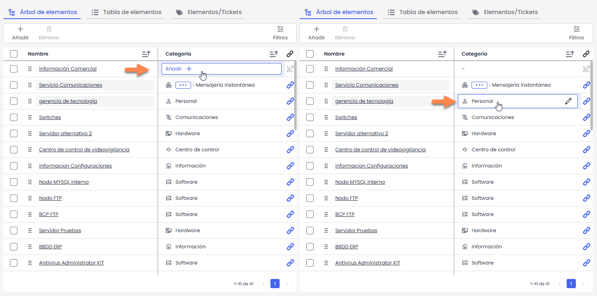


\*\*Nota:\*\* No es posible crear nuevos elementos pertenecientes a las categorías especiales \*\*Servicios, Procesos, Personal, Proveedores\*\* y \*\*Relaciones con el Negocio\*\*. Asimismo, si un elemento ya pertenece a una categoría especial, únicamente podrá modificarse por otra categoría dentro de esa misma rama especial. Por ejemplo, un elemento de tipo \*\*Servicio\*\* solo podrá cambiarse a otra categoría de Servicios, pero no a otra categoría especial distinta.


### Árbol de Elementos

Desde la vista **Árbol de Elementos** se muestra la estructura jerárquica definida para los elementos, organizada según las relaciones de dependencia existentes entre ellos.

En la columna **“Árbol”** se visualiza la estructura jerárquica, permitiendo expandir o contraer los distintos niveles mediante los iconos **“+”** y **“–”**.

La columna **“Dependencia”** permite definir el grado de dependencia de cada elemento respecto a su elemento superior. Para ello, se debe desplegar el selector correspondiente y elegir uno de los niveles disponibles (Los niveles y sus porcentajes se configuran en **Ajustes>Elementos>** Grados de dependencia)

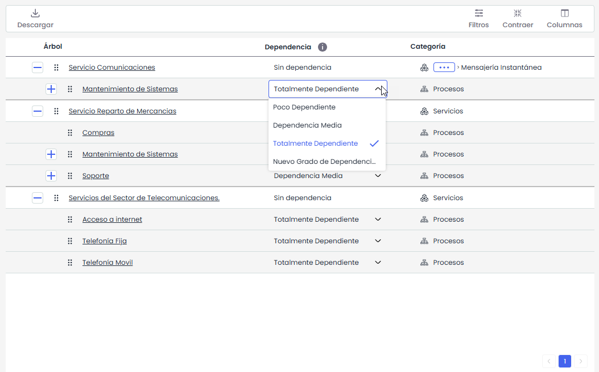

La columna **“Categoría”** muestra la categoría asignada al elemento dentro del inventario.

La actividad principal de esta pestaña es el **modelado de dependencias entre elementos**, así como la definición de la jerarquía entre **Servicios y Procesos**.

En la tabla de la izquierda se muestra el árbol jerárquico, que incluye tanto la estructura de **Servicios y Procesos** como el resto de elementos asociados. Desde esta vista es posible configurar directamente la relación jerárquica entre Servicios y Procesos, así como modelar la dependencia del resto de elementos dentro del árbol.

La asociación se realiza mediante funcionalidad **“Drag and Drop”**. Para ello, se debe seleccionar uno o varios elementos de la tabla derecha y arrastrarlos sobre el elemento del árbol (tabla izquierda) al que se desee asociar.

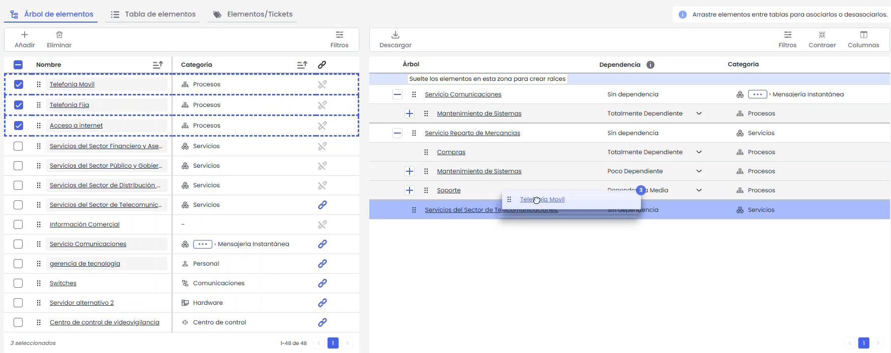

Cuando un elemento se encuentra insertado en alguna rama del árbol, se mostrará el icono  indicando que el elemento ya se encuentra **insertado en el árbol de elementos**.

## Valoración de Elementos.

La definición y valoración de los elementos se puede realizar en la pestaña “**Tabla de Elementos**”. Esta pestaña muestra el listado de elementos, permitiendo realizar las valoraciones oportunas con respecto a las dimensiones que se tengan configuradas, como por ejemplo, Confidencialidad, Integridad y Disponibilidad, cuyos valores dan un valor de Importancia (Nota: estas variables dependen de la configuración establecida para el inventario de elementos en **Ajustes>Metodologías** [**Elementos**](https://help.globalsuitesolutions.com/es/globalsuite/v1/metodologia-elementos))

Para realizar las valoraciones sobre las dimensiones de Confidencialidad, Integridad y Disponibilidad (dimensiones configuradas como “Manuales”), es necesario seleccionar la fila del elemento que corresponda y pulsar sobre la celda correspondiente, mostrándose un desplegable con diferentes niveles. Seleccionando el nivel oportuno en cada una de las dimensiones, realiza el cálculo automático de la variable de Importancia (según la fórmula de cálculo configurada)

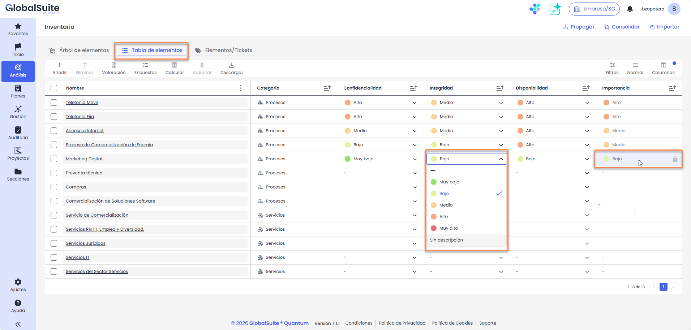

Desde el menú de la tabla de elementos se podrá:

* Añadir/Eliminar: permite crear/eliminar elementos.
* Valoración general
* Encuestas:
  * Resultados de Encuestas: permite consultar y gestionar los resultados obtenidos, esta opción se explica detalladamente en la guía de encuestas.
  * Enviar encuestas Esta opción permite, al seleccionar uno o más elementos, lanzar encuestas desde plantillas y configurar el envío.

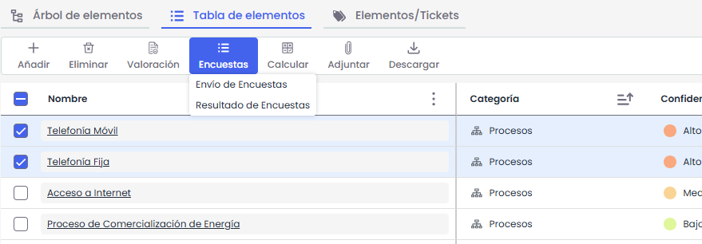

* Calcular
  * Calcular dimensiones acumuladas: realiza el cálculo de las dimensiones acumuladas definidas, en función de la dependencias establecidas entre los elementos del árbol de dependencias.
  * Calcular AR: Realiza el cálculo de todas las valoraciones y modificaciones que se han realizado sobre el análisis de riesgos.

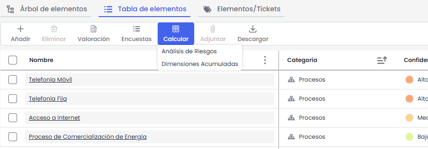

* Adjuntar: Se verá únicamente si esta marcada la opción Documentación >Visible en tabla de elementos en Ajustes>Elementos, y se habilitará al tener uno o mas elementos seleccionados. Al hacer clic en el botón “Adjuntar”, se abre el selector de archivos del ordenador, permitiendo seleccionar hasta 10 documentos en una misma acción.
* Relacionar Cis: permite relacionar los elementos de configuración identificados en la CMDB con los elementos incluidos en el Inventario de Elementos.
* Filtros: permite filtrar por todos los campos de la tabla. A demás a la derecha se encuentran los llamados “Filtros predefinidos”, que son filtros que se configuran desde **Ajustes>Metodologías** [**Elementos**](https://globalsuitesolutions.atlassian.net/wiki/spaces/GlobalSUITEes/pages/266864054/Metodolog+a+Elementos)**, en donde se pueden aplicar vistas en la tabla de elementos.**
*

    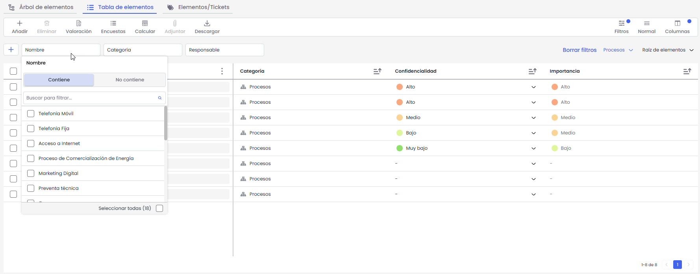
*   Columnas: Opción para mostrar, ocultar y ordenar columnas

    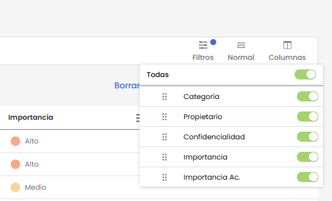
*   Alto de Fila: Permite seleccionar el alto de las filas de la tabla para adaptar la visualización según la preferencia del usuario.

    Al hacer clic en el botón “Alto de Fila”, se muestran las opciones Normal, Pequeña y Cómoda. Cada selección modifica dinámicamente la altura de las filas en la tabla, permitiendo visualizar más información en pantalla o priorizar una lectura más cómoda, según la necesidad.
* Importar: permite cargar un listado de elementos tomando como formato el modelo que se encuentra en el botón descarga.

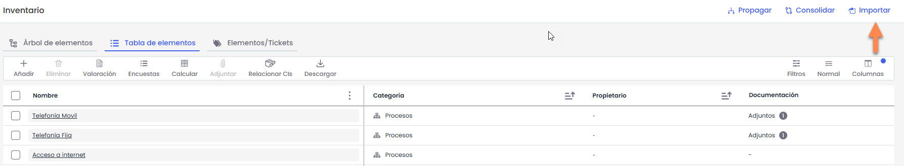

* Descarga: Permite descargar el inventario en un archivo que incluye tanto los datos existentes como el modelo necesario para realizar futuras importaciones. Además, si existen plantillas configuradas y visibles en la Tabla de elementos, estas también se incluirán en la descarga.

## Valoración General

Además de la valoración de las dimensiones de **Confidencialidad, Integridad y Disponibilidad** (dimensiones configuradas como “Manuales”) de manera específica para cada elemento, también es posible realizar una valoración de una o varias dimensiones de manera global, si alguna de las dimensiones tuviera una valoración común para los elementos de la misma categoría.

Se accede a la vista de Valoración General de elementos, desde la pestaña de “Tabla de Elementos” el botón “**Valoración General**”.

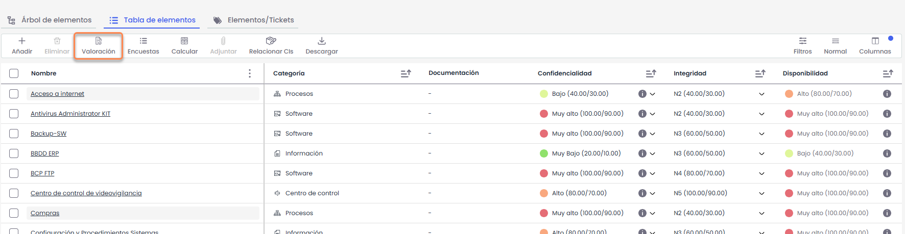

En la vista de Valoración General se podrá definir la Confidencialidad, Integridad y Disponibilidad para cada categoría de elemento.\
Esta valoración se podrá aplicar a todos los elementos de esa categoría o de categorías inferiores, además de poder indicar si se debe aplicar a los elementos que no han sido valorados todavía (Todos los elementos sin valoración) o sobrescribir las valoraciones existentes para los elementos con esas categorías.

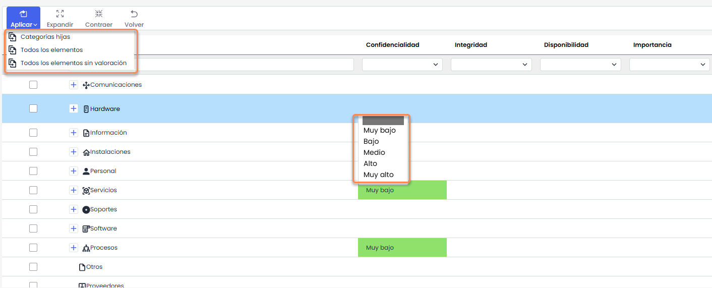
