# ¿Cómo implantar el ENS en GlobalSuite® (servicios, valoración, categorización y adecuación)?


En este artículo tratamos cómo identificar servicios y procesos, definir roles, realizar la \*\*valoración\*\* de activos (CIDAT), obtener la \*\*categorización del sistema\*\*, gestionar \*\*medidas de seguridad\*\* y el \*\*plan de adecuación\*\*, y cómo apoyarse en inventario, gestor documental, incidencias y ScoreCard para el seguimiento del ENS en GlobalSuite®


## 1. Inicio

### 1.1. Catálogo de Servicios

GlobalSuite® ENS permite identificar servicios o productos de la organización sobre los que se van a aplicar las medidas establecidas por ENS y sobre los que se hará una futura valoración, esto se hará mediante la opción “Catálogo de Servicios”.

Posteriormente se establecerán las dependencias con las diferentes áreas o departamentos de los que está compuesta la organización. Para definir esos catálogos de servicios o productos, se debe configurar pulsando sobre el botón y definir la información relativa a la empresa.

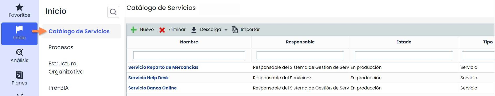

### 1.2. Procesos de Negocio

GlobalSuite® ENS permite a la organización definir los servicios o productos que componen la empresa, han sido dados de alta en la opción de “Catálogo de Servicios”. Partiendo de ellos, se podrá desglosar la organización en un nivel más bajo, en el que se incluirán los procesos, áreas, departamentos, divisiones o gerencias mediante la opción de “**Procesos**”.

Para la definición de dichos procesos se accederá a la pestaña “**Listado de Procesos**” y pulsando el botón “**Nuevo”** se pueden ir creando los mismos.

Una vez completado este listado de procesos/áreas, se podrán asociar a los servicios según lo definido en la siguiente transparencia.

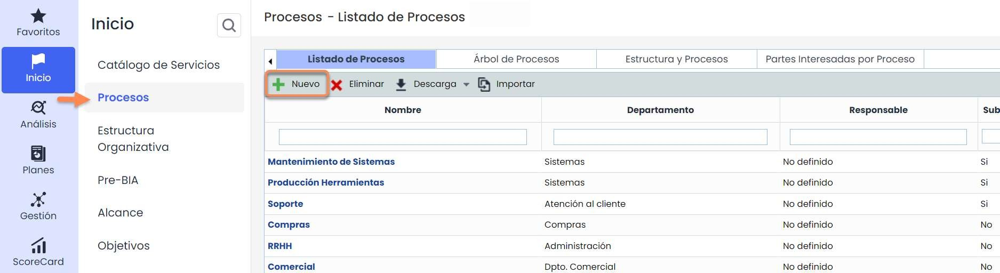

Una vez definidas los procesos/áreas se pueden incluir en los Servicios creados en Catálogo de Servicios, se hará a través de la opción “**Árbol de Procesos**” donde se permite establecer la estructura de la organización en forma de árbol, vinculado los servicios creados con los procesos. Para hacerlo, únicamente habrá que arrastrar los procesos de la tabla derecha a la jerarquía de la tabla izquierda hasta conformar las dependencias entre las distintas áreas de la organización.

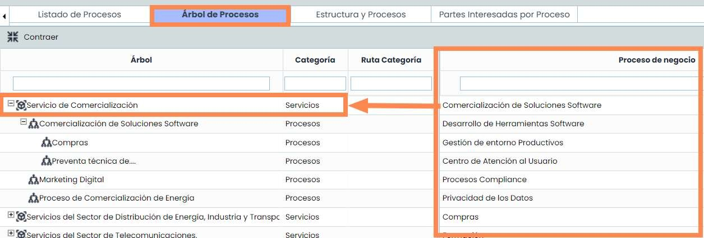

### 1.3. Roles y Responsabilidades

En esta opción se permite crear los roles que intervienen en la gestión del ENS, para ello GlobalSuite® ENS permite configurar nuevos tipos de perfiles a través del menú “Configurar Roles” y, posteriormente en la nueva pestaña, definir aquellos perfiles requeridos por la organización con el botón “**Nuevo**”

Tras ello, se podrá asignar o asociar un empleado a cada rol como responsable del mismo.

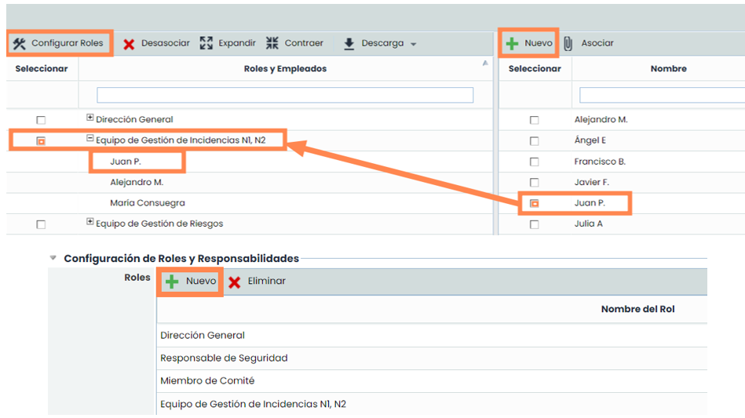

### 1.4. Valoración

La opción de “**Valoración**” que tiene GlobalSuite® ENS permite valorar los diferentes activos que pertenezcan a la categoría de “**Servicios**” y de “**Información**”. La valoración de dichos activos se hace a través de 5 dimensiones (Confidencialidad, Integridad, Disponibilidad, Autenticidad y Trazabilidad), las cuales tienen 5 niveles diferentes (Muy Bajo, Bajo, Medio, Alto, Muy Alto). Estas dimensiones y niveles vienen configurados por defecto en **Ajustes > Metodologías >** [**Elementos**](https://help.globalsuitesolutions.com/es/globalsuite/v1/metodologia-elementos) y no se deben eliminar ni editar para no alterar el funcionamiento del módulo.

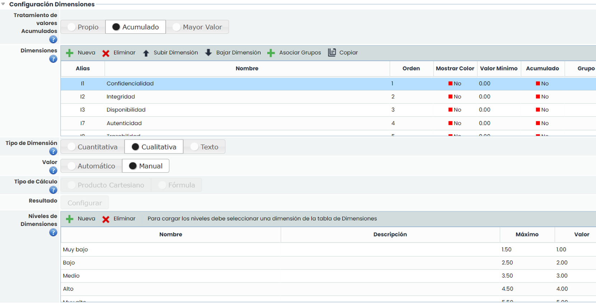

Para realizar la valoración hay que entrar en la opción de “[**Valoración**](https://help.globalsuitesolutions.com/es/globalsuite/v1/valoracion)” e ir valorando cada activo eligiendo el nivel correspondiente en cada dimensión.

Además de valorar los activos existentes, mediante el botón “Nuevo” se podrán crear activos de tipo Información y así se podrán ir valorando.

Esta valoración es muy importante para GlobalSuite® ENS, ya que sin ella no será posible determinar la **“**[**Categorización del Sistema**](https://help.globalsuitesolutions.com/es/globalsuite/v1/categorizacion-del-sistema)”.

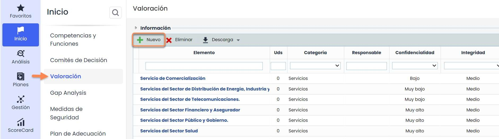

### 1.5. Categorización del Sistema (Secciones)

Esta es una de las opciones más importantes de GlobalSuite® ENS, es donde aparece, por defecto, el valor máximo de los activos anteriormente valorados. Adicionalmente, se pueden elegir las dimensiones que se quieren visualizar en esta opción. Para ello se ha de ir a A**justes > Metodologías >** [**Elementos**](https://help.globalsuitesolutions.com/es/globalsuite/v1/metodologia-elementos), y en la opción de **Visibilidad Dimensiones en Tablas**, hacer click sobre “Sí/No” en la columna de ENS indicando si se quiere o no visualizar dicha columna.

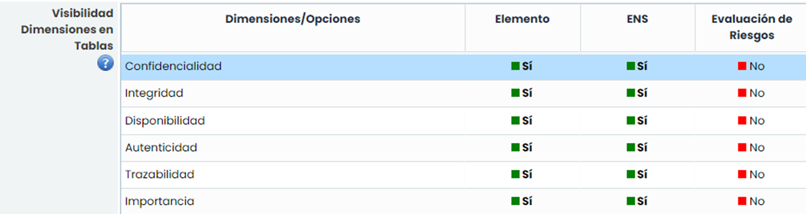

Una vez elegidas, si se pulsa sobre la “**Categorización del Sistema**” que se encuentra en la opción de Secciones (la cual se puede encontrar en cualquiera de las pestañas de GlobalSuite®), saldrá una ventana con la información requerida y el Nivel de Seguridad que aplica a la compañía.

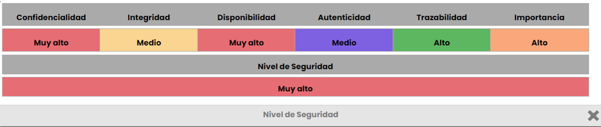

### 1.6. Medidas de Seguridad

El Análisis Diferencial del ENS tiene como objetivo principal establecer los principios y requisitos de seguridad en la utilización de medios electrónicos, permitiendo así la adecuada protección de la información. Para cumplir con el Esquema Nacional de Seguridad, se debe cumplir cada uno de los ámbitos de actuación que apliquen a la compañía. Se ha de tener en cuenta que en la actualidad hay dos versiones del Análisis Diferencial del ES, la versión de 2015 y la nueva de 2022.

GlobalSuite® permite realizar copias y almacenar históricos de los diferentes análisis mediante el botón de **Copiar** y **Activar/Desactivar**. Los registros resaltados en verde están activos, aquellos que tengan un fondo blanco son versiones inactivas. Para consultar todas las versiones, se debe pulsar el botón **Mostrar**.

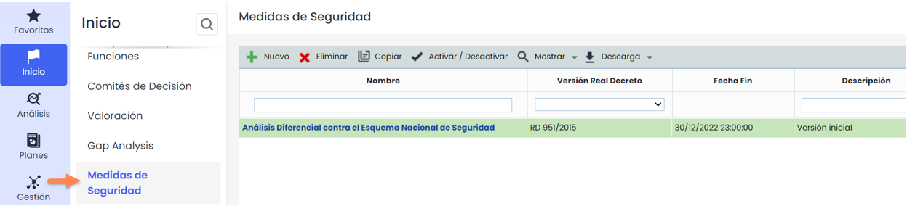

Para las medidas de seguridad, primero se debe tener ya configurada la categorización del sistema, y para ello, se debe haber valorado los servicios y elementos de tipo información en la pestaña valoración previamente. Una vez hecho, aparecerán las diferentes secciones con colores dependiendo de si su valoración ha sido baja, media o alta. Y en el grado de estas, aparecerá si aplican o no teniendo en cuenta la valoración de los elementos mencionados anteriormente.

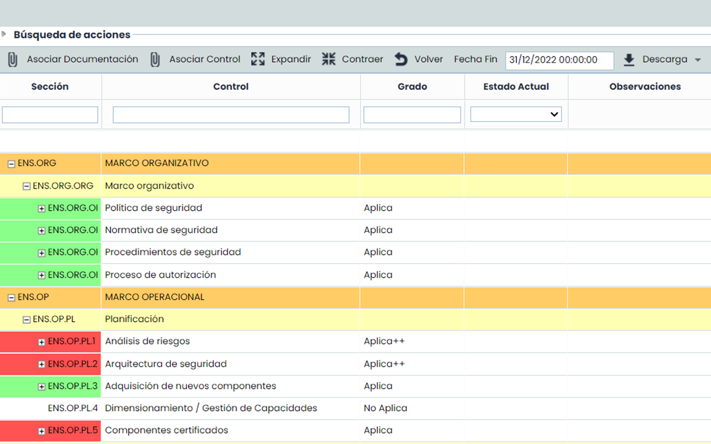

Se puede utilizar la sección "Búsqueda de acciones“ (pulsar para desplegar) y sirve para buscar requisitos o medidas de seguridad (filas sin color) dentro de los controles, ya que los filtros de las columnas sólo permiten filtrar controles, que son las filas en color.

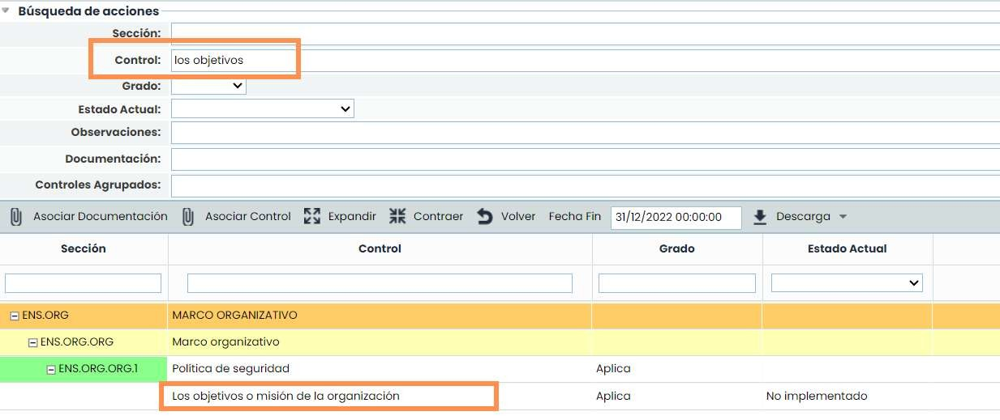

Dentro de los requisitos o medidas de seguridad, en la columna **Grado** se puede editar la aplicabilidad de las mismas (filas sin color), pero no de los controles del ENS (filas en color), que vienen impuestos por el nivel de la categorización del sistema. Se ha de indicar el estado de cumplimiento de cada medida en la columna **Estado Actual**.

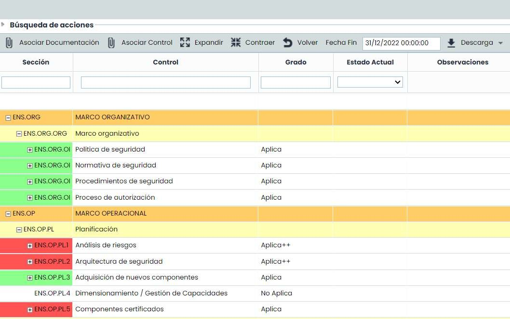

### 1.7. Plan de Adecuación

El **Plan de Adecuación del ENS** sirve para identificar los controles del ENS que aplican a la compañía y cuyas medidas de seguridad no están implementadas al 100%. Para ello, se irán implementando los mismos, se usará el filtro de búsqueda de acciones, y se podrán usar también el filtro de las columnas.

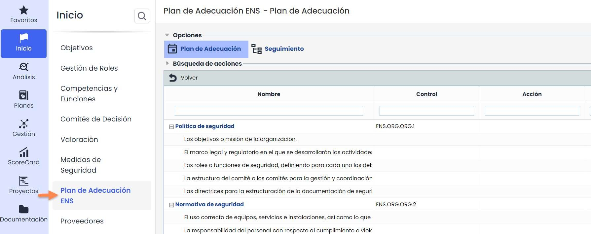

Para aquellos requisitos que no hayan sido implementados en la organización, GlobalSuite® permite establecer acciones para lograr su cumplimiento y hacer un seguimiento de las mismas desde el menú “**Seguimiento**”.

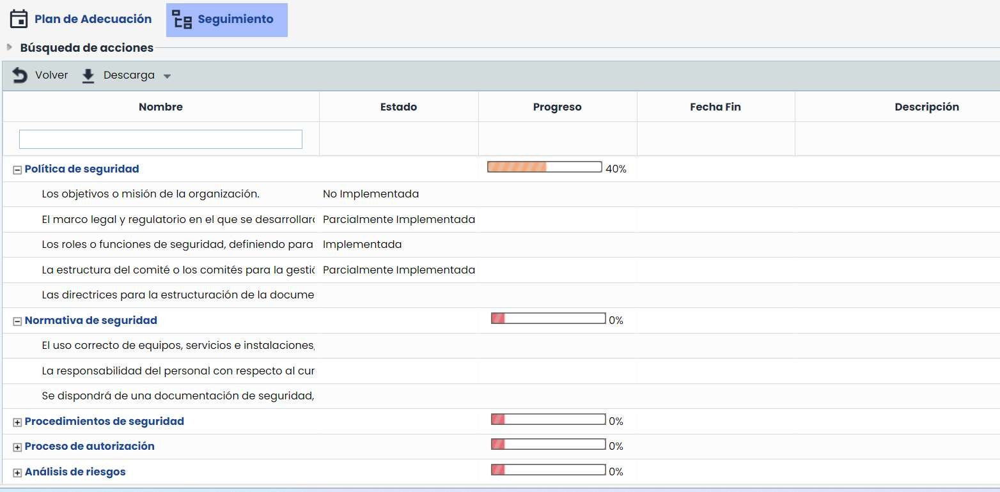

Además de todo ello, se pueden realizar unos ”**Históricos**” del Plan de Adecuación para ver los cambios que ha habido entre una fecha y otra. Estos históricos solo están a modo lectura, es decir, no se puede modificar la información que contiene.

Para ello, se pulsa el botón “Nuevo” y se quedaría guardado el Nuevo histórico con la información actual.

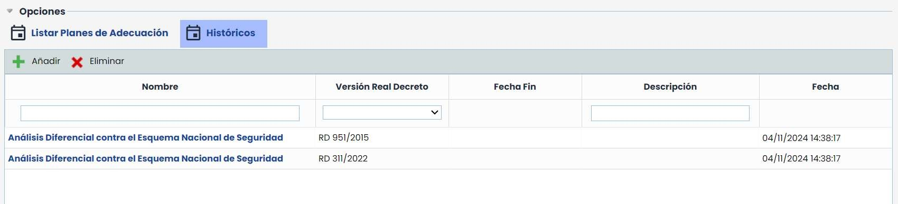

## 2. Análisis

### 2.1. Inventario

En el Inventario se encuentran todos los activos de la organización, y se podrán añadir al Árbol de elementos según la jerarquía existente. Esta opción es muy importante porque es donde se añadirán los activos de “**Información**” entre otros. Todos los activos de información que estén en el inventario podrán ser valorados para su posterior categorización.

Además de ello, se podrá indicar qué aplicaciones, servidores o infraestructuras dan soporte a estos activos, y también se podrán valorar, aunque no se categorice esa valoración. Para más información, se puede consultar la guía rápida “**Inventario de Elementos**”.

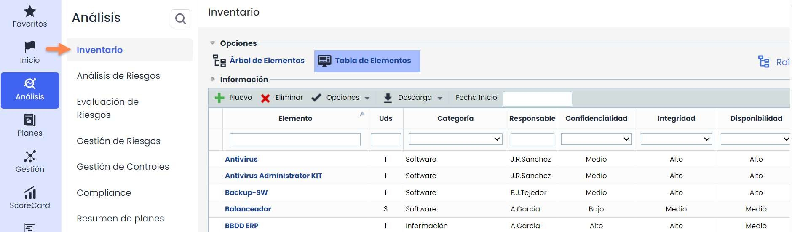

### 2.2. Análisis de Riesgos

GlobalSuite® ENS permite realizar el análisis de Riesgos completo a través del Menú análisis de Riesgos. En este análisis se podrán analizar los diferentes activos de la compañía, todos los activos que aparezcan en el Inventario son susceptibles de ser analizados.

Para llevarlo a cabo se han de seguir varios pasos, los cuales se detallan en la guía rápida “**Análisis de Riesgos**”.

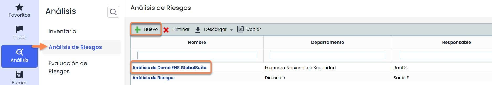

### 2.3. Evaluación de Riesgos

En el menú de “**Evaluación de Riesgos**” se puede ver un resumen de los resultados obtenidos en el análisis de riesgos. Con distintas gráficas que muestran los resultados de forma visual y posibilitando la descarga de dichas gráficas para incluirlas en distintos documentos.

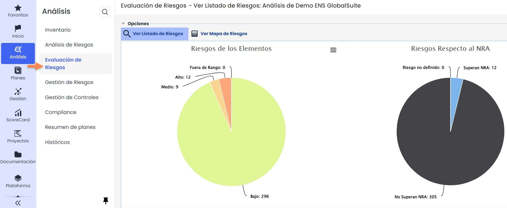

### 2.3. Evaluación de Riesgos (Mapa de Riesgos)

GlobalSuite® ofrece la posibilidad de mostrar el análisis de riesgos, entre otras opciones, a partir de la representación de un “mapa de calor”. Todos estos datos podrán ser exportados mediante el botón “Descarga”, situado encima del mapa.

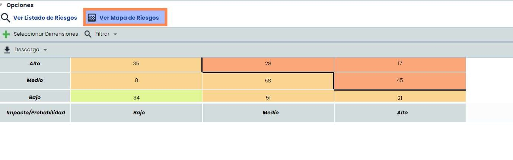

Para más información sobre la Evaluación de Riesgos, se puede consultar la guía rápida “[**Evaluación de Riesgos**](https://help.globalsuitesolutions.com/es/globalsuite/v1/evaluacion-de-riesgos)”.

### 2.4. Gestión de Riesgos

Una vez evaluadas las amenazas será necesario establecer los distintos controles que permiten mitigar los riesgos detectados que estén por encima del Nivel de Riesgo Aceptable (Apetito de Riesgo) definido, lo que va a conformar el Plan de Tratamiento.

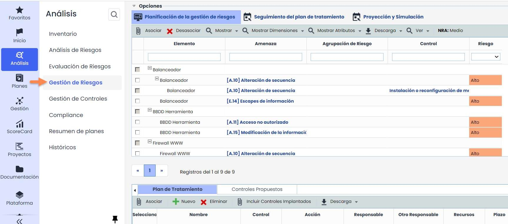

Para el plan de tratamiento se podrá proponer nuevos controles mediante el botón “**Nuevo**”, incluir los controles que ya se han implantado mediante la opción “**Incluir Controles Implantados**” o incluir nuevos controles propuestos según la configuración del Catálogo de Riesgos definidos, mediante la selección de la pestaña **“Controles propuestos**”.

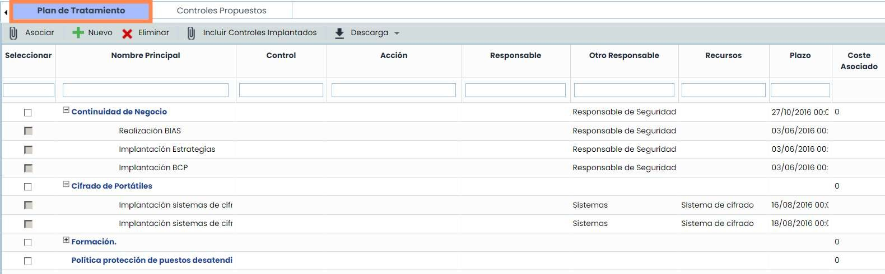

Para más información sobre la [**Gestión de Riesgos**](https://help.globalsuitesolutions.com/es/globalsuite/v1/gestion-de-riesgos), consultar la guía rápida “Gestión de Riesgos”.

## 3. Gestor Documental

Este Gestor Documental permite tanto disponer de un repositorio compartido y único para concentrar toda la documentación derivada del Sistema de Gestión de la organización como poder realizar a través del mismo la aprobación de los documentos a través de Flujos de Aprobación configurables (Workflows).

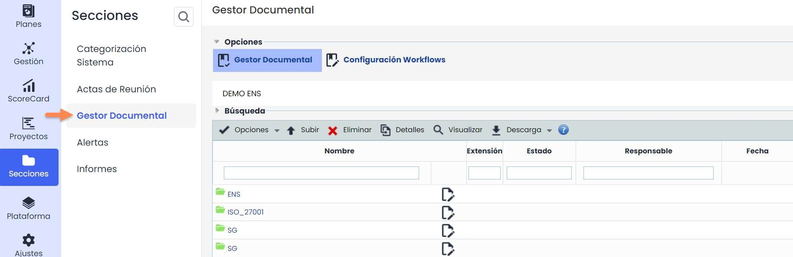

Al acceder a la opción se visualizará todo el árbol de carpetas y documentos que representa el gestor documental de la organización.

En la parte superior se pueden encontrar varios botones como los siguientes:

* **Opciones** sobre el gestor: Nueva Carpeta y Mover las carpetas del Gestor Documental.
* En el menú de **Descarga** se encuentran las opciones para: “Carpeta” que descarga la carpeta seleccionada, “Informe CSV”, para descargar el informe en formato CSV que se puede abrir con Excel o en un editor similar.

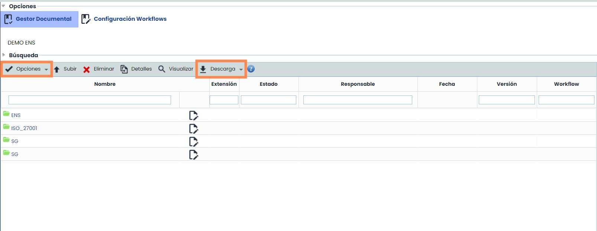

3. Gestor Documental

Además, cuando se marca o selecciona unos de los elementos del Gestor Documental, también se activan las opciones específicas que se aprecian a continuación:

* **Subir** permite adjuntar un nuevo Archivo (seleccionando previamente el Workflow en el caso de que haya).
* **Eliminar** para poder borrar uno de los elementos del Gestor.
* **Detalles** para entrar dentro del detalle de un registro, y dentro del mismo poder consultar o modificar las diferentes versiones.
* **Visualizar** el Documento online. Para poder previsualizarlo deben ser archivos PDF, JPEG, JPG, BMP o PNG.

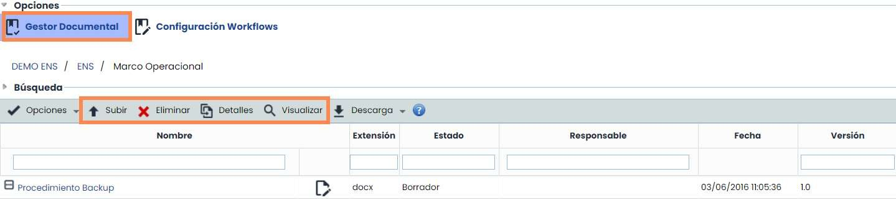

Para ampliar información sobre estas opciones del Gestor Documental, consultar la guía rápida “**Gestor Documental**”.

## 4. Incidencias

GlobalSuite® dispone de una parte de Gestión donde se gestionan las Incidencias, No Conformidades, Cambios y Entregas, Correctivas y Preventivas. Todas estas opciones pertenecen a Ticketing, por lo que su funcionamiento es igual, pero se podrá utilizar para diferentes finalidades. Por ejemplo, si hay alguna incidencia, se puede abrir un nuevo ticket, pulsando el botón “**Nuevo**” y rellenando el formulario. Una vez hecho esto, aparecerá la información en pantalla:

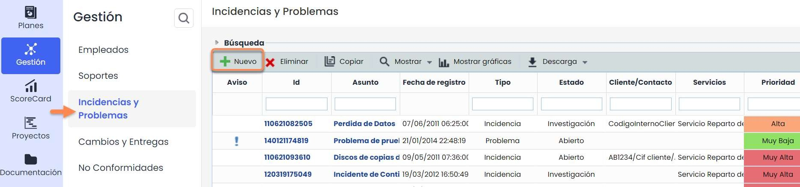

Tanto la información que aparece a nivel de tabla, como la información que hay dentro del formulario de cada ticket, es totalmente parametrizable. Incluso el nombre de los tickets puede ser modificado. Todo ello se haría desde la parte de **Ajustes > Configuración >** [**Tickets**](https://help.globalsuitesolutions.com/es/globalsuite/v1/configuracion-tickets)**.**

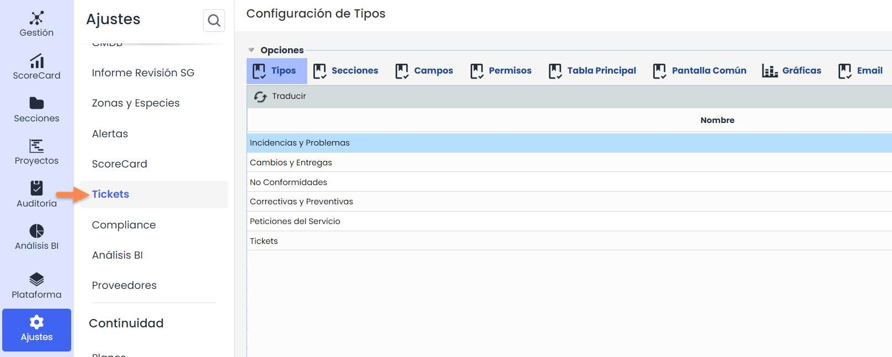

Para ampliar información sobre estas opciones de Gestión, consultar la guía rápida “¿**Cómo configurar los tickets en GlobalSuite®**?**”**.

## 5. ScoreCard

### 5.1. Métricas

GlobalSuite® permite establecer métricas que permitan recoger distintos datos en la herramienta. Los datos de cada métrica serán representados dependiendo de su fecha y su valor. Será en la siguiente etapa cuando a partir de la combinación de las métricas se establezcan los indicadores.

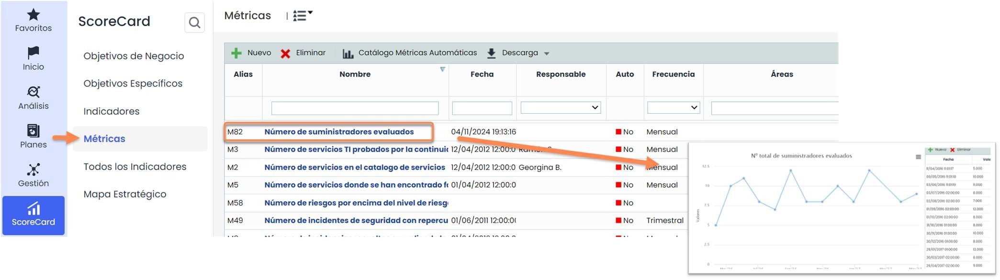

Para ampliar más información sobre los indicadores, consultar la guía rápida “**¿Cómo crear y gestionar indicadores y métricas en el ScoreCard de GlobalSuite®?**”

### 5.2. Indicadores

A partir de la combinación de las métricas anteriormente establecidas se elaborarán los indicadores. Para ello, se debe establecer la relación de las mismas a través de una fórmula. Para poder utilizar los datos introducidos en las métricas, los indicadores deberán tener la misma frecuencia de recolección. Estos indicadores podrán ser utilizados en la extracción de informes (Secciones/ Informes).

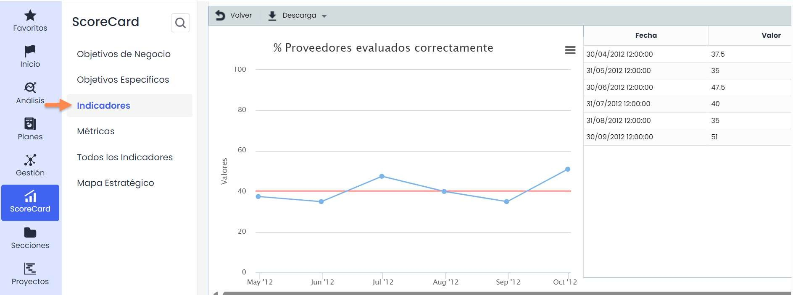

Para ampliar más información sobre los indicadores, consultar la guía rápida “**¿Cómo crear y gestionar indicadores y métricas en el ScoreCard de GlobalSuite®?**”
