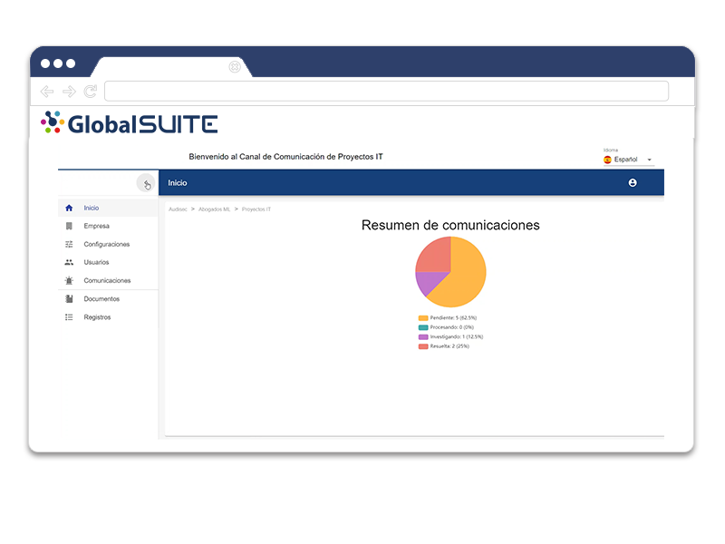

# v2.24 (Junio 2020)

Funcionalidades y mejoras incluidas:

- **Anonimización** de denuncias:

* Posibilidad de eliminar los **datos de carácter personal** de una denuncia ya gestionada, para poder mantenerla en el entorno cumpliendo con la legislación en materia de protección de datos.
* Los datos del comunicador (no anónimo), personas relacionadas se anonimizan directamente. Para el resto de apartados y adjuntos se puede revisar y anonimizar manualmente. La herramienta apoyará en esta fase, identificando y resaltando direcciones de correo electrónico y NIF.

- Nuevo servicio de **envío y almacenamiento de denuncias a canal secundario**.

* Este servicio permitirá, una vez gestionadas, enviar las Comunicaciones a un repositorio secundario para custodiarlas a modo de histórico y poder consultarlas.
* Se trata de un servicio adicional que se podrá activar previa contratación.

 - Mejoras internas y resolución de errores.

