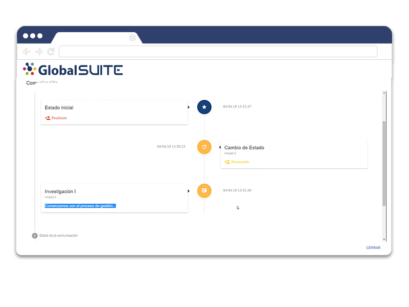

# v2.27 (Julio 2020)

Funcionalidades y mejoras incluidas:

**-** Integración con **ADFS**:

* Posibilidad de integrar el entorno para que los usuarios autentiquen a través del IdP, mediante estándar SAML 2.0.
* Mecanismos de autenticación con ADFS mediante **Single Sign-On** (SP initiated), o a través de portal de aplicaciones corporativo (IdP Initiated).
* Definición de rol de usuario por defecto para nuevos usuarios.
* Parametrización de URL de desconexión.
* Asignación y actualización del rol de usuario desde los datos de conexión

- Mejoras internas y resolución de errores.

