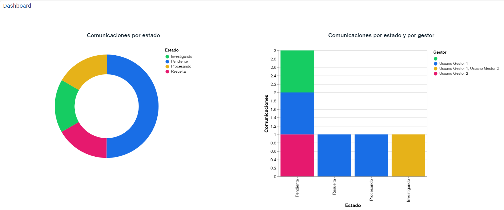

# v2.41 (Abril 2021)

Funcionalidades y mejoras incluidas:

- Nuevo **DashBoard** de Comunicaciones: Se amplía la funcionalidad de cuadro de mando inicial para poder revisar el estado del canal.

* Personalización de las gráficas que se muestran en la vista inicial, pudiendo activarlas/desactivarlas, y cambiar el orden en el que se muestran.
* Filtrado de fechas. Es posible seleccionar el período que se quiere consultar la información
* Nuevas gráficas disponibles:

  * Comunicaciones por estado: Gráfica de sectores para visualizar el estado de las comunicaciones
  * Comunicaciones por estado y gestor: Gráfica de barras para identificar cuántas comunicaciones están asignadas a cada gestor, y en qué estado se encuentran.
  * Se incorporarán más gráficas en próximas versiones

- **Categorización** de denuncias: Ahora es posible asignar tipos a las comunicaciones para clasificarlas y mejorar su gestión.

* Categorías personalizables, adaptadas a la casuística del cliente
* Es posible habilitar categorías para que el comunicador elija en el momento del registro
* Se puede definir si en función de la categoría de la denuncia, se realizará anónimamente u obligando a identificarse al comunicador

- **Descarga** de Comunicaciones:

* Permite generar un informe csv con el listado de comunicaciones existentes, para poder almacenarlo o procesarlo de forma externa. Se descargarán las columnas y registros que se hayan filtrado en el listado principal.

- Mejoras internas y resolución de errores.
