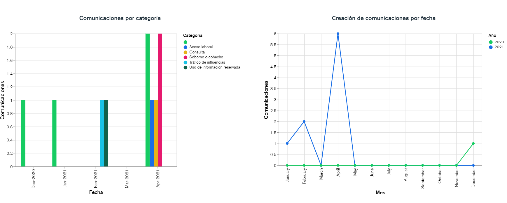

# v2.42 (Abril 2021)

Funcionalidades y mejoras incluidas:

- Ampliación del **DashBoard** de Comunicaciones: Se amplía la funcionalidad de cuadro de mando inicial con nuevas gráficas.

* Nuevas gráficas disponibles:

  * Comunicaciones por Categoría: Gráfica de barras para consultar cuántas comunicaciones de cada tipo se han creado, por meses.
  * Creación de comunicaciones por fecha: Gráfica de histograma, para comprobar la evolución de cuántas comunicaciones se han generado, por meses, en el sistema. Esta información tiene en cuenta, a partir del registro de logs, todas las comunicaciones generadas, aunque las comunicaciones ya no se encuentren en el sistema.
* Como las anteriores, es posible configurar qué gráficas se muestran en la vista inicial, pudiendo activarlas/desactivarlas, y ajustar el orden.
* Ahora, el rango de fechas que se muestra por defecto es el correspondiente al último año.

 - Mejora en la configuración de **Notificaciones**:

* Ahora es posible personalizar la introducción o tratamiento de los mensajes que se envían, en cualquiera de los idiomas disponibles y para cualquier tipo de alerta, ya que deja de ser un texto fijo. Por ej. "Estimado Sr."
* Nuevas notificaciones configurables: Posibilidad de personalizar el mensaje enviado al **asignar o desasignar** a un gestor a una comunicación.

- Mejoras internas y resolución de errores.
