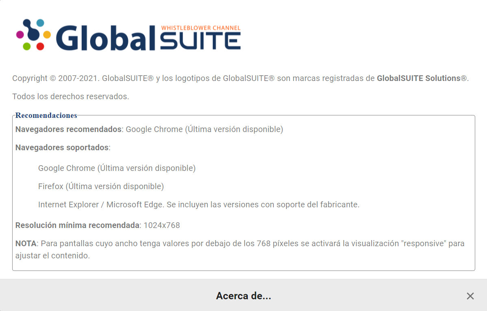

# v2.48 (Julio 2021)

Funcionalidades y mejoras incluidas:

- Mejoras generales de usabilidad:

* Acceso directo al [Manual de Usuario](https://help.globalsuite.es/display/CD) en el pie de página: Ya no es necesario acceder al apartado de Documentación para poder consultarlo.
* Vista de **Gestores** en la ficha de una comunicación: Ahora podrá consultar los gestores asignados a una comunicación sin necesidad de abrir la ventana de selección.
* Columna de **Comunicador** en el listado principal de comunicaciones: En el listado se incluye una columna con la dirección de email del comunicador (para comunicaciones no anónimas), y se podrá buscar por ella. Además, se incluirá en la descarga CSV que se puede realizar en esa vista.
* Mensaje de navegadores soportados: En la vista de login, se incluye un apartado con información sobre los navegadores y resoluciones soportadas:

- Mejoras en **Categorización** de denuncias:

* Se ha ajustado el comportamiento de Categorías visibles por el comunicador: Si en la configuración se oculta una categoría para el comunicador, ésta dejará de ser visible en comunicaciones anteriores, además de no poder asignarse en nuevas.

- Mejoras internas y resolución de errores.
