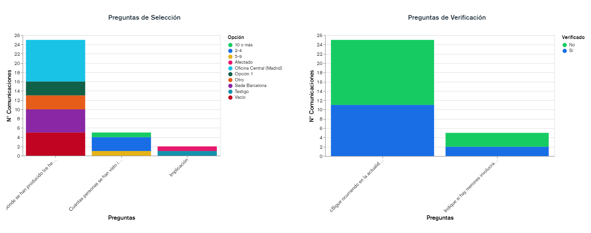

# v2.54 (Octubre 2021)

Funcionalidades y mejoras incluidas:

- Ampliación del **DashBoard** de Comunicaciones: Se amplía la funcionalidad de cuadro de mando inicial con nuevas gráficas.

* Nuevas gráficas disponibles:

  * Preguntas de selección: Gráfica de barras para consultar, de las preguntas de tipo desplegable, cuántas comunicaciones tienen cada opción seleccionada.
  * Preguntas de verificación: Gráfica de agregación, para poder obtener en cuántas comunicaciones se ha marcado cada pregunta.
* Como las anteriores, es posible configurar qué gráficas se muestran en la vista inicial, pudiendo activarlas/desactivarlas, y ajustar el orden de visualización.
* Ahora, el rango de fechas que se muestra por defecto es el correspondiente al último año, pudiendo ajustarse el período en el que se quiere consultar la información.

- Mejoras generales de **usabilidad**:

* Almacenamiento de la selección de columnas de un usuario: Ahora la selección de qué columnas son visibles en la vista principal de Comunicaciones, se recuerda durante toda la sesión de trabajo del usuario.  
  Cuando un usuario acceda por primera vez, se le mostrarán las columnas habilitadas por defecto (definidas en [Configuración](https://help.globalsuite.es/display/CD/Configuraciones+Consulting))
