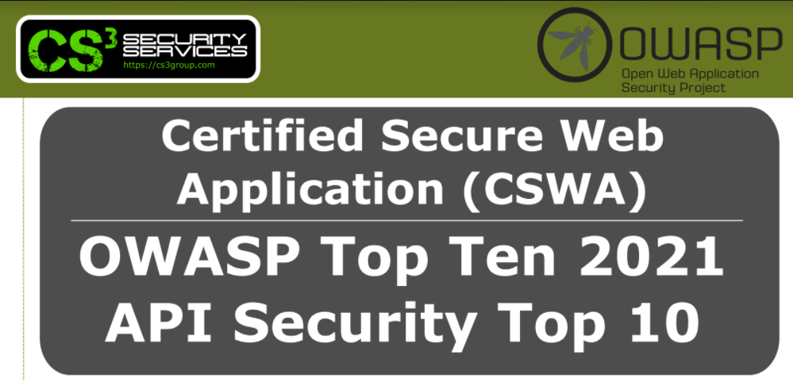

# v3.0 (Diciembre 2021)

## Nuevo Rebranding de GlobalSuite® Whistleblower Channel

Como parte del cambio de imagen y marca que hemos lanzado en GlobalSuite Solutions, hemos adaptado la nueva imagen corporativa de nuestra solución (si quieres conocer en detalle, puedes ver la entrada de [nuestro blog](https://www.globalsuitesolutions.com/es/globalsuite-solutions-nueva-imagen/))

El cambio que hemos realizado sobre el software es principalmente visual, modernizando la interfaz con unos cambios que representan nuestros valores de **innovación** y **profesionalidad**.

#### Certificación de seguridad GlobalSUITE® (CSWA)

Además de la nueva imagen, como parte del ciclo de mejora continua en nuestros procesos de desarrollo utilizados en GlobalSUITE® Whistleblower Channel hemos realizado una validación externa a través de una **auditoría de seguridad de Hacking Ético**.

Esta verificación ha sido llevada a cabo según los estándares **OWASP Top Ten 2021** y **API Security Top 10 2019**, integrando los controles propuestos por ambos estándares en nuestros procesos de verificación y cumplimiento.

Este proceso de auditoría ha permitido certificar la seguridad y resiliencia de GlobalSUITE®, trayendo consigo el **certificado CSWA**, en nuestros entornos SaaS y On Premise.

### Vídeos


GlobalSuite WhistleblowerChannelv3.0.mp4



WhistleblowerChannelv3.0.mp4

