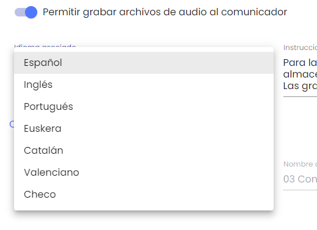
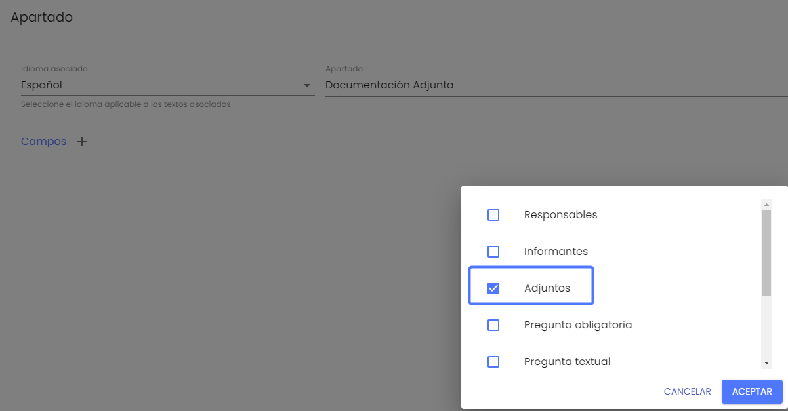
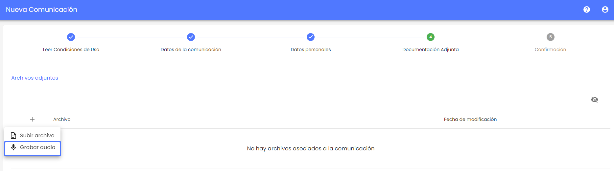
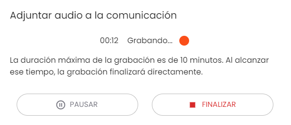
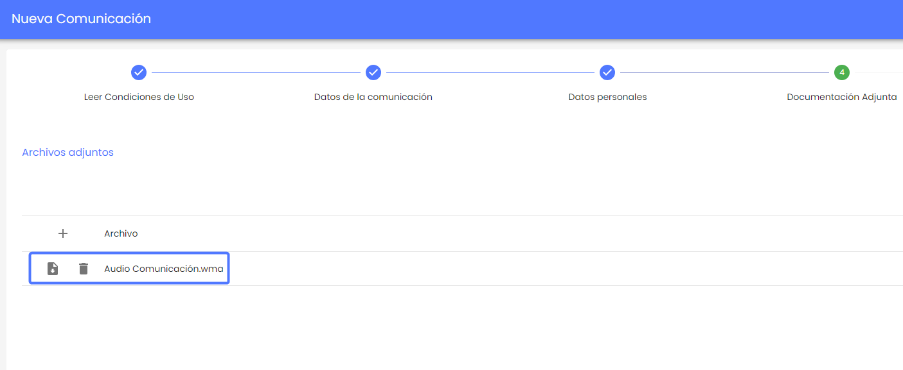
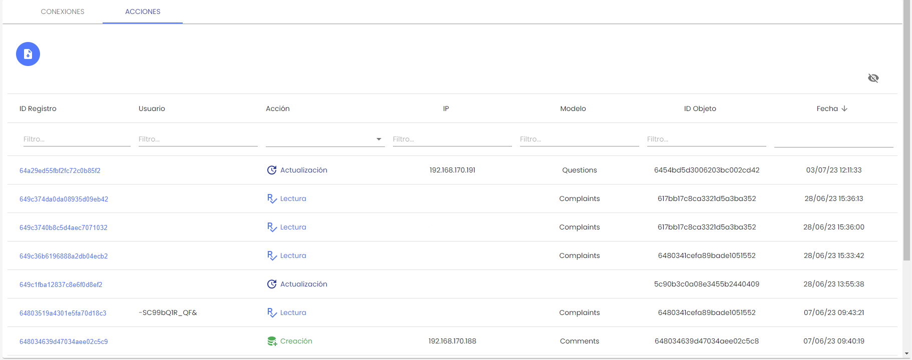

# v3.10 (Julio 2023)

Funcionalidades y mejoras incluidas:

* **Grabación por voz**

Se ha implementado una mejora que permite la inclusión de grabaciones de voz como parte del proceso de denuncia.

Ahora es posible configurar si se permitirá a los denunciantes grabar audios de voz (distorsionados) en el formulario de una nueva denuncia o en el seguimiento de denuncias ya registradas.

Esto brinda la opción de realizar denuncias por voz de manera segura y confidencial, además de la opción tradicional de realizar denuncias por texto.

* * Configuración

Esta opción se podrá configurar en el apartado de Configuraciones > Sistema, en el bloque de Comunicaciones, mediante el nuevo campo  “Permitir grabar archivos de audio al comunicador“.

También es posible incluir un mensaje de instrucciones de grabación por defecto que se mostrarán al comunicador al realizar la grabación, el cual podrá editarse. Adicionalmente se podrá elegir el idioma en que se mostrará

Para mostrar la opción deberá configurarse el campo "Adjuntos" en el apartado correspondiente

* * **Vista de la Comunicación**

En la vista del denunciante se accede a la nueva funcionalidad al pulsar el + y seleccionar "Grabar audio"

Una vez seleccionada la opción "Grabar audio", se mostrará una interfaz que permitirá al denunciante realizar la grabación. Al finalizar la grabación, el archivo resultante se adjuntará a la comunicación de la denuncia en formato wma.

Esto asegura que la grabación de audio esté disponible y sea accesible para su revisión por parte de los responsables de la gestión de la denuncia y del denunciante. 

Esta mejora brinda al denunciante una forma conveniente y segura de proporcionar información adicional mediante grabaciones de voz. 

* **Descarga de registros de acciones**

En esta versión se ha incorporado la posibilidad de exportar en un archivo CSV los logs de acciones realizadas sobre configuraciones y datos del Canal. 

* En el apartado de [Registros > Acciones](https://help.globalsuite.es/pages/viewpage.action?pageId=28737666) se incluirá un botón de descarga donde generar todos los registros de creación, modificación o eliminación de información.
* Este archivo incluirá las columnas que se hayan dejado como visibles en el listado, y en caso de aplicar filtros, los que coincidan con ese filtro aplicado.

* ***Actualización de plataformas: Cambio a VMware como estándar para nuevas instalaciones on-premises***

*Te informamos que, con la liberación de las versiones X.Y.Z de GlobalSuite y A.B.C del Canal de Comunicaciones, discontinuamos el soporte y asistencia técnica al despliegue de nueva infraestructura on-premises basada en entornos de virtualización Microsoft Hyper-V.*

*Tomamos esta decisión ya que los appliances de virtualización abierta que contienen las nuevas versiones de nuestros productos, no son compatibles con la tecnología de despliegue del software hipervisor de Microsoft.*

*En su lugar, VMware se convierte en la única plataforma y estándar de operación soportados para nuevas instalaciones on-prem.*

* Mejoras internas y resolución de errores.
