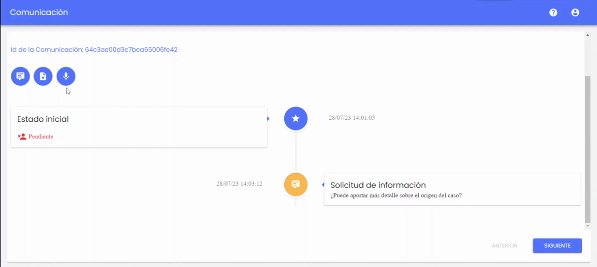
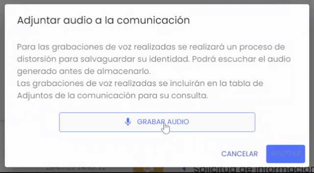
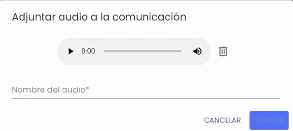
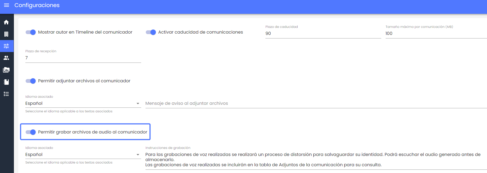

# v3.12 (Agosto 2023)

## Funcionalidades y mejoras incluidas:

* **Grabación por voz**

En esta versión se amplía la funcionalidad incorporada en una versión anterior ([v3.10](https://help.globalsuite.es/pages/viewpage.action?pageId=117637142)), que permite formular una nueva denuncia grabando audios de voz con la información que quieren registrar.

Esto puede complementar o sustituir el formulario escrito para facilitar la creación y envío de denuncias de forma rápida y sencilla.

Antes de almacenar la grabación, se realiza un proceso de distorsión de la voz para garantizar la privacidad y anonimato del denunciante.

A partir de esta esta versión, el denunciante podrá seguir interactuando con los gestores de la denuncia, grabando nuevos audios de voz (con el mismo proceso de distorsión) para poder aportar nueva información.

Esta grabación se adjuntará como un seguimiento de la denuncia (en un archivo con formato .wma), visible en el Timeline de la misma. Y en caso de tener configurada la notificación, se alertará a los gestores de la denuncia.

La funcionalidad permitirá pausar la grabación, y reanudarla, hasta una duración máxima de 10 minutos.

Y una vez finalizada, se podrá reproducir para verificar el contenido, y asignarle un asunto, antes de enviarlo.

* * **Configuración**

Para poder realizar grabaciones en el seguimiento de una denuncia previa, al igual que cuando se registra una nueva, deberá habilitarse en el apartado de Configuraciones > Sistema, en el bloque de Comunicaciones, mediante el campo  “Permitir grabar archivos de audio al comunicador“.

