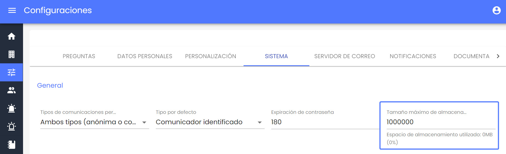

# v3.13 (Agosto 2023)

* **Configuración y ampliación del límite máximo de almacenamiento**

A partir de ahora, los usuarios con privilegios de Administrador o Administrador Global podrán ampliar el límite de almacenamiento de empresas Administradoras o Consulting, superando el valor actual de 10GB. Esta ampliación estará en línea con el almacenamiento contratado para la empresa.

La configuración de este límite se llevará a cabo a través de la opción Configuraciones > Sistema, en el campo "Tamaño máximo de almacenamiento (MB)". Es importante destacar que este campo tendrá un límite máximo permitido de 1.000.000 MB, equivalente a 1TB.

Estas mejoras permitirán una mayor flexibilidad al ajustar el límite de almacenamiento según las necesidades específicas de cada empresa.

