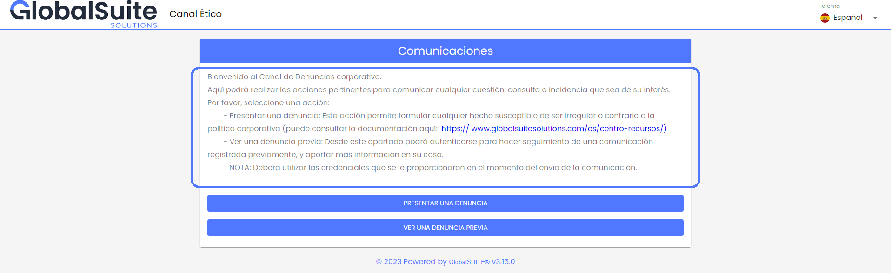
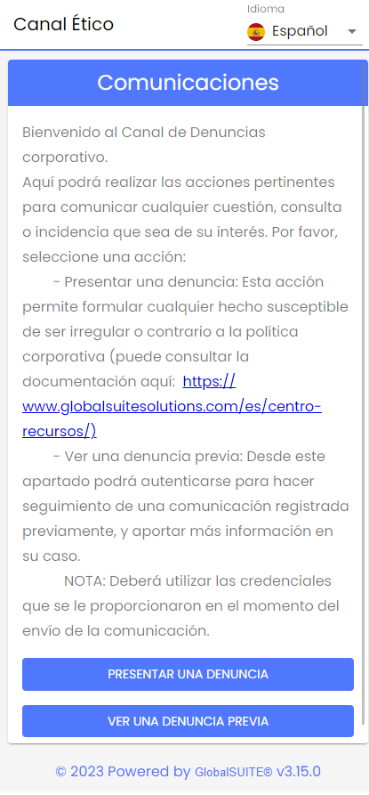
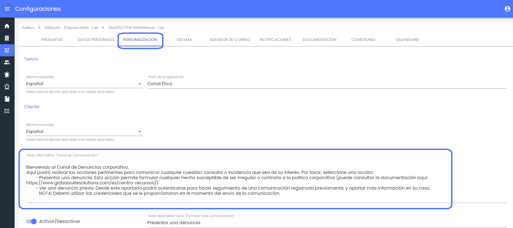

# v3.16 (Septiembre 2023)

* **Personalización de mensaje de Bienvenida del Canal**

A partir de ahora, para un Canal de denuncia se podrá mejorar la personalización del mensaje que aparece en la vista principal del Canal de Comunicaciones, incluyendo links a documentación o páginas de ayuda externa (como Políticas de Privacidad, guías de uso, otros canales de comunicaciones, etc.).

Esta mejora, junto con otras incorporadas en próximas versiones, permite adaptar el mensaje o la información que se quiere proporcionar a los denunciantes, para que el uso del canal sea más sencillo, claro, directo y adecuado a las necesidades de cada compañía.

Como características principales, están:

 - Los enlaces o URLs que se incluyan en la configuración, dentro del apartado [Configuraciones > Personalización](https://help.globalsuite.es/display/CD/Configuraciones+Consulting), estarán disponibles para acceder a esos recursos clicando directamente, y se abrirán en una pestaña nueva.

 - El formato, incluyendo saltos de línea, tabulaciones se respetará y será visible en cualquier dispositivo.

 - Este texto se podrá seguir personalizando para cualquiera de los idiomas disponibles en el entorno, y al comunicador le aparecerá en función del idioma seleccionado.

