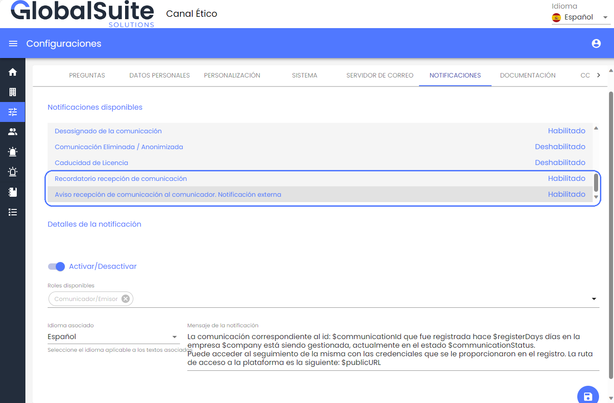
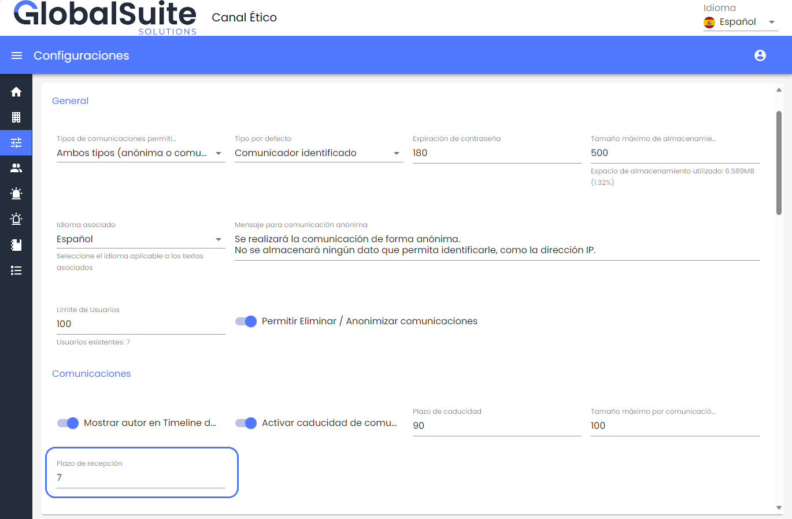
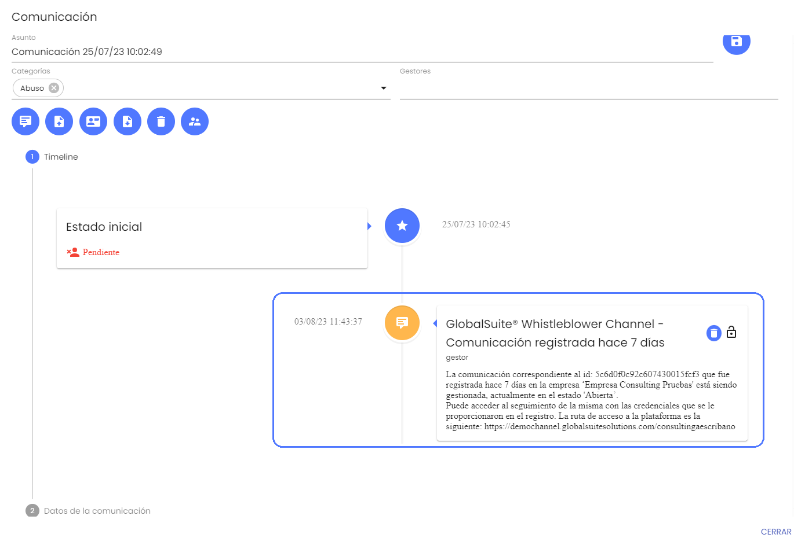
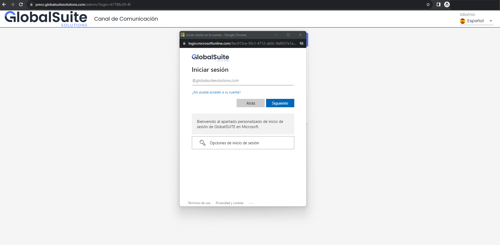
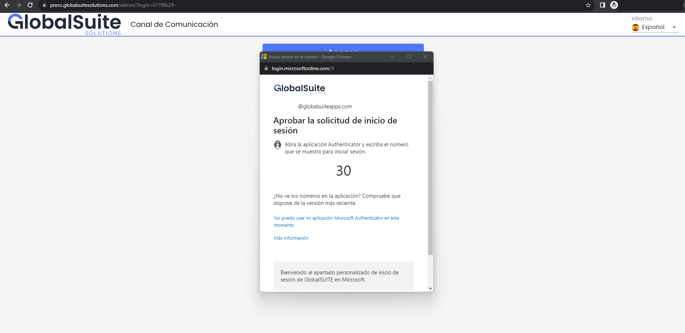
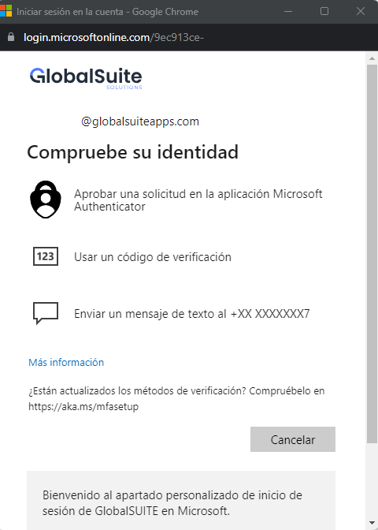
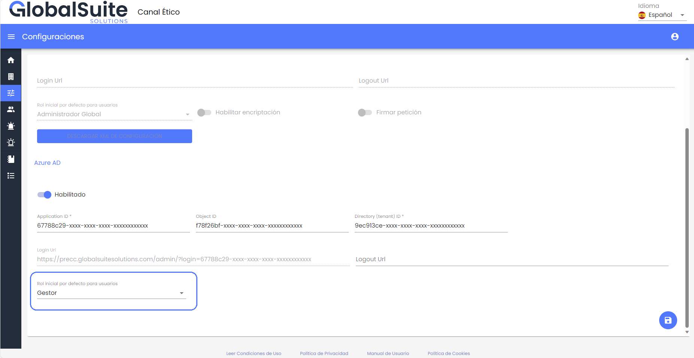

# v3.18 (Octubre 2023)

## Funcionalidades y mejoras incluidas:

### Nuevas alertas de acuse de recibo de denuncias

A partir de esta versión, es posible configurar alertas automáticas que se enviarán X días después del registro de una comunicación.

Esta funcionalidad permite dar un mejor seguimiento a las denuncias registradas en el Canal, enviando avisos o recordatorios tanto a los gestores como al denunciante.

Además, permite dar respuesta a la *Directiva Europea de Protección al Denunciante (Directiva 2019/1937)*, y la *Ley 2/2023, de 20 de febrero, reguladora de la protección de las personas que informen sobre infracciones normativas y de lucha contra la corrupción,*para dar solución al requerimiento de notificación de acuse de recibo al comunicador.

Se incluyen dos nuevas alertas configurables en el apartado [Configuraciones](https://help.globalsuite.es/display/CD/Configuraciones+Consulting) > Notificaciones:

* Recordatorio recepción de comunicación: Esta alerta interna, permite notificar a los usuarios del Canal, incluyendo a los gestores asignados.
* Aviso recepción de comunicación al comunicador. Notificación externa: Permite notificar del estado o situación de la denuncia registrada en el Canal, cuando pase un determinado número de días desde la creación. Esta alerta por correo electrónico se enviará únicamente en caso de que el comunicador no la haya registrado de forma anónima.

* En ambos casos será posible activar o desactivar estas notificaciones. Por defecto aparecen desactivadas, por lo que si se quiere empezar a utilizar se deberá habilitar.
* El número de días a desde la recepción a los que se enviará la alerta es configurable en [Configuraciones](https://help.globalsuite.es/display/CD/Configuraciones+Consulting) > Sistema, estando establecido por defecto en **7 días desde la recepción** de la denuncia.

* Además, en el caso del aviso de recepción al comunicador, dejará registro en el Timeline de la denuncia de esa comunicación realizada

### Autenticación SSO con Azure AD

En esta versión se suma a las posibilidades de autenticación que ya existían (usuarios locales a la aplicación o integración con ADFS - SAML), la posibilidad de configurar en el Canal la autenticación con el servicio de **Azure AD** en la nube.

* La autenticación se hará mediante Single Sign-On, para lo cual el usuario únicamente tendrá que acceder a la URL específica en la configuración.
* Si el usuario ya está autenticado en su equipo, el acceso será directo al sistema.
* Si no está autenticado en el navegador, o se tiene varias cuentas activas, se solicitará elegir qué cuenta utilizar o introducir las credenciales válidas.

* En caso de tener configurado el uso de MFA (Multi Factor Autentication) en Azure AD se solicitará el código de verificación a través de Microsoft Authenticator, correo electrónico o SMS. Esto es compatible con el mecanismo de 2FA que está incluido en GlobalSuite® Whistleblower Channel y que se podrá habilitar.

* Cuando un usuario autorizado accede por primera vez, se registrará en el Canal asignándole el rol por defecto definido en la configuración.

### Mejoras internas y resolución de errores.

## Resumen de nuevas funcionalidades versiones v3.3 a v3.18

### Vídeos


Changelog v3.3 - v3.8, v3.11, v3.17 y v3.18.mp4

