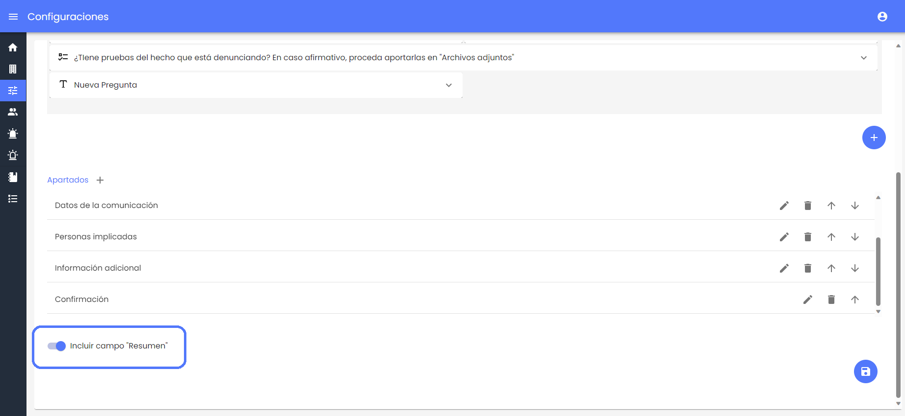
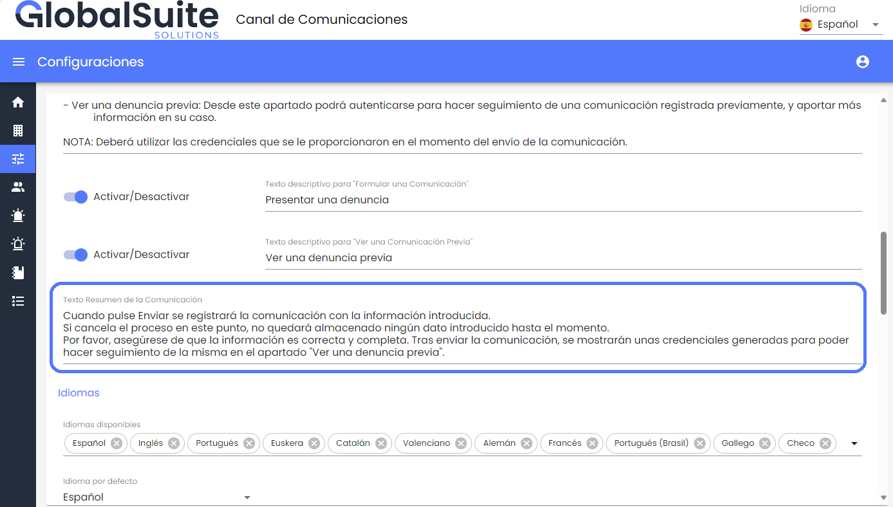
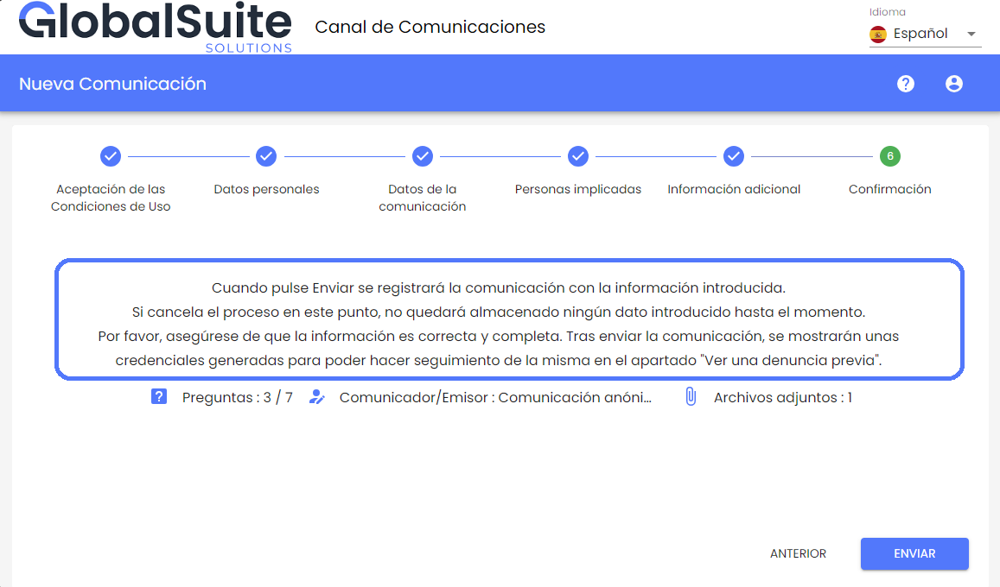
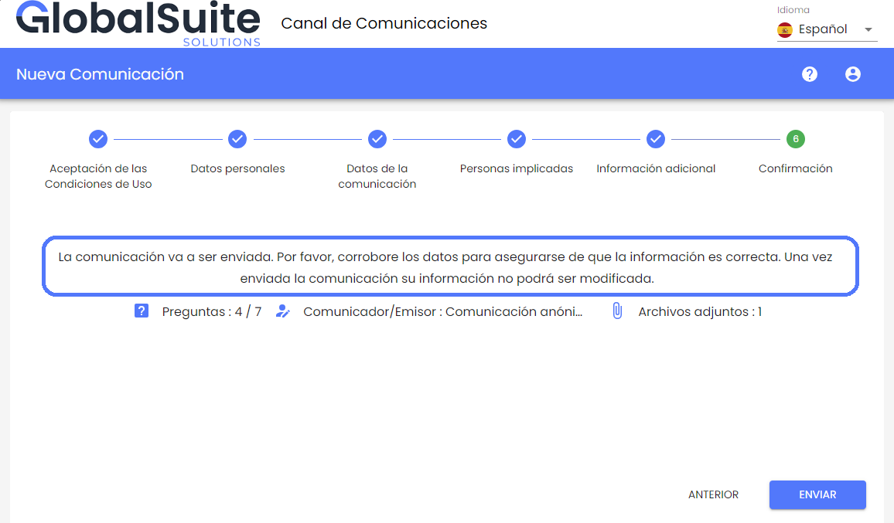

# v3.19 (Noviembre 2023)

## Funcionalidades y mejoras incluidas:

### Nuevo mensaje de Resumen de la comunicación

En esta versión, se ha incluido la posibilidad de personalizar un mensaje informativo para el comunicador en el último paso del registro de una nueva denuncia.

Esta funcionalidad permite personalizar y añadir instrucciones o avisos específicos para un canal, para que el proceso de formular una comunicación sea más sencillo, claro, directo y adecuado a las necesidades de cada compañía.

Para utilizar esta funcionalidad, se deberá activar el Resumen de la comunicación en el apartado [Configuraciones](https://help.globalsuite.es/display/CD/Configuraciones+Consulting) > Preguntas.

Y se podrá personalizar este mensaje en el campo "Texto Resumen de la Comunicación" en el apartado [Configuraciones](https://help.globalsuite.es/display/CD/Configuraciones+Consulting) > Personalización. Como características principales, están:

* Los enlaces o URLs que se incluyan en el campo, estarán disponibles para acceder a esos recursos clicando directamente, y se abrirán en una pestaña nueva.

* El formato, incluyendo saltos de línea, tabulaciones se respetará y será visible en cualquier dispositivo.

* Este texto se podrá seguir personalizando para cualquiera de los idiomas disponibles en el entorno, y al comunicador le aparecerá en función del idioma seleccionado.

Una vez configurado el campo, el texto configurado se mostrará en el apartado resumen, junto con la información de cuántos campos o preguntas se han completado, si la denuncia se registrará de forma anónima o identificando al comunicador, y el número de archivos adjuntos.

En caso de que este campo de Texto Resumen no esté configurado, se mostrará el mensaje por defecto que existía actualmente.

## Resumen de nuevas funcionalidades versiones v3.9, v3.10, v3.16 y v3.19

### Vídeos


Changelog Canal v3.9, v3.10, v3.16, v3.19.mp4

