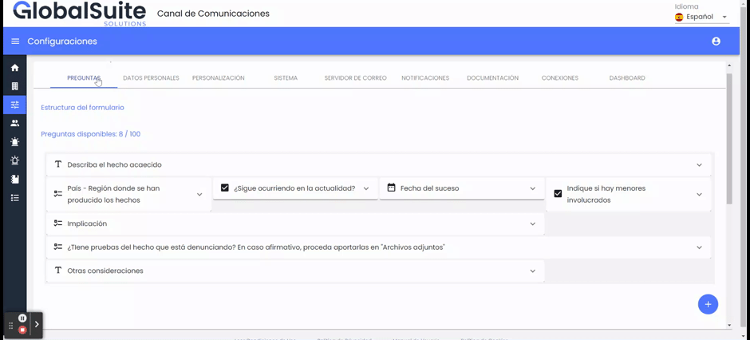
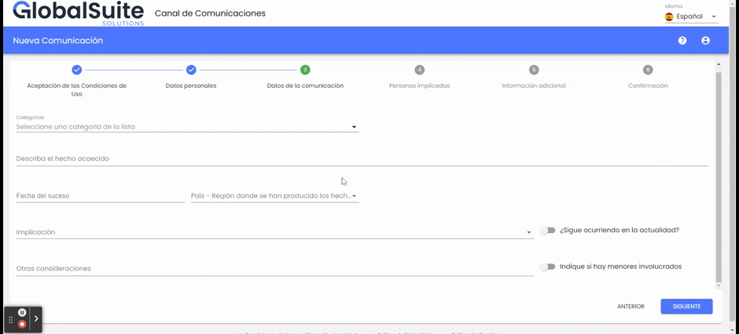
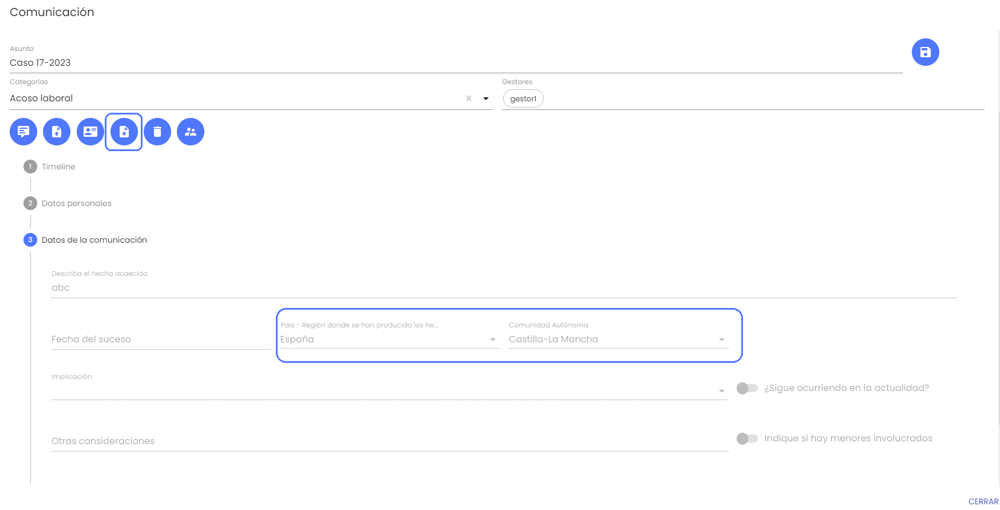
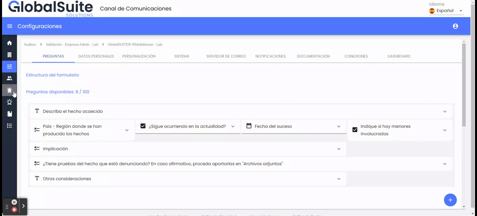

# v3.20 (Noviembre 2023)

## Funcionalidades y mejoras incluidas:

### Preguntas de selección dependientes

En esta versión, se ha ampliado un tipo de pregunta o campo del formulario de la comunicación: las **preguntas de tipo Selector** podrán estar **anidadas**.

A partir de ahora, es posible incluir subpreguntas o niveles inferiores, cuya pregunta y opciones varíen en función de la opción seleccionada en la pregunta principal. Las principales características son:

* Se podrán establecer hasta 3 niveles de profundidad, estableciendo subpreguntas para todas o algunas de las opciones elegidas en el nivel superior, con un enunciado o título diferente para cada una.

* Las opciones y subpreguntas se podrán traducir para todos los idiomas habilitados en el Canal.

* En caso de que una de las opciones no tenga una subpregunta asociada, en el formulario de la comunicación no aparecerá ese nivel inferior.

* Si una pregunta de selección se marca como obligatoria, se tendrán que completar todos los niveles definidos para una opción.

Esta mejora funcional permite personalizar el formulario de la comunicación adaptándolo a las necesidades de cada compañía, facilitando el proceso a la persona que va a registrar una nueva comunicación, y mejorando las respuestas obtenidas para los gestores del canal, permitiendo definir un árbol de decisión que guíe al usuario.

Para utilizar esta funcionalidad, se deberá definir subpreguntas para cada una de las opciones que se deseen en el apartado [Configuraciones](https://help.globalsuite.es/display/CD/Configuraciones+Consulting) > Preguntas.

Las opciones de un selector se podrán reordenar para ajustarlo al orden en el que se quieran mostrar en el formulario.

Para cada opción, de manera concreta se podrán definir subpreguntas o no, no siendo necesario completar todos los niveles para todas las opciones.

En el formulario de la comunicación, aparecerán las subpreguntas para una opción concreta, pudiendo tener hasta tres niveles de profundidad.

Si la opción elegida no tiene una subpregunta configurada, no aparecerá ningún campo para completar.

Una vez registrada la comunicación, en el área interna esta información aportada aparecerá en el formulario de la comunicación, y se incorporará en el informe .pdf que se puede generar de un registro.

También, en la vista principal de [Comunicaciones](https://help.globalsuite.es/display/CD/Comunicaciones) o Comunicaciones caducadas, si se ha habilitado para ver esta pregunta de selección anidada, aparecerán tantas columnas como niveles haya, pudiendo ver y filtrar las respuestas de cada uno de estos niveles.

Y esa información también se descargará en el informe CSV que se puede obtener en esa vista.

