# v3.26 (Febrero 2024)

## Funcionalidades y mejoras incluidas:

### Borrado de Metadatos

En esta versión se incluye la posibilidad de poder habilitar un mecanismo automático de borrado de metadatos de los archivos que se adjunten en las denuncias.

Esta funcionalidad está orientada para poder preservar la privacidad del denunciante (sobre todo en caso de que sea anónimo), y borrar los metadatos de los archivos que puedan permitir identificarlo, tales como geolocalización, nombre de dispositivo, IP, fecha, autor, etc..

Esta nueva funcionalidad, por defecto no está habilitada ya que depende del licenciamiento y de las necesidades de cada canal, además de para no modificar el comportamiento actual, si se quiere activar a continuación se detallan los pasos para hacerlo.

#### Habilitar el borrado de metadatos

Dentro de Configuraciones > Sistema, en el bloque de Comunicaciones, mientras que este permitido subir documentos a una denuncia ( “Permitir adjuntar archivos al comunicador“ habilitado), se mostrara la opción “Borrado de Metadatos en Archivos“.

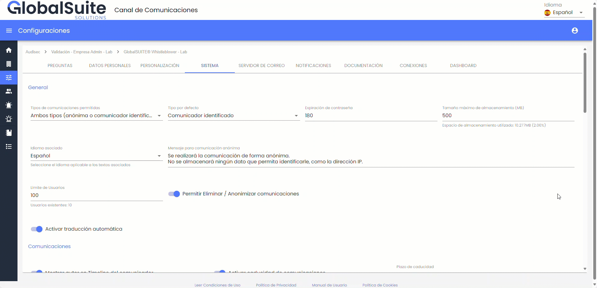

#### Subir documentos a una denuncia.

Después de activar esta función, al crear o editar una denuncia y adjuntar un archivo, la eliminación automática de metadatos se llevará a cabo de manera transparente para el usuario que esté realizando el envío.

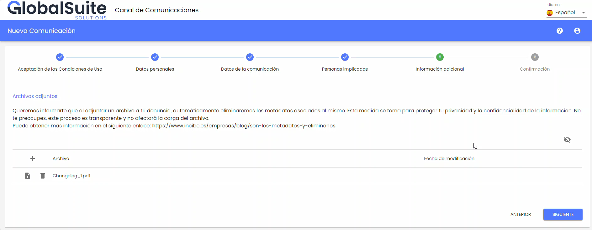

Además, se generará un registro de acción denominado "Metadatos eliminados" cada vez que se suba un archivo y se eliminen los metadatos. Es importante destacar que este registro será informativo y no almacenará los metadatos que fueron borrados.

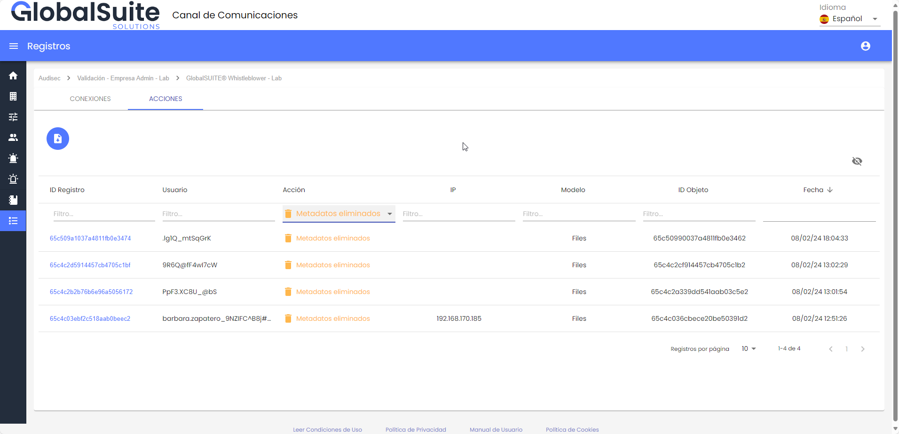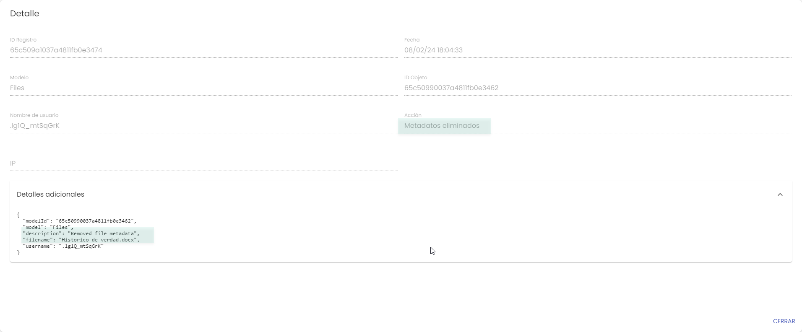

### Traducción automática a otros idiomas

Debido a que el Canal de Denuncias es una plataforma abierta, donde cualquier interesado puede registrar un hecho para que se gestione, es posible que el denunciante ingrese la información en cualquier idioma.

El Canal de Denuncias de GlobalSuite® actualmente está disponible en 11 idiomas: Español, Inglés, Alemán, Francés, Portugués, Brasileño, Checo, Euskera, Catalán, Gallego y Valenciano. Pero incluso un denunciante puede registrar un caso en otro idioma diferente, por lo que es muy difícil que un equipo encargado de gestionar el canal disponga de expertos con conocimiento de todos los idiomas posibles.

Por eso, esta funcionalidad adicional permite que los gestores de las denuncias puedan revisar la información aportada en otros idiomas (**hasta 75 idiomas**), a través de este asistente automático integrado en la propia interfaz, de forma rápida, sencilla y confidencial.

#### Uso del módulo de Traducción automática

En el Canal de Denuncias de GlobalSuite®, un denunciante puede introducir la información en cualquier idioma, incluyendo idiomas no habilitados en la interfaz de usuario.

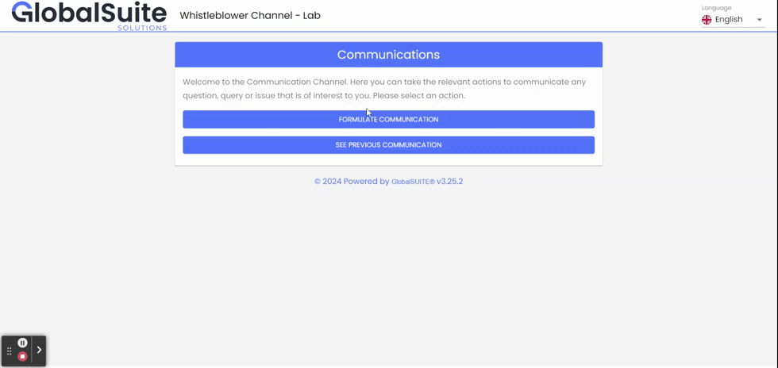

Una vez se recepciona una denuncia escrita en cualquier idioma, los usuarios responsables pueden revisarla en el apartado de [Comunicaciones](https://help.globalsuitesolutions.com/canal-comunicaciones/comunicaciones).

Cuando accedemos al formulario de la denuncia, todos los campos de texto donde el denunciante ha podido ingresar la información en otros idiomas disponen de un botón “Traducir” que **autodetecta el idioma origen** del texto y lo traduce automáticamente al idioma del usuario de manera rápida y directa.

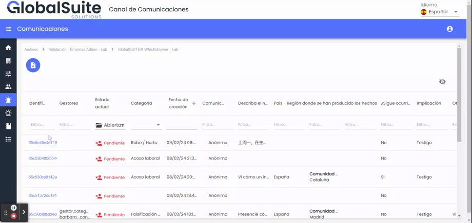

Esta información se muestra en pantalla sombreada (para indicar que no se trata del texto original), y permite una vez traducido al idioma del usuario, traducirlo a otro idioma entre los disponibles.

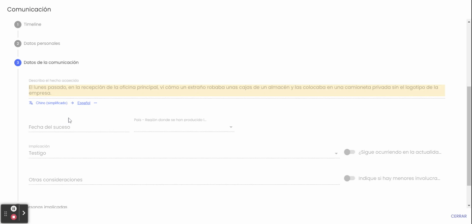

El asistente de traducción no modifica ni elimina en ningún caso la información original introducida por el denunciante, la cual es inalterable, sino que permite consultarla sin necesidad de conocer dicho idioma.

#### Seguimiento e interacción con el denunciante

Además de poder traducir los campos del formulario de la denuncia que se registra inicialmente, si se realiza alguna interacción con el denunciante a través de los comentarios del Timeline, también es posible traducir dicha información.

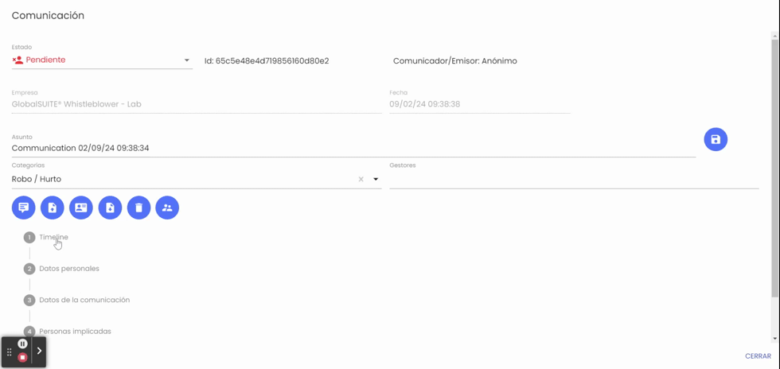

#### Activación del servicio y confidencialidad

Esta funcionalidad adicional de Traducción automática, por defecto no está disponible entre las capacidades del Canal, sino que es necesario activarla bajo demanda. Puede ponerse en contacto con su gestor de GlobalSuite® para más información.

La información de la denuncia que se envía para su traducción no se almacena fuera del Canal, además de contar con todas las medidas de seguridad y privacidad para ello, centradas en mantener la confidencialidad de la misma.

### Mejoras en las categorías de las denuncias

Anteriormente, las categorías utilizadas para clasificar las denuncias, incluso para asignarlas a unos gestores o a otros, tenían una limitación de tamaño por motivo de usabilidad (100 caracteres), lo que ocasionaba que en casos en los que se deseaba incluir una descripción o detalle de la categoría para facilitar su identificación, esta resultara insuficiente.

Por lo tanto, en esta versión se ha ampliado esa funcionalidad con una descripción detallada de las categorías tanto para que un denunciante pueda seleccionar la categoría que le aplica, como para la gestión interna de la misma.

#### Añadir descripción a las categorías.

Para añadir una descripción a las categorías, se debe acceder desde el apartado de [Configuraciones > Personalización](https://help.globalsuitesolutions.com/canal-comunicaciones/configuraciones-consulting) > Categorías.

En esta sección, se podrán crear nuevas categorías o modificar las existentes, y añadirles una descripción.

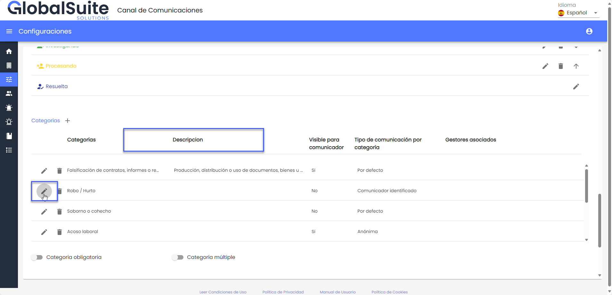

Las categorías preexistentes de las empresas se presentarán inicialmente con el campo de descripción vacío. Al editar una categoría, se mostrará el formulario con un nuevo campo de texto denominado "Descripción", el cual tiene un límite de 1050 caracteres.

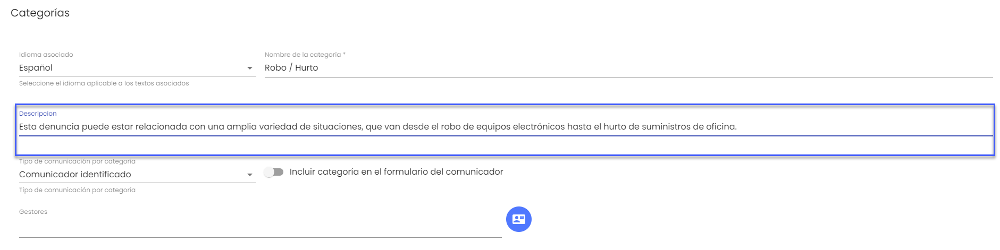

Además, si modificamos el idioma asociado, tendremos la opción de ingresar la traducción de la descripción para todos los idiomas disponibles.

#### Categorías de denuncias

Una vez configuradas, podremos ver el detalla de las categorías en las siguientes instancias:

* Al crear una denuncia

La descripción de la categoría estará disponible en dos momentos: se puede consultar al presionar el icono "i" junto a cada categoría.

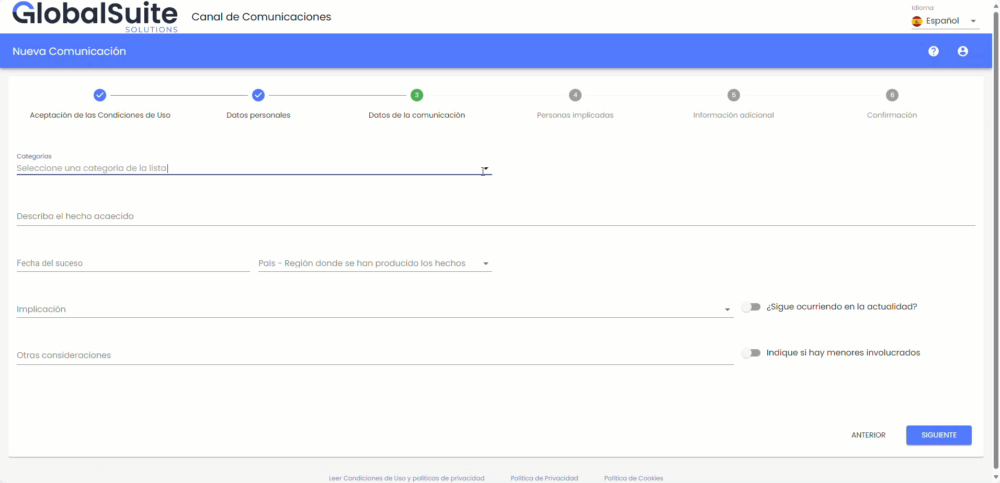

Una vez seleccionada la categoría, se verá la descripción debajo del campo correspondiente.

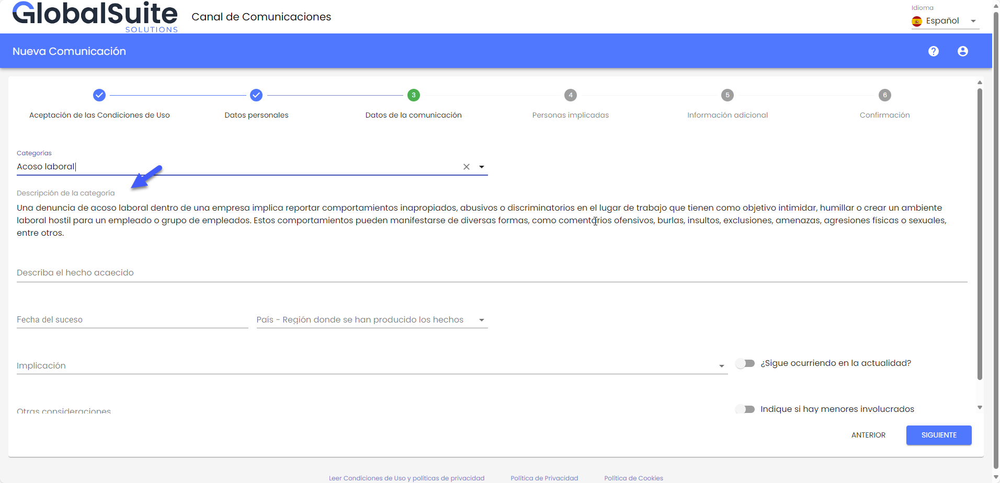

* Gestión de una denuncia desde el BO principal y secundario.

Una vez que su denuncia esté lista para ser gestionada desde el Backoffice, al acceder, verá el detalle de la categoría asociada a cada denuncia al presionar el icono "i" junto a cada categoría.

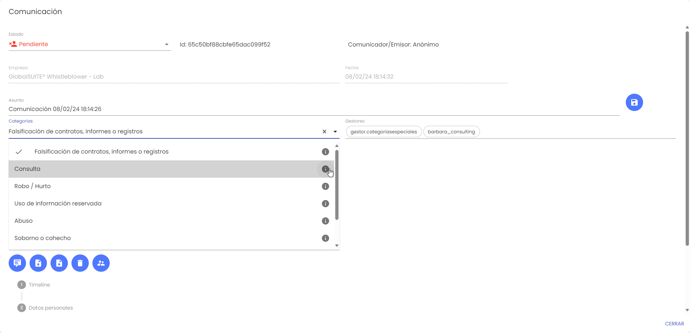

Además, al descargar la comunicación a pdf, también encontrará la descripción asociada a cada categoría.

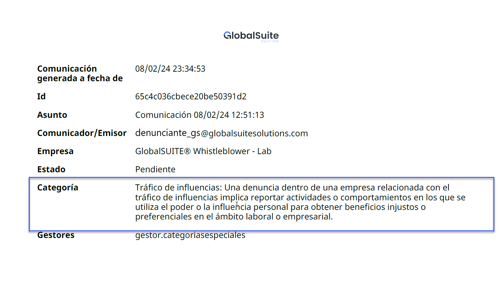

Y por ultimo, en el caso que se envíe la denuncia al canal secundario, ésta viajará con la descripción de la categoría asociada y se podrá consulta de la misma forma que desde este repositorio secundario.
