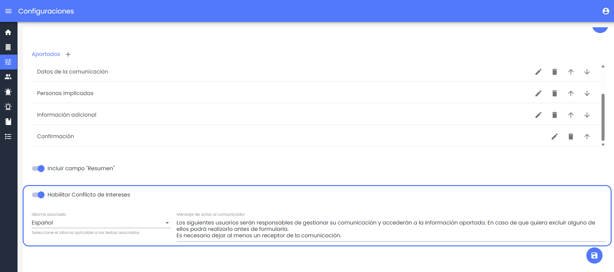
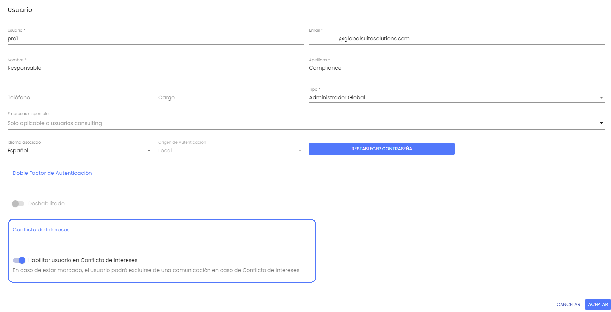
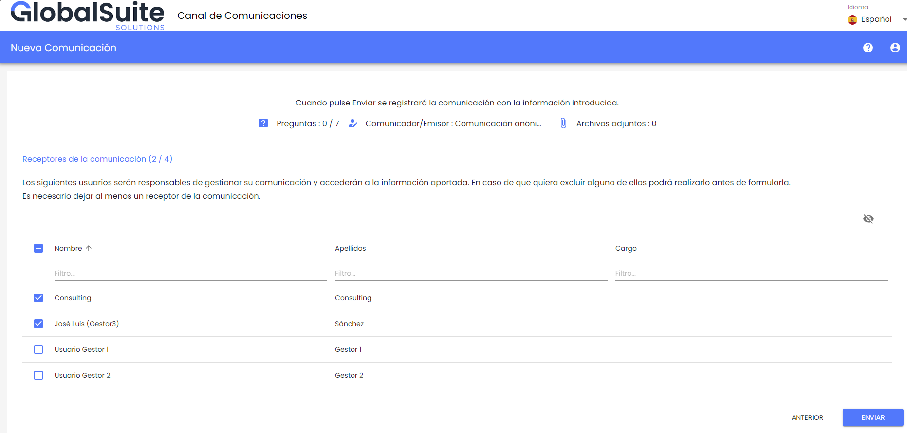
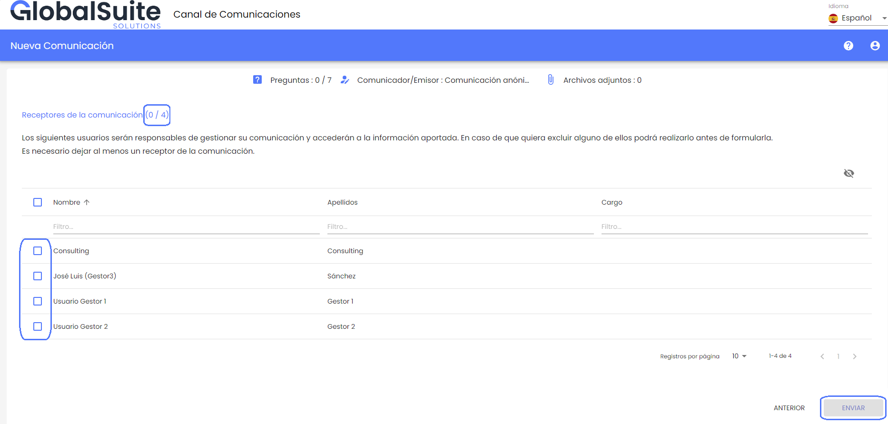
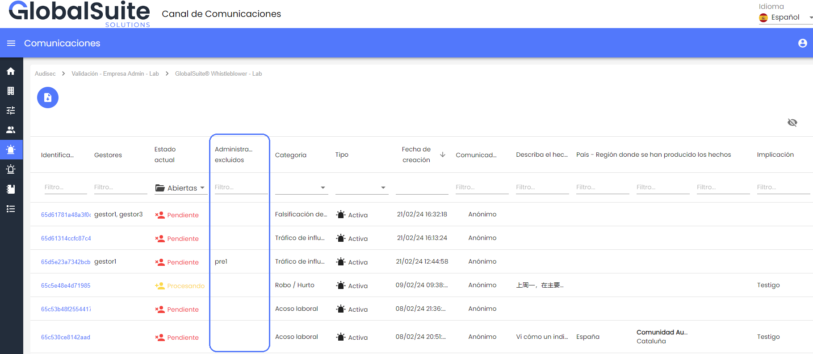
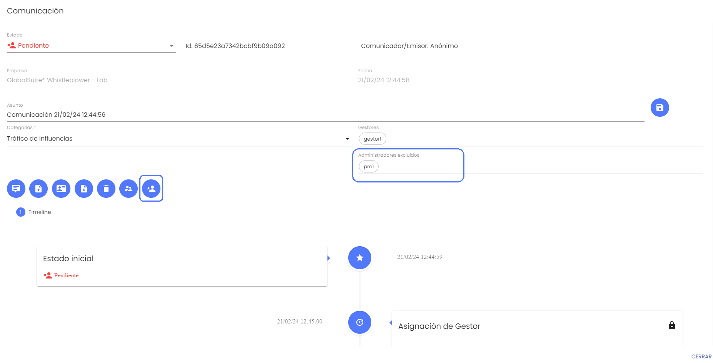

# v3.27 (Febrero 2024)

## Funcionalidades y mejoras incluidas:

### Conflicto de Intereses

En esta versión se incorpora una nueva capacidad para tratar y evitar posibles conflictos de intereses con los gestores del canal a la hora de que un denunciante registre una denuncia.

A no ser que el canal de denuncias corporativo esté gestionado por un tercero independiente (por ejemplo, externalizando dicha gestión a un proveedor que apoye el programa de cumplimiento como los [servicios que ofrecemos](https://www.globalsuitesolutions.com/es/servicios-gestionados/) en GlobalSuite Solutions), puede darse el caso de que un denunciante quiera informar sobre alguna situación en la que esté involucrado alguno de los gestores del canal que recibirán esa denuncia para su investigación.

Para tratar esta posible situación se ha creado esta funcionalidad para que el gestor pueda identificar qué personas recibirán la denuncia cuando la registre, pudiendo dejar fuera a personas que es posible que estén involucradas en el hecho a comunicar.

Esta nueva funcionalidad, por defecto no está habilitada ya que depende del licenciamiento y de las necesidades de cada canal, además de para no modificar el comportamiento actual. A continuación explicamos las principales características de la mejora.

**Configuración de Conflicto de Intereses**

Para comprobar si el uso de conflicto de intereses está habilitado, se puede hacer en el apartado de [Configuraciones > Preguntas](https://help.globalsuitesolutions.com/canal-comunicaciones/configuraciones-consulting#ConfiguracionesConsulting-Preguntas) del Canal.

Ahí se muestra el campo que indica si el conflicto de intereses está habilitado o no. Al igual que el campo Resumen, se muestra al final ya que será en el último apartado del formulario de la denuncia donde el denunciante podrá ver los receptores de la denuncia.

En caso de estarlo, se muestra un campo de texto para poder definir un mensaje informativo que verá el denunciante en ese apartado.

Además, cuando el Conflicto de Intereses está habilitado, es posible configurar qué usuarios de los que tienen acceso a las denuncias (los roles Administrador Global, Gestor o Consulting a nivel organizativo superior en caso de tener múltiples canales) van a estar incluidos en el conflicto de intereses y serán visibles para el denunciante.

Para ello, accediendo al formulario de estos usuarios (salvo los de rol Administrador, que en ningún caso tienen acceso a las denuncias) se podrá habilitar o deshabilitar el que sea susceptible de tener un conflicto de intereses.

Esto es así para que en los casos que también existan usuarios independientes o de terceros que no estarían involucrados, estos no aparezcan para el denunciante.

**Registro de una nueva denuncia con Conflicto de Intereses**

Cuando tenemos habilitada esta funcionalidad, el denunciante podrá completar el formulario de la denuncia de manera normal, teniendo que completar los campos obligatorios, adjuntando archivos, o seleccionando una categoría para la denuncia, en función de cómo esté configurado el sistema.

En el último paso antes de enviar la denuncia, además del resumen de la información aportada, al denunciante le aparecerá qué usuarios van a recibir la denuncia.

Por defecto, aparecerán marcados los administradores globales (ya que estos usuarios reciben siempre las nuevas denuncias) y los gestores que estén asociados a la categoría seleccionada por el usuario, en caso de tener configurados destinatarios por categorías en [Configuraciones > Personalización](https://help.globalsuitesolutions.com/canal-comunicaciones/configuraciones-consulting#ConfiguracionesConsulting-Personalizaci%C3%B3n)

También se mostrarán, sin marcar, otros gestores que no apliquen para la categoría seleccionada, como destinatarios alternativos.

En caso de que el denunciante considere que alguna persona de las que van a recibir esa denuncia puede estar involucrada y no debería tener acceso, puede desmarcarlo, y marcar alguno alternativo.

Para asegurar que la denuncia se pueda gestionar en el Canal, sólo será posible enviarla si hay al menos marcado un usuario que recibirá la denuncia.

Cuando se envíe la denuncia, los usuarios del canal que no tengan acceso, no recibirán ninguna notificación o alerta al respecto.

**Gestión de denuncias con Conflicto de Intereses**

Cuando la funcionalidad de Conflicto de Intereses está habilitada en el Canal, si algún usuario administrador ha sido excluido de una denuncia, esta no le aparecerá en el listado de [Comunicaciones](https://help.globalsuitesolutions.com/canal-comunicaciones/comunicaciones).

Además, se mostrará una columna adicional de Administradores excluidos donde se podrá ver que usuarios han sido excluidos de la denuncia.

Para los usuarios que sí tengan acceso a una denuncia, cuando se entra al detalle de la misma, también será visible en un apartado específico si hay algún administrador excluido de la denuncia.

Y además, se dispondrá de un botón para poder gestionar esos administradores excluidos, tanto para volver a dar acceso a uno (por ejemplo, cuando tras investigar el hecho se compruebe que dicho usuario no está implicado) o para excluir a otros usuarios.
