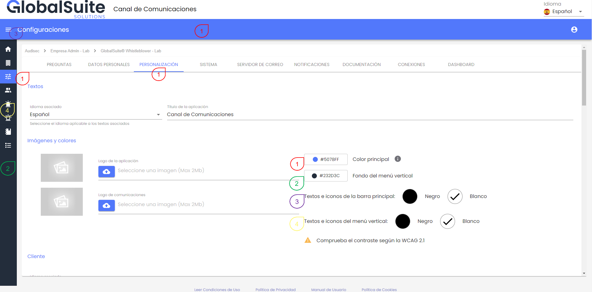
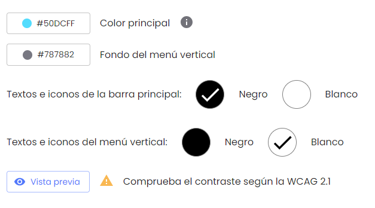
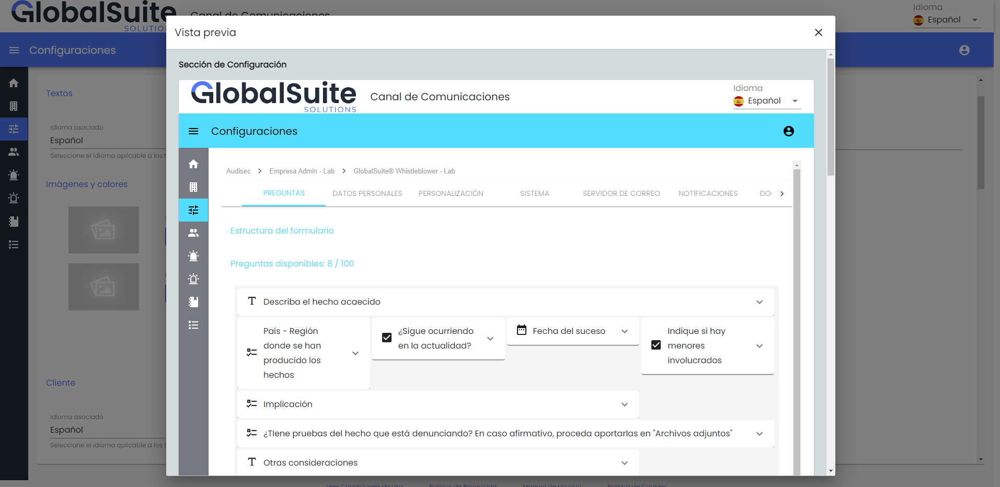
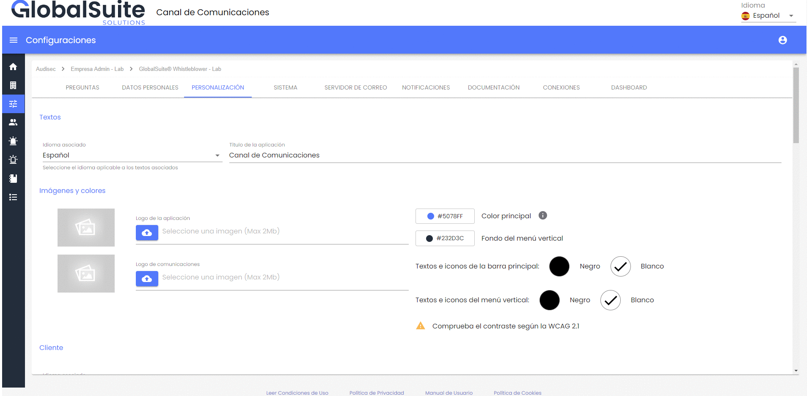

# v3.30 (Abril 2024)

## Personalización corporativa del canal

En esta versión se incorpora la posibilidad de adaptar la identidad gráfica del Canal de Denuncias corporativo a la **imagen de marca**, personalizando con los colores propios de la compañía.

Debido a que el Canal de Denuncias es un portal abierto al exterior para que cualquier interesado pueda reportar un hecho, es muy útil que sea fácilmente identificativo y vaya alineado con el resto de plataformas de la empresa.

Para ello, se ha incluido en el apartado de [Configuraciones > Personalización](https://help.globalsuitesolutions.com/canal-comunicaciones/configuraciones-consulting#ConfiguracionesConsulting-Personalizaci%C3%B3n) la posibilidad de personalizar los colores corporativos de la interfaz.

Este cambio aplica tanto a la **interfaz de administración** (backoffice interno de gestión del canal) como sobre todo a la **vista del denunciante** (formulario público), tanto a la hora de reportar una nueva denuncia como de hacer seguimiento de una previa.

### Configuración de colores

En la configuración, por defecto aparecen los colores actuales de la solución, pero es posible personalizarlos en función de distintos parámetros.

1. Color principal: Este color será el que se aplicará a la barra principal del menú, botones, títulos y frontal principal de la vista del denunciante.
2. Menú vertical: Este color se utilizará para la banda de menú vertical del panel
3. Textos e iconos del menú principal: Con la posibilidad de elegir entre blanco y negro, se utilizará para representar los textos e iconos que existan en el menú principal
4. Textos e iconos del menú vertical: El color elegido (blanco o negro) se utilizará para representar los iconos y textos del menú lateral

Esto está pensado para que, además de ir alineado con la imagen corporativa, los textos e iconos sean legibles y se adapten a los criterios de contraste y accesibilidad marcados por las [WCAG 2](https://www.w3.org/WAI/standards-guidelines/wcag/) (Web Content Accesibility Guidelines).

Una vez modificado alguno de los parámetros, es necesario pulsar el botón “Vista Previa” que en una ventana te muestra cómo queda la interfaz de usuario sin necesidad de aplicar los cambios.

Al abrirlo, mostrará una ventana para visualizar cómo quedará con los ajustes propuestos, viendo los cambios en distintas vistas:

* Sección de Configuración
* Sección de Landing
* Formulario de denuncia

Una vez revisada la vista previa, se podrán aplicar los cambios mediante el botón Guardar y se actualizará la interfaz para todos los usuarios.

### Ejemplos

