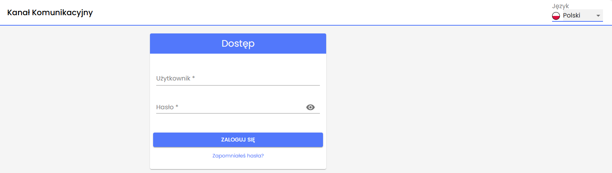

# v3.36 (Marzo 2025)

## Funcionalidades y mejoras incluidas:

* **Nuevo Idioma Disponible: Polaco (pl-pol)**  
  El idioma polaco está disponible en nuestra aplicación tanto en el canal principal, el Backoffice como en el canal secundario.

  

  Actualmente, los idiomas disponibles son: Español, Inglés, Alemán, Francés, Portugués, Portugués (Brasil), Checo, Euskera, Catalán, Gallego, Valenciano y Polaco.

La habilitación de nuevos idiomas debe solicitarse al servicio de soporte.
