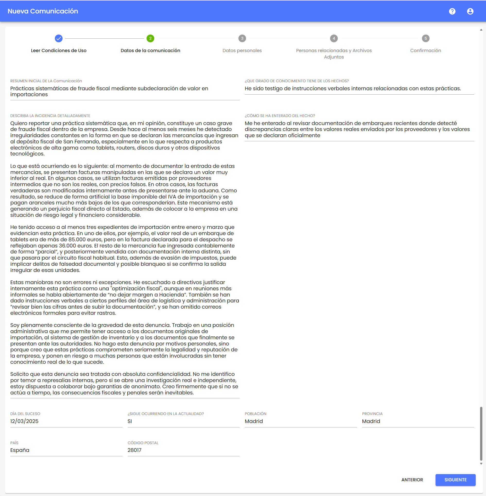
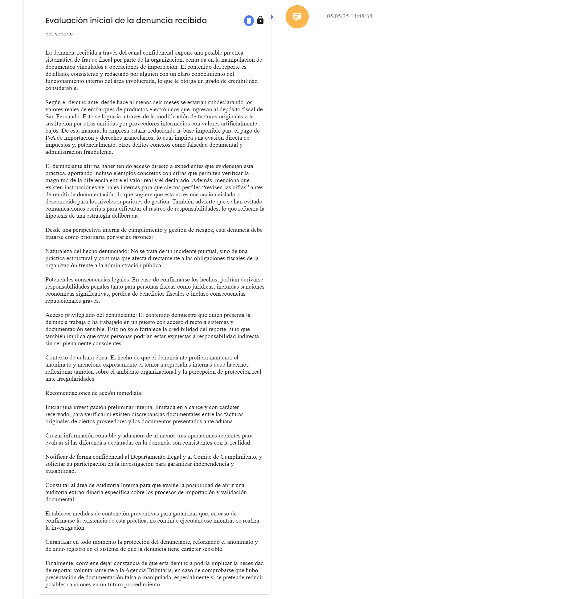

# v3.37 (Abril 2025)

## Funcionalidades y mejoras incluidas:

### Ampliación de campos de texto en Canal de Denuncias


Se amplía el límite de caracteres en los campos de texto del formulario de denuncia y del timeline, permitiendo registrar y consultar información más extensa durante todo el proceso.


Se aumentó el límite de caracteres en los campos de texto utilizados al registrar una denuncia desde el canal, pasando de 1550 a un máximo de 5.000 caracteres.

Estos campos ahora se expanden dinámicamente a medida que el usuario escribe, facilitando la redacción de contenido más detallado. Esta expansión también aplica al momento de consultar la denuncia desde el back office, donde los campos se mostrarán completos y sin recortes.

En el timeline de la denuncia, los comentarios también admiten hasta 5.000 caracteres. En la vista del asunto se aplica una elipsis y un tooltip a partir de los 1.000 caracteres para mantener la legibilidad del listado, mientras que el contenido completo del comentario se muestra íntegro al consultarlo.

Este cambio no modifica el comportamiento actual de guardado, exportación o visualización de los textos, manteniendo la compatibilidad con las funcionalidades ya disponibles.
