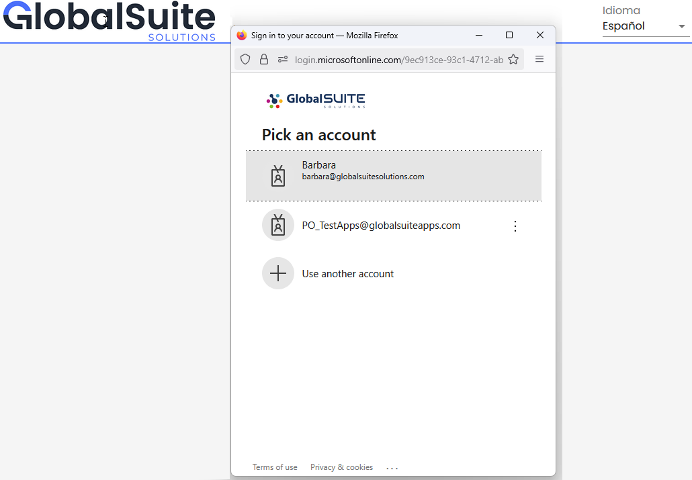
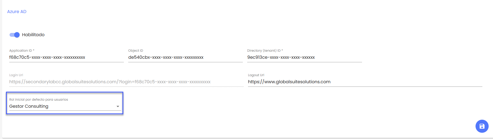

# v3.39 (Septiembre 2025)

## Funcionalidades y mejoras incluidas:

## Autenticación SSO en el canal secundario con Azure AD

En esta versión se añade la posibilidad de configurar en el Canal Secundario la autenticación con el servicio de **Azure AD** en la nube.

* La autenticación se hará mediante Single Sign-On, para lo cual el usuario únicamente tendrá que acceder a la URL específica en la configuración.
* Si el usuario ya está autenticado en su equipo, el acceso será directo al sistema.
* Si no está autenticado en el navegador, o se tiene varias cuentas activas, se solicitará elegir qué cuenta utilizar o introducir las credenciales válidas.

* En caso de tener configurado el uso de MFA (Multi Factor Autentication) en Azure AD se solicitará el código de verificación a través de Microsoft Authenticator, correo electrónico o SMS. Esto es compatible con el mecanismo de 2FA que está incluido en GlobalSuite® Whistleblower Channel y que se podrá habilitar.

* Cuando un usuario autorizado accede por primera vez, se registrará en el Canal asignándole el rol por defecto definido en la configuración.

