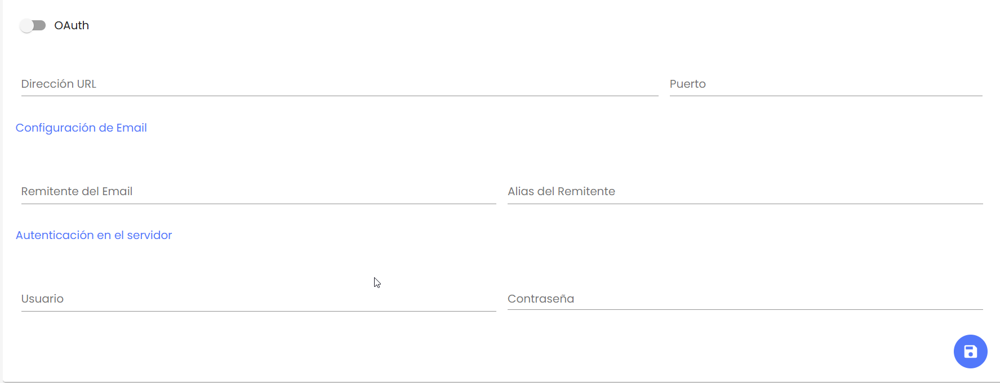
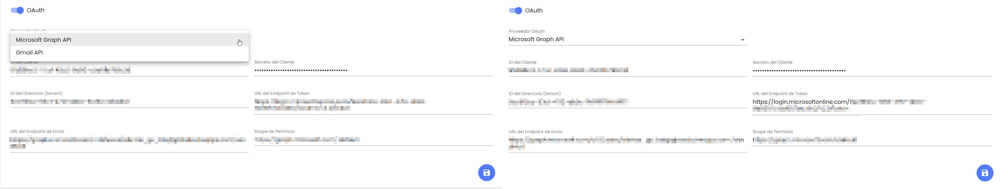

# v3.40 (Octubre 2025)

## Nuevas funcionalidades y mejoras generales

### Actualización del Canal de Denuncias: soporte para autenticación OAuth en servidores de correo


Incorporación de autenticación \*\*OAuth\*\* para servidores de correo SMTP, con compatibilidad para \*\*Microsoft Graph API\*\* y \*\*Gmail API\*\*, mejorando la seguridad y el cumplimiento de los nuevos estándares.


Se actualiza la configuración del **Canal de Denuncias** para incorporar compatibilidad con el nuevo estándar de **autenticación OAuth** en el envío de correos electrónicos a través de servidores SMTP, sustituyendo progresivamente el sistema tradicional basado en usuario y contraseña.  
Esta mejora aplica a la **configuración de servidores de correo por empresa**, permitiendo adaptar la autenticación del Canal de Denuncias a los nuevos requisitos de seguridad de los proveedores de correo electrónico y prevenir vulnerabilidades en el proceso de envío.

**Características principales:**

* **Nuevo interruptor OAuth** en el formulario de **Configuración de servidor de correo** del Canal de Denuncias.

  * Si está **desactivado**, se mantiene el método clásico de autenticación con **usuario y contraseña**, que seguirá disponible temporalmente hasta la migración completa al nuevo formato.

    
  * Si está **activado**, se utiliza **OAuth**, mostrando únicamente los campos necesarios según el proveedor seleccionado.
* **Compatibilidad con dos proveedores de autenticación:**

  * **Microsoft Graph API** (seleccionado por defecto).
  * **Gmail API**.

    
* **Compatibilidad con TLS:**

  * Si la opción **TLS** está activa, la conexión SMTP se establece cifrada tanto en modo **user/pass** como en **OAuth**.
  * Si no está activa, la conexión seguirá la configuración sin cifrado.
* **Compatibilidad retroactiva:**

  * Las empresas que actualmente tengan configurada la autenticación clásica **user/password** podrán seguir utilizándola temporalmente.
  * La funcionalidad queda preparada para la transición gradual a **OAuth**, garantizando la compatibilidad y la seguridad durante el proceso de actualización.
