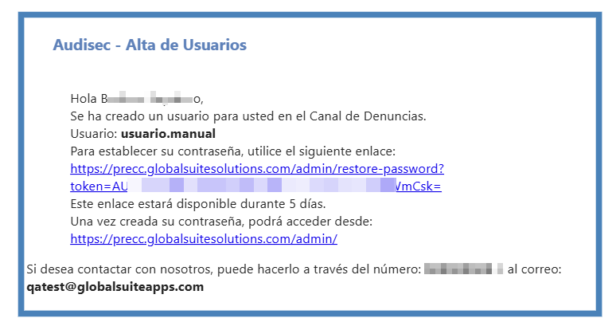
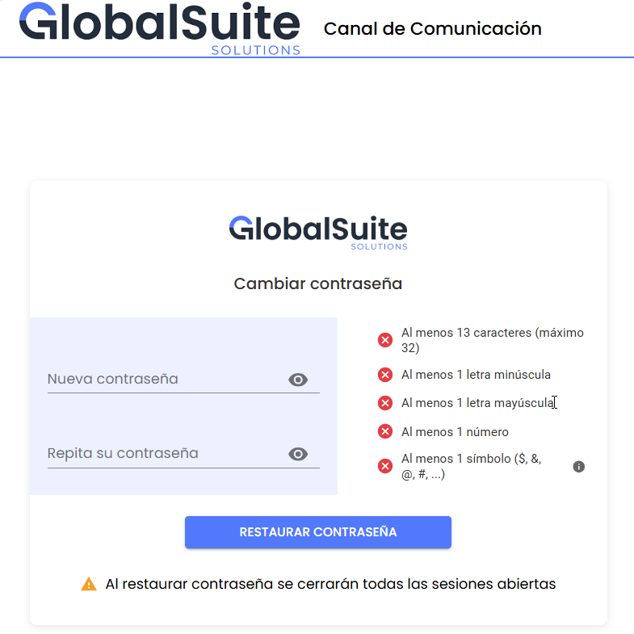
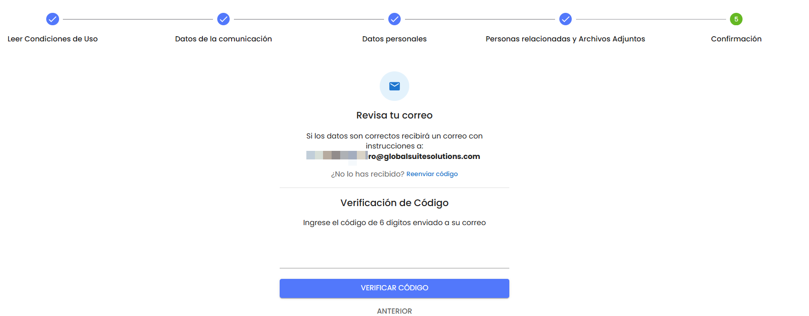
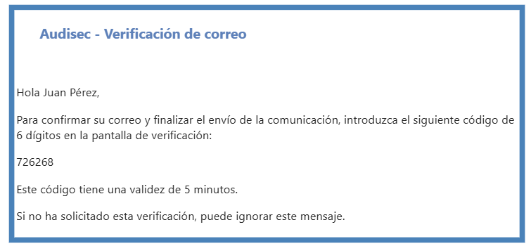
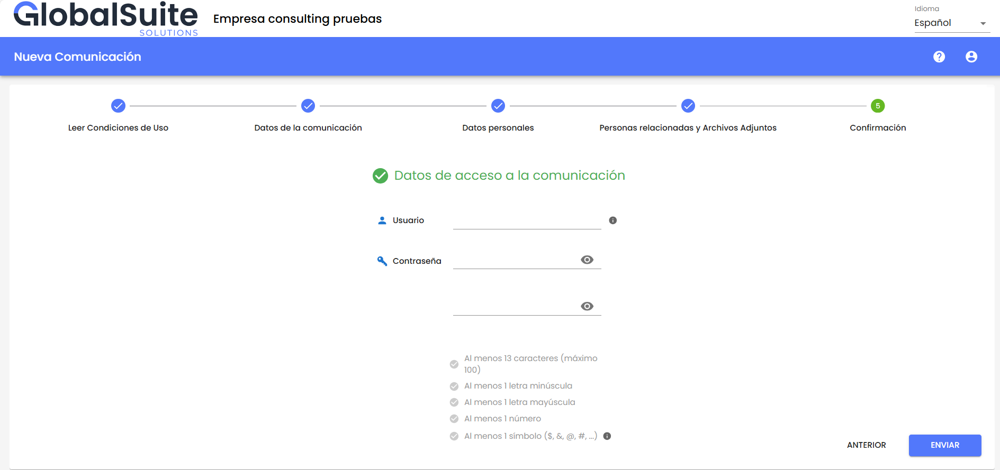
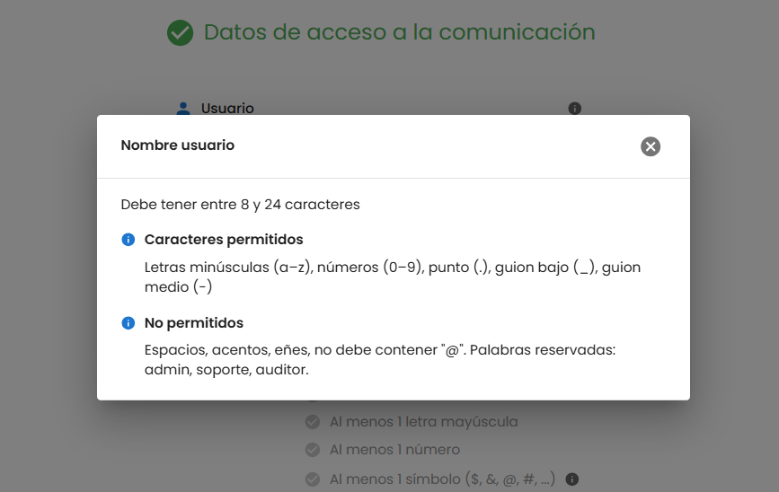
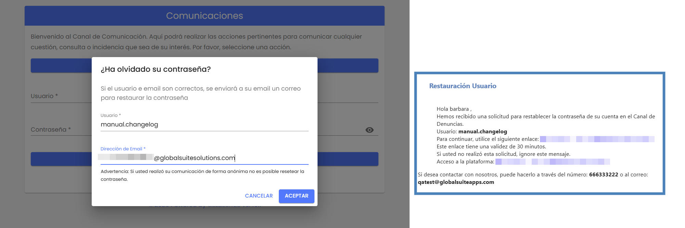
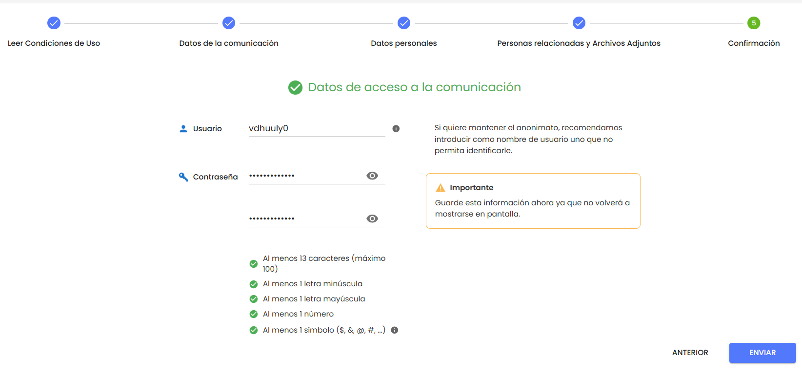

# v3.43 (Febrero 2026)

## Nuevas funcionalidades y mejoras – Gestión de contraseñas en el Canal de Denuncias


Se ha eliminado el envío de contraseñas por correo electrónico, reforzando la seguridad de las credenciales en los distintos accesos del Canal de Denuncias.
Esta mejora afecta tanto a los \*\*usuarios del Back Office\*\* como a los \*\*comunicadores del Canal de Denuncias\*\*, diferenciando los flujos de alta y recuperación según el tipo de usuario.


### Usuarios del Back Office

En el **alta de usuarios del Back Office** (principal y secundario), el sistema ya no envía contraseñas por correo electrónico.  
El usuario recibe un correo desde el que puede **establecer su contraseña** de forma segura a través de un enlace temporal.

Al acceder, el sistema muestra la pantalla para cambiar la contraseña.No se han realizado cambios en los requisitos ni en las políticas de complejidad de las contraseñas.

Asimismo, el proceso de **restablecimiento de contraseña** (“Ha olvidado su contraseña”) de usuarios de Back Office ha sido actualizado para evitar el envío de credenciales en texto plano y permitir la recuperación segura del acceso.

### Nuevas comunicaciones

#### Verificación del correo del comunicador

Se ha incorporado un nuevo paso de **verificación del correo electrónico del comunicador** en el momento de enviar la comunicación.

Antes de finalizar el envío, el usuario debe verificar su dirección de correo mediante una pantalla específica de validación.

El sistema envía un correo con un **código de verificación de 6 dígitos**, con una vigencia limitada en el tiempo (5 minutos).

Al introducir un código válido, el comunicador avanza a la pantalla donde puede **definir su usuario y contraseña**, para posteriormente acceder a la consulta de su comunicación.

Las políticas de creación de usuario y contraseña se muestran de forma clara en la propia pantalla.

Una vez completado el proceso, la comunicación se envía correctamente y el flujo continúa con el comportamiento habitual del sistema.

También a partir de ahora, si los comunicadores desean recuperar su contraseña, podrán hacerlo como hasta ahora.  
Tal y como se ha detallado en el apartado anterior, recibirán por correo un enlace para restablecer su contraseña.

Los comunicadores pueden recuperar su contraseña desde el Canal de Denuncias, introduciendo su usuario y correo electrónico como hasta ahora, pero la diferencia es que recibirán un correo con un enlace para establecer una nueva contraseña.

#### Denuncias anónimas

Cuando la comunicación sea **anónima**, **no se realiza la validación del correo electrónico**.

En este caso, los campos **Usuario**, **Contraseña** y **Repetir contraseña** se muestran **pre-completados con valores aleatorios generados por el sistema**, utilizando el mismo generador actual, **permitiendo al comunicador modificarlos** si lo desea antes de continuar.

De este modo, el comunicador puede definir las credenciales de acceso a su comunicación manteniendo el anonimato, sin necesidad de verificar una dirección de correo electrónico.
