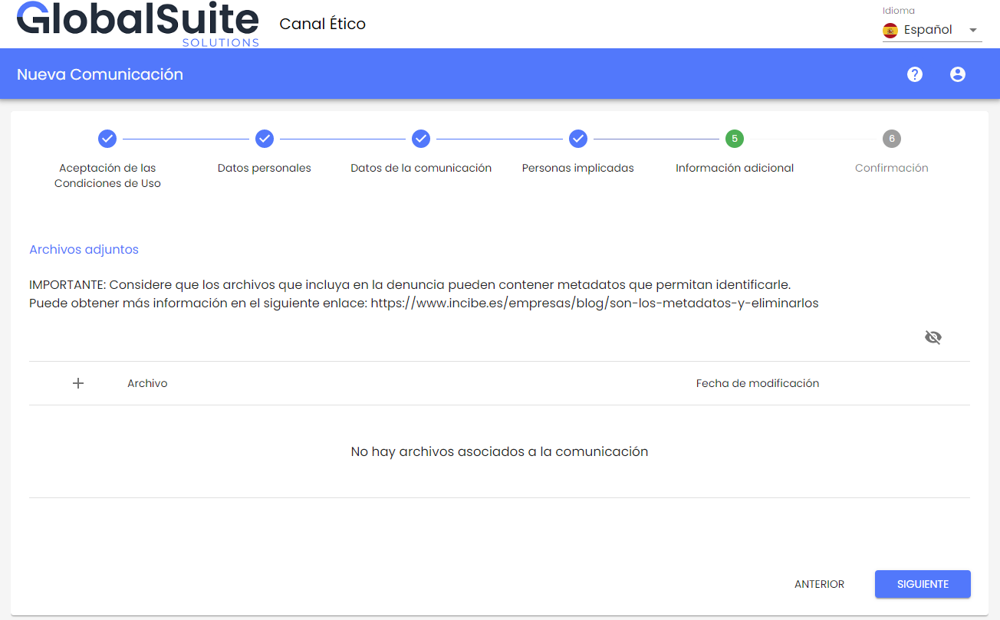
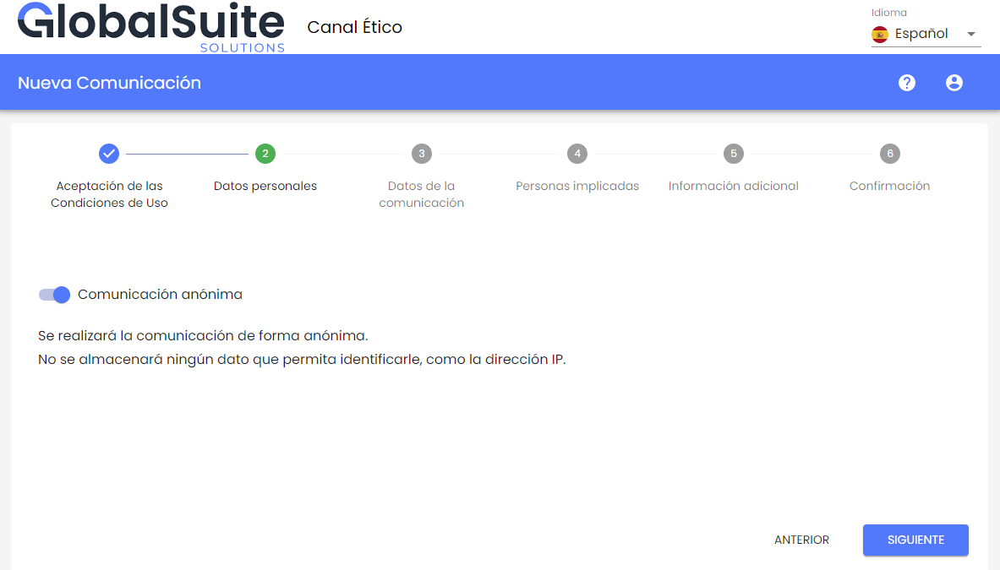

# v3.8 (Junio 2023)

**Funcionalidades y mejoras incluidas:**

- Configuración de **adjuntado de archivos** del comunicador:  En esta versión se ha incorporado la posibilidad de limitar la subida de adjuntos al denunciante, además de poder personalizar un mensaje con instrucciones o aclaraciones sobre los adjuntos incorporados, por ejemplo, para especificar las limitaciones de tamaño, formato, o instrucciones relativas a los metadatos de los mismos.

* Se añade la posibilidad de deshabilitar la subida de archivos al denunciante, tanto a la hora de formular una nueva denuncia, como en los seguimientos.
* Puede personalizar un mensaje, en todos los idiomas disponibles en el Canal, que aparecerá en la tabla de Adjuntos del formulario de la denuncia, además de al aportar un nuevo archivo una vez enviada la denuncia.

- Personalización del mensaje de **Comunicación Anónima**:  A partir de ahora, se podrá configurar un mensaje personalizado cuando el comunicador quiera formular una nueva denuncia de forma anónima, pudiendo especificar más información.

* Se incluye un campo configurable para adaptar el mensaje por defecto hasta ahora que indica que "Se realizará la comunicación de forma anónima."
* Este mensaje le aparecerá al denunciante en el formulario de una nueva comunicación, en el apartado donde se indica si la comunicación se realizará de forma anónima o identificándose.

Ambas mejoras podrán configurarse en el apartado [Configuraciones](https://help.globalsuite.es/display/CD/Configuraciones+Consulting) > Sistema de una empresa Administradora o Consulting.
